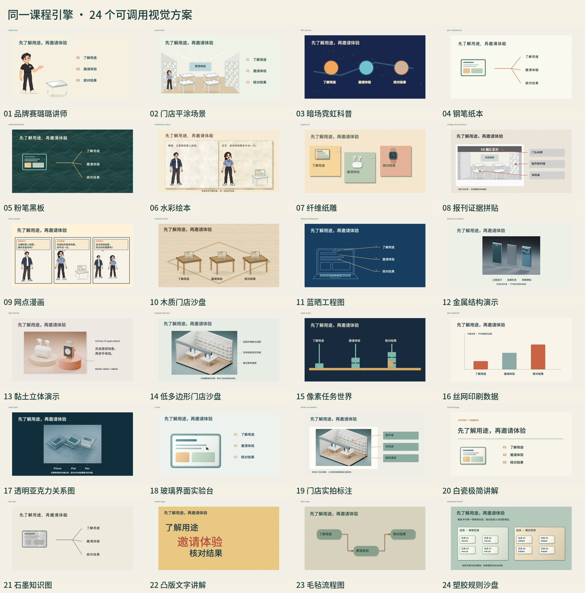
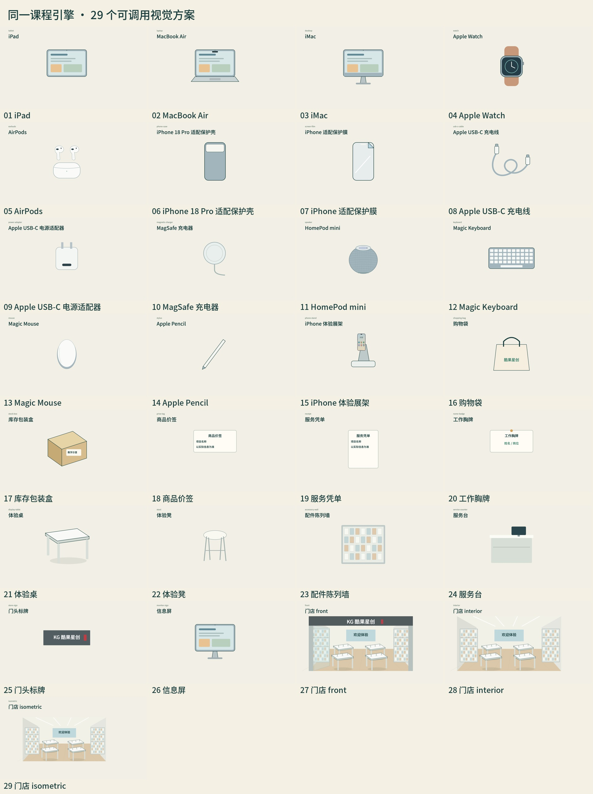
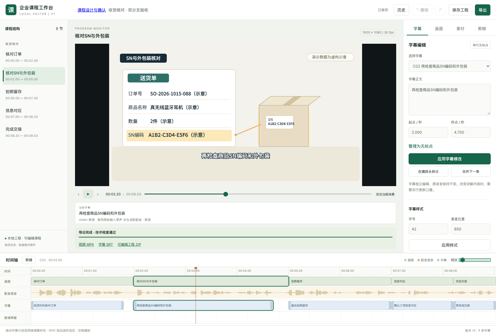
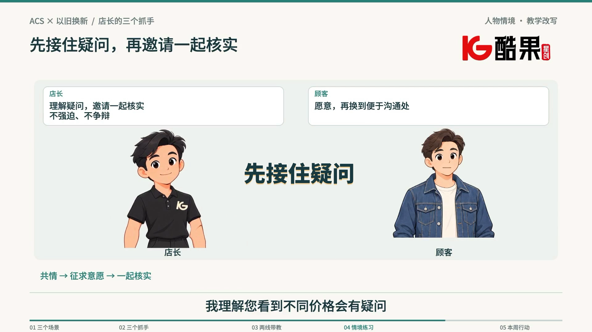
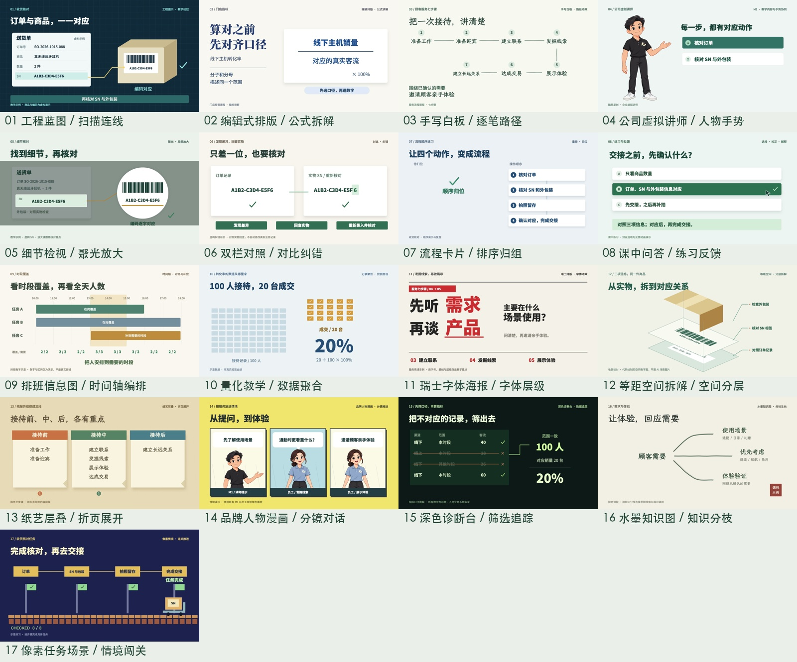

# 酷果星创 · AI 企业培训制课 Skill

把制度、手册和业务资料，做成**能直接讲的课件与配套文档**，或带拟真人配音、字幕与代码化教学动画的**单支 / 多集系列课程视频**。适合培训负责人、门店管理者和带教同事，把“制度怎么写”讲成“遇到这件事，应该怎么做”。

- **适用范围更广（跨宿主标准 Skill）**：基于标准 `SKILL.md` 与本地媒体工作台，支持 **Antigravity、Claude Code、Codex、WorkBuddy、Cursor、Trae、Windsurf** 等主流支持 Agent Skill 规范的 AI 编程与桌面宿主，无需依赖单一工具。
- **DSH 图形插件（可选）**：如使用 DeepSeek Harness（DSH），可另装图形工作台插件，在同一窗口完成上传资料、分阶段预览与原生问答确认。

[下载独立 Skill v7.0.0](https://github.com/hebokenn/kgxc-corporate-course-skill/releases/download/v7.0.0/kgxc-course-suite-v7.0.0.zip) · [下载 DSH 插件 v0.10.0](https://github.com/hebokenn/kgxc-corporate-course-skill/releases/download/v7.0.0/kgxc-course-plugin-v0.10.0.zip) · [在线看 42 秒宣传片](https://hebokenn.github.io/kgxc-corporate-course-skill/) · [安装与使用](#安装或更新)

| 你的需求 | 主要交付 | 适用方式 |
| --- | --- | --- |
| **单支课程视频** | MP4 视频、SRT 字幕、独立封面，过程工程保留 | 内部学习平台、集中培训或自主学习 |
| **多集系列课 + 配套套件** | 分集 MP4/SRT/封面 + 《讲义精要》、测验题库、A4 可打印手写作业 | 专题训练营、门店系统化赋能，整门课统一批次推进 |
| **自己讲课或带教** | 独立 PPTX / PDF / HTML 课件 + 完整逐字稿 | 现场授课、线上分享、带教或自行录屏 |
| **已有课程局部返修** | 仅重配/重渲受影响片段与字幕，复用未变更章节 | 业务规则或话术更新后的最小范围回改 |

---

## 适合哪些培训场景

| 场景 | 可提供的资料 | 课程怎样讲 |
| --- | --- | --- |
| **新人入职与岗位带教** | 岗位手册、工作清单、常见问题 | 按真实工作顺序拆任务，穿插示范、易错点与练习 |
| **制度与 SOP 流程** | 制度正文、条件与例外说明 | 交代适用范围，用案例对照“何时这样做、何时例外处理” |
| **收货、交接与信息核对** | 订单、票据、实物图、编码标签 | 同屏定位字段与实物，逐项核对、标出差异并演示处理 |
| **销售服务与顾客沟通** | 服务流程、典型对话、正反案例 | 编排走近、倾听、提问、异议回应与示范，多角色分声演练 |
| **店长经营与多集专题课** | 指标口径、辅导记录、多章节材料 | 统一批次规划多支视频与讲义/题库/手写作业，形成课后闭环 |
| **系统操作与 Apple 产品体验** | 界面截图、字段说明、Apple 设备资料 | 放大关键入口与状态反馈，结合设备示意讲清观察重点 |

> 当前内置角色、片头片尾和产品素材以酷果星创及 Apple 门店培训为主要场景；其他企业与团队可直接复用全套制课方法与工作台，按需替换为自有品牌与资料。

---

## 核心能力与实际价值

### 1. 资料变课程 & 多集系列课统一批次

先把原始资料转化为工作任务、学习目标、讲法与完整口播逐字稿，并生成**原件要点对照**（保留/合并/舍弃理由及新增依据，不漏关键条件与例外，默认学员拿不到原始附件也能听懂）。

当一门课包含多支章节视频及配套《讲义精要》、测验题库与 A4 可打印手写作业时，整门课作为一个**统一批次**推进：统一大纲 → 统一逐字稿 → 按内容类型提炼视觉母版（每类母版 3 套实质不同方案，`template_masters`）+ 全课逐段 1 套最优分镜 → 跨章节抽 3 段代表性有声小样 → 共享配色、字体、声音与片头片尾并分集导出。不为每支视频重复跑满重流程。[教学设计模块](skills/elearning-course-design/SKILL.md) · [7.0.0 系列课与自查规范](skills/corporate-training-motion/references/59-streamlined-series-and-selfcheck.md)

### 2. 代码化自由动画、100 种教学动效与 16 套明亮浅色画布

- **两个设计原则**：用 **F 型扫读提醒**（动作写在前，条件紧邻动作旁，不硬套版式）减少漏读；借鉴**迪士尼动画设计准则**（场面调度、预备动作、弧线、节奏与收势）把因果讲清，不使用迪士尼角色或素材。[NN/g 原文](https://www.nngroup.com/articles/f-shaped-pattern-reading-web-content/) · [制课设计指引](skills/corporate-training-motion/references/58-scan-and-teaching-motion.md) · [动效库](docs/MOTION.md)
- **纯代码动态呈现**：内置 **100 种可调用动作、17 类教学构图与 24 种视觉参考**，坚持用代码实现动态表现（微表情、手势、路径形变、程序化描边、分屏带练、进度与情绪可视化、必要时的代码化 Blender 3D 道具），不调用外部 AI 生图，不用整张静态 PNG 人物贴图。
- **16 套精选明亮通透浅色色板**：新课默认仅从 `workbench/course-palettes.json` 中 **16 套高对比（WCAG ≥ 4.5）、明亮通透、无绿色**的浅色系精选池随机抽取（`random_eligible: true`），同一门课视频画布与配套讲义/作业保持视觉和谐；深色画布仅在用户主动指定时启用。[选色规则](skills/corporate-training-motion/references/47-course-palette.md)

<details>
<summary>展开查看：视觉方案参考、人物与门店素材、阅读节拍与花字规范</summary>

- **人物与门店物件**：内置黑衣 KG 店长、蓝衣店员、黑衣 MyCoach 教练与便装无标顾客（多部件可动结构，通过发型与穿搭区分，同场对白朝向受话人、柜台前后遮挡合理、脚底与物件有真实支撑），以及 Apple 设备、票据与门店场景。[角色指南](docs/CHARACTERS.md) · [内容素材](docs/CONTENT-ASSETS.md) · [情境演绎](skills/corporate-training-motion/references/48-situational-acting.md)
- **阅读节拍与花字**：分镜安排入场、停稳与稳定阅读窗口，防止“卡片动完文字只剩一瞬”；花字绑定讲稿原句、用途与阅读时间，突出重点条件而非装饰堆砌。[阅读节奏](skills/corporate-training-motion/references/45-reading-and-information-pacing.md) · [花字与选音](skills/corporate-training-motion/references/46-flower-text-and-native-sfx.md)
- **历史兼容**：未启用 `template_masters` 母版的工程仍支持每个教学片段提供 3 套实质不同表现方案。[分镜与三段抽样](skills/corporate-training-motion/references/44-storyboard-and-sampling.md)





</details>

### 3. 拟真人本地配音、多角色分声与原库音效

默认使用本地 **Qwen3-TTS** 生成配音（无需额外云端 TTS API Key），完整安装随包提供已获授权的 **didi 男声、pipi 女声**推荐参考与通用试听，支持多角色分声、中文/英文命名声音库、语速与英文发音核对及参考克隆。

| 推荐语音 | 常见用途 | 同文案试听 |
| --- | --- | --- |
| **didi · 男声** | 任务说明、步骤讲解与重点提醒，清晰轻亮 | [点击试听 MP3](https://raw.githubusercontent.com/hebokenn/kgxc-corporate-course-skill/main/docs/media/voices/didi-audition.mp3) · [下载 WAV](docs/media/voices/didi-audition.wav) |
| **pipi · 女声** | 课程导入、概念解释与服务情境，清楚亲切 | [点击试听 MP3](https://raw.githubusercontent.com/hebokenn/kgxc-corporate-course-skill/main/docs/media/voices/pipi-audition.mp3) · [下载 WAV](docs/media/voices/pipi-audition.wav) |

动作音效默认使用随包内置的 **“叮”与“嘟咚”两款原库素材**（重点/完成用叮，弹出/轻提醒用嘟咚），按需留白并保留立体声混音。[配音指南](docs/VOICE.md) · [双播放器离线试听](docs/media/voices/audition.html) · [音效库与试听](docs/SOUND.md)

### 4. 产出前实质自查验收 & 最小范围局部回改

- **实质自查门禁（Self-Check Gate）**：在交付大纲/逐字稿、分镜/三段有声小样、完整成片给用户前，由制作端先逐项核验并修精（用户显性要求与禁忌项、原件要点覆盖、口语自然且不把制作限制念进正文、编号顺序与口播同步、多角色分声、花字与原库音效、遮挡支撑、首帧外部封面与完整末句收尾），大幅降低人工多轮把关负担。
- **最小范围局部回改**：成片后回头改某段逐字稿、讲义或大纲微调，只重配受影响句子、重渲对应片段并更新对应字幕与讲义，复用未变更章节，不强迫全流程重跑。
- **成品归集与过程保留**：成品按一门课一个文件夹交付至桌面 `ai 制课/<课程名称>/`（MP4、SRT、独立首帧封面及配套文档），原始资料、逐字稿、小样、配音与工程默认保留在课程工程内，绝不自动删除。

<details>
<summary>展开查看：历史工程盲审兼容、制作合同校验与 DSH 工作台进阶机制</summary>

- **历史工程兼容**：已存在 `ai-review.json` 的既有工程继续保留原有独立学员盲审、固定问题清单验收与执行监督门禁，不破坏旧工程状态。[独立审阅规则](skills/corporate-training-motion/references/50-independent-review.md)
- **执行契约与编码取证**：支持 `production-contract.json` 合同校验、`ordered_reveals` 编号逐条出现校验、`introPolicy` 片头等待预算校验及基于当前编码字节的解码与抽帧核验（自动检查与完整人工视听/用户认可分别记录）。[制作合同](skills/corporate-training-motion/references/51-production-contract.md) · [执行契约](skills/corporate-training-motion/references/55-execution-contract-and-release.md) · [编号与片头校验](skills/corporate-training-motion/references/56-ordered-reveals-and-intro.md) · [整课质量基线](skills/corporate-training-motion/references/57-series-quality-baseline.md)
- **DSH 图形工作台与可恢复编辑器**：支持大纲卡片拖拽拆并、分章改稿对比、小样时间点反馈、应用内检查/下载更新，以及跨对话恢复与空闲自动退出。[DSH 插件详解](docs/PLUGIN.md) · [编辑与恢复指南](docs/USAGE.md)



</details>

---

## 实际演示

### 42 秒新版宣传片：耳机一边没声音，怎么接？

用虚构售后场景展示人物与 didi/pipi 拟真人音色、F 型扫读前后对照、交接教学动效、花字与工作台完整制作流程（规则与操作为演示，不代表门店正式政策）。

**[在线播放新版宣传片](https://hebokenn.github.io/kgxc-corporate-course-skill/)** · [下载 42 秒 MP4](https://github.com/hebokenn/kgxc-corporate-course-skill/releases/download/v6.9.8/kgxc-story-trailer-42.mp4) · [下载 100 种动效图谱](https://github.com/hebokenn/kgxc-corporate-course-skill/releases/download/v6.9.8/kgxc-motion-actions-100.zip) · [动效指南](docs/MOTION.md)

### 73 秒花字与原库音效样片：《回收价格异议处理》

展示弹出短词、条件便签、依据标记、平等选项与步骤划线怎样和旁白、原库“叮/嘟咚”音效配合。

[](https://hebokenn.github.io/kgxc-corporate-course-skill/media/flower-native/)

**[在线播放样片](https://hebokenn.github.io/kgxc-corporate-course-skill/media/flower-native/)** · [下载有声 MP4](https://github.com/hebokenn/kgxc-corporate-course-skill/releases/download/v6.1.0/price-objection-native-sfx.mp4) · [对应字幕](docs/media/flower-native/price-objection-native-sfx.srt) · [音源与说明](docs/media/flower-native/README.md)

<details>
<summary>展开查看：历史演示（80 秒动效混剪 / 17 支独立样片 / 64 秒鼓点版 / 36 秒迁移短片 / 独立 HTML 课件）</summary>

- **64 秒动效鼓点版**：[下载 MP4](https://github.com/hebokenn/kgxc-corporate-course-skill/releases/download/v6.9.8/kgxc-kinetic-showreel.mp4) · [在线播放](https://hebokenn.github.io/kgxc-corporate-course-skill/?showreel=64)
- **36 秒规则扫读与数据迁移短片**：[下载 MP4](https://github.com/hebokenn/kgxc-corporate-course-skill/releases/download/v6.9.8/kgxc-motion-promo.mp4)
- **80 秒教学效果混剪 & 17 支独立样片**：[下载混剪 MP4](docs/media/capability-showreel.mp4) · [逐条播放 17 支样片](docs/SHOWCASE.md) · [下载原画质包](https://github.com/hebokenn/kgxc-corporate-course-skill/releases/download/v5.0.0/kgxc-course-effects-17-v1.zip) · [可编辑样片工程](https://github.com/hebokenn/kgxc-corporate-course-skill/releases/download/v5.0.0/kgxc-course-effects-17-editable-v1.zip)
- **9 秒原生导出有声短片**：[下载 MP4](docs/media/v5-course-demo.mp4) · [查看字幕](docs/media/v5-course-demo.srt)
- **6 页可独立交付 HTML 课件**：[查看课件源码](docs/media/courseware-demo.html) · [查看总览截图](docs/media/courseware-overview.png) · [查看练习页](docs/media/courseware-exercise.png)
- **演示素材来源与验证范围**：见 [docs/media/README.md](docs/media/README.md)



</details>

---

## 一门课怎样完成

**原始资料 → 统一大纲与讲法 → 完整逐字稿（含原件对照与自查） → 独立课件/配套文档 或 母版分镜与 3 段有声小样 → 分集导出与局部回改。**

| 阶段 | AI 协助完成 | 你重点判断 |
| --- | --- | --- |
| **1. 资料与目标** | 诊断来源、梳理学习目标与大纲，规划单课或多集视频及配套讲义/题库/作业分工 | 教给谁、学什么、内容是否完整准确 |
| **2. 完整逐字稿** | 编写自然口播稿与原件要点对照表，制作端先完成实质自查并修精 | 核对原件覆盖、取舍依据、关键条件与例外 |
| **3A. 课件 / 配套文档** | 输出 PPTX / PDF / HTML 课件，或《讲义精要》、测验题库与 A4 手写作业 | 是否便于讲授、带教、自学或课后闭环 |
| **3B. 母版与全课分镜** | 每类内容母版提供 3 套实质不同方案（`template_masters`），定调后全课逐段输出最优分镜 | 选定视觉母版与共用配色、风格及重点段落 |
| **4. 3 段有声小样** | 跨章节/母版抽取 3 段完整片段，用真实生产链导出带头尾接缝与多角色配音的有声 MP4 | 正常速度听看画面、动作、字幕、花字音效与声音 |
| **5. 整课交付与回改** | 共享母版分集导出 MP4/SRT/首帧封面至桌面 `ai 制课/<课程名称>/`，工程保留；后续改稿仅局部重做 | 审阅成片或提出局部修改意见 |

---

## 安装或更新

### 方式一：独立 Skill（推荐，通用主流 AI 宿主）

**[下载 v7.0.0 联合包](https://github.com/hebokenn/kgxc-corporate-course-skill/releases/download/v7.0.0/kgxc-course-suite-v7.0.0.zip) → 解压 → 双击“安装或更新.command”**（或将 `skills/corporate-training-motion` 与 `skills/elearning-course-design` 放入宿主的全局/项目 `.agents/skills/` 目录）。

- 适用于 **Antigravity、Claude Code、Codex、WorkBuddy、Cursor、Trae、Windsurf** 等支持 Agent Skill 规范的宿主，日常统一调用 `corporate-training-motion`。
- 包含 `corporate-training-motion 7.0.0` 与 `elearning-course-design 2.1.0`；升级自动保留个人配置、已有课程与声音库。

### 方式二：DSH 图形工作台插件（可选）

**[下载插件 v0.10.0](https://github.com/hebokenn/kgxc-corporate-course-skill/releases/download/v7.0.0/kgxc-course-plugin-v0.10.0.zip) → 解压 → 双击“安装制课插件.command” → 重新打开 DSH。**

- 包含 DSH 工作台界面、制课核心与两个课程模块，保留已有 DSH 账号、模型路由与其他插件配置。[DSH 安装与说明](docs/PLUGIN.md)

<details>
<summary>展开查看：命令行安装、环境检查（doctor）、校验文件与快速开始示例</summary>

**命令行安装与更新：**

```sh
# 已有媒体环境，仅更新 Skill（自动兼容 Codex / WorkBuddy；其他宿主可直接复制到 ~/.agents/skills/）
./install.sh --skill-only --agent both

# 新机器准备完整本地媒体与配音环境（macOS Apple Silicon，需预留约 10GB 空间）
./install.sh --agent both

# 安装后检查本地依赖与 Qwen3-TTS 配音状态
"$HOME/.local/bin/kgxc-course" doctor
```

**安装包校验文件：** [Skill 包 SHA256SUMS](https://github.com/hebokenn/kgxc-corporate-course-skill/releases/download/v7.0.0/SHA256SUMS) · [DSH 插件 PLUGIN-SHA256SUMS](https://github.com/hebokenn/kgxc-corporate-course-skill/releases/download/v7.0.0/PLUGIN-SHA256SUMS) · [完整依赖说明](docs/DEPENDENCIES.md)

**开始做第一门课（在任意已加载本 Skill 的 AI 宿主中输入）：**

```text
请用 corporate-training-motion，把我提供的资料做成《收货核对流程》培训课。
受众：新入职门店同事。
目标：能找到并核对订单、商品 SN 和外包装信息，按原文要求完成交接。
交付：完整视频（MP4 + SRT + 封面）；若只需课件请改为“只交付独立课件和逐字稿”。
先诊断素材并给出大纲与讲法，等我确认后再推进逐字稿、母版分镜、三段有声小样与整课导出。
```

**恢复旧课或局部修改：**

```text
继续制作这门课程，工程目录：填写实际课程目录。
请读回已有方案、逐字稿和确认记录，只对我要改的段落做局部更新。
```

也可双击课程目录中的 `打开课程工作台.command`，或运行 `kgxc-course resume ./courses/my-course`。

</details>

---

## 适用范围与相关文档

- **AI 宿主范围**：核心 Skill 为标准 `SKILL.md` + 本地 Python/Node/Playwright/FFmpeg 脚本架构，可在 **Antigravity、Claude Code、Codex、WorkBuddy、Cursor、Trae、Windsurf、DeepSeek Harness（DSH）** 等支持自定义 Skill 或本地命令执行的 AI 宿主中运行；AI 模型与计费沿用各宿主自身配置。
- **本地运行环境**：完整本地渲染与 Qwen3-TTS 配音环境当前在 **macOS Apple Silicon（arm64）** 验证通过，录制、渲染、字幕与导出均在本机完成，无需额外 TTS API Key。
- **隐私与素材边界**：公共安装包仅包含可复用源码、说明及已获授权的 didi/pipi 推荐参考与通用试听；私人课程资料、门店实拍、个人录音与凭据不随包分发，详见 [THIRD_PARTY_NOTICES.md](THIRD_PARTY_NOTICES.md)。

| 想进一步了解 | 文档 |
| --- | --- |
| 7.0.0 精简工作流、系列课与自查清单 | [59-streamlined-series-and-selfcheck.md](skills/corporate-training-motion/references/59-streamlined-series-and-selfcheck.md) |
| 完整安装、制作、编辑与恢复 | [使用指南](docs/USAGE.md) · [依赖说明](docs/DEPENDENCIES.md) · [DSH 插件指南](docs/PLUGIN.md) |
| 配音、多角色分声与原库音效 | [配音指南](docs/VOICE.md) · [音效库](docs/SOUND.md) |
| 教学动效、角色与内容素材 | [动作指南](docs/MOTION.md) · [角色指南](docs/CHARACTERS.md) · [内容素材](docs/CONTENT-ASSETS.md) |
| 公开样片与演示来源 | [17 支独立样片](docs/SHOWCASE.md) · [演示素材说明](docs/media/README.md) |
| 完整版本历史与发布流程 | [完整变更日志](docs/CHANGELOG.md) · [Skill 发布流程](docs/RELEASING.md) |

---

## 版本更新

以下列出近期版本概览，完整逐版记录、原始说明与验证链接见 [docs/CHANGELOG.md](docs/CHANGELOG.md)。

### 精简系列课工作流、16 套明亮浅色板与自查验收：插件 0.10.0 / 核心 7.0.0 · 2026-11-24

- **多集系列课统一批次与母版三选一**：`storyboard.py` 新增 `template_masters` 与 `segments[].template_id` 校验，每类内容母版提供 3 套实质不同方案供定调，定调后全课逐段输出 1 套最优分镜；未启用母版的旧工程继续兼容逐段三备选。
- **16 套精选明亮通透浅色色板**：扩展 `course-palettes.json` 至 16 套 `random_eligible: true` 高对比（WCAG ≥ 4.5、无绿色）明亮浅色画布，`course_palette.py` 默认随机池自动过滤深色，深色画布改为用户明确指定时启用。
- **代码化自由动画、实质自查与最小范围局部回改**：新增 [7.0.0 精简工作流规范](skills/corporate-training-motion/references/59-streamlined-series-and-selfcheck.md)，整合为产出前实质自查验收（Self-Check Gate）；`workflow.py` 仅在历史工程存在 `ai-review.json` 时启用旧门禁，成片后改稿只局部重做受影响片段。
- **扩大宿主适用范围与本地语音诊断**：明确支持 Antigravity、Claude Code、Codex、WorkBuddy、Cursor、Trae、Windsurf、DSH 等主流支持 Skill 的宿主；`kgxc_course.py doctor` 支持识别本地多模式 `model_paths` 与克隆参考音就绪状态；主页按渐进式披露重构。

### 教学动效与新版宣传片：插件 0.9.9 / 核心 6.9.8 · 2026-11-15

- 新增可选择的教学动效参数（预备、弧线、节奏与停稳）与 F 型扫读设计指引；旧工程按原样打开，不自动重做。
- 上线 42 秒新版宣传片与 100 种动效图谱下载，旧演示保留为历史展示。

### 教学画面与渐进式工作台：插件 0.9.8 / 核心 6.9.7 · 2026-11-14

- 制课规范增加扫读层级与教学动作复核；DSH 工作台默认优先显示当前任务与可用成果，其余阶段与诊断按需展开。

<details>
<summary>展开查看更早版本概览（6.9.6 – 5.7.1）</summary>

- **6.9.0 – 6.9.6（DSH 0.9.0 – 0.9.7）**：应用内更新检查/下载与重启提示、侧栏收起防重叠、顶栏品牌 Logo 与拖窗、配音与分镜并行提速、编号逐条显示（`ordered_reveals`）与片头等待预算（`introPolicy`）校验、整课质量基线与对话恢复。[6.9.0 验证](docs/verification-release-v6.9.0.md) · [6.9.1 验证](docs/verification-release-v6.9.1.md) · [6.9.3 验证](docs/verification-next-dsh-release.md)
- **6.8.1 – 6.8.2（DSH 0.8.23 – 0.8.24）**：六项制作合同（`production-contract.json`）、业务图示文字标签绑定、原件覆盖与人工确认、高质量写稿前置与一次盲审验收。[6.8.1 验证](docs/verification-release-v6.8.1.md) · [6.8.2 验证](docs/verification-release-v6.8.2.md)
- **6.5.0（DSH 0.6.0）**：DSH 六阶段课程工作台、合并制作偏好窗口、多部件可动顾客与对白朝向遮挡校验。[验证范围](docs/verification-plugin-v0.6.0.md)
- **6.0.0 – 6.3.0**：可复用全身情境演绎运行器（6.3.0）、原件不漏项与独立封面（6.2.1）、新课随机选色与禁绿校验（6.2.0）、花字与内置“叮/嘟咚”原库音效（6.1.0）、阅读契约与同轴停顿连贯性检查（6.0.0）。[6.3.0](docs/verification-v6.3.0.md) · [6.2.0](docs/verification-v6.2.0.md) · [6.1.0](docs/verification-v6.1.0.md) · [6.0.0](docs/verification-v6.0.0.md)
- **5.7.1 – 5.9.1**：文字阅读契约（5.9.1）、全课分镜三备选与三段随机有声预览（5.9.0）、随包 didi/pipi 推荐声音与试听（5.8.6）、工作台性能缓存与空闲自动退出（5.8.5）、命名本地声音库（5.8.4）、参考片方法与人物反应（5.8.0–5.8.3）、章节导航与底部进度条（5.7.1–5.7.5）。[完整历史与验证链接](docs/CHANGELOG.md)

</details>
