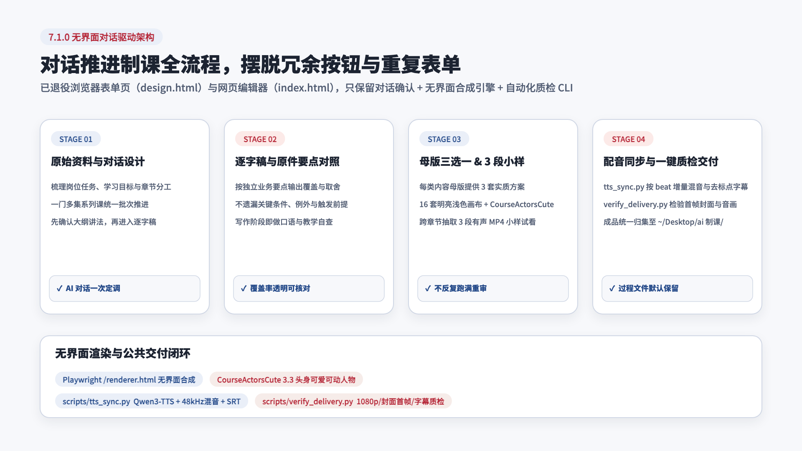
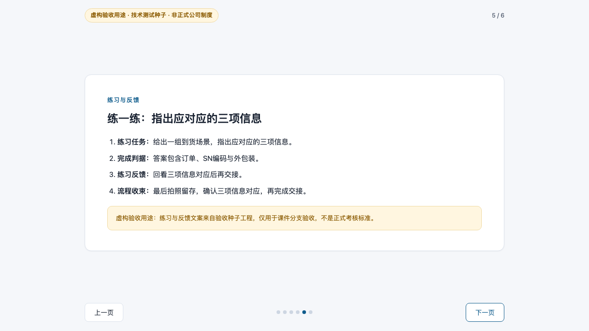
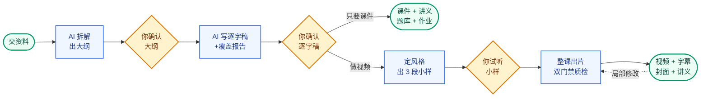
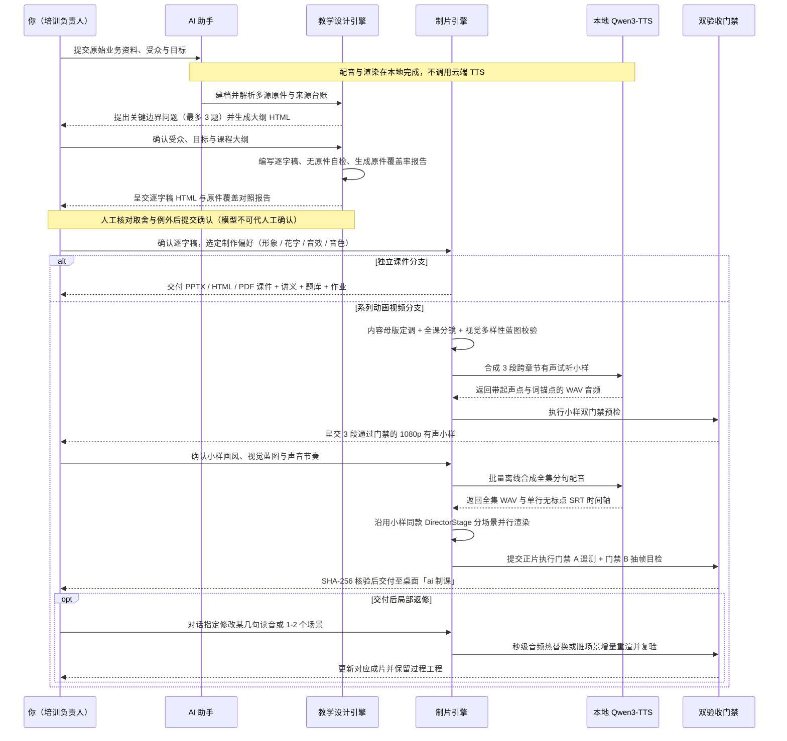
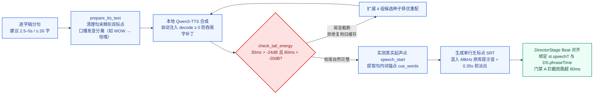
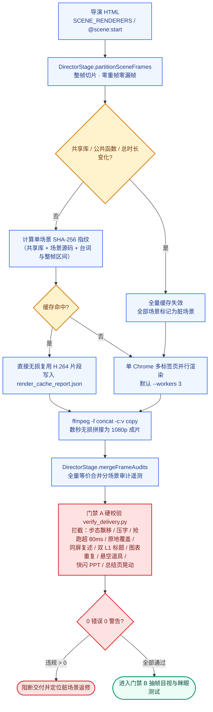

<div align="center">

# 酷果星创 · 企业培训课程全链路引擎

**把制度、SOP、产品手册交给 AI，做出带配音、字幕和封面的系列培训动画课，或可直接授课的课件。**

源自酷果星创门店培训的真实制课实践，教学设计与制作流程可替换为自有品牌复用。

[](https://github.com/hebokenn/kgxc-corporate-course-skill/releases/tag/v9.0.0)
[](LICENSE)
[](docs/DEPENDENCIES.md)
[](#安装与使用)

<a href="https://hebokenn.github.io/kgxc-corporate-course-skill/"></a><br>
<sub>69 秒演示片由 Antigravity 调用本套件实际渲染 · <a href="https://hebokenn.github.io/kgxc-corporate-course-skill/">在线观看</a> · <a href="docs/media/v71/kgxc-v71-promo.mp4">下载 1080p MP4</a> · <a href="docs/media/v71/kgxc-v71-promo.srt">下载 SRT 字幕</a> · <a href="docs/media/v71/kgxc-v71-promo-cover.png">查看第 0 帧封面</a></sub>

[在线看演示](https://hebokenn.github.io/kgxc-corporate-course-skill/) · [适用场景](#适用场景) · [流程图](#制作流程) · [环境要求](#环境要求与局限) · [一句话安装](#安装与使用) · [换成自己的品牌](#换成自己的品牌) · [常见问题](#常见问题) · [联系作者](#相关文档) · [下载 v9.0.0](https://github.com/hebokenn/kgxc-corporate-course-skill/releases/download/v9.0.0/kgxc-course-suite-v9.0.0.zip)

</div>

<details>
<summary>English summary</summary>

This open-source Agent Skill turns internal company policies, SOPs, and product manuals into 1080p narrated training videos (with local Qwen3-TTS voiceover, subtitles, and covers) or standalone interactive courseware, along with handouts, quizzes, and exercises. The full media rendering and local voice pipeline is verified on macOS Apple Silicon and works with Antigravity, Claude Code, Codex, Cursor, Windsurf, WorkBuddy, and Trae. Documentation is primarily in Chinese.

</details>

---

## 用途与交付

只让 AI 概括文档做出来的课件或视频，往往会漏掉业务条款的前提和例外，或者把同一组数字在图表、卡片和旁白里反复堆砌，局部修改时也常常需要全片重来。本套件把课程拆解写稿和动画出片分成两个互补阶段，先和你确认讲法，再自动制作和检查交付：

| 维度 | 说明 |
| --- | --- |
| **你提供** | 制度 PDF / Word / PPT、扫描件与图表、产品手册、业务 SOP、现场访谈音视频 |
| **你得到** | 1080p 系列有声动画课（含无标点 SRT 字幕与第 0 帧独立封面）或 PPTX / HTML / PDF 课件，同步产出《讲义精要》、测验题库与 A4 实战作业 |
| **你要做的** | 在大纲、逐字稿与覆盖报告、制作偏好、试听小样及最终验收等节点确认方向与业务准确性 |
| **在哪运行** | 标准 `SKILL.md` 规范，原生兼容 **Antigravity、Claude Code、Codex、Cursor、Windsurf、WorkBuddy、Trae**；配音与渲染在本地完成 |

---

## 适用场景

| 适用人群 / 团队 | 已有材料 | 用本套件能得到什么 |
| --- | --- | --- |
| **企业培训团队 / 课程研发** | 制度 PDF、Word、PPT、业务 SOP、扫描件与图表 | 将条款、触发前提、适用条件与例外逐页建账，交付可溯源的系列 1080p 有声动画课、字幕、独立封面与讲义/题库/作业 |
| **内训师 / 讲师（暂不做视频）** | 零散讲稿、流程手册或现场访谈记录 | 直接走课件分支，输出可面授或录屏的 HTML / PPTX / PDF 课件、逐字稿与对齐学习目标的练习反馈 |
| **门店零售与一线新人上岗培训** | 门店服务规范、操作流程或系统使用手册 | 自动采用“先白话讲清本质、再引出术语与红线道理”的新人友好写法，结合可动矢量角色演绎门店场景 |
| **已交付课程的局部修改与维护** | 已建档的课程工程 + 对话指定修改范围 | 改句长度落入原槽位时热替换音轨；改动画面或时长时仅重渲受影响场景并无缝拼回，不必全片重来 |
| **不希望业务音频走云端配音服务的团队** | 内部制度文档、业务规程、自有讲师参考录音 | 配音与渲染在本地完成，不调用云端 TTS；资料解析由你所用 AI 助手的模型完成 |
| **其他品牌与行业培训团队** | 任意行业企业培训原始材料 | 完整复用教学设计、视觉规划、动效渲染与质检流程，按需替换为自有品牌视觉与片头片尾 |

> **适用范围说明**：完整本地渲染与离线 `Qwen3-TTS` 配音已在 **macOS Apple Silicon（arm64）** 实测验证；Windows / Linux 尚未验证。具体软硬件准备与运行边界见 [环境要求与局限](#环境要求与局限)。

---

## 核心能力

### 一、课程拆解与写稿（`elearning-course-design`）

先把原始业务材料读准，再写成一线员工听得懂、用得上的逐字稿：

| 解决什么问题 | 你会得到什么 |
| --- | --- |
| **AI 编造流程或漏掉条件例外** | 逐页梳理 PDF、Word、PPT、扫描件图表与录音，单独列出每条业务规则的触发前提、适用条件与例外，并输出覆盖对照报告供你核对 |
| **离开原件后看不懂“见原表 / 如图”** | 按“学员手头没有原附件”的视角通读检查，自动补全表单名称、用途与查看位置 |
| **照念制度枯燥、口号化** | 按“工作触发情境 → 动作判断 → 规则依据 → 示范 → 练习反馈”组织内容，关键取舍先用简短选择题向你确认 |
| **新员工一上来就听不懂行话** | 标题短促口语化，隐藏小节标题连读时依然衔接顺畅；面向新人时先用大白话讲清业务道理，再引出简称和红线规则 |

### 二、动画视觉与角色演绎（`corporate-training-motion`）

用代码统一渲染 1080p 画面，避免静态 PPT 拼图和单集重复套模板：

| 解决什么问题 | 你会得到什么 |
| --- | --- |
| **画面元素堆砌、重点看不清** | 统一按 12 栏网格排版，每屏只保留 1 套清晰观点大标题与 1 个视觉主角；采用“左证据 + 右结论”分工，不把同一组数字在图表和卡片里重复摆两遍 |
| **AI 偷懒用同一套柱图和卡片凑数** | 写渲染代码前先通过 [`check_visual_blueprint.py`](skills/corporate-training-motion/scripts/check_visual_blueprint.py) 检查全集视觉多样化排期，限制同一内置图表反复套用，并鼓励按业务现场定制专属图形 |
| **小样好看、正片水准掉档，或动画抢跑剧透** | 试听小样与全集正片共用同一套导演内核；画面随旁白开口时刻逐项浮现，不提前剧透，总结页保持机位稳定不晃动，也不做几秒一翻页的快闪大卡片 |
| **人物僵硬滑步、道具悬空或挡住字幕** | 可动矢量角色按剧情区分闲逛、迎宾、快步、离场等接地步态并带自然口型；手机、名片等道具遵循桌面展示、手持与递交交互，气泡与花字自动避让人物与标志 |
| **长视频找不到当前章节、配色发灰** | 画面底部按各章真实音频时长生成三态分段进度胶囊与独立单行无标点字幕，搭配 16 套高对比浅色画布，确保视频、课件与讲义风格统一 |
| **改一两个画面就要整集重渲** | 自动按场景切片并做内容指纹缓存；局部调整 1–2 个场景时，未改动片段直接无损复用并在数秒内拼回成片 |

#### 9.0 引擎实渲画面画廊（公开脱敏示例）

以下 4 张 1080p 画面均由本套件 9.0 引擎直接代码实渲，展示实景角色演绎与多样化信息图的交替节奏：

<table>
  <tr>
    <td width="50%" align="center">
      <br>
      <sub><b>聚光灯高亮 × 人像点阵</b>：唯一大标题、非焦点条退阶，右侧用 3×3 人像点阵把数字翻译成现场体感</sub>
    </td>
    <td width="50%" align="center">
      <br>
      <sub><b>12 栏无框清单 × 虚线骨架占位</b>：未讲到的步骤以虚线编号槽占位，避免剧透同时保持整屏平衡</sub>
    </td>
  </tr>
  <tr>
    <td width="50%" align="center">
      <br>
      <sub><b>门店实景演绎 × 接地道具互动</b>：可动矢量角色接地步态、手持真机、手部引导线特写与避让气泡</sub>
    </td>
    <td width="50%" align="center">
      <br>
      <sub><b>横向旅程断点图 × 定制视觉</b>：按业务动线定制流程断点图与引导线拆解，避免单集反复套用同一模板</sub>
    </td>
  </tr>
</table>

#### 设计原则与依据

本套件借鉴了 ADDIE / 5P 教学设计、CMU 学习目标对齐、Mayer 多媒体学习认知理论、清晰阅读节奏以及 WCAG ≥ 4.5:1 对比度要求，并将其落实为可自动检查的排版与声画规则（仅列仓库内已落地的规则，不宣称获得第三方机构认证）。

<details>
<summary>查看方法论与落地对照表</summary>

| 所属阶段 | 借鉴原理 / 方法论 | 解决的真实制课痛点 | 在本套件中的落地方式 |
| --- | --- | --- | --- |
| **教学设计**<br>（前端） | **ATD 电子学习设计与 ADDIE / 5P 模型**<br>（Commit · Process · Practice · Prove · Perform） | 把制度原文直接缩写念稿，缺少业务情境、试做反馈与岗位落地支撑。 | [`elearning-course-design`](skills/elearning-course-design/references/research-and-methods.md) 将教学设计与制片解耦，按“情境触发 → 动作判断 → 规则依据 → 示范 → 练习反馈 → 岗位作业”组织课程，先审大纲与来源台账再进制作。 |
| **教学设计**<br>（前端） | **CMU Eberly Center 教学目标对齐原则**<br>（Learning Objectives Alignment） | 讲的内容、练的题目与考核目标脱节，用“看完率/满意度”替代能力证据。 | 按可观察的岗位行为目标反推内容取舍与测验题，改动目标、讲稿或练习任一项时联动复核其余项。 |
| **认知节奏**<br>（中段） | **Vanderbilt《Effective Educational Videos》与稳定阅读节奏模型** | 把“动画播完/旁白念完”当成“学员读懂”，或机械插入大片静音凑时长导致拖沓。 | [`45-reading-and-information-pacing.md`](skills/corporate-training-motion/references/45-reading-and-information-pacing.md) 将动作、信息曝光与讲解三轨分离：淡入和位移不计入有效阅读，稳定阅读窗口与同任务旁白自然重叠。 |
| **可读无障碍**<br>（底座） | **W3C WAI 音视频无障碍规划 & WCAG 对比度下限（≥ 4.5:1）** | 配色发灰看不清、字幕与开口错位，或课后缺乏可检索的文本替代材料。 | [`47-course-palette.md`](skills/corporate-training-motion/references/47-course-palette.md) 的 16 套明亮浅色画布均做 ≥ 4.5:1 对比校验；同步交付开口对齐的无标点 `.srt` 字幕与《讲义精要》。 |
| **信息视觉**<br>（9.0 升级） | **Richard Mayer 多媒体学习认知理论**<br>（冗余 / 信号 / 空间临近 / 一致性） | 旁白、左侧图表与右侧卡片同时重复同一组数字导致认知过载；标注远离目标对象。 | 旁白讲因果、主图展结构、文字作极简锚点；自动检查拦截同屏双载体复述同一组数据；引导线与分组括号就近锚定数据对象。 |
| **信息视觉**<br>（9.0 升级） | **唯一视觉重心与三级字阶**<br>（Rule of One + Visual Hierarchy + 眯眼测试） | 页眉、副标题与彩色大胶囊同时抢戏，观众难以判断第一眼焦点。 | 每屏只保留 1 套无框主标题与 1 个视觉主角；自动检查拦截双主标题叠加，抽帧核验加入「眯眼测试」否决项。 |
| **信息视觉**<br>（9.0 升级） | **信息叙事与骨架占位方法**<br>（聚光灯降噪 / 人像点阵 / 12 栏网格骨架先行） | 多项数据全亮抢眼；抽象分数缺乏体感；防剧透造成半屏空洞与孤立飘字。 | 讲哪项只高亮哪项、其余退阶；用人像点阵把抽象比例翻译为顾客体感；分步清单先呈现虚线编号骨架槽，兼顾不提前剧透与构图平衡。 |
| **AI 工程**<br>（9.0 升级） | **对抗 AI 最小路径执行**<br>（Anti-Satisficing / Goodhart's Law） | 当规则写死少量组件名和数值门禁时，AI 会走省力的应试路径，用同一套柱图和卡片反复排列组合。 | [`70-v9-editorial-info-design-and-diversity.md`](skills/corporate-training-motion/references/70-v9-editorial-info-design-and-diversity.md) 解绑旧组件的强制调用，以全集视觉多样性蓝图与运行期形态重复检测倒逼每课按业务现场定制视觉。 |

</details>

<table>
  <tr>
    <td width="33%" align="center">
      <br>
      <sub><b>全链路工作流</b>：从原件拆解到多态交付</sub>
    </td>
    <td width="33%" align="center">
      <br>
      <sub><b>16 套明亮浅色画布</b>：WCAG ≥ 4.5:1 对比校验</sub>
    </td>
    <td width="33%" align="center">
      <br>
      <sub><b>可动矢量角色阵营</b>：多档步态与便装扩展</sub>
    </td>
  </tr>
</table>

### 三、本地配音、双门禁质检与多态交付

| 解决什么问题 | 你会得到什么 |
| --- | --- |
| **云端配音泄密或句尾吞字** | 本地运行 `Qwen3-TTS`（内置获授权的 **didi 男声**、**pipi 女声**，支持克隆获授权讲师声音），无需外部 TTS API Key；内建防吞尾字补丁与双窗口尾音检测，尾音被裁时自动换种子重配 |
| **英文缩写读不准、字幕和口播不同步** | 自动实测每句真实开口时刻与词锚点，生成单行无标点 `.srt` 字幕；支持字幕与读音分离（如 `WOW` 读“哇哦”、章节号不读前导 0，且可逐句自定义读音）并混入提示音 |
| **同一份资料要适配视频和面授** | 一套资料可输出多集 1080p 系列视频套件（视频 + 字幕 + 封面 + 讲义 + 题库 + 作业）、单支重点视频或独立 HTML / PPTX / PDF / DOCX 课件；过程文件默认保留 |
| **AI 出片常见硬伤漏过验收** | [`verify_delivery.py`](skills/corporate-training-motion/scripts/verify_delivery.py) 自动检查步态滑步、压字、抢跑、原地覆盖、同屏复述、双标题、模板重复、悬空道具、快闪翻页与结尾晃动，并配合抽帧目视核验；仅微调读音且落入原槽位时支持无损热替换 |

| 内置授权音色 | 典型适用位置 | 实声试听 |
| --- | --- | --- |
| **didi · 男声** | 步骤拆解、系统示范与要点提示，清晰利落 | [在线试听 MP3](https://raw.githubusercontent.com/hebokenn/kgxc-corporate-course-skill/main/docs/media/voices/didi-audition.mp3) · [下载 WAV](docs/media/voices/didi-audition.wav) |
| **pipi · 女声** | 课程导入、情景对话与概念阐述，自然亲切 | [在线试听 MP3](https://raw.githubusercontent.com/hebokenn/kgxc-corporate-course-skill/main/docs/media/voices/pipi-audition.mp3) · [下载 WAV](docs/media/voices/pipi-audition.wav) |

<table>
  <tr>
    <td width="50%" align="center">
      <br>
      <sub><b>独立课件分支 · 知识结构页</b>：不做视频也可直接交付可授课 HTML / PPTX / PDF 课件</sub>
    </td>
    <td width="50%" align="center">
      <br>
      <sub><b>独立课件分支 · 情景练习页</b>：自动配套与学习目标对齐的演练任务与核对判据</sub>
    </td>
  </tr>
</table>

---

## 制作流程



| 阶段 | AI 自动完成 | 你只需确认 |
| --- | --- | --- |
| **1. 资料拆解与设计** | 解析多源原件，梳理规则与例外，生成学习目标和大纲 | 教给谁、学什么、重点范围 |
| **2. 原件对照与逐字稿** | 完成口语化改写与自检，生成原件覆盖对照报告并锁定哈希 | 核对取舍说明、条款细节与讲法 |
| **3A. 独立课件与配套文档** | 生成可面授或录屏的 PPTX / HTML / PDF 课件、讲义、题库与 A4 作业 | 核对授课节奏与练习难度 |
| **3B. 视觉定调、蓝图与小样** | 提供 3 套视觉母版，先过全集视觉多样性排期校验，再输出 3 段有声小样 | 选定画风偏好、视觉布局与声音节奏 |
| **4. 分场景出片与双门禁交付** | 沿用小样同套引擎并行出片，过自动化检查与抽帧核验后交付桌面；支持局部修改 | 验收成片或对话指定局部微调 |

<details>
<summary>展开查看详细流程图（完整链路、协作时序、配音管线、增量渲染）</summary>

**1. 完整端到端流程**

```mermaid
flowchart TD
    subgraph S1 ["① 建档与恢复"]
        IN(["原始业务资料\nPDF / Word / PPT / 扫描件 / 音视频"]) --> START["kgxc_course.py start / resume\n保留 inputs 原件 · 建规范目录 · 抽取浅色色板"]
    end

    subgraph S2 ["② 教学设计 elearning-course-design"]
        PARSE["读透原件与来源台账\n单列业务规则 / 触发前提 / 适用条件 / 例外"] --> ASK["宿主结构化提问（最多 3 题）\n对齐受众、岗位目标与边界"]
        ASK --> OUTLINE["生成可审阅教学大纲 HTML"]
        OUTLINE --> GATE_OUT{"人工确认大纲?"}
        GATE_OUT -- "调整目标或取舍" --> PARSE
        GATE_OUT -- "确认大纲" --> SCRIPT["编写完整口播逐字稿\n情境 → 动作判断 → 规则依据 → 示范 → 练习反馈"]
        SCRIPT --> SELF["作者自检\n无原件视角 / 去标题连读 / 新人友好 / 问候与收尾"]
        SELF --> COV["原件覆盖对照报告\nworkflow.py source-coverage --save"]
        COV --> GATE_SCR{"人工确认逐字稿与覆盖率?"}
        GATE_SCR -- "退回修稿" --> SCRIPT
    end

    START --> PARSE
    GATE_SCR -- "source-coverage --confirm\nreview --gate script" --> BRANCH{"交付形态?"}

    subgraph S3A ["③A 独立课件分支"]
        CW["生成 PPTX / HTML / PDF / DOCX 课件\n（独立课件不作为视频制作输入）"] --> CW_ASSETS["同步产出 讲义精要 · 测验题库 · A4 实战作业"]
        CW_ASSETS --> CW_OUT(["交付独立课件与配套资产"])
    end

    BRANCH -- "只交付课件" --> CW

    subgraph S3B ["③B 视频制片 corporate-training-motion"]
        PREF["制作偏好确认\n顾客形象 / 花字 / 原库提示音 / 配音音色"] --> MASTER["内容母版定调（3 套风格）\n匹配浅色画布与 R5/R8 品牌片头片尾"]
        MASTER --> SB["全课最优导演分镜\n声明 scene_id / layout_kind / visual_cue"]
        SB --> BP["全集视觉多样性蓝图校验\nscripts/check_visual_blueprint.py"]
        BP --> BP_OK{"蓝图通过?"}
        BP_OK -- "同屏复述或复用超限\n退回重排" --> SB
        BP_OK -- "通过" --> SAMPLE["抽取 3 段跨章节有声小样\nDirectorStage + 本地 Qwen3-TTS"]
        SAMPLE --> GATE_SMP{"人工试听小样确认?"}
        GATE_SMP -- "调整风格或节奏" --> MASTER
        GATE_SMP -- "小样通过" --> PROD["沿用同一 DirectorStage 内核\n分集 · 分场景增量并行渲染正片"]
    end

    BRANCH -- "制作系列动画视频" --> PREF

    subgraph S4 ["④ 双门禁验收与桌面交付"]
        GA["门禁 A 自动化硬校验\nverify_delivery.py --render-audit --visual-blueprint"]
        GA --> GATE_A{"0 错误 0 警告?"}
        GATE_A -- "不通过 · 退回修复" --> PROD
        GATE_A -- "通过" --> GATE_B["门禁 B 人工抽帧与实听核验\n首帧封面 / 迈步 / 揭示对照 / 眯眼测试 / 尾音"]
        GATE_B -- "画面或听感异常" --> PROD
        GATE_B -- "核验通过" --> HASH["SHA-256 校验与导出打包\n过程文件默认保留在工程内"]
        HASH --> DELIVER(["交付至桌面「ai 制课/课程名/」\n1080p MP4 + 无标点 SRT + 第 0 帧封面 + 讲义/题库/作业"])
    end

    PROD --> GA

    subgraph S5 ["⑤ 交付后局部返修回环"]
        REV["对话指定修改某句读音或局部场景"] --> SLOT{"改句落入原时间槽位?"}
        SLOT -- "是 · 时长不变" --> HOTSWAP["本地重配单句 + ffmpeg -c:v copy\n秒级无损音频热替换"]
        SLOT -- "否 · 改动画面或时长" --> INCR["render_director_incremental.mjs\n仅重渲脏场景并无损拼接"]
    end

    DELIVER -. "后续按需微调" .-> REV
    HOTSWAP --> GA
    INCR --> GA

    classDef io fill:#ECFDF5,stroke:#059669,color:#064E3B,stroke-width:2px;
    classDef ai fill:#EFF6FF,stroke:#2563EB,color:#1E3A8A,stroke-width:1.5px;
    classDef human fill:#FFF3CD,stroke:#D97706,color:#78350F,stroke-width:2px;
    classDef gate fill:#FEE2E2,stroke:#DC2626,color:#7F1D1D,stroke-width:2px;

    class IN,CW_OUT,DELIVER io;
    class START,PARSE,ASK,OUTLINE,SCRIPT,SELF,COV,CW,CW_ASSETS,PREF,MASTER,SB,SAMPLE,PROD,HASH,REV,HOTSWAP,INCR ai;
    class GATE_OUT,GATE_SCR,BRANCH,GATE_SMP,SLOT human;
    class BP,BP_OK,GA,GATE_A,GATE_B gate;
```



**2. 多方协作与数据边界时序图**



**3. 单句音画同步管线**



**4. 分场景增量并行渲染与门禁 A**



</details>

---

## 环境要求与局限

| 项目 | 实际要求与说明 |
| --- | --- |
| **操作系统** | 完整媒体渲染与本地配音链路已在 **macOS Apple Silicon（arm64）** 实测验证；Windows / Linux 尚未验证 |
| **建议磁盘空间** | 首次完整安装建议预留 **≥ 10 GB** 空闲空间（用于两套 Python 环境、专用 Chromium、配音模型与课程输出；属于容量建议，非实测最低要求） |
| **自动安装的依赖** | 安装器自动准备 `uv`、独立 `CPython 3.12`、Playwright 专用 Chromium、Node（声明要求 ≥ 20）；若缺少 `ffmpeg` 或 Node，会尝试通过本机已有的 Homebrew 安装 |
| **首次联网需求** | 安装期间需访问 GitHub / codeload、astral.sh、Python 发行下载源、PyPI、npm、Playwright 浏览器下载源及 Hugging Face（公开权重 `Qwen3-TTS-12Hz-1.7B-Base-bf16`） |
| **AI 模型账号与费用** | 本地配音与渲染默认无需外部 TTS API Key；资料理解、写稿与分镜调用你所在 AI 助手的原生模型，账号权限与费用以宿主配置为准 |
| **可选工具（Blender）** | 常规换课名与日常出片无需安装 Blender；仅需修改片头片尾三维源工程时，需自行从官网安装 Blender（已验证 5.2.2 LTS） |

**使用前请了解以下边界：**

- 视频分支通常需要 **4–5 个人工确认点**（大纲、逐字稿与覆盖报告、制作偏好、3 段试听小样、成片验收），不能完全无人值守直接交付。
- 自动检查只证明技术指标与文档结构合规，不证明教学效果或业务正确性；业务规则、数据与结论需要你亲自把关。
- 实际耗时取决于课程长度、章节数量与本机性能，本页不做耗时承诺。
- 内置酷果星创品牌资产（Logo、工服角色、R5/R8 片头片尾）仅限内部使用，未确认对外再授权。
- Windows / Linux 暂未验证完整媒体链路（详细依赖见 [依赖说明](docs/DEPENDENCIES.md)）。

---

## 安装与使用

无需手动配置目录或记忆终端命令。**将下面这段话直接发给你正在使用的 AI 助手**，AI 会自动拉取仓库、完成本地安装与环境体检：

```text
请帮我安装这个企业培训制课 Skill：https://github.com/hebokenn/kgxc-corporate-course-skill
（macOS Apple Silicon 请运行仓库安装脚本 ./install.sh --agent both；若只需加载 Skill 规范也可安装 skills/corporate-training-motion 与 skills/elearning-course-design，安装好后告诉我怎么开始做第一门课。）
```

**安装完成后，附带业务资料发给 AI 即可开课：**

```text
请用 corporate-training-motion，把我提供的资料做成《收货核对流程》培训课。
受众：新入职门店同事。
目标：能找到并核对订单、商品 SN 和外包装信息，按原文要求完成交接。
交付：完整系列视频（或改为“只交付独立 HTML/PPTX 课件 + 逐字稿 + 题库”）。
先做资料诊断与原件要点梳理，等我确认大纲后再推进后续制作。
```

<details>
<summary>手动安装 / 环境体检（doctor）/ 校验清单</summary>

1. **下载 ZIP 双击安装**：[下载 `kgxc-course-suite-v9.0.0.zip`](https://github.com/hebokenn/kgxc-corporate-course-skill/releases/download/v9.0.0/kgxc-course-suite-v9.0.0.zip) → 解压 → 双击`安装或更新.command`（升级自动保留个人配音、设置与已有课程工程；仅同步 Skill 可运行 `./install.sh --skill-only --agent both`）。
2. **命令行体检（核验 FFmpeg / Chromium / 本地 Qwen3-TTS）**：
   ```sh
   "$HOME/.local/bin/kgxc-course" doctor
   ```
3. **校验与依赖**：[SHA256SUMS 校验清单](https://github.com/hebokenn/kgxc-corporate-course-skill/releases/download/v9.0.0/SHA256SUMS) · [完整依赖说明](docs/DEPENDENCIES.md) · [已停用的 v7.2.0 历史插件归档](docs/ARCHIVE.md#历史-dsh-桌面插件安装备份已停用仅作历史存档)

</details>

---

## 换成自己的品牌

内置示例与品牌包装默认服务酷果星创门店场景，但教学与制作主干可完整替换品牌后复用：

| 类别 | 包含内容 |
| --- | --- |
| **酷果专属（可按课替换）** | 酷果 Logo、R5/R8 片头片尾、开场问候语、工服与 KG 胸标角色、Apple 门店实景场景 |
| **通用能力（直接复用）** | 教学设计与逐字稿流程、原件覆盖核对、视觉多样性蓝图、导演引擎与角色骨骼、本地配音、双门禁质检 |

**替换方式**：开课时在对话里直接告诉 AI 你的**品牌名称、Logo 原图文件、品牌色板（或让系统从浅色池匹配）、开场问候语，以及是否需要定制片头片尾**；角色外貌和便装会按你的业务场景重新配置。更多细节见 [品牌资产与固定头尾说明](skills/corporate-training-motion/references/11-brand-bookends.md)。

```text
请用 corporate-training-motion，把附带资料做成《门店安全巡检》培训课。
品牌：XX 科技（不使用酷果片头片尾、门店制服和 KG 标志，Logo 见附件 logo.png）。
风格：浅蓝灰商务色板；开场语使用“欢迎来到 XX 科技内训课堂”。
受众与目标：一线运维新人，掌握每日开机前 5 项安全检查。
```

> **版权提醒**：酷果星创的 Logo、专有工服角色与 R5/R8 片头片尾属于内部授权资产，未授权对外再分发，详见 [THIRD_PARTY_NOTICES.md](THIRD_PARTY_NOTICES.md)。

---

## 常见问题

**需要会编程吗？**
不需要。建档、审大纲、改逐字稿、试听小样和局部返修都在 AI 对话中按提示确认完成，不需要手写代码。

**资料会上传到哪里？**
配音和画面渲染都在本机完成，不调用外部云端 TTS；但理解资料和写逐字稿由你选用的 AI 助手模型处理，数据处理遵循该宿主的服务条款。

**Windows 能用吗？**
目前完整本地渲染与 `Qwen3-TTS` 配音链路只在 macOS Apple Silicon 上验证过，Windows 和 Linux 尚未验证；如只使用 `SKILL.md` 的教学拆解与写稿规范，可在其他系统按通用 Skill 运行。

**只要课件可以吗？**
可以。在需求阶段说明“只交付独立 HTML / PPTX / PDF 课件 + 逐字稿 + 题库”即可，不会触发耗时的视频渲染流程。

**改一句话要整片重做吗？**
不用。如果修改后的句子长度能落入原时间槽位，只重配这一句并热替换音轨；如果改动了画面或时长，增量渲染器只重新渲染受影响的场景再无损拼回成片。

**收费吗？**
本仓库自研引擎与脚本采用 Apache 2.0 开源免费；本地配音无需付费语音 API，但 AI 助手的模型调用费用取决于你的宿主账号；如需克隆讲师声音，须先取得讲师本人授权。

---

## 相关文档

- **运行环境**：完整本地渲染与离线 `Qwen3-TTS` 配音已在 **macOS Apple Silicon（arm64）** 实测验证；标准 `SKILL.md` 兼容 Antigravity、Claude Code、Codex、Cursor、Windsurf、WorkBuddy、Trae，模型推理沿用宿主原生配置。
- **开源协议与共创**：自研引擎代码、工具链与通用规范采用 **[Apache License 2.0](LICENSE)**；酷果星创品牌视觉、专有工服角色、R5/R8 片头片尾及第三方字体音效沿用 [THIRD_PARTY_NOTICES.md](THIRD_PARTY_NOTICES.md)。由 [@hebokenn](https://github.com/hebokenn) 主导设计与维护，携手 **Antigravity（[Gemini](https://github.com/gemini-code-assist)）** 与 **[Codex](https://github.com/codex)** 协同共创。
- **反馈与联系**：使用问题或改进建议欢迎提交 [GitHub Issues](https://github.com/hebokenn/kgxc-corporate-course-skill/issues)；合作与其他事宜可邮件联系作者 [2803546261@qq.com](mailto:2803546261@qq.com)。
- **参与贡献**：欢迎通过 Issue 和 Pull Request 参与改进；修改主页结构或发布新版本前请先阅读 [发布流程规范](docs/RELEASING.md)。

| 专题文档 | 链接 |
| --- | --- |
| 文档导航总览 | [docs 文档索引](docs/README.md) |
| 使用指南与依赖说明 | [使用指南](docs/USAGE.md) · [依赖说明](docs/DEPENDENCIES.md) |
| 9.0 权威规范（信息层级、多样性与导演硬门禁） | [70-v9-editorial-info-design-and-diversity.md](skills/corporate-training-motion/references/70-v9-editorial-info-design-and-diversity.md) · [60-v8-cinematic-director-and-gates.md](skills/corporate-training-motion/references/60-v8-cinematic-director-and-gates.md) |
| 角色、配音、音效与动效参考 | [角色指南](docs/CHARACTERS.md) · [配音指南](docs/VOICE.md) · [音效库](docs/SOUND.md) · [动效指南](docs/MOTION.md) |
| 归档、完整变更记录与发布规范 | [历史归档 ARCHIVE.md](docs/ARCHIVE.md) · [CHANGELOG.md](docs/CHANGELOG.md) · [RELEASING.md](docs/RELEASING.md) |
| 历史演示与画廊 | [历史版本归档](docs/ARCHIVE.md) · [在线历史画廊（GitHub Pages）](https://hebokenn.github.io/kgxc-corporate-course-skill/archive.html) |

---

## 版本更新

### 9.0.0 · 2026-11-28 · 信息层级与视觉多样性

- **清晰排版与图文分工**：统一 12 栏网格、单屏唯一主标题与“左证据 + 右结论”布局，限制左右重复摆出同一组数字，未讲到的清单条目用虚线编号槽占位。
- **全集视觉多样性蓝图**：出代码前先检查全集图表与版式排期，限制内置图表在单集内反复套用，鼓励按业务现场定制专属图形。
- **增强自动校验与抽帧复核**：自动检查同屏数据复述、双主标题与模板重复，抽帧核对增加一秒看清主标题与主角的目视检查项。

### 8.3.0 · 2026-11-28 · 分场景增量并行渲染

- **修改局部只重渲脏场景**：按场景对源码、台词与共享库计算内容指纹，未改场景直接无损复用并在数秒内拼回成片，公共改动自动触发全量重渲。
- **多标签页并行渲染**：单次启动无头浏览器后同时派生多路标签页并行渲染，提高首次出片与多场景修改效率。
- **分片审计合并等价**：分场景渲染后自动合并跨场景统计与门禁遥测，保持与整集渲染一致的质检口径。

### 8.2.0 · 2026-11-27 · 指标留存、接地道具与防快闪

- **并列指标与事件累进留存**：同场多条指标与连续案例事件改为依次推进并温和退阶保留，避免在同一槽位直接覆盖前文数字。
- **实景手部与桌面道具交互**：支持角色手持真机或卡片、弧线递交以及从手部锚点拉出屏幕特写窗，拦截实景门店中的悬空无互动道具。
- **开放画布与翻页节奏约束**：深度拆解停留在开放画布从容展开，自动拦截几秒一翻页的大卡片快闪写法。

<details>
<summary>展开查看 7.0.0 – 8.1.2 版本记录</summary>

- **8.1.2 · 2026-11-27 · 修复本地克隆音色吞尾字**：注入解码防吞尾字补丁、清理句末畸形双标点，并升级 30ms/80ms 双窗口尾音防截断重配。
- **8.1.1 · 2026-11-27 · 逐字稿口语化与新人友好**：规范短标题（建议 ≤ 14 字）、隐藏小节标题连读衔接自查，以及先讲白话道理再引术语的新人写法。
- **8.1.0 · 2026-11-27 · 声画同步、定机位板书与分段进度条**：实测每句真实起声点与词锚点使画面跟随开口出现，增加定机位总结板书与底部融合胶囊分段进度条。
- **8.0.0 · 2026-11-26 · 统一导演内核与双验收门禁**：引入小样与正片共享的导演时间轴、角色避让、口播字幕发音分离、无损音频热替换及门禁 A/B 双验收。
- **7.3.0 · 2026-11-26 · 纯净 Skill 化与纯对话原件确认**：移除主分支桌面插件分发链，打通纯对话与命令行原件覆盖确认闭环。
- **7.2.0 · 2026-11-26 · 多档情绪步速与 3 层视差门店**：支持闲逛、迎宾、急冲与快撤等情绪步速，并加入 3 层视差门店实景与开放画布基元。
- **7.1.1 · 2026-11-26 · 连续运镜动效与联网素材检索**：加入真实比例 3D 手机道具、F 型扫读组件与开放许可图库联网检索溯源入库。
- **7.1.0 · 2026-11-26 · 纯对话工作流与可动矢量角色**：全面切换无网页表单的纯对话制课流，统一 3.3 头身可动矢量角色引擎与公共配音/交付校验脚本。
- **7.0.0 · 2026-11-24 · 系列课母版三选一与 16 套浅色板**：支持多集系列课统一批次、内容母版三选一，并将默认画布升级为 16 套 WCAG ≥ 4.5 浅色色板。

</details>

<details>
<summary>展开查看更早版本概览（5.7.1 – 6.9.8）</summary>

- **6.9.0 – 6.9.8（DSH 0.9.0 – 0.9.9）**：教学动效节奏参数（预备、弧线与落定）、渐进式任务面板、应用内更新提醒与片头等待预算。
- **5.7.1 – 6.8.2**：原件要点覆盖与条件例外单列、全身可动顾客与对白朝向校验、独立第 0 帧封面规则、原库“叮/嘟咚”音效及本地 `didi / pipi` 参考音色。

</details>

完整记录与验证链接见 [CHANGELOG.md](docs/CHANGELOG.md)
