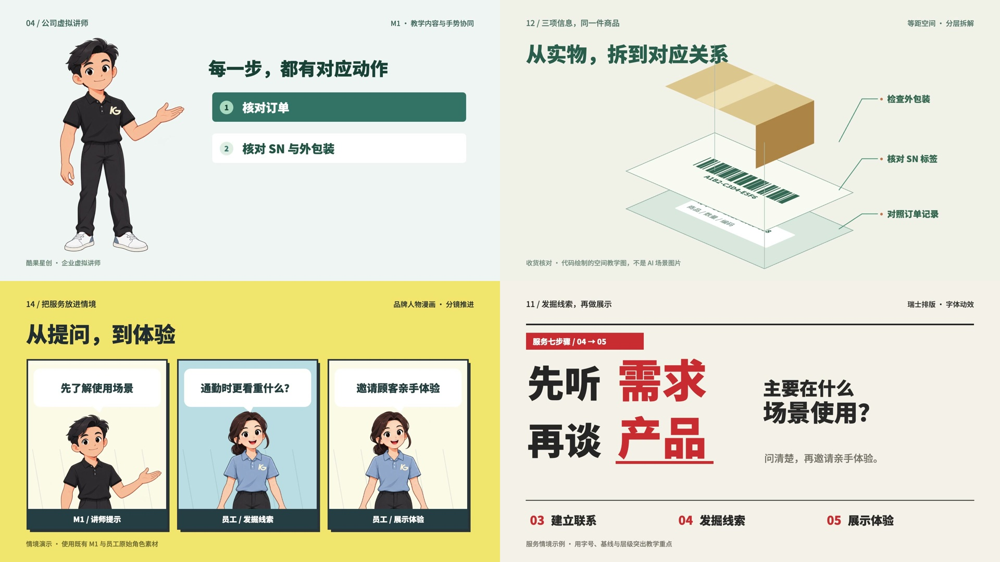
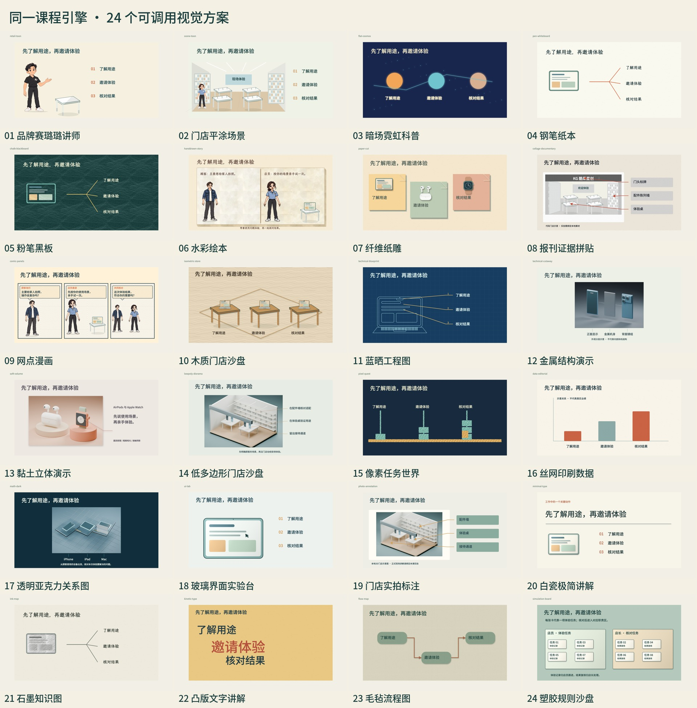
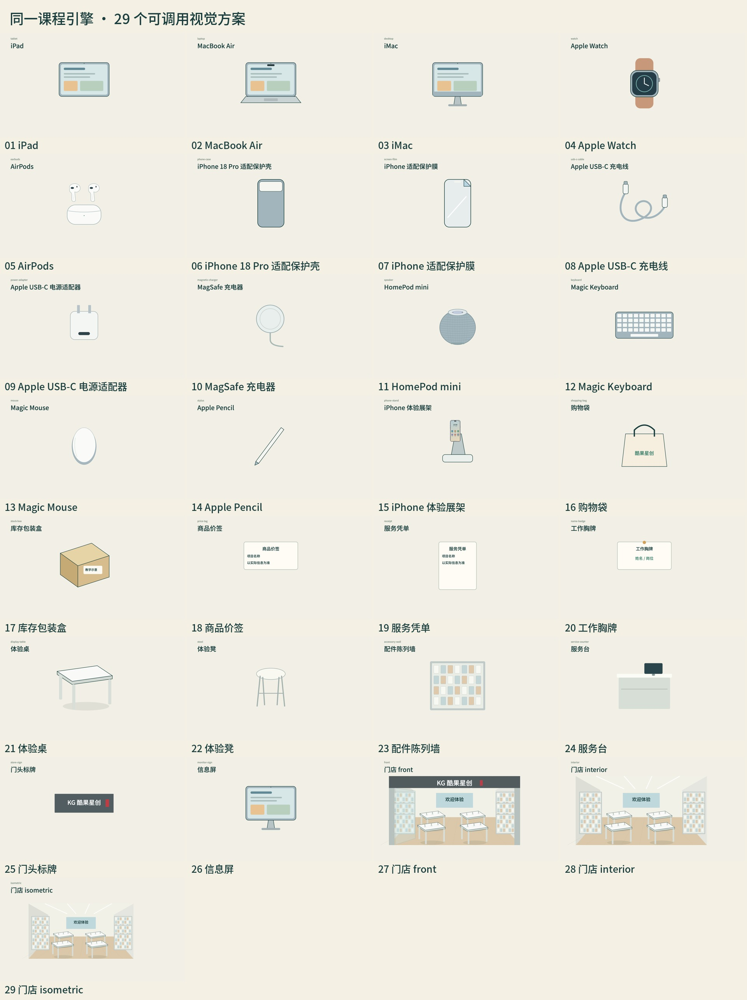
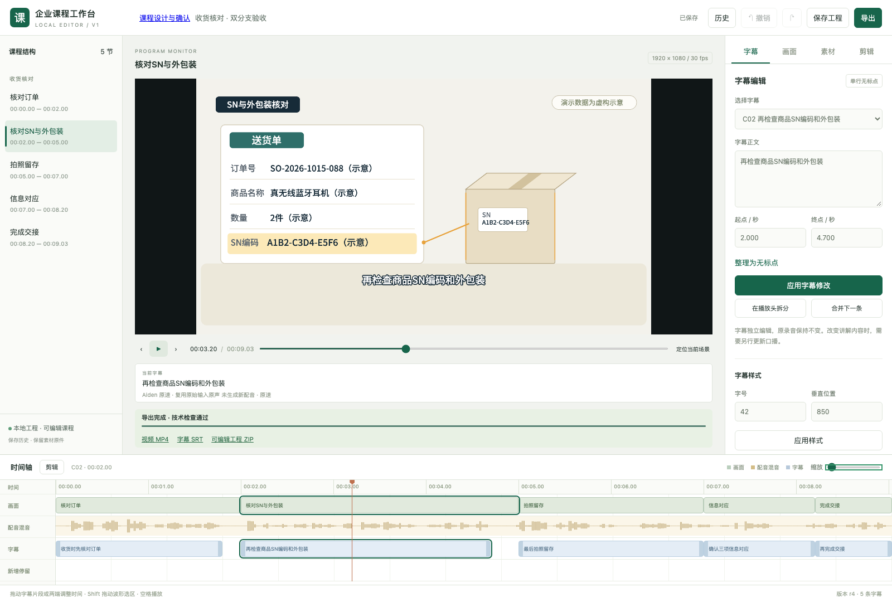
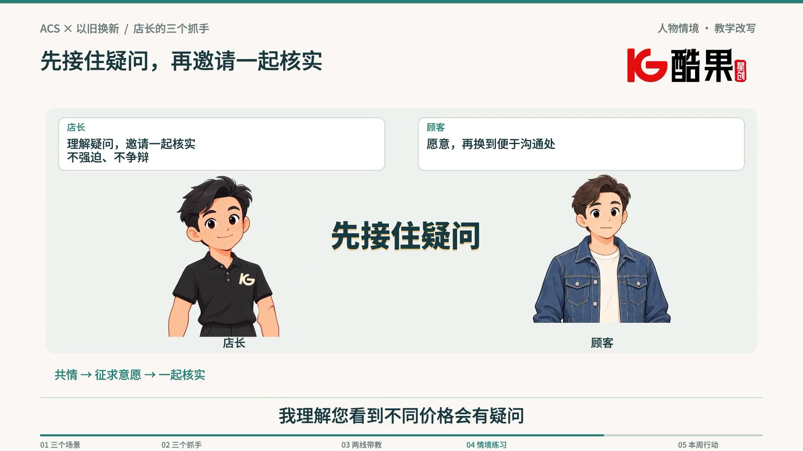
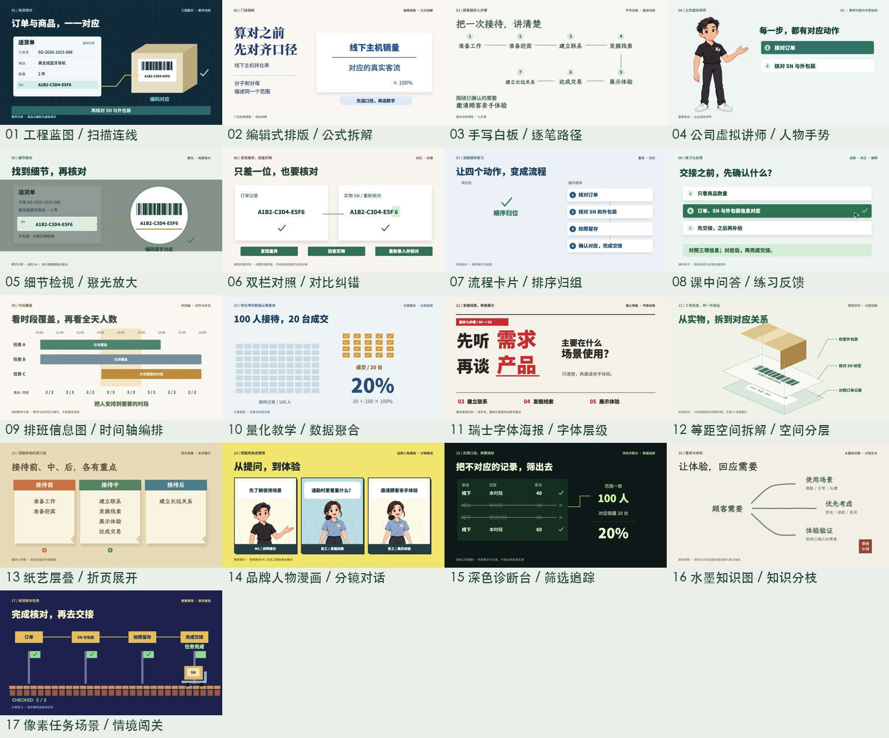
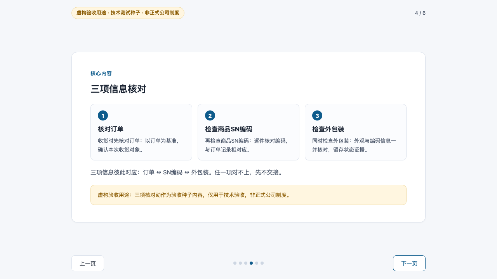

# 酷果星创 · AI 企业培训制课 Skill

本次更新面向 DSH 课程工作台：先展示当前作品和下一步，素材取舍与检查记录默认折叠。缺数据时明确标注，避免猜测进度或验收。小样页改为“制作现场”，已保存的实际合成画面、分段配音与样段在左侧查看/试听，每 3 秒更新一次；新产物不会自动播放或抢走当前选择。Qwen3/Azure 分段配音及现有渲染器已接入，其它制作路径需登记产物清单。保存不等于完成或验收。内部审阅与设置按需展开，必要确认保留。

工作台的关键确认统一走右侧问答。讲稿、三段有声小样或成片准备好且满足检查条件时，AI 在右侧主动提问；你在左侧看当前版本和状态，在右侧作出选择。左侧的确认记录可悬停或聚焦查看，也可以点击固定，不提交或改变选择。关闭问答、暂不确认和版本更新不会冒充批准；原件对照和实际听审仍按当前课的分工与证据核对。分镜内部审阅、主体与后期制作检查不额外增加人工确认。

制作中要查看另一门课时，从课程列表打开它自己的对话；不会改绑当前课。没有关联对话的课程，需要明确选择用独立对话打开。只读查看与开工分开，小样保留视频、字幕和检查记录，完整工程包在成片阶段生成。

「资料」内的课程素材库把上传原件和使用记录放在一起。可按文件检查门店实拍、制度文档等素材，查看原件、核实未使用原因，以及在有当前视频证据时跳到对应时间。讲稿参考和画面实际使用分开显示；没有当前证据的素材标为尚未核实，不把文件存在或分镜计划当成已出镜。

工作台优先显示当前可查看的作品和下一步。顶部只负责导航；「画面与配音」和「后期与成片」分开浏览。只有当前版本的原生问答实际出现在右侧时，左侧才提示用户确认，其他制作和检查记录集中收起。

第一次做课，可以从「上传资料」或「描述课程」直接开始，右侧会准备一条生成可编辑大纲的草稿，不替你发送。看小样或成片时可点「这里要改」，把对应视频版本、片段和播放位置带到右侧；写好具体意见再提交。中断后的制作会保留已有文件，继续时先核对可复用的成果，不从空白课重新开始。

**把 PDF、PPT、制度、手册和业务资料，做成可讲授的课件，或带配音、字幕和教学动画的完整课程视频。**

这套企业培训制作工具提供 **DSH 课程工作台插件**，也保留 Codex / WorkBuddy 的独立 Skill 入口。DSH 与其他宿主分别使用，当前插件只适配 DSH。你提供资料、培训对象和希望学员完成的工作，AI 按教学设计、逐字稿、画面导演、配音、编辑和交付的流程协助制作；你在关键阶段查看实际内容并确认。适合培训负责人、业务专家、门店管理者和带教同事，把工作经验与业务要求整理成可以反复使用、持续修改的课程。

一份资料可以先交付独立课件，也可以直接进入视频制作。课程方案、原件、讲稿、素材、配音和确认记录随工程保存，后续换对话、改内容或交接给同事时，可以从已有成果继续。



**教学设计与完整逐字稿 · 独立课件 / 有声视频 · 100 种可调用动作 · 24 种视觉方案 · 新课随机配色并持续沿用 · 花字与默认原库音效 · 本地配音 · 可恢复编辑工作台**

[下载 DSH 插件 v0.9.7](https://github.com/hebokenn/kgxc-corporate-course-skill/releases/download/v6.9.6/kgxc-course-plugin-v0.9.7.zip) · [独立 Skill v6.9.6](https://github.com/hebokenn/kgxc-corporate-course-skill/releases/download/v6.9.6/kgxc-course-suite-v6.9.6.zip) · [开始做第一门课](#开始做第一门课) · [查看实际演示](#实际演示) · [完整使用指南](docs/USAGE.md)

[能交付什么](#它能帮你做什么) · [适用场景](#适合哪些培训场景) · [能力与价值](#核心能力与实际价值) · [制作流程](#一门课怎样完成) · [安装或更新](#安装或更新) · [版本更新](#版本更新)

**本次更新修正稳定频道的提醒刷新。** 只提醒、不会自动安装或打断当前课程。桌面整课端到端流程和连续视听仍需独立验证；技术通过不等于业务课程或用户验收。

## 它能帮你做什么

**要求能追到当前画面和声音。** 适合多轮返修、外部组装和恢复旧工程。先登记用户原话、稳定要求ID与可观察条件，再派发带真实输入哈希、负责范围、对象和必检动作的任务；交回文件、对象、帧窗及证据，缺项不能完成。正式登记、定制CLI和桌面复制共用同一当前字节检查器，渲染期间冻结输入并排队修改。候选已编码、验收受阻、正式保存、用户接受分别显示。

**后续课程沿用已验证的质量基线，而不是反复试错。** 适用于同系列扩展和既有课程返修：分镜按关系、对比、判断、过程选择不同表现，先完成主体再单独制作检查花字和原库音效；底部按内容分区，每一区域显示自己的进度。用同一时间轴核对口播、正文、字幕和导航，检查真实编码中的字形、重叠、划线与章节边界。流程标准与技术检查不冒称完整看听或用户验收。[整课基线与验收方法](skills/corporate-training-motion/references/57-series-quality-baseline.md)

**变化跟着讲解推进。** 章节表共用真实显示时轴，剪切和停顿后导航仍随播放前进；章节文字遵守本课选择。结构签名排除换文案/颜色等换皮，语义事件绑定当前配音原文区间、出现次数和逐项触发，专门花字与原库音效检查实际编码。抽帧、采样和包哈希保留真实范围，不能代替听感或连续观看。[具体输入与命令](skills/corporate-training-motion/references/55-execution-contract-and-release.md) · [预览验证范围](docs/verification-next-dsh-release.md)

**逐条显示时，编号跟着讲解走。** 适合拆成上下篇、局部改开场或总结后出现“第三条先跳出”的课程。制作端为每行登记具体段落、句子区间和出现次数，用 `reveal-plan / reveal-check` 一并核对相关各篇；不靠首次短语命中、时间排序或钳制修饰错误。检查覆盖当前编码的出现前/出现时/稳定后图像，音效引用跟随新事件，已有必要条目保留；同时呈现的整页不会机械判成乱序。它验证已声明节点与指定像素探针，不是任意画布的OCR或完整听审。[字段与实际用法](skills/corporate-training-motion/references/56-ordered-reveals-and-intro.md)

**缩短片头时，一并核对整段等待和时间线。** 适合品牌标题停留太久，或只缩标题仍迟迟不开讲的返修。先区分整片头与标题后的等待；只改等待时保留原动画、标题显现与落定过程，停留秒数不直接套成整个片头时长。在本课 `introPolicy` 保存实际选定的总时长、静止停留及正文间隙预算，`intro-check` 测量当前包装显示轴和编码静止区间，并检查字幕、章节、进度、音效、音频速度及总时长的当前依赖。缩包装不再给讲解重复降速；外部封面仍只占首帧。某课选择1—2秒，不会成为其他课的统一硬时长。[操作与边界](skills/corporate-training-motion/references/56-ordered-reveals-and-intro.md)

**macOS 应用内更新。** 从工作台顶栏或插件详情检查新版、下载并校验。课程忙时等待；只有用户主动选择安装且正常退出 DSH 后才替换并重开，不退出 Codex。顶栏空白可拖窗，按钮仍可点击。

**有新版时主动提醒，不强制更新。** 打开课程工作台时和工作台保持打开期间会后台检查官方 GitHub 稳定 Release，成功结果缓存 15 分钟，连接失败约 2 分钟后重试。工作台顶部右上角「检查更新」可跳过缓存；有更新时显示版本和下载入口，不自动下载安装、不打断当前制作。旧版本用户需先手动安装本次更新才具备提醒能力；预览版不会提示降级到较旧稳定版。

**DSH 插件详情页也能检查 GitHub 更新。** 在「插件 → kgxc-course-plugin」点击「检查 GitHub 更新」，不需要打开课程。这个按钮只读版本信息，不会安装。通过 npm 安装的版本由 DSH 原生包管理检查 npm 更新；首次部署课程制作环境仍需配置 Python、浏览器和渲染依赖。

**DSH 对话可收起，也能随时重新打开。** 源码新增顶部常驻的“收起 AI 对话 / 打开 AI 对话”按钮，不再放在容易被课程画面覆盖的区域；折叠后、刷新后仍可恢复。制作与独立审阅沿用当前会话已选的原生模型，不要求同事切换到 Codex，也不会替换个人模型或计费配置。JavaScript 状态与原生模型路由回归已通过；重复折叠、刷新及窄窗的浏览器测试已编写，但当前环境阻止 Chromium 启动，尚未完成浏览器或同事原生 DSH 桌面的实装验证。此说明对应 rc.3 候选包，旧 rc.2 安装不会自动获得修复。

**DSH 课程工作台。** 顶栏左上显示酷果星创原版 Logo，侧栏收起时为系统窗口控件留出空间。下载更新后可选择立即或稍后重启，稍后会保留下载。 在当前会话工作区内完成资料、大纲、逐字稿、分镜、有声小样和整课交付，顶部固定阶段导航，右侧保留原生 AI 对话、模型选择和附件。大纲卡片可编辑、拖动、增删、拆并，稳定章节关联带动讲稿移动，并标出后续影响；AI 修改先给建议，由用户采用。分镜独立选择，小样使用实际视频和时间点反馈，整课显示真实任务与文件。制作进度栏显示实际步骤、耗时、等待模型回复和最近执行结果；合成时读取实际任务百分比，同一步连续失败会累计提示，报错不会被后续读取掩盖。画面、配音和绑定就绪后由程序直接合成，避免重复模型等待，仍保留原有确认与校验。保存与确认分开，未生成内容不会冒充成品。时长、受众等选择主动弹出，最后一道单选题点选后发送整组答案，预选不发送。本版插件 0.9.7，核心 6.9.6；当前插件只开发和验证 DSH，Codex 宿主插件暂缓。此前版本已用独立微课走通完整151.2秒视频、字幕、封面和桌面交付；本版验证范围单独记录，不据旧片声称新版课程已验收。保存后核对Finder可见性，显示实际位置，并可一键打开成品文件夹。交付默认保留逐字稿、小样、配音和工程；保留无需清理检查，如需清理，先弹出本课范围供选择，明确确认后才执行。历史会话保留成品回看及继续编辑入口。实际编码与技术观察不代替业务用户验收。[使用与验证范围](docs/PLUGIN.md)

从“这里有一份业务资料”开始，先明确学员在什么场景下、需要作出什么判断或完成什么操作，再组织讲解、示范、案例和练习。随后编写可直接讲授或配音的完整逐字稿，按你的需求制作课件或视频。

| 你的需求 | 主要交付 | 怎样使用 |
| --- | --- | --- |
| 想自己讲课、带教或录制 | 按需求及宿主能力制作的独立 PPTX / PDF / HTML 课件，以及逐字稿 | 用于现场授课、线上分享、带教或自行录屏；课件交付即可完成本次制作 |
| 想直接拿到完整课程视频 | MP4 视频、SRT 字幕、课程封面，工程与过程文件保存在课程目录，可按需打包 | 用于内部学习平台、集中培训或自主学习；需要上传的平台由你决定 |
| 已有课程，想更新其中一段 | 修订的讲稿、相关配音与画面，以及重新检查的对应交付文件 | 业务条件、系统界面或讲解方式变化时，从课程工程继续修改 |
| 先要课件，以后再做视频 | 保留课件，从仍有效的已确认逐字稿和原始资料追加视频分支 | 共用内容基础，视频重新设计镜头与动作，保留两种交付形式 |

课程方案、来源记录和制作文件保留在工程中，方便追溯和返修。视频练习可以呈现问题、思考停顿、示范答案与反馈；可点击的交互取决于所选课件格式和实际实现。

**看清原始资料怎样变成课程。** 适合需要压缩、合并或补充业务材料，又希望审阅者能核对内容取舍的课程。在“原件对照”查看独立业务要点的原文与出处、讲稿对应段、保留/合并/舍弃理由，以及新增示例、解释或外部事实的理由与依据。覆盖率按全部已登记要点计算，舍弃不从分母删除，关键规则、条件与例外单列；漏读、未知或无法核验不填满覆盖。比例仍需人工判断拆点和语义是否完整。用户查看后可在右侧同一逐字稿问答中明确确认；原件、稿件或报告改变会使当前确认失效，旧回执留存。制作端能生成对照，模型不能代确认；独立学员盲审继续只看当前作品。原件对照本身不改稿、不出片，也不启动另一盲审。[原件对照标准](skills/elearning-course-design/references/source-coverage-and-scope.md) · [本版发布验证](docs/verification-next-dsh-release.md)

**高质量写稿在前，一次盲审收齐问题。** 适合已有资料却经常写成口号、同义反复，或返修后不断出现新审阅要求的培训制作。先把每个要点对应到实际任务、具体情境、动作与判断依据、结果和练习反馈，再写自然口语；送审前由制作端自检信息增量，程序定位品牌问候遗漏、占位和明显重复。酷果课程正文开场保留已确认的酷果星创问候语。之后每阶段只对当前选定方案盲审一次，按稳定问题清单集中修复与定向验收，不把新哈希、升级或次数不限变成再审理由。技术检查不冒称自然度已通过，本版使用隔离合成测试，不启动真实课程制作验证。[写稿标准](skills/elearning-course-design/references/script-authoring-quality.md) · [一次盲审与验收标准](skills/corporate-training-motion/references/50-independent-review.md)

**独立学员盲审与执行监督（插件 0.9.4 / 核心 6.9.3）。** 适合制作方熟悉原件却容易忽略学员理解困难、分镜长期静止或视觉问题的课程。在逐字稿、全课分镜、有声小样和完整成片四个节点，各开新的独立 agent，只给该阶段成品，让它先复述“讲了什么、学到了什么”，再找可定位的问题。原件、目标答案、制作历史与旧评语留在制作端；审阅者不能改稿或提供补丁，每阶段当前已选方案只盲审一次，意见一次汇总为固定清单；实际制作 agent 集中修复一批，以当前成品证据逐项定向验收。未解决项保留卡点，不自动启动新盲审，也不要求未选备选达到验收标准。

**宿主核对实际请求，再绑定审阅报告。** 适合独立审阅或生产监督已经读完当前成品、却因手抄长版本编号错误而被拒绝的情况。宿主先核对本次注册调用、冻结输入、实际原生输入与零工具边界；只有报告确实未提供绑定字段时，才附上已核实的本次绑定。模型已提供的空值或错误绑定继续拒绝，真实成果变化仍由后端阻止。原模型正文与宿主封装分别留档，历史无效报告不追认。该检查是原生应用调用边界的证据，不声称捕获供应商最终 HTTP 请求。

**让讲解带动画面，并检查实际视觉效果。** 分镜审阅逐段对应旁白与对象的起态、过程、结果、信息和焦点变化，指出长时间停在同一页面、字幕变化代替演示或方案重复的位置。小样和全片检查构图、文字字幕、人物演出与遮挡、风格、动作转场、花字、声音和音画配合；增加切镜数不等于讲得更清楚。另设只读监督侦探 agent 跟踪用户要求、实际执行、角色隔离和版本证据，便于总导演发现要求未落实或报告与当前成品不符的问题。

**把已选要求交到实际制作和交付。** 适合多人分工、换对话恢复，或从中段小样扩展整课时容易漏掉声音、品牌与导航的制作任务。开工和恢复读取同一份 `production-contract.json`，把原库叮／嘟咚、重点强调、原句对应的语义动作、正文原Logo、分节导航与R5/R8头尾交给负责者；正式登记前用当前文档、素材和实际视频逐项核对，缺什么就报告什么并保留候选。花字可以是标记、聚焦或划线，须对应原句、用途、目标、帧与阅读窗口；动作不能靠透明度变化次数代替演示。机器核对结构和证据绑定，不证明美观、教学语义或声音自然。该核对沿用每阶段一次盲审与固定清单验收，不增加模型评审轮次。[合同用法与验证边界](skills/corporate-training-motion/references/51-production-contract.md)

正常改选分镜时，仍然有效的制作偏好会随新的已选方案更新绑定，避免把正常选择误报为需要重新决定；旧绑定已经过期时继续提示核对，不借改选把它刷新成有效。恢复、派工及导出仍核对当前选择，旧确认与历史分别保留。

编码和解码成功后，如果六项制作合同尚未核完，工作台保留实际候选供作者检查，明确显示“制作候选已生成，待核验，未登记”。技术任务可结束，但候选不提前替换旧成功导出、正式引用、阶段登记或桌面成品；当前合同就绪后才沿原登记流程继续。编码失败和其他执行错误仍按失败处理，不会被待核验状态掩盖，也不因此增加盲审轮次。

**图示既能动，也能读懂。** 适合团队分工、信息流转、比较和因果关系等图解。分镜与派工先说明重要节点和关系分别代表什么，再安排与口播同步的正文标签；不能只剩纸页、对话框、连线和高亮，让学员靠字幕猜含义。需要解释的业务图示登记图示与文字节点及共同可见窗口，制作端从当前编码核对文字、指向和阅读。装饰图标不逐一强加标签，页眉、字幕或节点数量不冒充业务说明。这样把缺字问题前移到设计与作者自检，并沿用原固定清单验收，不新增盲审。[文字标签与制作合同](skills/corporate-training-motion/references/51-production-contract.md#业务图示与文字标签)

**AI审文字与画面，用户听音轨。** 当前课使用的模型没有音轨感知能力时，可依据用户真实选择分工，保持原模型和计费通道。AI按实际文字、帧和帧序列检查内容与画面，工作台分别显示AI检查范围和待用户听审；用户完整播放当前全部小样或全片后，在原确认动作中明确声明声音与音画配合是否通过。记录绑定每个视频的版本、SHA和完整范围，视频变化后重验，反馈问题继续交制作端处理。选择这种安排本身不算完成听审，抽帧和ASR也不算听过声音。这样保留声音检查职责，同时让用户看清谁检查了什么。

**配音也可由制作端负责自动核查。** 用户明确表示无需亲自审核配音时，可以只为当前课记录免人工音轨审批，停止逐句试听，把当前MP4的音轨、解码、时长和非静音等交给程序核对。AI继续检查实际文字和画面；工作台分别保留自动检测结果、未执行连续听审和主观听感的能力范围。免审批不会生成“用户听审通过”，也不会把技术检测变成完整听审；内容、视觉与其他关键未知继续按原门槛处理。分镜审阅同时保留结构化的数字阅读窗口，避免制作端已安排的入场和停稳时间在交给学员审阅时丢失。

用户明确要求本轮优先改善效果时，可临时关闭本课调用次数与返修轮数门槛；保留旧上限、累计调用、用量和失败，随时可恢复。该选择不改变新课默认值、模型通道或质量检查，工作台明确显示“本轮次数暂不限”。 纯执行设置升级可显式沿用仍有效的内容复核，保留代码与审阅绑定，课程内容变化后须以新证据核验固定问题与直接回归，不自动重开盲审。分镜证据支持从明确的片段字段定位识别片段；不能核实的意见保留阻断并交制作端核对，避免一处格式问题吞掉整份意见。

用户要求保留原文、来源和ID，按适用阶段与职责登记：内容要求进入本阶段制作核验，隔离、职责与通道要求交给独立监督。后续阶段义务继续保留；当前文字不承担尚未产生的成片验收。制作端给出可回查的逐字引文，监督取得核验结果与拟执行动作，能区分正常待修、保留卡点和违规放行。

**普通过程合批，关键动作继续独立检查。** 制作过程中完整保留每条事实，普通读取、搜索及后台任务通知按批交监督，避免在正式内容尚未变化时反复执行相同范围的模型核查。开始、结束、失败、用户新指令、实际导出生命周期，以及原生正式保存和直接写入工具的前后，仍同步等待独立监督。合批不改变调用限额选择、质量验收、模型通道或日志。

**正确处理原生重复调用提醒。** 同一制作代理重复读取相同内容时，DSH会生成程序提醒。制作快照核对真实工具执行、实际策略、原文与入队时序后保留这条上下文，帮助代理调整做法；已核实但尚未处理的提醒由原生流程正常领取。真人插话、伪造、外来及重复消费的提醒继续停止旧任务，已有历史和输入不删除。

**看清当前任务与历史失败。** 恢复长会话时，工作台从可信制作派发读取当前课程、阶段与任务，避免继续展示旧版本错误。旧失败留在可展开历史；只有实际成功且候选、目标正文和较新版本都匹配，才标明被哪个修订替代。新任务开始本身不会把旧错误改成成功，无法关联的旧问题继续如实保留。

**让监督看见真实执行证据。** 制作任务的工具记录保留经过筛选的读取路径、工具请求声明的写入目标、简单脚本参数、实际返回的断言结果与文件哈希，便于监督判断本轮是否写入正确目录、基线核对是否成立。已支持的结构化布尔值、版本和备份数量在桌面端与核心两层传递中保留实际值；任意正文、复杂命令和自由输出不直接传入。请求路径、工具返回与宿主独立文件检测分别标明来源和范围，不支持的格式继续无法验证。证据不足保留阻断，不能把退出码零当成课程通过。

恢复曾中止或异常结束的制作时，保留旧任务及未知用量。已核实原生 `turn/end` 因 Codex app-server 错误而结束时，保留 `failed/error` 原种类、错误和未知用量，通过正常事件追加同一制作身份、操作、step/turn、seq、时间与来源观察回证。在暂停且全部调用已结算后可继续原授权设置。工具错误、缺少终态、错误身份或序列、后续仍有进展的任务继续阻止；失败本身不表示已经结束。

模型长时间不返回事件时，先保留失败和未知用量，再检查原通道与实际等待阶段。本课制作核验可在暂停且无在途调用时显式调整独立等待时限并保留依据，默认10分钟；次数不限不会自动改变等待设置。上游适配器的无事件等待与课程总等待分别配置，不伪造进度或切换模型。

**长会话仍可继续实际制作。** 已授权的制作派发沿用原制作agent、会话、工具及工作区权限，实际请求只带当前任务和本轮后续工具结果；旧材料和历史仍保留在工程与日志中，制作端可以按需读取。当前任务结束或取消后恢复普通行为；同一派发请求不重复执行。分镜通过后的自动小样继续也使用这条路径，降低旧核对包反复累积造成上下文超限的风险。这条制作路径保持原有确认与监督，不给学员盲审者开放制作权限。

**后台任务完成后继续取回制作结果。** 适合导入、配音或渲染转入后台的制作任务。程序把完成通知与本轮真实工具调用、原制作agent和终态任务逐项对应，再让制作端读取结果、回读文件并返回独立审阅流程，避免自己的完成通知把制作误停。只有可核实的本轮任务通知参与该流程；真实用户插话继续打断，其他任务和未知来源保留停止行为。已有候选、正式文件及失败记录分别保存。

**制作端只读核验中的自动技能清单。** 适合原制作会话已有技能清单、转入只读核验后原生SDK更新工具可用性的情况。核验仅保留完整当前包与原生系统指令，按实际原生生成位置核对并剔除精确的空技能清单更新，避免把程序更新误当用户插话。真实用户和不能核实的消息继续中止旧快照并保留输入；已接受盲审的同轮制作核验可按原有绑定恢复。

**长会话中的制作核验可以从真实失败处恢复。** 本轮制作核验发送完整当前核对包及原生系统指令，保留原制作 agent 身份与持久历史，避免反复附带旧核对包和工具返回。若独立审阅已经接受、制作调用却失败，且成果版本、协议、原通道和绑定仍一致，可在同一轮追加制作端重试，随后继续监督；旧失败、未知用量和新调用分别记账。分镜包保留完整必要原件、逐字稿、方案、要求和本次发现，去除不能在该阶段编辑的工程副本及重复旧报告。成果实际修改后逐项核验固定问题与直接回归，旧版本证据不冒称当前已解决，不重开盲审。

分镜盲审同时取得该成品中已有的导航标题、目录帧窗及结构化显示状态，便于核对遮挡与完整阅读区间。导航按可见字段单独筛选，未知状态不补造；原件、教学目标、资源路径和旧评语继续隔离，避免把成品中本已写明的信息误判为缺失。

中文长稿和分镜经本机服务传给制作与审阅代理时，按完整UTF-8字符流解码，保持跨响应分块的汉字。审阅中发现的文本问题应回查实际收到的成品，传输失真须修复并重验，不能误改正常原稿。

返修事务遭版本或保护字段拒绝时，本轮立即停在原错误，保留学员意见、制作提案和用量；制作方完成真实修改后按固定清单定向验收。不会用重复审阅未改稿件来掩盖执行失败。分镜局部返修的既有保护字段会在制作提示中明确列出。

制作阶段可沿用原会话，在只读核验后继续编辑及读取后台任务；恢复时从当前已注册技能及其真实显示规则重建本轮工作上下文，避免原生目录更新误停制作。已知程序消息逐项核实，真实用户插话和陌生输入仍保留并中止旧任务。

原生DSH默认给新agent注册的团队工具由只读执行器隔离，最终模型请求仍须为零工具、无额外运行上下文。创建阶段的阻塞单独记为preflight失败，不冒称已调用模型，预算及未知用量保留。报告绑定真实 agent、只读访问、阶段和成品哈希。刷新、重开和协议升级不重置累计返修、调用及用量；旧报告和所有过程文件保留。分镜新增独立AI检查沿用已确定选择与委托，不增加一次强制人工审批。当前Codex通道支持文本与图片，抽帧和ASR不能充当完整连续视听；默认模式关键项缺证据继续阻塞。用户明确选择本人听审时，由真实用户声明承担；用户明确免人工配音审批时，保留自动技术结果与未执行连续听审，关键未知不据此通过。其余关键内容、视觉及技术项仍须核实。AI审阅、用户确认及桌面正式交付分别记录。[规则与角色边界](skills/corporate-training-motion/references/50-independent-review.md) · [本机验证范围](docs/verification-plugin-v0.8.22.md)

DSH内直接使用共用课程编辑与审阅界面，原件、讲稿、实际小样和成片在同一插件查看；后台继续复用原有媒体制作服务。修改意见进入后续验收依据，执行失败可在累计次数内分析原因、调整方法并复核，保留每次失败和恢复证据。新版本要求DSH 0.2.2-rc.1或更新的0.2系列。

分镜前可在“制作偏好”中选择同风格可动顾客、花字密度和提示音；点选即保存，已选事项不反复问。新增顾客可写描述、上传参考图，先查看设计再采用。人物统一用多部件可动结构，V01/V02/V03是可复用起点，新课可按情境设计其他人物，通过发型、眼镜、便装款式与颜色区分，同课同人保持连续；选择窗口的缩略图由同一运行器生成，成片中不使用整张人物贴图。修改会提示更新相关分镜和音视频。启用花字或音效后，当前视频必须有真实对象、匹配的混音回执和非静音音效分轨，不能只保存开关。场内人物对白逐句检查说话人、同场受话人与头部方向；真正的人物转向、手势和行走直接进入动作校验，避免用无意义线条顶替。工作台空闲关闭后，切换阶段由程序恢复原服务入口。整课页把当前任务和历史失败分开：旧诊断可展开查看，最新失败不会被旧成功掩盖。总部授课立场保留在内容设计中，默认不自报部门；结尾另查完整末句后是否混入保护提示的残音。

## 适合哪些培训场景

| 场景 | 可以提供的资料 | 课程怎样讲 | 对培训工作的帮助 |
| --- | --- | --- | --- |
| 新人入职与岗位带教 | 岗位手册、工作清单、流程说明、常见问题 | 按真实工作顺序拆成任务，穿插操作示范、易错点和练习 | 把分散的口头经验整理成一致的带教内容，便于新人反复查阅 |
| 制度与标准作业流程培训 | 制度正文、SOP、通知、条件与例外说明 | 交代适用范围，用案例比较“何时这样做、何时需要另行处理” | 把条款转成可执行的判断与行动，保留原文中的条件和例外 |
| 收货、交接与信息核对 | 订单、票据、商品照片、编码标签、交接记录 | 同屏定位订单、实物与记录，逐项连线、核对、标出差异并演示处理 | 帮助学员看清具体核对位置、先后顺序和完成标准 |
| 销售服务与顾客沟通 | 服务流程、典型对话、顾客问题、正反案例 | 由讲师引题，编排走近、停步、提问、倾听与示范，再回到服务要点 | 用有意图的站位、视线与回应讲清话术时机，动作自然完成，减少慢放和机械摆动 |
| 系统与表单操作 | 实际截图、字段说明、操作步骤、成功与异常状态 | 依次展示入口、填写内容、操作反馈与结果，放大关键字段 | 让学员知道“在哪操作、填什么、完成后应该看到什么” |
| 店长经营与现场带教 | 指标定义、业务报表、销售案例、员工接待与辅导记录 | 讲清业务目标和口径，再用早会示范、完整接待、顾客异议及员工重练解释管理动作 | 让店长知道今天看什么、怎样带人，并区分经营结果与可观察的员工动作 |
| Apple 产品与体验教学 | 对应产品资料、设备照片、功能与演示步骤 | 结合设备示意、局部放大、状态切换和人物引导解释重点 | 把产品信息连接到实际观察与体验；精确型号和操作仍以对应资料核实 |
| 连锁门店与品牌内部培训 | 总部标准、品牌角色、统一流程和典型案例 | 沿用统一授课身份、角色、视觉与声音，按不同主题组织内容 | 方便持续制作系列课程，并在业务更新后保留可追溯的修订基础 |

当前内置角色、片头片尾和产品素材以酷果星创及 Apple 门店培训为主要场景。其他团队可以复用制课方法；涉及品牌、产品与角色的内容，需要准备相应资料并调整配置。

## 核心能力与实际价值

### 1. 先把资料变成课程，让学员知道如何用

先诊断素材、梳理工作任务和学习目标，再推荐讲解方法、课程大纲、示范与练习。逐字稿包含实际讲解、案例、过渡、提问和答案反馈；业务事实、条件、例外及资料疑义保留依据。

例如，收货资料中的“订单、SN 和外包装一致”，可以展开为：为什么要核对、到哪里看三个信息、怎样逐项对应、发现不一致时按什么依据处理，以及交接前如何再确认。培训负责人可以在制作画面前检查课程是否教到了真正需要的工作动作。

资料内容较多、课程需要压短或拆分时，先逐页对照要点在课程中的去处，说明保留、合并或舍弃的理由。业务目标与岗位动作分别讲清，缺失的内部指标不补造，案例数字不改成统一标准。店长课可以用“听完一单、指出漏讲的一句话、示范后请员工重说”解释带教，再按需要把完整话术或操作演示安排为选修；精简重复，保留原因、回应和收尾。这样能减少漏项，也让没有原件的学员知道怎样做。[原件覆盖、现场讲解与主选修取舍](skills/elearning-course-design/references/source-coverage-and-scope.md)

默认学员拿不到制作端的原始附件。首次出现表单或图表时，先讲清名称、用途和当前项目，把完成任务必需的字段与条件放进课程。这样只有视频的学员也能跟上讲解。酷果课程按总部面向门店授课的立场组织表达，来源追溯保留在制作记录中。

[教学设计模块](skills/elearning-course-design/SKILL.md) · [学员上下文与改写示例](skills/elearning-course-design/references/learner-context.md)

### 2. 按知识点安排动作，把过程、关系和结果演出来

内置 **100 种可调用动作和 17 类教学构图**，覆盖核对、操作、判断、对比、路径、信息流转、记录回填和反馈。制作时先确定本句要讲的对象、起始状态、变化和结果，再把动作安排到对应旁白时刻；动作完成后留出读图时间。

收货课可以让订单字段与商品标签逐项对应；指标课可以把记录聚合成分子、分母；服务课可以让人物提问、观察和回应。不同知识点使用适合的表达，让学员有机会看清“怎么发生”和“结果是什么”。动作数量用于提供选择，不要求每门课凑齐。

已有参考片方法可用于“讲师引题—情境演示—回到要点”“说—听—回应”“聚焦当前对象”和“逐项对照”。学习其组织方法后，用本课内容及已确认美术重新实现。普通操作保持利落，讲解时长由内容、示范和读图需要共同决定。

**字段与流程课同时安排阅读与讲解节奏。** 分镜列出每组新增文字、要读懂的任务、动作时间、完整停稳后的阅读时间，以及后续需要回看的结果。比如任务卡上的责任人与日期稳定保留，旁白解释其工作含义；前一步留下摘要，后一步可回看比较。动作结束不必换字，阅读时间也不机械变成无声等待。阅读不足时先精简正文、分组和调整顺序，禁止自动插静音凑秒数。导出会按真实文字、父容器运动、替换、剪切与渲染曝光检查，拦住“卡片动完了，文字却只剩一瞬”的候选。6.0新视频还绑定同轴旁白干声与明确任务停顿，导出前和最终编码分别检查讲解中断；背景音乐不能掩盖旁白断续。练习先提示学员自行暂停，较长观察或作答须有具体用途。工程阈值用于发现异常，不能代替正常速度连续听看和学员理解判断。[具体方法与检查命令](skills/corporate-training-motion/references/45-reading-and-information-pacing.md)

**用花字把当前重点落到具体词句。** 服务沟通、条件判断与总结段可以安排短词弹出、重点标记、移动定位和步骤划线，先绑定讲稿原句与动画，再留足稳定阅读。条件和否定一起保留，平等选项保持同样权重，普通叙述可留白。花字与声音随分镜和小样一起审阅，方便培训负责人看清“此刻让学员注意什么”。[花字设计与选音方法](skills/corporate-training-motion/references/46-flower-text-and-native-sfx.md)

[动作与调用方法](docs/MOTION.md) · [按内容导演](skills/corporate-training-motion/references/42-content-directed-production.md) · [参考片讲解方法](skills/corporate-training-motion/references/43-reference-teaching-and-voice.md)

### 3. 全课先看演绎与分镜，再用三个随机片段验证效果

当一门课同时包含人物对话、概念解释和操作演示时，单看一个片段无法判断整课。新视频先把已确认逐字稿全部对应到画面，**每个教学片段至少提供三种实质不同的表现方案**，说明起始状态、动作、结果、观看焦点、人物、实现条件、预计成本和风险，并给出推荐组合。用户可以逐段选择，也可以明确采用推荐组合。

例如同一句“目标要变成现场动作”，可以比较目标改写过程、前后行为对照和触发条件路径；不是只换三种颜色。全课分镜表先用文字与必要粗图审阅，避免先生成全部候选视频。共同美术规范另行保存；情境可以用人物演绎，概念可以用无人物图解，具体依本课偏好组合。

全课分镜确认后，**分层随机抽取三个不同的完整片段**生成有声动态小样，优先覆盖情境、概念和剩余高风险实现。抽样保存种子、候选池和选择原因，恢复工程不会重抽；需要重抽时记录理由。三个片段使用与整课相同的生产代码、素材和时间线。小样确认后才制作整课，未抽中类型及高风险片段仍须逐段检查，目录、章节衔接及密集信息段也检查阅读与声音连续性，不能只挑好看的画面。

系列课程不必反复套用同一种颜色。未指定品牌色的新课会从六套合格色板中随机抽取一套，默认候选不含绿色；可以直接说“这节课随机配色，不要绿色”或提供品牌色板。工具先排除禁用色，再保存候选池、种子和结果；同一课的分镜、图表、人物讲解与进度条沿用整套配色，恢复与重编译不重抽。用户指定和实际已确认小样优先，旧课程保留原画面。

17 类教学构图与 24 种视觉方案通过同一份色板绑定，避免换了构图又回到固定灰绿；工作台与文稿审阅界面保持白色和中性灰。人物、设备与真实界面保留本色。[选色、禁用色与恢复的具体用法](skills/corporate-training-motion/references/47-course-palette.md)

内置 **24 种视觉方案**仍可用作字体、材质和构图参考，目录中的旧配色不覆盖新课已保存色板。旧工程保留原有效确认，明确要求升级后才切换流程。[全课分镜与三段抽样的具体用法](skills/corporate-training-motion/references/44-storyboard-and-sampling.md)



[风格、动作与素材的调用和扩展](skills/corporate-training-motion/references/40-library-direction-assets.md)

### 4. 用人物、设备和业务物件解释现场

素材库包含讲师、店长、店员、Coach、顾客，以及 Apple 设备、文书、票据、外箱和门店场景。角色身份与胸标对应：黑衣 KG 店长、蓝衣店员、黑衣 MyCoach 教练；讲解、服务和顾客角色可以在画面中各司其职。

仅恢复既有纹理工程时，C01 顾客与 S01 店员仍支持各自原图标定的二维眉眼、视线、眨眼、点头和部分关节动作，可表现关注、倾听和回应。适合把服务要点放进短情境；这些能力的适用范围是正面二维演出，其他人物和新姿态需重新制作与检查。

需要全身演绎的情境，默认先排人物意图与站位，再以简化二维形体粗演和精修。可复用人物实现包括走近、停步、全身转向、说听回应、短手势及部分手部任务；肩袖连续，摆臂随步态走弧线，脚交替支撑，实心手臂按前后层级遮挡。动作有自己的时长，完成后自然进入倾听或展示，避免为配音慢放。`stage-acting` 按本课外观、站位和距离生成候选节点及步态/转向轨道，`acting-check` 给出连续帧复看范围，预览与导出使用同一代码。这样后续可以从可运行做法开始调整，减少重复修正；不是只增加限制。当前为正面到左右侧面的新绘人物，保留已确认身份特征和原版胸标，不等于旧PNG已获得万能骨架。实际演出仍需正常速度观看。[怎样编排、怎样画、怎样调整](skills/corporate-training-motion/references/48-situational-acting.md)

手机屏幕、票据内容、字段高亮和对象状态可以按本句讲解制作。照片标注绑定实际对象位置，人物检查可见脚底，设备检查桌面或手部接触，文字为产品、说明与字幕留出空间。这样既便于解释具体业务对象，也能减少素材悬浮、指错位置和遮挡信息的问题。

本地原件可注册、按哈希暂存到课程中，风格与素材继续扩展；部分立体方案配有 Blender 静态素材与源文件。用户门店实拍保留在本地素材库。



[内容素材制作](docs/CONTENT-ASSETS.md) · [角色创建与修改](docs/CHARACTERS.md) · [人物演出范围](skills/corporate-training-motion/references/41-direction-and-performance.md)

### 5. 先试听声音，再让语气、发音和动作配合内容

完整新安装推荐 **didi 男声、pipi 女声**，未指定性别时使用 didi。这是我们选过、较适合常见培训讲解的两套推荐声音，参考音频、逐字文本和配置均随包提供；准备同一本地 Base 模型后即可直接生成。你可以按自己的课程和听感换声、调速、设计新音色或克隆参考，已有个人默认在升级时继续保留。

| 推荐语音 | 可先尝试的用途 | 同文案试听 |
| --- | --- | --- |
| didi · 男声 | 任务说明、步骤讲解与重点提醒，清晰轻亮、有自然起伏 | [点击试听 didi](https://raw.githubusercontent.com/hebokenn/kgxc-corporate-course-skill/main/docs/media/voices/didi-audition.mp3) · [下载 WAV](docs/media/voices/didi-audition.wav) |
| pipi · 女声 | 课程导入、概念解释与服务情境，清楚亲切 | [点击试听 pipi](https://raw.githubusercontent.com/hebokenn/kgxc-corporate-course-skill/main/docs/media/voices/pipi-audition.mp3) · [下载 WAV](docs/media/voices/pipi-audition.wav) |

两段均为 AI 合成，使用[同一段通用文案](docs/media/voices/audition.txt)、1.0 交付倍率，方便对照；也可下载[双播放器试听页](docs/media/voices/audition.html)后离线比较。推荐是开始制作的起点，正式课程仍先听包含本课内容的小样，再确认声音、语速与画面配合。

长课尽量沿用同一已确认声线，按完整语义段组织配音，检查响度、接缝和尾字。提问、邀请、提醒与总结按句意安排自然起伏；英文名称与字母缩写分别核对，字幕保留标准写法。适合含有设备名称、SN 等专业词的课程，避免字幕正确但实际读音仍有问题。

本地声音库支持注册中文或英文名称，分别保存默认男女声；以后可以按名字调用，减少重复准备参考的工作。单次选声、个人默认与课程既有录音分别保存。保持音色时可先调句子、标点、分段与交付速度；要用文字描述另一种音色，选 VoiceDesign；要复用自己的录音，选 Base 参考克隆。二者的模型和控制方式分别说明，新候选仍需试听。

新音效默认使用随包内置、已经选定的 **“叮”和“嘟咚”两款原库素材**，安装后可直接调用：重点与完成用叮，弹出与轻提醒用嘟咚，移动和连续划线按需要提示或留白。15 类动作映射复用这两款声音，同组平等选项保持同素材同增益；不把角色数当作独立音色数。实际混音保留立体声，避让只降低局部音效。原45个CC0常用WAV作为明确选用的备选，已有课程的冻结声音继续保留。

[试听、语速与发音调试、换声及克隆指南](docs/VOICE.md) · [动作音效及逐项试听](docs/SOUND.md) · [默认两款音效试听](skills/corporate-training-motion/assets/sfx/teaching-native-v1/audition.html)

### 6. 让学员知道学到哪里，让成品方便上架

视频课程带有随视觉风格设计的底部进度条；两个及以上小节包含目录页和每节独立标题页。目录、口播任务与实际章节时间对应，目录和章节以简洁口播衔接，避免无声占位；正式教学区间显示进度，封面、片头、导入、目录、总结和片尾保留各自的画面空间。

多节课程中，学员可以知道当前学习任务及所处位置。导航同时避让主体与字幕，外观跟随整课美术，便于系列课程保持一致。

课程名称、片头标题页与课程封面分别处理。为学习平台上架或系列课程列表设计独立封面，沿用已确认名称和品牌，以业务相关场景、人物或物件说明学什么，区分主课与选修；不能默认复制片头定格或只放大标题。实际查看完整尺寸和 320×180 缩略图，再核对播放器真实poster，让学员在入口处就能辨认课程内容。

品牌片头片尾替换本课名称，酷果正文默认持续保留右上角原版Logo，仅按本课用户明确选择改变位置或显隐；其他企业使用自己的品牌。新增场景和拆分导出继续沿用确认配色与人物。首尾口播优先当前已确认稿，从实际视频核对完整且一次，不因旧固定句自动重录或追加。只改封面不自动改配音或重编码视频；后期调整速度时，画面、声音、字幕和章节共用时间映射，保留原版及分轨，方便检查与返修。

酷果成品默认按一门课程一个文件夹归集到桌面 `ai 制课/<课程名称>/`，当前视频、字幕和封面同放，旧版与小样分别归档，工程和过程文件留在项目内；也可沿用你明确指定的交付位置。

[课程导航要求](skills/corporate-training-motion/references/03-visual.md#课程导航与章节呈现) · [封面与后期交付](skills/corporate-training-motion/references/37-cover-and-delivery-finish.md)

### 7. 检查实际成片，帮助发现影响理解与观感的问题

交付前分别复核课程是否讲清、构图与节奏是否合适、声音是否自然。逐场检查文字边界、高亮、人物对齐、物件支撑、箭头所指和动画结束状态；修改共用素材后，沿全片复用位置检查同类问题。

新工程的对象状态与画面证据绑定当前实际编码 MP4，动作按真实发生时刻检查；长课程的批量取证支持数百个对象事件。这样可以核对“导出的那一版”是否呈现了预期内容，也便于定位返修范围。

自动检查用于发现问题和核对证据；正式交付前仍须正常速度完整连续看听最终候选，核对讲解因果、数字条件、完整尾字、章节与练习衔接，以及实际构图、字体和留白。只做抽查就说明实际范围，不能把识别、抽帧或技术通过写成完整试听。**技术检查、实际听看和用户最终认可分别记录**，便于你理解当前结果经过了哪些检查、还需要审阅什么。

[文字与胸标检查](docs/LAYOUT-UNIFORMS.md) · [逐场视觉检查](skills/corporate-training-motion/references/39-visual-hygiene.md) · [课程工艺复核](skills/corporate-training-motion/references/36-course-craft.md)

### 8. 用可恢复工作台持续改课，完成后释放资源

工作台保留场景、画面对象、字幕、素材、音轨和时间轴，支持修改已登记文字与位置、替换素材、调整停留、同步裁剪、撤销重做及再次导出。改字幕不会自动改变录音；讲解内容变化时，可让 AI 同步修订配音、画面与时间线。

方案、分支、用户选择、确认原话、时间和关联版本写入课程文件。换对话时提供工程目录，或双击课程中的“打开课程工作台.command”，可以读回已有进度。适合跨天制作、多人交接和业务更新，减少重新解释背景和重复确认；实际内容变更时复核受影响部分。

未变化文件的复核结果可复用，并发查询共用一次检查，隐藏页面暂停轮询。课程完成、无导出任务且空闲两分钟后，工作台自动退出，减少后台持续占用；导出、未保存编辑、播放和下载会延后关闭。文件与确认记录继续保留，返修时重新打开。



[编辑、裁剪与恢复操作](docs/USAGE.md) · [工作台自动关闭规则](skills/corporate-training-motion/references/27-content-workbench.md#完成后的自动关闭)

## 实际演示

### 花字与原库音效样片

约73秒的《回收价格异议处理》，展示弹出短词、条件便签、依据标记、平等选项和步骤划线怎样与旁白对应。22处花字中选择15次发声，末尾三问留给讲解；这组数量和密度只属于本样片。

[](https://hebokenn.github.io/kgxc-corporate-course-skill/media/flower-native/)

**[在线播放样片](https://hebokenn.github.io/kgxc-corporate-course-skill/media/flower-native/)** · [下载有声MP4](https://github.com/hebokenn/kgxc-corporate-course-skill/releases/download/v6.1.0/price-objection-native-sfx.mp4) · [对应字幕](docs/media/flower-native/price-objection-native-sfx.srt) · [音源、文件哈希与说明](docs/media/flower-native/README.md)

保留这段既有画面、旁白与字幕，音效采用已确定的两款原库文件，不叠加旧音效。样片已按用户要求公开；它展示具体制作方法，业务条件仍需在使用时按实际情况核实。安装包已内置同一音源，供后续课程默认调用。

### 80 秒教学效果混剪

无旁白，以 BGM 和动作音效串起 17 种具体教学效果，1920×1080、30fps。可以观察文字层级、对象对应、步骤推进与人物配合。

https://github.com/user-attachments/assets/d66985f1-e143-4a30-83d4-336f45908d54

[下载混剪 MP4](docs/media/capability-showreel.mp4) · [逐条播放 17 支独立样片](docs/SHOWCASE.md) · [下载全部原画质样片](https://github.com/hebokenn/kgxc-corporate-course-skill/releases/download/v5.0.0/kgxc-course-effects-17-v1.zip) · [下载可编辑样片工程](https://github.com/hebokenn/kgxc-corporate-course-skill/releases/download/v5.0.0/kgxc-course-effects-17-editable-v1.zip)



这 17 支展示片与混剪由 **huashu-motion** 基于既有课程内容、公司角色和动效资源制作，展示其实际效果。它们是公开展示集，覆盖范围与当前 100 种可调用动作分别说明；动作调用与扩展见[动作指南](docs/MOTION.md)。

### WorkBuddy 原生导出的有声正文

约 9 秒，演示核对订单、检查 SN、拍照留存、确认对应和完成交接，保留原画面与原声音。这一短片用于查看实际宿主导出结果。

https://github.com/user-attachments/assets/a3710430-2c9f-482e-8d03-6fb9078e4471

[下载原始 MP4](docs/media/v5-course-demo.mp4) · [查看对应字幕](docs/media/v5-course-demo.srt)

### 可以独立交付的课件

WorkBuddy 实际生成的 6 页 HTML 课件包含目标、讲解、示范、练习与反馈。下图展示三项信息核对页，可以查看实际页面与课件源码。



[查看课件源码并下载](docs/media/courseware-demo.html) · [查看练习页](docs/media/courseware-exercise.png)

<details>
<summary>播放实际课件页面展示</summary>

https://github.com/user-attachments/assets/10078738-05f7-4fcd-84fb-c60ce0863921

</details>

上述商品、编码、数字与情境为教学演示。17 支展示片、原生 WorkBuddy 短片及独立课件分别标明制作来源与验证范围，详见[素材与演示说明](docs/media/README.md)。

## 一门课怎样完成

**原始资料 → 教学方案确认 → 完整逐字稿确认 → 选择课件或视频 → 审阅与交付。**

| 阶段 | AI 协助完成 | 你重点判断 |
| --- | --- | --- |
| 1. 整理资料与目标 | 诊断来源、疑义、工作任务、学习目标，推荐讲法、大纲、示范与练习 | 课程教给谁、需要学会什么、内容是否准确完整 |
| 2. 编写完整逐字稿 | 写出实际讲解、案例、过渡、提问和反馈；生成原件要点与讲稿对照；独立agent只读当前稿件，进行本方案唯一一次学员盲审 | 核对原件覆盖、舍弃与新增依据、关键条件及例外；明确勾选原件对照声明，可与讲稿确认一次提交 |
| 3A. 独立课件 | 按确认讲稿制作所需格式的课件，交付课件和逐字稿 | 是否方便自己讲授、带教或录制；这条路线交付即可完成 |
| 3B. 全课演绎与分镜 | 全部逐字稿对应画面，每个片段至少三种实质不同的表现；独立agent只读分镜，检查旁白与画面起态、过程、结果及节拍，排查长静止页面 | 可调整表现与共用美术规范；沿用已有选择与委托，不另设强制人工审批 |
| 4. 三段随机有声小样 | 按已保存抽样用生产实现制作有声MP4，独立agent仅审当前片段的教学、视觉、表演与音画问题 | 正常速度听看不同表现、动作、字幕及声音，确认后制作整课 |
| 5. 完整视频与工程 | 扩展整课并由新agent只看当前全片审阅，制作端负责修复；监督agent另查实际执行，交付当前视频、字幕和封面，过程保留 | 查看实际课程及真实检查范围，提出具体修订或最终认可 |

**视频制作默认并行，不重复返工。** 逐字稿确认后，可以一边生成已确认文本的配音，一边做分镜、素材和导出准备；实际配音确定后再对齐字幕、动作和花字。制作有声小样时先用实际导出链检查片头、正文和片尾两处接缝，不等整课渲完才排查。主体完成后单独制作花字和音效；可独立生成的分段流程只重做受影响的部分；工作台仍做必要的整课最终合成与检查。逐字稿、小样、成片三个确认节点不变。

教学方案和逐字稿是共同前段。选择视频可以直接进入导演；已有独立课件时，追加视频仍从已确认逐字稿与原始资料重新设计画面。后续增加适合内容的镜头和动作，沿用有效美术方向；重要内容、声音或风格改变时，复核相应部分。

工程保留来源、方案、媒体、确认记录和独立编辑器，可按需打包交接。换机器继续制作时仍需准备匹配的媒体环境。

## 安装或更新

**DSH：[下载插件 v0.9.7](https://github.com/hebokenn/kgxc-corporate-course-skill/releases/download/v6.9.6/kgxc-course-plugin-v0.9.7.zip) → 解压 → 双击“安装制课插件.command” → 重新打开 DSH。**

完整插件包包含工作台、制课核心和两个课程模块；独立 Skill 联合包不含 DSH 宿主界面。已有媒体环境会继续使用，安装器保留 DSH 账号、模型路由和其他插件配置。[DSH 安装与验证范围](docs/PLUGIN.md)

**独立 Skill：[下载 v6.9.6 联合包](https://github.com/hebokenn/kgxc-corporate-course-skill/releases/download/v6.9.6/kgxc-course-suite-v6.9.6.zip) → 解压 → 双击“安装或更新.command”。**

默认安装或更新 Codex 和 WorkBuddy 的两个课程模块，日常只需调用统一入口 `$corporate-training-motion`。当前联合包包含 `corporate-training-motion 6.9.6` 与 `elearning-course-design 2.1.0`；升级保留个人配置，已有课程和录音按原记录继续使用。

完整媒体环境目前的验证范围为 **macOS Apple 芯片**。首次完整安装需要联网准备媒体依赖及数 GB 的本地 Base 配音模型，建议预留至少 10GB 空间；使用已登录的 Codex 或 WorkBuddy。默认录音、编辑、渲染和导出在本地运行，无需额外 TTS API Key；AI 账号与其他另选服务按你的实际配置使用。

<details>
<summary>命令行安装、已有环境更新与检查</summary>

已有媒体环境，仅更新 Skill：

```sh
./install.sh --skill-only --agent both
```

新机器准备完整环境：

```sh
./install.sh --agent both
```

只安装到 WorkBuddy 时使用 `--agent workbuddy`。仅更新 Skill 不下载模型，也不代表媒体环境已准备齐全。安装器保护已有自改 Skill；明确需要替换时使用 `--replace-skill`，先备份再更新。

安装后检查环境：

```sh
"$HOME/.local/bin/kgxc-course" doctor
```

需要修改三维源工程时，按依赖说明准备 Blender。换课名使用包内标题合成器，一般无需重渲三维。

[Skill 包校验文件](https://github.com/hebokenn/kgxc-corporate-course-skill/releases/download/v6.9.6/SHA256SUMS) · [DSH 插件包校验文件](https://github.com/hebokenn/kgxc-corporate-course-skill/releases/download/v6.9.6/PLUGIN-SHA256SUMS) · [依赖与安装范围](docs/DEPENDENCIES.md)

</details>

## 开始做第一门课

把原始资料放进课程工作目录，在 Codex 或 WorkBuddy 新对话中输入，并替换受众、课程名和资料位置：

```text
请用 $corporate-training-motion，把我提供的资料做成《收货核对流程》培训课。
受众：新入职门店同事。
目标：能找到并核对订单、商品 SN 和外包装信息，按原文要求完成交接。
原始资料：我提供的文件；业务条件和例外以原文为准，疑义请列出来。

先打开课程工作台，诊断素材，推荐讲解方法、大纲、示范与练习，等我确认。
再写完整逐字稿，让没有原始附件的学员也能听懂，确认后进入制作。
本次需要完整视频：先给全课内容演绎和分镜，每个教学片段至少三种画面表现。
分镜确定后随机抽三个完整片段生成有声动态小样，记录抽样依据。
小样确认后完成整课，交付 MP4、SRT、封面和可编辑工程包。
请说明实际完成的检查、听看范围和待我审阅的内容。
```

只需要自己讲课时，把交付要求改为“本次只交付独立课件和逐字稿”。先说明目标和已有材料，讲法、画面、声音等制作选择可以在查看具体方案时确定。

以后继续制作或返修，在新对话中提供课程工程目录：

```text
继续制作这门课程，工程目录：填写实际课程目录。
请读回已有方案、逐字稿和确认记录，从当前阶段继续。
```

也可以双击课程目录中的“打开课程工作台.command”，或使用：

```sh
kgxc-course resume ./courses/my-course
```

## 使用范围与相关文档

日常制作通过 Codex / WorkBuddy 对话和本机浏览器工作台完成。公共仓库提供通用方法、脚本与配套资源；品牌与配套素材用于酷果星创内部课程，使用素材前可查看[第三方与素材说明](THIRD_PARTY_NOTICES.md)。

默认媒体制作在本地运行。随包公开的声音素材仅为本次明确授权的 didi / pipi 推荐参考及通用试听；其他私人课程原件、门店实拍、个人录音、私有声音库、凭据和模型权重不随公共安装包分发；换机使用私有声音时，需要另行迁移相应获授权参考。AI 宿主和另选外部服务的数据处理范围以实际配置为准。

WorkBuddy 的原生验证覆盖过文件恢复、工作台打开、课件交付、确认保存和短技术视频导出；各次功能更新的验证范围分别记录。短片、自动回归与安装检查各有用途，任意长课的创作质量和学习效果仍需结合真实课程审阅。安装更新保留历史冻结工程，不会自动重制旧课。

| 想进一步了解 | 文档 |
| --- | --- |
| 完整安装、制作、编辑与恢复 | [使用指南](docs/USAGE.md)、[依赖说明](docs/DEPENDENCIES.md) |
| 声音、中文命名、参考克隆与音效 | [配音指南](docs/VOICE.md)、[音效库](docs/SOUND.md) |
| 动作、角色与内容素材 | [动作指南](docs/MOTION.md)、[角色指南](docs/CHARACTERS.md)、[内容素材](docs/CONTENT-ASSETS.md) |
| 公开样片与实际来源 | [17 支独立播放器](docs/SHOWCASE.md)、[演示素材说明](docs/media/README.md) |
| 验证覆盖与实际限制 | [WorkBuddy 原生验收](docs/V5-VERIFICATION.md)、[人物与导演更新](docs/V5.8.2-VERIFICATION.md)、[声音库更新](docs/V5.8.4-VERIFICATION.md)、[工作台性能与自动关闭](docs/V5.8.5-VERIFICATION.md) |
| 维护主页与发布新版本 | [Skill 发布流程与主页检查清单](docs/RELEASING.md) |

## 版本更新

### 更新与重启提示：插件 0.9.7 / 核心 6.9.6

区分下载和安装；确认后请求正常退出，安装成功不再显示旧版本提示。


### 修复侧栏收起后的顶栏重叠：插件 0.9.6 / 核心 6.9.5

保留 Logo 和拖窗；自动避让宿主窗口按钮与侧栏快捷按钮。


### 顶栏品牌标识：插件 0.9.5 / 核心 6.9.4

将工作台左上角的 K / STUDIO 替换为酷果星创原版 Logo；不改课程流程、顶部拖窗或更新入口。


### 制课提速、应用内更新与顶栏拖窗：插件 0.9.4 / 核心 6.9.3

配音与分镜并行、先试拼再渲整课、按修改范围复用已有产物。直接下载校验，正常退出后安装重开；限流时尝试官方备用入口。[发布验收清单](docs/verification-next-dsh-release.md)。


### 工作台右上角检查更新：插件 0.9.3 / 核心 6.9.2

无需打开课程即可手动检查。保留插件详情入口与非强制提醒。课程切换使用独立会话；同版本解码结果可复用，小样不再生成整课工程包，关键确认不变。

### 更新提醒修复：插件 0.9.1 / 核心 6.9.1

在工作台持续打开时重新检查稳定频道；成功结果缓存 15 分钟，失败约 2 分钟重试。设置中可立即检查；只有新版安装包已上传时才提示。不自动安装，桌面实测与完整课程验证另记。[验证边界](docs/verification-release-v6.9.1.md)

### 课程工作台与更新提醒试验：插件 0.9.0 / 核心 6.9.0 · 2026-11-13

新课从上传或描述进入可编辑大纲草稿；当前作品和下一步优先显示，讲稿、小样、成片由右侧问答确认。资料页逐个素材显示使用依据和已核实时点；主体与后期分开浏览。此版本试验稳定更新频道，不自动安装；实际桌面整课验收不在本次验证范围。[本版验证范围](docs/verification-release-v6.9.0.md) · [完整记录](docs/CHANGELOG.md)

### 对话恢复、原生模型与课程质量基线：插件 0.9.0-rc.3 / 核心 6.9.0-rc.3 · 2026-11-12

修复收起后恢复对话入口；公共版本沿用当前会话原生模型；课程制作采用内容分区导航和各区进度、表现去重复、花字音效独立后期及真实编码验收。[验证范围](docs/verification-release-v6.9.0-rc.3.md) · [完整记录](docs/CHANGELOG.md)


### 2026-11-10：片头等待范围澄清（文档维护）

只缩短标题后等待时保留原片头动画；区分标题停留与整个包装时长，并对照当前编码检查。此次更新使用说明，功能版本及既有安装附件保持原样。[详细记录](docs/CHANGELOG.md#片头等待范围澄清--2026-11-10文档维护)

### 编号与片头校验预览：插件 0.9.0-rc.2 / 核心 6.9.0-rc.2 · 2026-11-10

新增编号组的具体句子/次数与布局顺序校验、当前编码逐条存在性检查、同批各篇自查入口，以及本课片头整体等待/静止预算和改时长依赖检查。重复短语、比例兜底和排序钳制不能悄悄通过；同时完整呈现的页面单独处理。修复拼接流元数据变化时取证帧号重置的问题。预览范围及实际测试、安装和公开下载核验分别记录，不将技术通过宣传为课程听审验收。[本版验证](docs/verification-release-v6.9.0-rc.2.md) · [完整记录](docs/CHANGELOG.md)


### 执行链预览：插件 0.9.0-rc.1 / 核心 6.9.0-rc.1 · 2026-11-10

要求与派工进入主合同，正式入口固定执行当前字节检查；增加语义逐事件、去换皮、专门花字、原库音效、真实显示轴导航及首帧封面/音轨分离封装。隔离发包前检查完整白名单与实际能力，保留一次盲审、历史用量及过程文件。预览版尚未完成宿主权限隔离和实际连续听审，不宣称12项88动作全部闭环。[真实验证与限制](docs/verification-release-v6.9.0-rc.1.md) · [完整记录](docs/CHANGELOG.md)


### 正式发布：插件 0.8.24 / 核心 6.8.2 · 2026-11-09

将原库音效、重点强调、语义动作、原版Logo、分节导航与品牌头尾收敛到同一制作合同，供开工、恢复、派工和正式登记核对；缺少实现或当前证据时只保留候选。重要业务图示增加正文文字标签及显式节点绑定，避免只有图标和连线却说不清含义；结构检查不代替制作端实看。优先本课已确认问候、末句与品牌选择；正常改选仅续接有效的偏好绑定，已过期绑定继续阻断。编码成功但合同未就绪时保留可检查候选，正式登记与旧成品引用不提前改变。保留一次盲审、原件对照人工确认和历史用量。[本版实测与范围](docs/verification-release-v6.8.2.md) · [完整记录](docs/CHANGELOG.md)

### 正式发布：插件 0.8.23 / 核心 6.8.1 · 2026-11-09

本次把 0.7.0 至 0.8.23 的本地完善统一发布：每阶段当前方案一次独立学员盲审，冻结问题清单后集中修复与定向验收；作者先自检口语、信息增量、示范反馈和酷果正文问候。原件对照展示全部登记要点的覆盖、舍弃及新增依据、关键条件与例外，人工确认绑定当前原件、讲稿和报告。审阅隔离、实际调用与累计用量、真实失败恢复和当前任务版本分别留证。联合包包含教学设计模块 2.0.6。

使用隔离合成数据验证本次代码、构建和安装；没有启动真实课程或模型推理，也没有替换正在运行的本机插件。[本次实测与限制](docs/verification-release-v6.8.1.md) · [完整开发历史](docs/CHANGELOG.md)


以下本地开发条目保留当时的状态和验证范围；这些完善现已汇入上方正式版，不表示当前仍未发布。

### 本地开发 0.8.23 / 核心 6.8.1

新增原件与逐字稿逐项对照、信息覆盖率、舍弃与新增依据及人工确认；可与原逐字稿确认合并一次提交。原件读取和对照生成保持只读范围，不启动课程或增加盲审。公共下载不变。[实际验证范围](docs/verification-plugin-v0.8.23.md)

### 本地开发 0.8.22 / 核心 6.8.0

质量要求前移到输入和写稿；每阶段当前选定方案仅一次盲审，冻结问题清单后集中修复与定向验收，保留真实阻断、历史和累计用量。酷果正文开场保留品牌问候。公共下载仍为既有正式版。[实际验证范围](docs/verification-plugin-v0.8.22.md)

### 本地开发 0.8.21 / 核心 6.7.16

- 已核实的Codex原生失败终态保留failed/error种类并追加回证，恢复暂停课程设置；普通失败或工具错误继续阻止。
- 原有身份、操作、序列、时间、事件哈希和无在途调用检查保留，旧失败与累计不改写。
- [验证范围](docs/verification-plugin-v0.8.22.md)分别记录代码、安装及实际课程结果；20版安装包保留。

### 本地开发 0.8.20 / 核心 6.7.15

- 宿主按实际冻结请求及原生输入核实独立审阅/监督报告的版本绑定，免除模型手抄长编号；错误绑定和真实版本变化继续拒绝。
- 原始模型正文、宿主封装及边界证据分别保存，旧失败及累计不改写。
- 实施与验证状态见[验证记录](docs/verification-plugin-v0.8.20.md)，安装、课程审阅和公共发布分别记录。

### 本地开发 0.8.19 / 核心 6.7.14

- 当前课可依据真实要求取消配音人工审批；自动音频技术证据与未完成连续听审分别显示。
- 分镜盲审安全保留数字阅读窗口，变更审阅边界后重新独立审阅，保留旧报告。
- 本次验证与本地安装状态见[验证记录](docs/verification-plugin-v0.8.19.md)，不代表课程完成或公共发布。

### 本地开发修复：插件 0.8.18 / 核心 6.7.13

当前制作阶段按可信任务绑定显示，历史失败折叠保留并标明实际替代版本；不因新任务开始就宣称修复，也不把旧失败挂在当前任务。AI审阅、听审和确认逻辑保持。[验证范围](docs/verification-plugin-v0.8.18.md)


### 本地开发修复：插件 0.8.17 / 核心 6.7.12

切换审阅职责前核对实际终态；可恢复错误的failure标识继续阻挡，旧任务用真实原生中止证据正常追加失败回证后恢复设置，保留原事件、报告与用量。[验证范围](docs/verification-plugin-v0.8.17.md)


### 本地开发更新：插件 0.8.16 / 核心 6.7.11

- 当前课可按用户真实选择采用AI文字画面检查与用户听审，保持原模型与计费来源。
- 在原有小样、全片确认中绑定当前全部视频SHA及完整听审范围；选择分工不等于听审完成，旧版本和局部试听不能放行当前全课。[验证范围](docs/verification-plugin-v0.8.16.md)


### 本地开发修复：插件 0.8.15 / 核心 6.7.10

- 执行监督收到工具请求中声明的写入目标路径，以及已支持的结构化基线核对值；桌面端与核心同步保留其类型、实际值和来源。
- 路径声明、工具返回与宿主文件检测分别记录，未知格式继续无法验证；保留此前因证据不足触发的暂停与失败，不追认旧报告。[验证范围](docs/verification-plugin-v0.8.15.md)


### 本地开发修复：插件 0.8.14 / 核心 6.7.9

普通执行事实合批监督，关键原生写入前后仍同步检查；根据真实SDK执行链识别重复调用程序提醒，正常保留与领取，避免误认真人指令中止制作。完整日志、旧失败和质量门槛保留。[验证范围](docs/verification-plugin-v0.8.14.md)。尚未发布公共附件。

### 本地开发修复：插件 0.8.13 / 核心 6.7.9

执行监督补齐有界工具参数及真实结构化结果，区分工具回证与独立实核；任意正文和复杂命令不直接传入。旧阻断与用量保留，严格清洗新增执行证据，不改变学员成品边界。[验证范围](docs/verification-plugin-v0.8.13.md)。尚未发布公共附件。

### 本地开发修复：插件 0.8.12 / 核心 6.7.8

分镜盲审保留成品已有的安全导航信息，核对帧窗、遮挡与阅读时长；不复制原件或自由制作说明，不伪造缺失状态。沿用Unicode流解码与失败即停编排；边界改变按原绑定规则重验。[验证范围](docs/verification-plugin-v0.8.12.md)。尚未发布公共附件。

### 本地开发修复：插件 0.8.11 / 核心 6.7.7

返修失败保留原错误并立即终结，等待原制作实际修改；明确既有分镜保护字段，减少无效提案，不放宽门禁。[验证范围](docs/verification-plugin-v0.8.11.md)。尚未发布公共附件。

### 本地开发修复：插件 0.8.10 / 核心 6.7.7

修复长中文响应跨字节块时的乱码，制作与审阅取得完整汉字；保留原超时、取消和大小限制。真实子进程复现旧故障并验证修复。[验证范围](docs/verification-plugin-v0.8.10.md)。尚未发布公共附件。

### 本地开发修复：插件 0.8.9 / 核心 6.7.7

同一制作会话在普通工作与只读核验之间切换时，核对实际技能清单并恢复当前可用技能，继续读取经真实归属验证的后台结果；核验提示明确问题编号，避免正确局部提案因裸编号被拒绝。真实插话与未知输入仍停止旧任务。[验证范围](docs/verification-plugin-v0.8.9.md)。尚未发布公共附件。

### 本地开发修复：插件 0.8.8 / 核心 6.7.7

制作端只读QA识别并剔除本轮原生生成的精确空技能清单更新，保留真实用户打断及输入；沿用已验证课程核心，不重做同稿盲审。[验证范围](docs/verification-plugin-v0.8.8.md)。尚未发布公共附件。

### 本地开发修复：插件 0.8.7 / 核心 6.7.7

受控制作按当前工具调用、真实任务归属与终态核验后台完成通知，完成后继续读取结果及进入独立审阅；保留真实用户打断、陌生输入阻断和全部历史。[验证范围](docs/verification-plugin-v0.8.7.md)。尚未发布公共附件。

### 本地开发修复：插件 0.8.6 / 核心 6.7.6

授权制作派发保留原agent、工具和完整历史，每次实际发送当前任务及其后续工具结果，避免旧会话超限导致不能制作；原盲审边界保持。私有核验明确区分原文与JSON哈希，生产派发按持久请求去重。[验证范围](docs/verification-plugin-v0.8.6.md)。尚未发布公共附件。

### 本地开发修复：插件 0.8.5 / 核心 6.7.5

本课制作核验可显式设置独立等待时限，暂停且无在途调用时记录变更；与调用次数不限分开，旧失败和未知用量保留。配合适配器的无正文等待诊断，避免把缺少事件直接归因为额度或模型故障。[验证范围](docs/verification-plugin-v0.8.5.md)。尚未发布公共附件。

### 本地开发修复：插件 0.8.4 / 核心 6.7.4

制作核验只发送当前完整核对包与原生系统指令，保留原制作身份、持久历史和实际出站审计。有效独立审阅之后的制作调用失败可校验版本后在同轮恢复，旧失败及未知用量保留；成果修改仍须新独立审阅。[验证范围](docs/verification-plugin-v0.8.4.md)。尚未发布公共附件。

### 本地开发修复：插件 0.8.3 / 核心 6.7.3

增加仅当前课、可恢复的临时次数不限授权；保留旧上限、全部累计与失败，界面显示真实状态，不因取消次数门槛跳过独立审阅、质量或通道核验。[验证范围](docs/verification-plugin-v0.8.3.md)。尚未发布公共附件。

### 本地开发修复：插件 0.8.2 / 核心 6.7.2

用户要求按适用阶段和内容／执行职责登记，避免逐字稿被要求证明未来成片；制作核验明确逐字引文格式，监督取得当前核验结果与拟执行动作，区分待修内容和实际越过阻断。[验证范围](docs/verification-plugin-v0.8.2.md)。尚未发布公共附件。

### 本地开发修复：插件 0.8.1 / 核心 6.7.1

覆盖原生DSH实际加载的团队工具与目录上下文，保持独立盲审的最终零工具和成品边界；补齐模型调用前失败的真实记录，不放松成功审阅校验或重置预算。[验证范围](docs/verification-plugin-v0.8.1.md)。尚未发布公共附件。

### 本地开发：插件 0.8.0 / 核心 6.7.0

四阶段独立成品盲审，审阅者只报告问题，由制作 agent 修改；增加旁白与分镜变化、实际视觉效果检查及独立执行监督。保留旧知情审阅与累计预算，不伪造用户确认。[规则与验证范围](docs/verification-plugin-v0.8.0.md)。尚未发布公共附件。

### 本地开发：插件 0.7.0 / 核心 6.6.0

补充三个正式 AI 审阅节点、版本绑定、授权内局部返修与复核、累计限制和待确认汇总。与原有阶段及真实导出衔接，保留全部过程文件；连续视听能力不足时明确阻塞。[详细记录](docs/verification-plugin-v0.7.0.md)。本次尚未发布公共安装附件。

### DSH 插件适配 0.6.0 · 核心 6.5.0 · 2026-11-06

新增合并的顾客、花字和音效选择窗口，逐项保存并沿用；实物复核阻止只启用却没接入。按课程设计不同发型和便装的可动人物，逐句检查受话人在场和朝向，核对柜台遮挡，真实转身和手势不再靠装饰线替代。空闲服务恢复使用原入口，切换保留稿件。当前制作与历史失败分开，原始诊断折叠保留。补充不自报部门、顾客完整呈现和结束句残音的检查。验证范围见[本机记录](docs/verification-plugin-v0.6.0.md)。

### DSH 插件适配 0.5.0 · 本机测试版 · 2026-11-05

升级为六阶段课程工作台：大纲卡片和稳定章节排序、分章改稿与差异采用、分镜选择、实际小样播放与时间点反馈、整课任务及文件。工程默认进入当前会话工作区，已有外置工程可保留身份和确认后迁入。当前只推进 DSH。

### 插件适配 0.4.0 · 本机测试版 · 2026-11-05

课程编辑区按 DSH 会话恢复，点击历史课程会话可直接回到编辑与右侧对话；普通对话提供课程入口，新建课程进入独立空白会话。增加切换保存与离开前输入恢复，避免串课和丢稿。

### 插件适配 0.3.0 · 本机测试版 · 2026-11-05

新增右侧 DSH 原生 AI 对话栏、资料文件夹选择、文件加入对话、宽度调整与收起；保持同一对话及宿主模型、工具和文件能力。AI 完成编辑后更新课程窗口。

### 插件适配 0.2.0 · 本机测试版 · 2026-11-05

新增逐字稿手工编辑、选段 AI 修改、自动保存、冲突保护与实际画面文字预览；渲染固定点击时的稿件，继续复用现有制作与导出流程。三栏视觉调整、多角色音色与正式调速属于后续交互方案，未冒称已经实现。

### 插件适配 0.1.0 · 本机测试版 · 2026-11-04

新增 DSH 原生侧栏与工具、Codex 插件清单与 stdio MCP，共用现有课程状态、确认和制作程序。新增八个明确操作入口；没有模型自动批准工具。详见[插件使用说明](docs/PLUGIN.md)，该适配版本独立于下方公共稳定版制课核心。

当前发布为 **核心 v6.5.0 / DSH 插件 v0.6.0**。插件验证范围为本机 macOS Apple 芯片 DSH；业务课程仍需实际审阅。下面按时间倒序概览变化；各项能力的使用场景与好处已归入前面的介绍。[查看完整版本历史、原始说明与验证链接](docs/CHANGELOG.md)。

### 6.3.0：可复用的情境演绎做法

- 新增简化二维人物运行器与本课编排入口，按意图安排站位、行走、停步、转身、倾听与回应；动作按自然节拍完成。
- 全身朝向、支撑脚、连续肩肘腕、实心前后遮挡和单一脸形裁剪共用实际预览/导出代码；提供可改写示例和连续帧检查入口。
- 原批准人物和历史课程保留，公共包只含通用代码与自造例子；技术验证与正常速度演出、用户认可分别记录。[用法](skills/corporate-training-motion/references/48-situational-acting.md) · [验证范围](docs/verification-v6.3.0.md)

### 6.2.1：原件不漏项，现场讲清，封面独立设计

- 原件要点对应课程位置与取舍理由，讲清业务目标、岗位动作和权益条件；管理课用真实场景解释，主选修按需要取舍，保留完整因果。
- 课程名、片头页和封面分别处理，业务场景封面独立设计；原版Logo、配色和有效确认持续沿用。
- 完整语义配音与剪接核对尾字，局部修改控制范围；正常速度完整看听与技术检查分别记录。教学设计模块同步至2.0.3，本版为制作指引修订，不新增自动审美或业务正确性判断。[验证范围](docs/verification-v6.2.1.md)

### 6.2.0：新课随机选色，整课持续沿用

- 未指定色板时自动抽取完整配色，默认候选不含绿色；禁用色、种子、候选池与结果保存，恢复不重抽。用户指定与实际已确认画面优先。
- 新课的17类教学构图和24种视觉方案读取同一色板；检查画布、绑定与禁用色，避免模板默认灰绿重新出现。
- 同步使用说明、安装包、安装副本和正式发布。[验证范围](docs/verification-v6.2.0.md)

### 6.1.0：花字跟随内容，默认使用已确定的原库音效

- 花字与原句、动作、稳定阅读和声音一并设计，保留条件、否定和并列选项的平等权重。
- 安装包内置叮与嘟咚，成为新音效默认；立体声混音、同组共同增益和来源哈希可复核，旧课程声音继续保留。
- 新增约73秒有声演示、两款默认音效试听与实际调用说明。[验证范围](docs/verification-v6.1.0.md)

### 6.0.0：画面可读、讲解连贯、停顿有目的

- 稳定要点与相关旁白可以同时进行；动作、信息和讲解分别编排，阅读不足先调整内容与画面，不自动补静音。
- 新工程增加旁白干声、明确任务停顿与导出前/最终编码的异常静音检查；练习可自行暂停，目录和章节保持自然衔接。
- 沿用全课分镜与三段随机有声预览，记录实际听看范围；旧课不自动改写，技术结果不代替用户认可。[验证范围](docs/verification-v6.0.0.md)

### 5.9.1：独立检查文字阅读与信息保留

- 分镜分别设计信息组、动作与稳定阅读、焦点顺序和旧信息保留；新课默认启用阅读契约。
- 导出前计算实际文字、父容器运动、替换、剪切和停留，渲染时再检查完整曝光与位置；缺少回执或时间不足不登记为当前视频。
- 工程下限、实际渲染和正常速度首次观看分别验收；旧课只读诊断，明确返修后启用，不自动重做或代填认可。[验证范围](docs/verification-v5.9.1.md)

| 版本 | 主要变化 | 带来的使用价值 |
| --- | --- | --- |
| 5.9.0 | 全课逐段三种表现备选、明确分镜选择与可复现的三段随机有声预览 | 先判断整课怎样讲，再投入动态生成；防止单个漂亮片段掩盖覆盖问题 |
| 5.8.6 | 随包 didi 男声、pipi 女声推荐参考与同文案试听；默认性别选声、调试和克隆指南 | 完整新安装即可使用推荐声音，后续可自行换声，升级保留个人选择 |
| 5.8.5 | 工作台缓存、并发检查复用、隐藏页面暂停轮询；完成后空闲自动退出 | 减少重复复核和后台占用，保护导出与未保存编辑，返修可重新打开 |
| 5.8.4 | 已注册的中文、英文命名声音可直接调用 | 用熟悉的名称选声，分别保留个人默认与本次选择 |
| 5.8.3 | 参考片讲解方法、人物回应与本地声音库 | 把服务情境组织成可理解的演示，复用自己已准备的参考声音 |
| 5.8.2 | 从当前口播、对象与时间线生成导演检查计划 | 按本课内容检查关键时刻，方便定位动作、表演和转场问题 |
| 5.8.1 | 长课程对象证据的批量解码修复 | 数百事件的编码检查继续保留证据，避免复杂取帧表达式失败 |
| 5.8.0 | C01 / S01 二维视线、表情与反应；对象状态及编码证据 | 更具体地表现倾听和回应，并核对最终视频中的对象变化 |
| 5.7.5 | 冻结小样保存实际导出范围 | 配色确认对应真正展示过的画面，整课扩展有据可查 |
| 5.7.4 | 白色中性工作台与实际小样配色约束 | 编辑界面与课程画布各自清楚，整课配色继续跟随有效确认 |
| 5.7.3 | 总部授课表达与章节导航显示边界 | 面向学员直接讲任务，正式教学区间的进度更清楚 |
| 5.7.2 | 英文发音、目录与最终视频同步复查 | 核对实际读音、重复位置及章节对应关系 |
| 5.7.1 | 随视觉风格设计的目录、章节页与进度条 | 多节课有清楚的学习路线与当前位置 |
| 5.7.0 | 100 种动作、24 种视觉方案与门店素材；支撑与文字约束 | 为不同知识点选择合适表达，检查对象落位和信息避让 |
| 5.6.0 | 逐场对齐、箭头、动画残留检查与成品归集 | 返修覆盖同类问题，视频、字幕和封面便于查找 |
| 5.5.0 | 封面检查、首尾口播核对与统一后期时间线 | 交付可识别的课程封面，调整速度后继续核对音画字幕同步 |
| 5.4.0 | 课程清楚、美术观感、配音自然分别复核 | 分别审阅不同质量维度，了解实际听看与检查范围 |
| 5.3.0 | 视觉风格与内容动效分别设计 | 整课美术一致，各段仍可组合适合内容的演示方式 |
| 5.2.2 | 学员上下文与资料指代检查 | 未拿到原始表格和附件的学员也能跟上课程 |
| 5.2.1 | 高亮边界与完整角色胸标检查 | 减少高亮穿字和角色标识遗漏 |
| 5.2.0 | 按内容制作设备、文书与状态，修订角色接触姿态 | 让示意素材对应当前讲解对象，便于表现具体操作 |
| 5.1.1 | 逐句动作锚点与正常速度复看 | 操作节奏按内容安排，动作完成后留出读图时间 |
| 5.1.0 | 48 种动作接入工作台，增加顾客角色 | 人物、操作和反馈进入共同的预览、编辑与导出流程 |
| 5.0.3 | B2 默认声音、可选配音方式与自然界面音效 | 提供可试听、可替换的声音起点，旧安装保留个人选择 |
| 5.0.2 | 恢复工程后按需求选择渲染路线并接入动作音效 | 从当前阶段继续制作，沿用原有录音与有效确认 |
| 5.0.0 | 共同教学设计与逐字稿前段，独立课件和视频两条分支 | 按交付需求选择路线，视频先看风格和有声小样 |
| 4.0.0 | 教学设计、持续工作台与文件恢复 | 保存阶段成果、用户选择及确认，支持跨对话继续 |
| 3.4.0 | 安装器、独立媒体环境与品牌资源打包 | 减少对开发者本机路径的依赖，便于安装和交接 |
