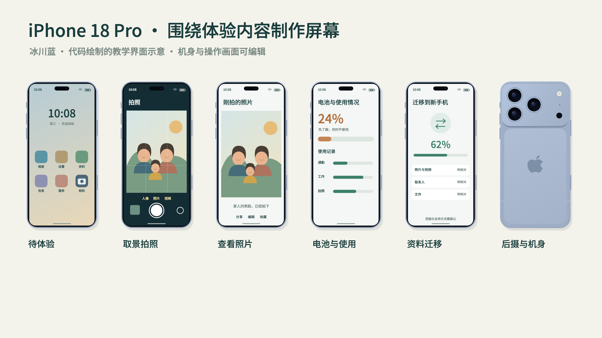
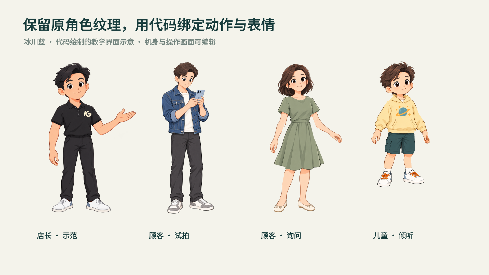
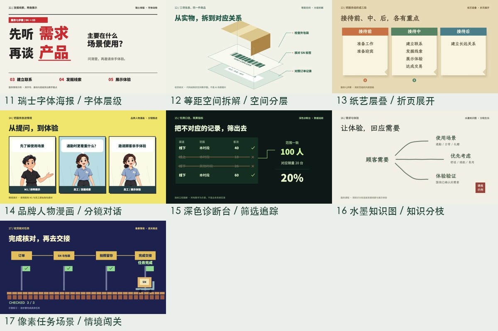
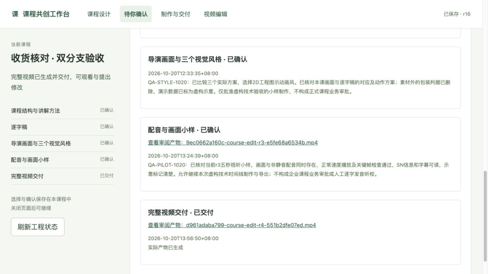

# 酷果星创 · 把知识做成看得进去的课程


**100种可调用动作 · 24种视觉风格 · Apple产品与门店素材 · 可持续扩展。**

看文字怎样排、信息怎样对应、步骤怎样推进、人物怎样配合知识点。给AI一份原始资料，从课程设计到独立课件或有声视频，把知识做成可以讲、可以看、可以继续改的作品。

**[安装 Skill v5.8.2](https://github.com/hebokenn/kgxc-corporate-course-skill/releases/download/v5.8.2/kgxc-course-suite-v5.8.2.zip)** · [下载全部展示视频](https://github.com/hebokenn/kgxc-corporate-course-skill/releases/download/v5.0.0/kgxc-course-effects-17-v1.zip) · [下载可编辑样片工程](https://github.com/hebokenn/kgxc-corporate-course-skill/releases/download/v5.0.0/kgxc-course-effects-17-editable-v1.zip) · [使用指南](docs/USAGE.md)

支持 **Codex / WorkBuddy** · [17个独立播放器](docs/SHOWCASE.md) · [开始做第一门课](#开始做第一门课)

## 5.8.3：参考片讲解方法与本地声音库

新增可按名字调用的讲师引题、情境演示、人物说听回应、焦点返回和逐项对照方法；用本课内容与已确认美术实现，不复制参考片角色或画面。章节页补查对应的任务口播，已有等价衔接不重复改稿。

声音按句意安排提问、邀请、提醒和总结的起伏；保留原音色与重新VoiceDesign的候选分别试听，不声称Base克隆支持情绪指令。`voice_library.py` 可注册、列出、核验和调用Skill之外的本地参考声音；参考片、裁段、克隆身份和私有音频不进入公共源码或安装包，注册不会改变默认；用户明确指定后可保存默认男女声，并用`--gender male|female`或`--voice 名称`调用。

[参考片方法](skills/corporate-training-motion/references/43-reference-teaching-and-voice.md) · [声音用法](docs/VOICE.md) · [验证范围](docs/V5.8.3-VERIFICATION.md)

## 5.8.2：按内容导演与关键时刻复核

自动恢复交接现在明确连接人物演出与按内容导演方法。新增 `direction-check`，从当前工程的口播、对象、动作、人物姿态、镜头/标签边界和时间映射生成检查计划；不使用某一课的布局、帧号、角色组合或动作数量作为模板。已有状态、编码像素、工艺与真实验收边界保持。

[制作方法](skills/corporate-training-motion/references/42-content-directed-production.md) · [验证范围](docs/V5.8.2-VERIFICATION.md)

## 5.8.1：长课程对象证据的批量解码

对象证据复用已有平衡表达式，修复数百提帧条件直接相加导致的FFmpeg解析深度失败。新增900个实际编码帧、300个对象事件的合成回归；不减少证据、不放慢动作，也不改变人物演出、视听或用户验收的边界。

## 5.8.0：人物反应、视线与对象证据

C01顾客与S01店员各自的原图标定接入正式工作台：眉眼连续形变、闭口情绪、视线、独立眨眼、短促点头和已验证范围的关节动作，共用预览、编辑与MP4导出。它属于正面二维演出，不承诺自然行走、接物或逐音素口型；其他人物需重新标定。

导演从动态分镜、实际对象和工作动词编排起态、过程、结果与反应。新工程按明确状态断言与目标隔离像素检查最终MP4；字幕高度参与排除，整场observe不能豁免需要演示的内容。结果能停稳读清，技术、工艺和用户认可分别保留。已有冻结课程不自动重渲染。

[导演与人物演出用法](skills/corporate-training-motion/references/41-direction-and-performance.md) · [使用指南](docs/USAGE.md)。本次公共发布仅含通用源码、已有角色资产与合成测试，不包含私人课程、音频或成片。

## 5.7.5：白色工作台与实际配色检查

设计、剪辑与资源预览界面统一白色和中性灰，工具界面不参与视频导出。新小样冻结时保留与视频哈希匹配的实际导出范围，确认只记录展示区间的配色；整课扩展检查画布、文字、容器与线条，不凭相同风格名放行新增灰绿卡片。保留原本确认的其他颜色方向及有依据的产品内容色。

## 5.7.3：总部授课立场与导航显示边界

酷果课程代表总部团队发展中心直接讲工作要求、操作、服务和管理动作，来源核验留在制作记录；全稿、字幕、标题与练习分别复核，不能只做来源关键词替换。章节导航仅在正式教学小节中显示，封面、品牌片头、导入、目录、总结和片尾隐藏；编码视频另查真实显隐边界。

## 5.7.2：发音、目录与成片同步复查

英文名称区分整词与字母缩写；标准字幕与配音输入分开记录，优先用相同声音重生成完整语义段，并从编码MP4核对全部重复位置。目录的章节名与口播任务逐项对应，当前高亮及章节进度使用同一实际时间线；返修先确认正在服务的课程编辑器与源码。某次有效参数不成为所有课程的默认，也不自动重配冻结录音。详见[配音指南](docs/VOICE.md)与[使用指南](docs/USAGE.md)。

## 5.7.1：随视觉风格设计的课程导航

后续视频课程包含画面底部的课程进度条；两节及以上必须有目录页和每节独立标题页，单节课可省略目录与小节标题页。进度条随所选视觉风格调整配色、字体、线条、材质和标记形式，同一课程内保持统一，不能所有课程套同一个外观。

目录、标题页、正文与当前进度共用章节表，进度依据实际成片时轴同步并避让字幕。三种风格预览及有声小样显示对应导航，完整视频检查实际编码画面。原稿已分节并有开场路线时只补画面设计，不机械重写口播；旧课不自动重制。这是制作规则更新，不宣称渲染器新增了自动导航功能。

[导航与章节要求](skills/corporate-training-motion/references/03-visual.md#课程导航与章节呈现) · [使用指南](docs/USAGE.md)。

## 5.7.0：100种业务动作、24种视觉方案与空间约束

100种动作都有实际门店任务、对象、起态和结果，通过同一课程渲染器调用；交接记录、岗位泳道、Apple设备、表单与操作替代三色块占位。新增52种动作，缓动、配色和材质不计入动作数量。


24种方案涵盖原角色讲解、门店情境、白板推导、水彩绘本、纤维纸雕、网点漫画、蓝晒工程图、界面操作和规则沙盘。四种立体方案分别使用本地Blender建立金属外观分层、黏土AirPods与Apple Watch、完整低多边形门店和透明斜置设备面板，保留独立几何、程序材质、PNG与blend源文件。它们是可调用静态素材，课程动作由节点驱动。参考Kurzgesagt、TED-Ed、3Blue1Brown、Crash Course、Animagraffs等官方作品和开放项目的视觉组织，不复制其角色或影片；风格JSON支持后续增改。

讲师、蓝衣KG店员和顾客默认绑定7位原批准角色；56份同源PNG提供纸本、水彩、漫画、像素等处理，身份与胸标保持对应。新增人物不再静默退回通用橙衣人。


商品限Apple及无其他品牌的Apple适配配件，包括具名iPhone 18 Pro、iPad、Mac、Apple Watch、AirPods与Apple配件。26种物件及3种门店场景进入实际画廊，另保留100个可选代码顾客组合，共129对透明SVG/PNG；代码顾客不充当公司人员。附30个Lucide ISC图标、36个Kenney CC0家具视角及9个GLB，仅用于操作符号与门店设施。

**后续课程必查人物落地、物件支撑和文字避让。** 人物按可见脚底定位，设备底座绑定实际桌面点；渲染器逐帧核对已登记接触关系和人物文字避让。新工程逐场要求支撑、排版与当前编码画面的复核记录。照片标签必须绑定实际图像尺寸与目标点，标签按对象顺序排列；说明、产品标签和字幕独立留区。返修沿所有复用位置排查，再检查动作进入、运动中和停稳后的画面。

本地素材注册、哈希暂存、照片平涂/线稿和可选Blender导出支持后续扩展；本次没有调用生图。用户门店实拍及衍生图仅保留在本地素材库，不进入公共源码、展示图或安装包。新规则不静默改写冻结课程。

[调用与扩展](skills/corporate-training-motion/references/40-library-direction-assets.md) · [空间与文字规则](skills/corporate-training-motion/references/39-visual-hygiene.md) · [验证范围](docs/V5.7.0-VERIFICATION.md)。自动约束覆盖已登记对象，技术采样不能代替实际看图、整课视听或用户最终验收。

## 5.6.0：逐场检查对齐、箭头和动画残留

完整视频交付前检查每个场景的人物与容器对齐、箭头端点和动画结束状态；局部返修时沿复用对象排查全片同类问题。新工程的完整候选需有绑定当前MP4与工程哈希的逐场编码画面证据，缺少场景、旧图或预览图不能通过。可见轮廓测量工具帮助识别透明图片留白造成的假居中，保留有意的非对称构图。

连接动画的移动点默认在完成后消失；有业务意义的终点可显式保留。普通箭头使用干净的逐笔路径。旧冻结工程不因安装更新自动改写。桌面成品按一门课程一个文件夹归集，当前视频、字幕与封面同放，历史版本、小样和工程过程文件分别保存。

[逐场检查用法](skills/corporate-training-motion/references/39-visual-hygiene.md) · [验证范围](docs/V5.6.0-VERIFICATION.md)。自动检查核对证据完整性与真实像素，实际美观、动态适配和用户验收分别记录。

## 5.5.0：封面、首尾口播与后期时间线一起交付

完整视频新增独立封面门槛：在320×180缩略图中检查课程名、构图和原版Logo，并核实实际视频首帧或播放器poster。缺少当前版本封面记录、旧视频哈希、只有一张图片而未接入播放器的候选，不算完成。旧冻结工程保留原约定。

新增可复用后期工具，将画面、语音、字幕和章节按同一基准提速，支持只升旁白音调、保持音乐音高，保留原版和分轨；首尾固定话术需从实际编码片段核对。倍率、音调和封面美术服从当前用户选择，不把某一课的1.1倍或升调值设成通用规则。

[封面与后期用法](skills/corporate-training-motion/references/37-cover-and-delivery-finish.md) · [验证范围](docs/V5.5.0-VERIFICATION.md)。技术检查不代替实际审美观察、试听或最终用户认可。新增外来经验的批判吸收规则：不照搬其他课程的speaker、CPS、F0或EQ参数；按实际时间锚点检查音画衔接，结束语先语义查重。

## 5.4.0：课程清楚、画面美观、配音自然，分别复核

新增适用于不同 AI 的课程工艺流程：按内容选择表现，复杂或易重复的段落比较有依据的方案，再对实际渲染的构图、字体、配色材质、插画、留白比例和视觉节奏分别复核。重复构图只提示导演判断；连续比较同一张表可以保持位置，不以动效数量或自评分冒充质量。

配音明确要求普通、自然的培训语气，标准普通话，干脆利落、停顿适度，速度不拖沓；整课尽量使用同一已确认参考声线，并检查衔接和完整尾音。新工程默认保存独立审美与声音复核要求，最终记录绑定当前视频、文档和早中晚段的实际编码画面；编码像素检查不能替代审美判断或真实试听。

[制作规则](skills/corporate-training-motion/references/36-course-craft.md) · [使用方法](docs/USAGE.md) · [配音要求](docs/VOICE.md) · [验证范围](docs/V5.4.0-VERIFICATION.md)。沿用有效确认，保留个人声音配置和历史冻结课程。规则无法保证每个 AI 的主观审美达到同一水平，也不宣称自动保证最佳课程效果。

## 5.3.0：视觉风格与内容动效分别设计

三选一比较配色、字体、图形材质和画面气质，确定整课美术方向。人物交流、表单操作、流程流转、对比、镜头和转场仍按每段内容组合，全部动效库保持可用，不能把小样扩成同一模板的反复播放。

工作台新增 `style_scope=visual`：视觉规范与分镜动作分开保存。正常增加内容镜头或动作不使已选风格和冻结小样批准失效；改变美术规范、声音、字幕、渲染源码或冻结MP4仍触发受影响复核。完整导出继续核对当前完整制作版本；旧工程不自动迁移。

[使用说明](docs/USAGE.md) · [验证范围](docs/V5.3.0-VERIFICATION.md)。此规则更新不等于已完成任何课程的视觉重制或用户验收。

## 5.2.2：学员不依赖原始附件也能听懂

默认学员只拿到课程成品。首次提到表单、图表、制度或界面，先交代名称、用途与当前要看的内容；判断或操作必需的字段、数值和条件直接纳入课程。不能默认学员拥有制作端的 Excel、PDF、手卡或工程包。

逐字稿在配音前按“没有原件”的视角通读；制作后再检查实际口播、字幕和画面标题。讲到具体子项时，同时定位该项及所属维度；“表里”“原表”等指代需要清楚前文。语义检查由制作端执行，结构校验和编码通过不能替代。

[具体规则与改写示例](skills/elearning-course-design/references/learner-context.md) · [验证范围](docs/V5.2.2-VERIFICATION.md)。本次更新不自动修改已确认逐字稿、既有配音或已交付视频。

## 5.2.1：拦截穿字高亮与漏胸标

实际审阅继续发现了固定宽度高亮穿过右列文字、蓝衣店员误用无标原图的问题。本版把文书高亮绑定到具体行，并在实际预览和导出中测量字体范围，检查框线与左右列。高亮窗口不重叠；改字或位移后不合布局会报错停止导出。

店长和蓝衣男女店员必须带原版 KG，Coach 保留 MyCoach。新增完整角色入口；直接裁切已知无标公司原图、胸标未覆盖人物时间窗，也会被检查拒绝。检查范围和具体调用见 [文字边界与门店胸标](docs/LAYOUT-UNIFORMS.md)，不把这些规则宣传为自动判断全部视觉遮挡。

## 5.2.0：按课程内容制作素材，具名手机与角色接触姿态

新增可编译为工作台普通节点的代码素材：手机机身与七类屏幕、文书/票据、外箱及角色表现。对象的结构、内容、状态、景别与操作按本句讲解设计，素材库不限制新增画法。iPhone 18 Pro 有独立的官方参考、机身比例、正背侧视角与配色；界面明确标为教学示意。



顾客原图分层、表情与姿态分别登记。实际审阅指出旋转松开手掌会产生错误握持，因此该捷径已在入口禁用；C01 修订为看向自己屏幕、手指握边的接触姿态，手机由代码绘制并位于自己的手部遮挡之后。黑衣 M1 必须带原版 KG 左胸标，与原有动作网格使用相同位置。角色修订仍是待课程小样审阅的候选，不将新图生成或技术检查冒充用户认可。

**角色定义：店长是黑衣 KG，店员是蓝衣，Coach 是黑衣 MyCoach。** 当前与后续新制作使用同一角色配置，保留历史冻结文件。



[创建、修改与调用代码素材](docs/CONTENT-ASSETS.md) · [角色制作方法](docs/CHARACTERS.md) · [5.2.0验证与范围](docs/V5.2-VERIFICATION.md)

## 5.1.1：动作按具体讲解发生，纠正慢放填时长

5.1.0的有声连续样段在实际观看中暴露了问题：局部交接、回填和描线被拖到整句的5～12秒，动作虽在执行，却没有继续展现下一句的操作、结果和反馈。此前的技术通过不能视为教学效果通过，该样段不再作为合格节奏示范。

新课把旁白窗口、单次动作和停稳读图分别安排。逐句说明正在解释的对象、用途与结果，动作绑定实际词句和时刻；普通过长位移与揭示会被检查拦下。编码验证改用动作真实起、中、末帧，快速点击无需放慢以迁就2fps采样。完成整课前还要记录正常速度连续复看，判断动作是否适合本句，技术计数不能代替观看。

[具体调用和修改方法](docs/MOTION.md) · [5.1.1修正及验证边界](docs/V5.1.1-VERIFICATION.md)

48种动作、17类构图、B2默认声音及角色创建能力保留；调用数量是可用能力，不是每门课必须凑齐的指标。

## 5.1.0：整课实际动效与虚拟角色

**48种动作已接入工作台的同一预览、编辑和导出入口**，其中37种是教学对象的操作、比较、判断、路径和反馈，另有8种文字/强调和3种符号描绘。17类教学构图可带入本课数据和实际旁白节拍；原有展示片保留在下方作为视觉参考。风格、配色、缓动和速度变化不计作新的动作。

为防止小样扩成全片后变成静止页面，新视频工程必须登记逐段对象动作与读图停留；导出前检查实现和旁白覆盖，编码后检查实际主体画面及运行回执。批准小样绑定实际动效代码；缺少逐段导演复核时，完整MP4仍是待审候选。检查用于发现问题，不能代替真实听看或自动保证审美。

[48种动作、17类构图与实际调用](docs/MOTION.md) · [本版验证范围](docs/V5.1-VERIFICATION.md)

**新增 C01 牛仔便装男性、C02 绿裙女性、C03 卡通卫衣儿童顾客**，配有已确认设计板、独立透明全身原图、同源半身取景、表情/姿态设计、profile及提示词。角色采用日常服装，与原品牌店员区分。

[创建、换衣、修改表情与动作的方法](docs/CHARACTERS.md) · [角色素材与确认记录](skills/corporate-training-motion/assets/characters/kgxc-customers-v1/catalog.json)

B2默认旁白及natural-ui-v1自然界面音效继续沿用。更新保留个人声音配置和既有课程；新顾客已验证静态全身、半身和图解站位，**自然走路、接物和关节动画需要该角色单独绑定与验证**。

## 5.0.3：B2 默认旁白与自然界面音效

**默认 B2 清亮平和教学男声**，沿用已确认整课的声音描述与 1.1 倍保音高交付节奏。它是默认选项；也可以选择其他九种预设、用文字调整音色，或用自己的参考录音与逐字文本克隆声音。一次换声与“以后默认”分开保存；既有课程保留原录音。新安装默认 B2，更新保留个人选择，主动切换可用 `--voice-profile B2`。

[如何切换、克隆和修改配音](docs/VOICE.md) · [B2 原始参考](skills/corporate-training-motion/assets/voice/B2-reference.wav) · [实际声音配置](skills/corporate-training-motion/assets/voice/profiles.json)

**音效改为 natural-ui-v1：15 类动作、45 个常用 WAV，另附 100 个 Kenney CC0 原始素材。** 覆盖点击、构建、移动、放大、缩小、出现、消失、旋转、增长、收拢、揭示、聚焦、确认、切换和提醒。常用素材经短切和柔化，取代上一版的滤波噪声生成器；动作对位、语音避让和静音留白可编辑。

[15 类动作有声试听 MP4](docs/media/natural-ui-audition.mp4) · [45 个声音逐项试听 HTML](skills/corporate-training-motion/assets/sfx/natural-ui-v1/audition.html)（下载后打开） · [音效库及替换方法](docs/SOUND.md) · [本版验证范围](docs/V5.0.3-VERIFICATION.md)

## 5.0.2：继续制作，自动选择渲染方式

在已知课程工程的对话中说“继续制作”，制作端会恢复已有确认，读取构图与导演需求，选择基础图解、内置动效或实际原生渲染，并接好当前阶段需要的动作。逐字、模糊、遮罩、渐变、描线、强调与镜头已接入，画面文字仍按整段编辑。新对话先提供课程工程目录即可。

5.0.2 曾使用 soft-tactile-v1：落位、位移、展开、聚焦、确认、转场、提醒共 7 类 21 个本地 WAV，按动作选择并轮换，支持留白。5.0.3 的新音效默认见上方；旧库保留用于历史课程。原始旁白和有效确认保留，已完成工程不因恢复自动重制。详见[选路说明](skills/corporate-training-motion/references/30-renderer-selection.md)、[动作音效](skills/corporate-training-motion/references/31-action-sound.md)和[本版验证](docs/V5.0.2-VERIFICATION.md)。

## 先看80秒成品

无旁白，用BGM和动作音效串起17种具体的教学效果。1920×1080，30fps。

https://github.com/user-attachments/assets/d66985f1-e143-4a30-83d4-336f45908d54

[下载网页版MP4](docs/media/capability-showreel.mp4) · [下载全部原画质视频](https://github.com/hebokenn/kgxc-corporate-course-skill/releases/download/v5.0.0/kgxc-course-effects-17-v1.zip)

本组新样片与宣传片由 **huashu-motion** 基于既有课程内容、原公司角色和动效资源制作。下方另有原生WorkBuddy 9秒导出，标明实际来源，方便对照。

## 新增7种视觉风格



每支都是8秒独立MP4。展开即可在GitHub内播放，也可以[一次下载全部视频](https://github.com/hebokenn/kgxc-corporate-course-skill/releases/download/v5.0.0/kgxc-course-effects-17-v1.zip)。

<details>
<summary><strong>11 · 瑞士字体海报 / 字体层级</strong></summary>

服务七步骤中的发掘线索与展示体验。大字遮罩上升；基线游标切换；提问层级建立。

https://github.com/user-attachments/assets/129abcc7-cdab-4aca-8679-97cda4269ab6

[下载独立MP4](docs/media/sample-swiss.mp4)

</details>

<details>
<summary><strong>12 · 等距空间拆解 / 空间分层</strong></summary>

外包装、SN标签与订单记录的对应关系。包装和信息层沿空间轴拆开；引线逐层标注。

https://github.com/user-attachments/assets/5b539c55-b9aa-45ed-99b1-0a9ebc5ce42d

[下载独立MP4](docs/media/sample-isometric.mp4)

</details>

<details>
<summary><strong>13 · 纸艺层叠 / 折页展开</strong></summary>

将服务七步骤分为接待前、中、后。三层纸面依次翻开；露出对应步骤；折角和投影随动。

https://github.com/user-attachments/assets/b9b4d6a5-3bf4-4661-a1a6-cb5a07068b0f

[下载独立MP4](docs/media/sample-papercut.mp4)

</details>

<details>
<summary><strong>14 · 品牌人物漫画 / 分镜对话</strong></summary>

从了解使用场景，到邀请顾客亲手体验。三个分镜推进；原始M1与员工角色入画；气泡弹出。

https://github.com/user-attachments/assets/9ea812c4-e1a9-4642-8efd-c498afc8566d

[下载独立MP4](docs/media/sample-comic.mp4)

</details>

<details>
<summary><strong>15 · 深色诊断台 / 筛选追踪</strong></summary>

只把范围对应的线下客流用于示意计算。无关记录划除；信号连入结果；同口径数字聚合。

https://github.com/user-attachments/assets/c6a58b13-cb9e-46c9-8ae2-5eb01635abff

[下载独立MP4](docs/media/sample-terminal.mp4)

</details>

<details>
<summary><strong>16 · 水墨知识图 / 知识分枝</strong></summary>

使用场景、优先考虑与体验验证。手绘分枝生长；知识节点顺势展开；朱印收束。

https://github.com/user-attachments/assets/2738bee1-8b12-484a-bfe6-b64a57efd578

[下载独立MP4](docs/media/sample-ink.mp4)

</details>

<details>
<summary><strong>17 · 像素任务场景 / 情境闯关</strong></summary>

按订单、SN与包装、照片完成交接前核对。商品小车经过任务站；逐关插旗；任务完成反馈。

https://github.com/user-attachments/assets/b0a91e06-b2a0-44c7-a6ca-e99c49a020eb

[下载独立MP4](docs/media/sample-pixel.mp4)

</details>

## 10种教学动效，逐条看


扫描、拆解、连线、手势、放大、纠错、重排、反馈、补位、聚合。每种动作都围绕实际课程知识点展开。

<details>
<summary><strong>01 · 扫描连线 / 工程蓝图 · 10秒</strong></summary>

订单与商品SN对应。扫描线扫过标签；连线连接同一SN；逐项勾选。

https://github.com/user-attachments/assets/b9cb36c9-e6bf-4b3f-ac22-890e83f44521

[下载独立MP4](docs/media/sample-blueprint.mp4)

</details>

<details>
<summary><strong>02 · 公式拆解 / 编辑式排版 · 10秒</strong></summary>

线下主机转化率的分子与分母。分子分母归位；分数线展开；圈出对应范围。

https://github.com/user-attachments/assets/4b709201-255c-4baf-a5be-0ba3543c68b4

[下载独立MP4](docs/media/sample-editorial.mp4)

</details>

<details>
<summary><strong>03 · 逐笔路径 / 手写白板 · 10秒</strong></summary>

顾客服务七步骤。路径逐笔绘制；步骤连续展开；手绘圈注。

https://github.com/user-attachments/assets/a9086358-c463-49b2-88cc-9f082d1dbd76

[下载独立MP4](docs/media/sample-whiteboard.mp4)

</details>

<details>
<summary><strong>04 · 人物手势 / 公司虚拟讲师 · 10秒</strong></summary>

M1讲解收货三项核对。连续网格抬手、眨眼与知识点选中协同。

https://github.com/user-attachments/assets/12c5efa5-d6f2-4e30-b60b-a50259ecf42e

[下载独立MP4](docs/media/sample-presenter.mp4)

</details>

<details>
<summary><strong>05 · 聚光放大 / 细节检视 · 8秒</strong></summary>

收货时读取并核对SN。背景压暗；局部放大；引导线接入核对位置。

https://github.com/user-attachments/assets/a2adf5be-3ee2-4fc2-9e7d-c6aebded7b65

[下载独立MP4](docs/media/sample-spotlight.mp4)

</details>

<details>
<summary><strong>06 · 对比纠错 / 双栏对照 · 8秒</strong></summary>

回查实物后纠正示意编码的末位。差异抖动；末位替换；由异常切换为对应状态。

https://github.com/user-attachments/assets/1d11a7ad-c4a0-4266-b3c9-eaa942e0612e

[下载独立MP4](docs/media/sample-correction.mp4)

</details>

<details>
<summary><strong>07 · 排序归组 / 流程卡片 · 8秒</strong></summary>

核对订单→核对SN和外包装→拍照→确认对应完成交接。四张内容卡从错序移动到对应步骤。

https://github.com/user-attachments/assets/55e2d65e-4dd3-4a86-9743-0ce6e8a9b8fc

[下载独立MP4](docs/media/sample-sorting.mp4)

</details>

<details>
<summary><strong>08 · 练习反馈 / 课中问答 · 8秒</strong></summary>

交接前确认三项信息对应。预设选择；错误解释；正确答案与反馈显现。

https://github.com/user-attachments/assets/261f7281-61e4-42ed-81d7-1d8a73f33372

[下载独立MP4](docs/media/sample-quiz.mp4)

</details>

<details>
<summary><strong>09 · 时间轴编排 / 排班信息图 · 8秒</strong></summary>

该时段在岗覆盖不等于全天人数。任务区间移动补位；时段覆盖数同步变化。

https://github.com/user-attachments/assets/7ee4f707-2dfd-414f-8f1b-1be9e7685766

[下载独立MP4](docs/media/sample-timeline.mp4)

</details>

<details>
<summary><strong>10 · 数据聚合 / 量化教学 · 8秒</strong></summary>

示意100人接待、20台销量与20%转化率。100条记录选出20条；聚合成分子；比例显现。

https://github.com/user-attachments/assets/b1eb5814-4ed0-426d-85f3-64af771e163c

[下载独立MP4](docs/media/sample-data.mp4)

</details>

## 原生WorkBuddy与独立课件

### WorkBuddy实际导出的9秒正文

核对订单、检查SN、拍照留存、确认对应、完成交接。保留原画面与原声音。

https://github.com/user-attachments/assets/a3710430-2c9f-482e-8d03-6fb9078e4471

[下载原始MP4](docs/media/v5-course-demo.mp4) · [查看字幕](docs/media/v5-course-demo.srt)

### 课件路线，交付后就能自己讲

WorkBuddy实际生成的6页HTML课件，包含目标、讲解、示范、练习与反馈，交付独立课件与逐字稿。


[查看课件源码与下载](docs/media/courseware-demo.html) · [查看练习页](docs/media/courseware-exercise.png)

<details>
<summary>播放实际课件页面展示</summary>

https://github.com/user-attachments/assets/10078738-05f7-4fcd-84fb-c60ce0863921

</details>

收货商品、编码、数字和情境为教学演示；17支样片、原生WorkBuddy短片和课件页面分别列出。[素材来源与演示范围](docs/media/README.md)

### 保存之后，还能继续改


画面文字、字幕、素材与时间轴可继续调整，原始素材与录音随工程保留。展示样片工程包含17支独立源项目与总片镜头表，可用huashu-motion打开、修改与重新导出。

## 一门课，先共创，再制作

**共同前段：原始素材 → 推荐讲法与课程大纲 → 你确认 → 完整逐字稿 → 你确认。**

按 ATD 教学设计思路，将资料拆成工作任务、学习目标、内容取舍、示范与练习。关键选择有具体建议和理由，确认原话、时间与关联版本随工程保存。

| 想自己讲、自己录 | 想直接拿到视频 |
| --- | --- |
| 制作独立课件，交付课件与逐字稿 | 启动导演，确认三个风格之一，再确认有声画面小样 |
| 完成本次交付；以后仍可追加视频 | 小样确认后生成完整 MP4、SRT 与可编辑工程 ZIP |

**课件与视频是两条独立路线。** 后续追加视频时，从仍有效的已确认逐字稿和原始素材启动导演，保留已有课件；生成的课件、页面布局或截图不作为视频制作基础。原始输入本来包含的 PPT 可以作为来源。

## 对话换了，工程还在



方案、逐字稿、当前分支、用户选择和确认记录保存在课程文件里。新建与恢复默认打开实际工作台；在独立新对话提供工程目录，即可读回进度并继续。

```sh
kgxc-course resume ./courses/my-course
```

也可以双击课程中的“打开课程工作台.command”。工程 ZIP 带上来源、导演方案、预览、确认记录、媒体与独立编辑器，方便后续修改和交接。

## 安装或更新

**[下载 v5.7.5 可安装更新包](https://github.com/hebokenn/kgxc-corporate-course-skill/releases/download/v5.7.5/kgxc-course-suite-v5.7.5.zip)** → 解压 → 双击 **安装或更新.command**。

默认更新 Codex 和 WorkBuddy 中的两个课程模块，保留现有媒体、配音环境和个人选择。更新后开启新对话，调用 `$corporate-training-motion`。

<details>
<summary>命令行安装、新机器准备与校验文件</summary>

已有媒体环境，仅更新 Skill：

```sh
./install.sh --skill-only --agent both
```

新机器准备完整环境：

```sh
./install.sh --agent both
```

完整安装首次需要联网下载媒体依赖和本地 B2 VoiceDesign 模型，目前完整环境验证范围为 macOS Apple 芯片。只安装 WorkBuddy 使用 `--agent workbuddy`。

安装器保护已有自改 Skill；明确替换时添加 `--replace-skill`，先备份再更新。联合包包含 `corporate-training-motion 5.6.0` 与 `elearning-course-design 2.0.1`，日常只需调用统一课程入口。

[SHA256SUMS 校验文件](https://github.com/hebokenn/kgxc-corporate-course-skill/releases/download/v5.6.0/SHA256SUMS) · [依赖说明](docs/DEPENDENCIES.md) · [完整安装与使用指南](docs/USAGE.md)

</details>

## 开始做第一门课

把资料放进课程工作目录，在 Codex 或 WorkBuddy 新对话中输入：

```text
请用 $corporate-training-motion，把我提供的资料做成一门门店培训课。
先打开工作台，诊断原始素材，推荐讲解方法与大纲，等我确认。
再写完整逐字稿，确认后由我选择做课件还是做视频。
做视频时，从逐字稿启动导演，给出三个视觉风格，
确认后制作配音与画面小样，再经我确认后完成整片。
```

适合制度解读、门店业务流程、系统操作、新人带教和岗位协作。课程目标、业务事实与画面选择由你和 AI 一起核对，关键阶段主动确认。

## 使用前可以核对的事实

5.0.2 已完成 **71 项技能自动回归、7 项安装测试及 5 组既有脚本检查**，并验证发布包隔离安装和重复更新。已从 WorkBuddy 实际安装目录验证本版恢复与有声技术片导出；原生宿主模型对新增自动选路的调度、用户对新音效的主观听感尚未验收，见[本版验证](docs/V5.0.2-VERIFICATION.md)。

5.0.0 的原生 WorkBuddy 验收已验证新对话文件恢复、服务重启后默认打开工作台、独立课件交付、确认记录保存、有声小样与完整短视频导出。

宿主整片验收使用准备好的短技术夹具；真实自动上下文压缩、任意长课的创作质量和学习效果没有据此宣称通过。实际发现、修复和限制见 [V5 验收记录](docs/V5-VERIFICATION.md)。旧 v4 工程沿用原流程，安装更新不自动改写或重渲既有课程。

[使用指南](docs/USAGE.md) · [版本变化](docs/CHANGELOG.md) · [V5 验收记录](docs/V5-VERIFICATION.md) · [第三方与素材说明](THIRD_PARTY_NOTICES.md)

品牌与配套资源用于酷果星创内部课程。仓库不包含私人课程原件、个人凭据或模型权重。
