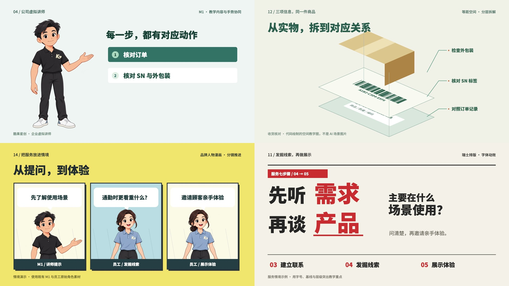
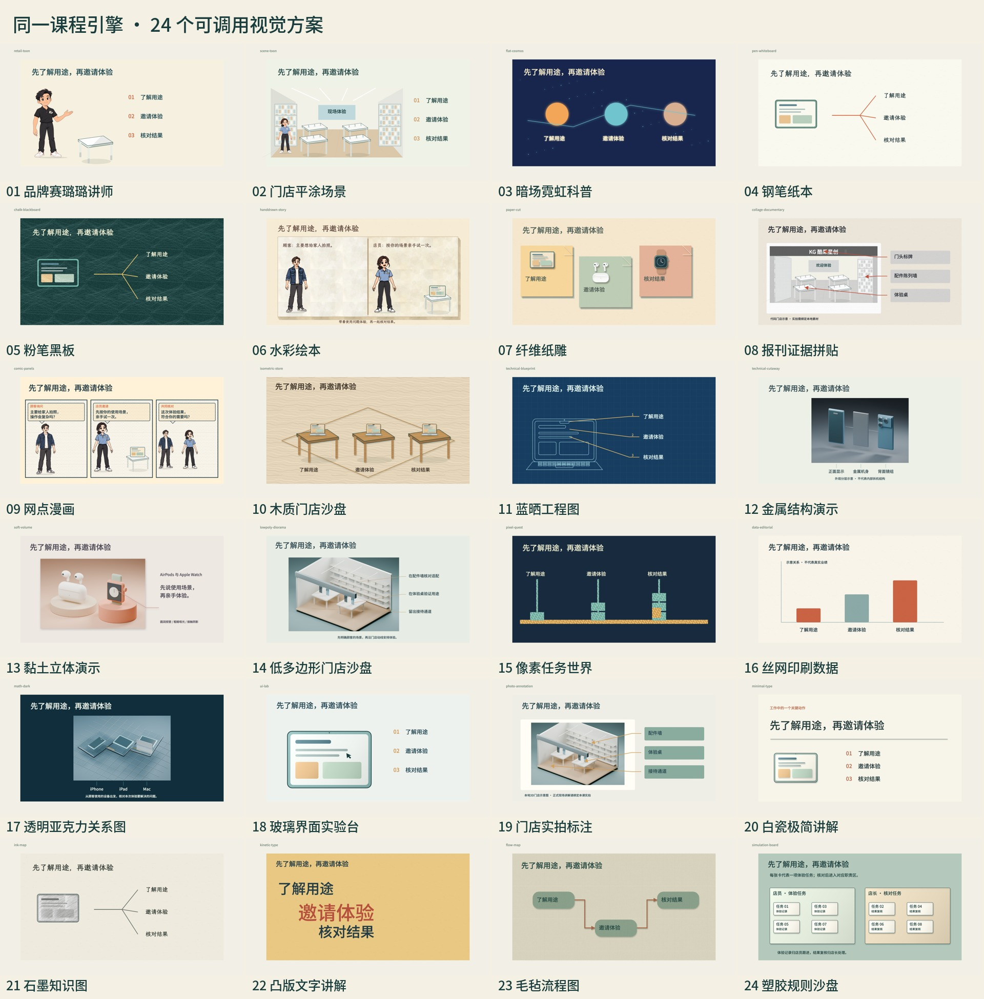
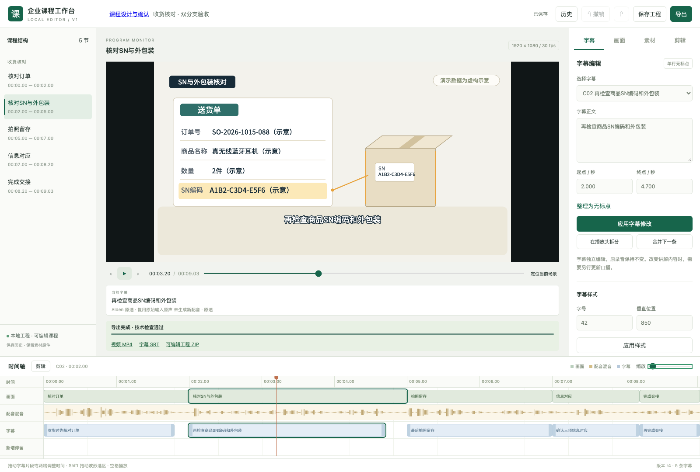
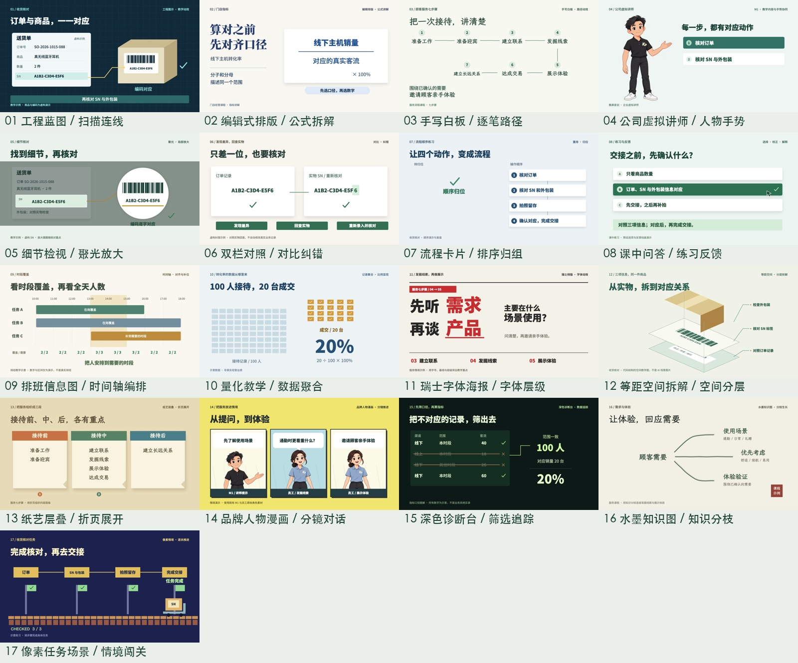
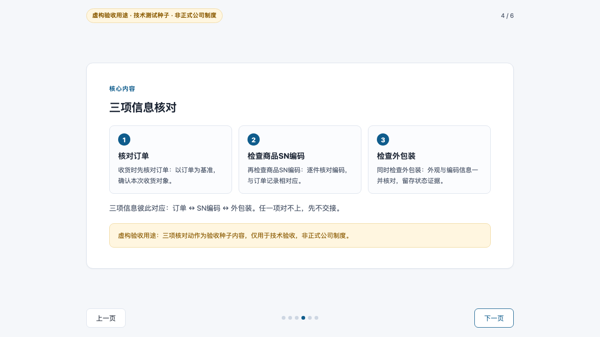

# 酷果星创 · AI 企业培训制课 Skill

**把 PDF、PPT、制度、手册和业务资料，做成可讲授的课件，或带配音、字幕和教学动画的完整课程视频。**

这是一套安装在 **Codex / WorkBuddy** 中使用的企业培训制作 Skill。你提供资料、培训对象和希望学员完成的工作，AI 按教学设计、逐字稿、画面导演、配音、编辑和交付的流程协助制作；你在关键阶段查看实际内容并确认。适合培训负责人、业务专家、门店管理者和带教同事，把工作经验与业务要求整理成可以反复使用、持续修改的课程。

一份资料可以先交付独立课件，也可以直接进入视频制作。课程方案、原件、讲稿、素材、配音和确认记录随工程保存，后续换对话、改内容或交接给同事时，可以从已有成果继续。



**教学设计与完整逐字稿 · 独立课件 / 有声视频 · 100 种可调用动作 · 24 种视觉方案 · 本地配音 · 可恢复编辑工作台**

[下载当前安装包 v5.8.6](https://github.com/hebokenn/kgxc-corporate-course-skill/releases/download/v5.8.6/kgxc-course-suite-v5.8.6.zip) · [开始做第一门课](#开始做第一门课) · [查看实际演示](#实际演示) · [完整使用指南](docs/USAGE.md)

[能交付什么](#它能帮你做什么) · [适用场景](#适合哪些培训场景) · [能力与价值](#核心能力与实际价值) · [制作流程](#一门课怎样完成) · [安装或更新](#安装或更新) · [版本更新](#版本更新)

## 它能帮你做什么

从“这里有一份业务资料”开始，先明确学员在什么场景下、需要作出什么判断或完成什么操作，再组织讲解、示范、案例和练习。随后编写可直接讲授或配音的完整逐字稿，按你的需求制作课件或视频。

| 你的需求 | 主要交付 | 怎样使用 |
| --- | --- | --- |
| 想自己讲课、带教或录制 | 按需求及宿主能力制作的独立 PPTX / PDF / HTML 课件，以及逐字稿 | 用于现场授课、线上分享、带教或自行录屏；课件交付即可完成本次制作 |
| 想直接拿到完整课程视频 | MP4 视频、SRT 字幕、课程封面，以及可编辑工程 ZIP | 用于内部学习平台、集中培训或自主学习；需要上传的平台由你决定 |
| 已有课程，想更新其中一段 | 修订的讲稿、相关配音与画面，以及重新检查的对应交付文件 | 业务条件、系统界面或讲解方式变化时，从课程工程继续修改 |
| 先要课件，以后再做视频 | 保留课件，从仍有效的已确认逐字稿和原始资料追加视频分支 | 共用内容基础，视频重新设计镜头与动作，保留两种交付形式 |

课程方案、来源记录和制作文件保留在工程中，方便追溯和返修。视频练习可以呈现问题、思考停顿、示范答案与反馈；可点击的交互取决于所选课件格式和实际实现。

## 适合哪些培训场景

| 场景 | 可以提供的资料 | 课程怎样讲 | 对培训工作的帮助 |
| --- | --- | --- | --- |
| 新人入职与岗位带教 | 岗位手册、工作清单、流程说明、常见问题 | 按真实工作顺序拆成任务，穿插操作示范、易错点和练习 | 把分散的口头经验整理成一致的带教内容，便于新人反复查阅 |
| 制度与标准作业流程培训 | 制度正文、SOP、通知、条件与例外说明 | 交代适用范围，用案例比较“何时这样做、何时需要另行处理” | 把条款转成可执行的判断与行动，保留原文中的条件和例外 |
| 收货、交接与信息核对 | 订单、票据、商品照片、编码标签、交接记录 | 同屏定位订单、实物与记录，逐项连线、核对、标出差异并演示处理 | 帮助学员看清具体核对位置、先后顺序和完成标准 |
| 销售服务与顾客沟通 | 服务流程、典型对话、顾客问题、正反案例 | 由讲师引题，进入店员与顾客情境，再回到提问、回应和服务要点 | 把抽象服务要求放回交流现场，让学员理解话术的用途与使用时机 |
| 系统与表单操作 | 实际截图、字段说明、操作步骤、成功与异常状态 | 依次展示入口、填写内容、操作反馈与结果，放大关键字段 | 让学员知道“在哪操作、填什么、完成后应该看到什么” |
| 店长经营与数据理解 | 指标定义、业务报表、计算示例、排班与覆盖要求 | 用公式拆解、同口径对比、记录聚合和时间轴解释数据 | 帮助管理者理解数字来自哪里、哪些数据能比较，以及判断需要哪些条件 |
| Apple 产品与体验教学 | 对应产品资料、设备照片、功能与演示步骤 | 结合设备示意、局部放大、状态切换和人物引导解释重点 | 把产品信息连接到实际观察与体验；精确型号和操作仍以对应资料核实 |
| 连锁门店与品牌内部培训 | 总部标准、品牌角色、统一流程和典型案例 | 沿用统一授课身份、角色、视觉与声音，按不同主题组织内容 | 方便持续制作系列课程，并在业务更新后保留可追溯的修订基础 |

当前内置角色、片头片尾和产品素材以酷果星创及 Apple 门店培训为主要场景。其他团队可以复用制课方法；涉及品牌、产品与角色的内容，需要准备相应资料并调整配置。

## 核心能力与实际价值

### 1. 先把资料变成课程，让学员知道如何用

先诊断素材、梳理工作任务和学习目标，再推荐讲解方法、课程大纲、示范与练习。逐字稿包含实际讲解、案例、过渡、提问和答案反馈；业务事实、条件、例外及资料疑义保留依据。

例如，收货资料中的“订单、SN 和外包装一致”，可以展开为：为什么要核对、到哪里看三个信息、怎样逐项对应、发现不一致时按什么依据处理，以及交接前如何再确认。培训负责人可以在制作画面前检查课程是否教到了真正需要的工作动作。

默认学员拿不到制作端的原始附件。首次出现表单或图表时，先讲清名称、用途和当前项目，把完成任务必需的字段与条件放进课程。这样只有视频的学员也能跟上讲解。酷果课程按总部面向门店授课的立场组织表达，来源追溯保留在制作记录中。

[教学设计模块](skills/elearning-course-design/SKILL.md) · [学员上下文与改写示例](skills/elearning-course-design/references/learner-context.md)

### 2. 按知识点安排动作，把过程、关系和结果演出来

内置 **100 种可调用动作和 17 类教学构图**，覆盖核对、操作、判断、对比、路径、信息流转、记录回填和反馈。制作时先确定本句要讲的对象、起始状态、变化和结果，再把动作安排到对应旁白时刻；动作完成后留出读图时间。

收货课可以让订单字段与商品标签逐项对应；指标课可以把记录聚合成分子、分母；服务课可以让人物提问、观察和回应。不同知识点使用适合的表达，让学员有机会看清“怎么发生”和“结果是什么”。动作数量用于提供选择，不要求每门课凑齐。

已有参考片方法可用于“讲师引题—情境演示—回到要点”“说—听—回应”“聚焦当前对象”和“逐项对照”。学习其组织方法后，用本课内容及已确认美术重新实现。普通操作保持利落，讲解时长由内容、示范和读图需要共同决定。

[动作与调用方法](docs/MOTION.md) · [按内容导演](skills/corporate-training-motion/references/42-content-directed-production.md) · [参考片讲解方法](skills/corporate-training-motion/references/43-reference-teaching-and-voice.md)

### 3. 视觉方向统一，每一段仍有适合的讲法

内置 **24 种视觉方案**，包括人物讲解、门店情境、白板推导、水彩绘本、纸雕、漫画、蓝晒工程图、界面操作和规则沙盘等。先用同一段课程内容制作三个实际预览，比较配色、字体、图形材质与画面气质，帮助你在整课制作前判断方向。

确定美术方向后，人物交流、表单、流程、对比、镜头与转场仍可按内容组合。例如同一门纸本风格课程，既能演示顾客对话，也能逐项核对票据；小样的版式不用反复套遍全课。

小样确认会保留实际展示区间与配色依据，整课扩展继续核对新增画面。适合制作系列课程时保持识别度，也方便在返修时判断哪些属于内容扩展、哪些改变了已选美术。



[风格、动作与素材的调用和扩展](skills/corporate-training-motion/references/40-library-direction-assets.md)

### 4. 用人物、设备和业务物件解释现场

素材库包含讲师、店长、店员、Coach、顾客，以及 Apple 设备、文书、票据、外箱和门店场景。角色身份与胸标对应：黑衣 KG 店长、蓝衣店员、黑衣 MyCoach 教练；讲解、服务和顾客角色可以在画面中各司其职。

已接入的 C01 顾客与 S01 店员支持各自原图标定的二维眉眼、视线、眨眼、点头和部分关节动作，可表现关注、倾听和回应。适合把服务要点放进短情境；这些能力的适用范围是正面二维演出，其他人物和新姿态需重新制作与检查。

手机屏幕、票据内容、字段高亮和对象状态可以按本句讲解制作。照片标注绑定实际对象位置，人物检查可见脚底，设备检查桌面或手部接触，文字为产品、说明与字幕留出空间。这样既便于解释具体业务对象，也能减少素材悬浮、指错位置和遮挡信息的问题。

本地原件可注册、按哈希暂存到课程中，风格与素材继续扩展；部分立体方案配有 Blender 静态素材与源文件。用户门店实拍保留在本地素材库。


[内容素材制作](docs/CONTENT-ASSETS.md) · [角色创建与修改](docs/CHARACTERS.md) · [人物演出范围](skills/corporate-training-motion/references/41-direction-and-performance.md)

### 5. 先试听声音，再让语气、发音和动作配合内容

完整新安装推荐 **didi 男声、pipi 女声**，未指定性别时使用 didi。这是我们选过、较适合常见培训讲解的两套推荐声音，参考音频、逐字文本和配置均随包提供；准备同一本地 Base 模型后即可直接生成。你可以按自己的课程和听感换声、调速、设计新音色或克隆参考，已有个人默认在升级时继续保留。

| 推荐语音 | 可先尝试的用途 | 同文案试听 |
| --- | --- | --- |
| didi · 男声 | 任务说明、步骤讲解与重点提醒，清晰轻亮、有自然起伏 | [点击试听 didi](https://raw.githubusercontent.com/hebokenn/kgxc-corporate-course-skill/main/docs/media/voices/didi-audition.mp3) · [下载 WAV](docs/media/voices/didi-audition.wav) |
| pipi · 女声 | 课程导入、概念解释与服务情境，清楚亲切 | [点击试听 pipi](https://raw.githubusercontent.com/hebokenn/kgxc-corporate-course-skill/main/docs/media/voices/pipi-audition.mp3) · [下载 WAV](docs/media/voices/pipi-audition.wav) |

两段均为 AI 合成，使用[同一段通用文案](docs/media/voices/audition.txt)、1.0 交付倍率，方便对照；也可下载[双播放器试听页](docs/media/voices/audition.html)后离线比较。推荐是开始制作的起点，正式课程仍先听包含本课内容的小样，再确认声音、语速与画面配合。

长课尽量沿用同一已确认声线，按完整语义段组织配音，检查响度、接缝和尾字。提问、邀请、提醒与总结按句意安排自然起伏；英文名称与字母缩写分别核对，字幕保留标准写法。适合含有设备名称、SN 等专业词的课程，避免字幕正确但实际读音仍有问题。

本地声音库支持注册中文或英文名称，分别保存默认男女声；以后可以按名字调用，减少重复准备参考的工作。单次选声、个人默认与课程既有录音分别保存。保持音色时可先调句子、标点、分段与交付速度；要用文字描述另一种音色，选 VoiceDesign；要复用自己的录音，选 Base 参考克隆。二者的模型和控制方式分别说明，新候选仍需试听。

动作音效库包含 **15 类动作、45 个常用 WAV**，可配合点击、落位、确认和提醒，并按局部人声避让。你可以先试听音效，再决定密度与留白，让声音帮助辨认动作。

[试听、语速与发音调试、换声及克隆指南](docs/VOICE.md) · [动作音效及逐项试听](docs/SOUND.md) · [有声动作试听片](docs/media/natural-ui-audition.mp4)

### 6. 让学员知道学到哪里，让成品方便上架

视频课程带有随视觉风格设计的底部进度条；两个及以上小节包含目录页和每节独立标题页。目录、口播任务与实际章节时间对应，正式教学区间显示进度，封面、片头、导入、目录、总结和片尾保留各自的画面空间。

多节课程中，学员可以知道当前学习任务及所处位置。导航同时避让主体与字幕，外观跟随整课美术，便于系列课程保持一致。

完整视频交付包含独立课程封面，在 320×180 缩略图中检查课名、构图与 Logo，并核对实际首帧或播放器封面。品牌片头片尾替换本课名称，首尾口播从实际视频核对。后期调整速度时，画面、声音、字幕和章节共用时间映射，保留原版及分轨，方便检查与返修。

酷果成品默认按一门课程一个文件夹归集到桌面 `ai 制课/<课程名称>/`，当前视频、字幕和封面同放，旧版与小样分别归档，工程和过程文件留在项目内；也可沿用你明确指定的交付位置。

[课程导航要求](skills/corporate-training-motion/references/03-visual.md#课程导航与章节呈现) · [封面与后期交付](skills/corporate-training-motion/references/37-cover-and-delivery-finish.md)

### 7. 检查实际成片，帮助发现影响理解与观感的问题

交付前分别复核课程是否讲清、构图与节奏是否合适、声音是否自然。逐场检查文字边界、高亮、人物对齐、物件支撑、箭头所指和动画结束状态；修改共用素材后，沿全片复用位置检查同类问题。

新工程的对象状态与画面证据绑定当前实际编码 MP4，动作按真实发生时刻检查；长课程的批量取证支持数百个对象事件。这样可以核对“导出的那一版”是否呈现了预期内容，也便于定位返修范围。

自动检查用于发现问题和核对证据；课程工艺还要查看实际构图、字体、配色、留白与正常速度节奏，配音还要真实试听。**技术检查、实际听看和用户最终认可分别记录**，便于你理解当前结果经过了哪些检查、还需要审阅什么。

[文字与胸标检查](docs/LAYOUT-UNIFORMS.md) · [逐场视觉检查](skills/corporate-training-motion/references/39-visual-hygiene.md) · [课程工艺复核](skills/corporate-training-motion/references/36-course-craft.md)

### 8. 用可恢复工作台持续改课，完成后释放资源

工作台保留场景、画面对象、字幕、素材、音轨和时间轴，支持修改已登记文字与位置、替换素材、调整停留、同步裁剪、撤销重做及再次导出。改字幕不会自动改变录音；讲解内容变化时，可让 AI 同步修订配音、画面与时间线。

方案、分支、用户选择、确认原话、时间和关联版本写入课程文件。换对话时提供工程目录，或双击课程中的“打开课程工作台.command”，可以读回已有进度。适合跨天制作、多人交接和业务更新，减少重新解释背景和重复确认；实际内容变更时复核受影响部分。

未变化文件的复核结果可复用，并发查询共用一次检查，隐藏页面暂停轮询。课程完成、无导出任务且空闲两分钟后，工作台自动退出，减少后台持续占用；导出、未保存编辑、播放和下载会延后关闭。文件与确认记录继续保留，返修时重新打开。



[编辑、裁剪与恢复操作](docs/USAGE.md) · [工作台自动关闭规则](skills/corporate-training-motion/references/27-content-workbench.md#完成后的自动关闭)

## 实际演示

### 80 秒教学效果混剪

无旁白，以 BGM 和动作音效串起 17 种具体教学效果，1920×1080、30fps。可以观察文字层级、对象对应、步骤推进与人物配合。

https://github.com/user-attachments/assets/d66985f1-e143-4a30-83d4-336f45908d54

[下载混剪 MP4](docs/media/capability-showreel.mp4) · [逐条播放 17 支独立样片](docs/SHOWCASE.md) · [下载全部原画质样片](https://github.com/hebokenn/kgxc-corporate-course-skill/releases/download/v5.0.0/kgxc-course-effects-17-v1.zip) · [下载可编辑样片工程](https://github.com/hebokenn/kgxc-corporate-course-skill/releases/download/v5.0.0/kgxc-course-effects-17-editable-v1.zip)



这 17 支展示片与混剪由 **huashu-motion** 基于既有课程内容、公司角色和动效资源制作，展示其实际效果。它们是公开展示集，覆盖范围与当前 100 种可调用动作分别说明；动作调用与扩展见[动作指南](docs/MOTION.md)。

### WorkBuddy 原生导出的有声正文

约 9 秒，演示核对订单、检查 SN、拍照留存、确认对应和完成交接，保留原画面与原声音。这一短片用于查看实际宿主导出结果。

https://github.com/user-attachments/assets/a3710430-2c9f-482e-8d03-6fb9078e4471

[下载原始 MP4](docs/media/v5-course-demo.mp4) · [查看对应字幕](docs/media/v5-course-demo.srt)

### 可以独立交付的课件

WorkBuddy 实际生成的 6 页 HTML 课件包含目标、讲解、示范、练习与反馈。下图展示三项信息核对页，可以查看实际页面与课件源码。



[查看课件源码并下载](docs/media/courseware-demo.html) · [查看练习页](docs/media/courseware-exercise.png)

<details>
<summary>播放实际课件页面展示</summary>

https://github.com/user-attachments/assets/10078738-05f7-4fcd-84fb-c60ce0863921

</details>

上述商品、编码、数字与情境为教学演示。17 支展示片、原生 WorkBuddy 短片及独立课件分别标明制作来源与验证范围，详见[素材与演示说明](docs/media/README.md)。

## 一门课怎样完成

**原始资料 → 教学方案确认 → 完整逐字稿确认 → 选择课件或视频 → 审阅与交付。**

| 阶段 | AI 协助完成 | 你重点判断 |
| --- | --- | --- |
| 1. 整理资料与目标 | 诊断来源、疑义、工作任务、学习目标，推荐讲法、大纲、示范与练习 | 课程教给谁、需要学会什么、内容是否准确完整 |
| 2. 编写完整逐字稿 | 写出实际讲解、案例、过渡、提问和反馈，检查没有原件的学员能否听懂 | 业务条件、表达、深度与授课语气是否合适 |
| 3A. 独立课件 | 按确认讲稿制作所需格式的课件，交付课件和逐字稿 | 是否方便自己讲授、带教或录制；这条路线交付即可完成 |
| 3B. 视频视觉方向 | 从讲稿和原始资料启动导演，用同一段内容提供三个实际视觉预览 | 选择整课的配色、字体、图形材质与气质 |
| 4. 视频有声小样 | 制作含代表性画面、动作、字幕和发音难点的 MP4 | 正常速度观看并试听，确认实际声音、节奏与音画配合 |
| 5. 完整视频与工程 | 在有效确认基础上扩展整课，检查当前导出，交付视频、字幕、封面和工程包 | 查看实际课程及已完成的检查范围，提出具体修订或最终认可 |

教学方案和逐字稿是共同前段。选择视频可以直接进入导演；已有独立课件时，追加视频仍从已确认逐字稿与原始资料重新设计画面。后续增加适合内容的镜头和动作，沿用有效美术方向；重要内容、声音或风格改变时，复核相应部分。

工程 ZIP 包含来源、方案、媒体、确认记录和独立编辑器，适合保存与交接。换机器继续制作时仍需准备匹配的媒体环境。

## 安装或更新

**[下载 v5.8.6 可安装包](https://github.com/hebokenn/kgxc-corporate-course-skill/releases/download/v5.8.6/kgxc-course-suite-v5.8.6.zip) → 解压 → 双击“安装或更新.command”。**

默认安装或更新 Codex 和 WorkBuddy 的两个课程模块，日常只需调用统一入口 `$corporate-training-motion`。当前联合包包含 `corporate-training-motion 5.8.6` 与 `elearning-course-design 2.0.1`；升级保留个人配置，已有课程和录音按原记录继续使用。

完整媒体环境目前的验证范围为 **macOS Apple 芯片**。首次完整安装需要联网准备媒体依赖及数 GB 的本地 Base 配音模型，建议预留至少 10GB 空间；使用已登录的 Codex 或 WorkBuddy。默认录音、编辑、渲染和导出在本地运行，无需额外 TTS API Key；AI 账号与其他另选服务按你的实际配置使用。

<details>
<summary>命令行安装、已有环境更新与检查</summary>

已有媒体环境，仅更新 Skill：

```sh
./install.sh --skill-only --agent both
```

新机器准备完整环境：

```sh
./install.sh --agent both
```

只安装到 WorkBuddy 时使用 `--agent workbuddy`。仅更新 Skill 不下载模型，也不代表媒体环境已准备齐全。安装器保护已有自改 Skill；明确需要替换时使用 `--replace-skill`，先备份再更新。

安装后检查环境：

```sh
"$HOME/.local/bin/kgxc-course" doctor
```

需要修改三维源工程时，按依赖说明准备 Blender。换课名使用包内标题合成器，一般无需重渲三维。

[v5.8.6 的 SHA256SUMS 校验文件](https://github.com/hebokenn/kgxc-corporate-course-skill/releases/download/v5.8.6/SHA256SUMS) · [依赖与安装范围](docs/DEPENDENCIES.md)

</details>

## 开始做第一门课

把原始资料放进课程工作目录，在 Codex 或 WorkBuddy 新对话中输入，并替换受众、课程名和资料位置：

```text
请用 $corporate-training-motion，把我提供的资料做成《收货核对流程》培训课。
受众：新入职门店同事。
目标：能找到并核对订单、商品 SN 和外包装信息，按原文要求完成交接。
原始资料：我提供的文件；业务条件和例外以原文为准，疑义请列出来。

先打开课程工作台，诊断素材，推荐讲解方法、大纲、示范与练习，等我确认。
再写完整逐字稿，让没有原始附件的学员也能听懂，确认后进入制作。
本次需要完整视频：提供三个实际视觉风格预览，选定后给有声画面小样。
小样确认后完成整课，交付 MP4、SRT、封面和可编辑工程包。
请说明实际完成的检查、听看范围和待我审阅的内容。
```

只需要自己讲课时，把交付要求改为“本次只交付独立课件和逐字稿”。先说明目标和已有材料，讲法、画面、声音等制作选择可以在查看具体方案时确定。

以后继续制作或返修，在新对话中提供课程工程目录：

```text
继续制作这门课程，工程目录：填写实际课程目录。
请读回已有方案、逐字稿和确认记录，从当前阶段继续。
```

也可以双击课程目录中的“打开课程工作台.command”，或使用：

```sh
kgxc-course resume ./courses/my-course
```

## 使用范围与相关文档

日常制作通过 Codex / WorkBuddy 对话和本机浏览器工作台完成。公共仓库提供通用方法、脚本与配套资源；品牌与配套素材用于酷果星创内部课程，使用素材前可查看[第三方与素材说明](THIRD_PARTY_NOTICES.md)。

默认媒体制作在本地运行。随包公开的声音素材仅为本次明确授权的 didi / pipi 推荐参考及通用试听；其他私人课程原件、门店实拍、个人录音、私有声音库、凭据和模型权重不随公共安装包分发；换机使用私有声音时，需要另行迁移相应获授权参考。AI 宿主和另选外部服务的数据处理范围以实际配置为准。

WorkBuddy 的原生验证覆盖过文件恢复、工作台打开、课件交付、确认保存和短技术视频导出；各次功能更新的验证范围分别记录。短片、自动回归与安装检查各有用途，任意长课的创作质量和学习效果仍需结合真实课程审阅。安装更新保留历史冻结工程，不会自动重制旧课。

| 想进一步了解 | 文档 |
| --- | --- |
| 完整安装、制作、编辑与恢复 | [使用指南](docs/USAGE.md)、[依赖说明](docs/DEPENDENCIES.md) |
| 声音、中文命名、参考克隆与音效 | [配音指南](docs/VOICE.md)、[音效库](docs/SOUND.md) |
| 动作、角色与内容素材 | [动作指南](docs/MOTION.md)、[角色指南](docs/CHARACTERS.md)、[内容素材](docs/CONTENT-ASSETS.md) |
| 公开样片与实际来源 | [17 支独立播放器](docs/SHOWCASE.md)、[演示素材说明](docs/media/README.md) |
| 验证覆盖与实际限制 | [WorkBuddy 原生验收](docs/V5-VERIFICATION.md)、[人物与导演更新](docs/V5.8.2-VERIFICATION.md)、[声音库更新](docs/V5.8.4-VERIFICATION.md)、[工作台性能与自动关闭](docs/V5.8.5-VERIFICATION.md) |
| 维护主页与发布新版本 | [Skill 发布流程与主页检查清单](docs/RELEASING.md) |

## 版本更新

当前稳定版为 **v5.8.6**。下面按时间倒序概览变化；各项能力的使用场景与好处已归入前面的介绍。[查看完整版本历史、原始说明与验证链接](docs/CHANGELOG.md)。

| 版本 | 主要变化 | 带来的使用价值 |
| --- | --- | --- |
| 5.8.6 | 随包 didi 男声、pipi 女声推荐参考与同文案试听；默认性别选声、调试和克隆指南 | 完整新安装即可使用推荐声音，后续可自行换声，升级保留个人选择 |
| 5.8.5 | 工作台缓存、并发检查复用、隐藏页面暂停轮询；完成后空闲自动退出 | 减少重复复核和后台占用，保护导出与未保存编辑，返修可重新打开 |
| 5.8.4 | 已注册的中文、英文命名声音可直接调用 | 用熟悉的名称选声，分别保留个人默认与本次选择 |
| 5.8.3 | 参考片讲解方法、人物回应与本地声音库 | 把服务情境组织成可理解的演示，复用自己已准备的参考声音 |
| 5.8.2 | 从当前口播、对象与时间线生成导演检查计划 | 按本课内容检查关键时刻，方便定位动作、表演和转场问题 |
| 5.8.1 | 长课程对象证据的批量解码修复 | 数百事件的编码检查继续保留证据，避免复杂取帧表达式失败 |
| 5.8.0 | C01 / S01 二维视线、表情与反应；对象状态及编码证据 | 更具体地表现倾听和回应，并核对最终视频中的对象变化 |
| 5.7.5 | 冻结小样保存实际导出范围 | 配色确认对应真正展示过的画面，整课扩展有据可查 |
| 5.7.4 | 白色中性工作台与实际小样配色约束 | 编辑界面与课程画布各自清楚，整课配色继续跟随有效确认 |
| 5.7.3 | 总部授课表达与章节导航显示边界 | 面向学员直接讲任务，正式教学区间的进度更清楚 |
| 5.7.2 | 英文发音、目录与最终视频同步复查 | 核对实际读音、重复位置及章节对应关系 |
| 5.7.1 | 随视觉风格设计的目录、章节页与进度条 | 多节课有清楚的学习路线与当前位置 |
| 5.7.0 | 100 种动作、24 种视觉方案与门店素材；支撑与文字约束 | 为不同知识点选择合适表达，检查对象落位和信息避让 |
| 5.6.0 | 逐场对齐、箭头、动画残留检查与成品归集 | 返修覆盖同类问题，视频、字幕和封面便于查找 |
| 5.5.0 | 封面检查、首尾口播核对与统一后期时间线 | 交付可识别的课程封面，调整速度后继续核对音画字幕同步 |
| 5.4.0 | 课程清楚、美术观感、配音自然分别复核 | 分别审阅不同质量维度，了解实际听看与检查范围 |
| 5.3.0 | 视觉风格与内容动效分别设计 | 整课美术一致，各段仍可组合适合内容的演示方式 |
| 5.2.2 | 学员上下文与资料指代检查 | 未拿到原始表格和附件的学员也能跟上课程 |
| 5.2.1 | 高亮边界与完整角色胸标检查 | 减少高亮穿字和角色标识遗漏 |
| 5.2.0 | 按内容制作设备、文书与状态，修订角色接触姿态 | 让示意素材对应当前讲解对象，便于表现具体操作 |
| 5.1.1 | 逐句动作锚点与正常速度复看 | 操作节奏按内容安排，动作完成后留出读图时间 |
| 5.1.0 | 48 种动作接入工作台，增加顾客角色 | 人物、操作和反馈进入共同的预览、编辑与导出流程 |
| 5.0.3 | B2 默认声音、可选配音方式与自然界面音效 | 提供可试听、可替换的声音起点，旧安装保留个人选择 |
| 5.0.2 | 恢复工程后按需求选择渲染路线并接入动作音效 | 从当前阶段继续制作，沿用原有录音与有效确认 |
| 5.0.0 | 共同教学设计与逐字稿前段，独立课件和视频两条分支 | 按交付需求选择路线，视频先看风格和有声小样 |
| 4.0.0 | 教学设计、持续工作台与文件恢复 | 保存阶段成果、用户选择及确认，支持跨对话继续 |
| 3.4.0 | 安装器、独立媒体环境与品牌资源打包 | 减少对开发者本机路径的依赖，便于安装和交接 |
