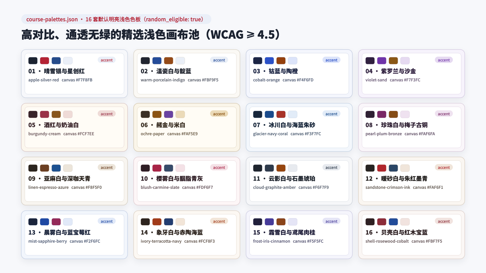
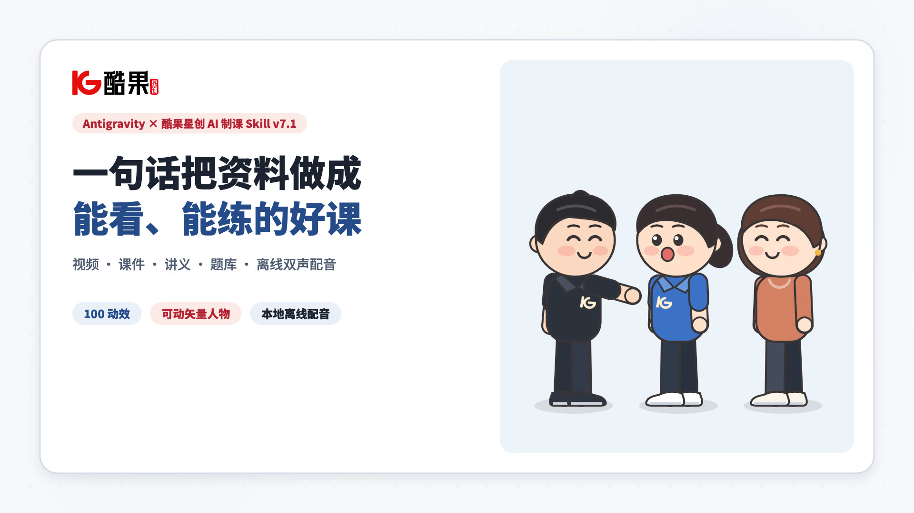

# 酷果星创 · AI 企业培训课程全链路引擎

**只需把制度文档、SOP 手册、产品资料或访谈录音发给 AI，通过自然对话，就能一键打造真正懂教学、有动效、有角色演绎、离线配音不出本机的全套企业精品课**——既能生成**多集 1080p 有声动画系列视频**，也能同步交付**独立交互课件（PPTX / HTML / PDF）、《讲义精要》、章节测验题库与 A4 可打印手写作业**。

> **它和普通 AI 生成 PPT/视频工具的本质区别**：市面工具只会“摘要念稿 + 贴静态网图”，遇到业务条款漏掉前提与例外、画面静止超过十秒、改一句话就要全片重做；本套件由 **ATD 教学设计引擎（`elearning-course-design`）** 与 **代码动画制片引擎（`corporate-training-motion`）** 双核驱动，从“核对原件覆盖率与条件例外”开始，到“1-Beat-1-Audio 毫秒级音画咬合”“3.3 头身可动角色演练”“自动化技术全检 + 按句秒级重渲”全程闭环。

- **跨主流 AI 平台通用（纯正 Agent Skill）**：基于标准 `SKILL.md` 与纯对话 / CLI 工作流，支持 **Antigravity、Claude Code、Codex、Cursor、Windsurf、WorkBuddy、Trae** 等主流 AI 工具直接安装使用，无桌面插件或浏览器工作台耦合。

[一句话发给 AI 自动安装](#一句话让-ai-帮你安装) · [在线观看 Antigravity 实渲宣传片与能力画廊](https://hebokenn.github.io/kgxc-corporate-course-skill/) · [下载 Skill v8.2.0](https://github.com/hebokenn/kgxc-corporate-course-skill/releases/download/v8.2.0/kgxc-course-suite-v8.2.0.zip) · [历史插件备份归档](docs/ARCHIVE.md#历史-dsh-桌面插件安装备份已停用仅作历史存档)

---

## 一句话让 AI 帮你安装

不需要自己配置路径或学终端命令。**直接复制下面这句话和链接，发给你正在用的 AI 助手**（Antigravity、Claude Code、Codex、Cursor、Windsurf、WorkBuddy 等），AI 会自动帮你拉取仓库、完成本地安装与依赖检查：

```text
请帮我安装这个企业培训制课 Skill：https://github.com/hebokenn/kgxc-corporate-course-skill
（macOS Apple Silicon 请运行仓库安装脚本 ./install.sh --agent both；若只需加载 Skill 规范也可安装 skills/corporate-training-motion 与 skills/elearning-course-design，安装好后告诉我怎么开始做第一门课。）
```

<details>
<summary>其他安装方式：双击安装包 / 命令行检查（doctor）/ 校验与开课示例</summary>

1. **下载 ZIP 双击安装（通用 Skill）**：[下载 `kgxc-course-suite-v8.2.0.zip`](https://github.com/hebokenn/kgxc-corporate-course-skill/releases/download/v8.2.0/kgxc-course-suite-v8.2.0.zip) → 解压 → 双击`安装或更新.command`（升级自动保留个人配音、设置与已有课程工程；仅同步 Skill 可运行 `./install.sh --skill-only --agent both`）。
2. **命令行体检（确认 FFmpeg / Chromium / 本地 Qwen3-TTS 状态）**：
   ```sh
   "$HOME/.local/bin/kgxc-course" doctor
   ```
3. **校验清单**：[Skill 包 SHA256SUMS](https://github.com/hebokenn/kgxc-corporate-course-skill/releases/download/v8.2.0/SHA256SUMS) · [完整依赖说明](docs/DEPENDENCIES.md)
4. **历史备份**：曾使用 DSH 桌面插件的用户，可在 [ARCHIVE.md](docs/ARCHIVE.md#历史-dsh-桌面插件安装备份已停用仅作历史存档) 查看已停用维护的 v7.2.0 历史安装包备份入口。

**装好后，直接把资料发给 AI 并输入：**

```text
请用 corporate-training-motion，把我提供的资料做成《收货核对流程》培训课。
受众：新入职门店同事。
目标：能找到并核对订单、商品 SN 和外包装信息，按原文要求完成交接。
交付：完整系列视频（或改为“只交付独立 HTML/PPTX 课件 + 逐字稿 + 题库”）。
先做资料诊断与原件要点梳理，等我确认大纲后再推进后续制作。
```

</details>

---

## 全景能力矩阵：从原始资料到整套培训交付

### 一、前端教学设计引擎（`elearning-course-design`）：先读透原件，再讲人话

| 核心能力 | 实际解决问题 |
| --- | --- |
| **多源资料精准解析** | 支持制度 PDF、Word、PPT、扫描件 OCR 及访谈音视频（按时间码定位），同时识读文档内的表格、截图与流程图表。 |
| **来源台账与条件/例外单列** | 逐页构建可追溯台账，明确标注**事实规则、触发前提、适用条件、例外情况与待核实缺口**，严格禁止 AI 臆造审批流程、业绩数字或内部制度。 |
| **“学员没有原件”上下文自检** | 培训成品只面向看不见原附件的学员。自动排查并改写“如图/原表/资料中”等悬空指代，首次提到表单与界面时先交代名称、用途与看哪里。 |
| **场景化实战转化 & 智能提问** | 拒绝“重视/赋能/形成闭环”式空话，严格按 **“工作触发情境 → 第一反应与动作判断 → 规则依据 → 示范 → 练习与反馈”** 重构口播；并在影响课程范围的节点主动弹出 **1–3 个带推荐与取舍的简洁选择**。 |
| **口语短标题、去标题连读衔接与零基础新人友好** | 针对全员课/新员工培训中常见的“AI 拼词冒号长标题”“切换小节突然跳题”“一上来堆缩写和规程导致新人听不懂”三大痛点：要求集标题与小节标题短促说人话（建议 ≤ 14 字，适配过场页与底部胶囊进度条）；视频默认不照念编号标题，交稿前执行**隐藏全部小标题从头连读自检**确保跨节口播自然过渡；面向全员或新人时，开篇 30–60 秒先用大白话讲清业务本质、术语首次出现先白话再带简称、讲红线风控前先一句讲透背后业务道理再给标准动作。 |

### 二、视觉、动效与角色引擎（`corporate-training-motion`）：纯粹代码生成，绝不静态拼图

| 核心能力 | 实际能力细节 |
| --- | --- |
| **电影级导演引擎与开放画布（拒绝快闪 PPT）** | 小样与全集正片共用同一套 [`director_stage.js`](skills/corporate-training-motion/workbench/motion/director_stage.js) 渲染内核，确保成片水准与试看小样完全一致。画面严格跟随旁白开口时刻逐项浮现（绝不提前剧透）；镜头推拉到位即停稳，结尾要点总结卡全程定机位零晃动，方便阅读与截图。遇到多要点案例拆解时，不靠每 2–4 秒切换整屏大白框应付，而是让每个核心主题在开放画布上从容停留 10–24 秒，通过人物对照与立体图示（柱图、天平、温度计、曲线等）逐步展开，技术门禁会自动拦截“高频卡片翻页”和超限白框。 |
| **多指标与关键事实累进保留（方便对照阅读）** | 做业务诊断、数据对比或连续步骤拆解时，系统严格区分「瞬时台词」与「需要对照记忆的关键信息」：人物对话气泡说完自然退场；而同一场景里的多项并列数据指标、连续发生的案例要点，会在侧边栏或画面分区按序累进排开（最新项高亮、前序项柔和保留），后讲的内容绝不原地覆盖前一条，让学员一眼看全完整因果与对比。 |
| **底部「分段章节进度条」与独立字幕区** | 针对 5–10 分钟多章节培训视频“只看一根总进度条，不知道当前讲到哪一环”的痛点，画面底部按各章真实音频时长自动生成胶囊式分段导航，实时呈现「已学 / 当前推进 / 未学」三态；单行无标点字幕独立排版避开画面主体与进度条，封面、片头和片尾自动隐藏。 |
| **场景道具真实互动与界面特写（杜绝悬空贴图）** | 情景演绎中的手机、名片、二维码等业务道具均遵循真实物理关系——平时稳稳摆放在展示桌或台面上，不凭空悬浮在画面中央充数；当剧情需要查资料、做演示、递给顾客试手或展示二维码时，角色会将道具真正握在手中、沿自然弧线完成递交，或从设备拉出引导线弹出清晰的屏幕功能特写（讲完平滑收回）。全息悬浮 3D 机型仅用于封面与概念展示；需要实景照片或图标时，亦支持通过 [`web_asset_search.py`](skills/corporate-training-motion/scripts/web_asset_search.py) 自动检索开放许可无水印素材并记录来源。 |
| **`CourseActorsCute` 可动矢量角色与智能防压字** | 全程代码骨骼驱动，自带闲逛、迎宾、快步走入、转身离开等多种情绪化步态与自然口型眨眼，脚底实时接地不滑步；对话气泡、重点花字与提示标签自动计算空间避让，绕开所有人物头身、背景 Logo 与画面边缘，彻底消灭压人脸和边缘裁切。 |
| **16 套高对比明亮浅色画布（WCAG ≥ 4.5）** | 从精选明亮浅色板（[选色规范](skills/corporate-training-motion/references/47-course-palette.md)）随机配对，让系列视频、独立课件与《讲义精要》、题库、A4 作业保持出版级统一美观。 |

> 内置人物预设与品牌片头片尾默认服务酷果星创及 Apple 门店零售场景；其他企业与讲师团队可完整复用整套教学设计、动效渲染与配音质检体系，并按需替换为自有品牌视觉。





### 三、离线安全配音、音画精确咬合与多态交付闭环

- **本地 `Qwen3-TTS` 离线配音与音色克隆（零吞字防截断、企业机密不外传）**：全流程本地生成拟真多角色语音，内置获授权的 **didi 男声**、**pipi 女声**，并可配置克隆自有讲师声线；不向任何第三方语音云发送制度文件与音频。[`qwen3_tts.py`](skills/corporate-training-motion/scripts/qwen3_tts.py) 在加载模型后自动修补 `mlx_audio` 解码器把 codebook-0 合法语音 token `0` 误判为 padding 导致句尾被硬切 80–240ms 的底层缺陷，确保克隆音色每句最后一个字完整自然收尾。
- **`1-Beat-1-Audio` 声画零抢跑咬合 + 口语发音与字幕分离**：告别长语音猜秒数导致的“画面提前剧透”或声画错位！[`tts_sync.py --strict-beats`](skills/corporate-training-motion/scripts/tts_sync.py) 按最小视觉意群逐句合成，自动清理分句末尾的悬空续接标点（避免向模型喂入 `，。`/`——。` 畸形双标点），实测每条 WAV 的真实起声点 `speech_onset_sec / speech_start` 与 `cue_words` 词锚点，拦截超长句、雷同克隆分镜、旁白误挂气泡与气泡错位；内置**口播与字幕发音分离**（默认把 `WOW` 读作“哇哦”、把 `第 01–09 节` 读作“第一–九节”不读前导 0，同时保留字幕原规范，也支持逐句 `tts_text` 覆写多音字/英文缩写），通过 **30ms + 80ms 双窗口尾音能量防切检**（自动拒绝复用有尾音截断隐患的旧缓存并多轮换种择优）、混入 48 kHz **“叮 / 嘟咚”原库提示音**与重点花字，并从 `speech_start` 对齐产出**单行无标点 `.srt` 字幕**。
- **一套资料，四种形态按需全套带走**：
  - **多集系列课套件**：统一批次按**内容母版三选一** + **跨章节 3 段代表性有声小样**定调，分集导出 `1080p / 24fps` 视频、字幕与封面，同步交付同风格的**《讲义精要》、章节测验题库、A4 可打印手写作业**。
  - **单支重点培训视频**：含完整品牌片头片尾（片尾音轨自动柔和淡出）、底部融合胶囊分段章节进度条、双声演练与重点花字。
  - **独立授课课件**：不录视频也能直接交付可面授或自录的 **PPTX / DOCX / PDF / 交互式 HTML 课件** 与完整逐字稿。
  - **双验收硬门禁 + 无损音频热替换返修**：渲染器运行期通过 `DirectorStage.createFrameAuditor()` 输出 `render_audit.json`，配合 [`verify_delivery.py --strict-ppt-guard --render-audit`](skills/corporate-training-motion/scripts/verify_delivery.py) 硬拦截走路飘移、文字压人物、同场景重播、**画面元素/气泡抢先旁白 > 80ms**、**并列指标/事件原地覆盖**、**实景门店无互动悬空道具**、**巨幅卡片高频翻页快闪 PPT**、**总结板书晃动或知识页反复摇摆**、**未接入分段章节进度条**、16×16 宏块微抖假动态、PPT 框体超 25% 与静态机位（门禁 A），再对最终编码 MP4 抽取迈步/气泡/道具互动/数据/分段切换与揭示前后对照帧逐一目检（门禁 B）后归档至桌面 `ai 制课/<课程名称>/`。若后续仅微调几句发音且新录音落入原时间槽，可直接按原轴重混音并 `-c:v copy` 无损热替换视频流，数秒完成复验交付；原始过程工程默认完整保留。

| 内置授权音色 | 典型适用位置 | 实声试听 |
| --- | --- | --- |
| **didi · 男声** | 步骤拆解、系统示范与要点提示，清晰利落 | [在线试听 MP3](https://raw.githubusercontent.com/hebokenn/kgxc-corporate-course-skill/main/docs/media/voices/didi-audition.mp3) · [下载 WAV](docs/media/voices/didi-audition.wav) |
| **pipi · 女声** | 课程导入、情景对话与概念阐述，自然亲切 | [在线试听 MP3](https://raw.githubusercontent.com/hebokenn/kgxc-corporate-course-skill/main/docs/media/voices/pipi-audition.mp3) · [下载 WAV](docs/media/voices/pipi-audition.wav) |

---

## 宣传片即实证：本片直接由本 Skill 经 Antigravity 实渲产出

下面这支 **全能力介绍宣传片** 本身就是本仓库产出的真实成品——由 **Antigravity 调用本 Skill** 完成文案分段、**`didi / pipi` 本地离线双声配音 + 原库提示音效、`CourseActorsCute` 动画演绎、16 套浅色画布渲染**，并通过 `verify_delivery.py` 全项技术校验（1920×1080、24fps、48 kHz 立体声、第 0 帧封面隔离与 `attached_pic`、单行无标点字幕）。

[](https://hebokenn.github.io/kgxc-corporate-course-skill/)

**[在线观看 69 秒全面展示宣传片（GitHub Pages）](https://hebokenn.github.io/kgxc-corporate-course-skill/)** · [下载 1080p MP4](docs/media/v71/kgxc-v71-promo.mp4) · [下载无标点 SRT 字幕](docs/media/v71/kgxc-v71-promo.srt) · [查看第 0 帧独立封面](docs/media/v71/kgxc-v71-promo-cover.png)

> 如需查阅更早期 5.x / 6.x 历史版本的旧宣传片、17 支风格样片与过往工作台界面，请移步独立归档页（仅供查阅过往历史版本）：[历史版本与过往素材归档](docs/ARCHIVE.md) · [在线历史画廊](https://hebokenn.github.io/kgxc-corporate-course-skill/archive.html)

---

## 一门课是如何在对话里完整落地的

| 阶段 | AI 为你自动完成 | 你只需要确认 |
| --- | --- | --- |
| **1. 资料拆解与设计** | 读取 PDF/Word/PPT/扫描件/录音，建立来源台账、学习目标与单课/系列课结构 | 教给谁、学什么、重点范围 |
| **2. 原件对照与逐字稿** | 核对要点覆盖、单列条件与例外、消除无原件悬空指代，并完成口语短标题、去小标题连读无缝衔接及零基础新人友好自查；通过 `workflow.py source-coverage` 绑定原件、逐字稿与覆盖报告哈希 | 在对话或结构化提问中核对取舍说明与讲法后明确确认 |
| **3A. 课件与配套文档** | 交付可讲/可录屏的 PPTX / HTML / PDF 课件、《讲义精要》、测验题库与 A4 手写作业 | 核对授课节奏与练习难度 |
| **3B. 视觉母版定调与小样** | 按内容母版输出 3 套实质不同方案（`template_masters`），定调后导出 3 段跨章节有声 MP4 小样 | 选定画布配色、角色造型与声音节奏 |
| **4. 共享引擎出片与双门禁交付** | 直接沿用并扩展小样验证通过的 `DirectorStage` 场景模块分集导出，经门禁 A（`verify_delivery.py --strict-ppt-guard --render-audit`）+ 门禁 B（最终 MP4 抽帧目检）后归集至桌面目录；后续局部改发音可秒级无损热替换音轨 | 验收成片，或随时对话局部微调 |

---

## 适用环境、开源边界与详细文档

- **运行环境**：完整本地渲染与离线 `Qwen3-TTS` 配音环境已在 **macOS Apple Silicon（arm64）** 实测验证；标准 `SKILL.md` 兼容 Antigravity、Claude Code、Codex、Cursor、Windsurf、WorkBuddy、Trae 运行，模型推理与额度沿用宿主原生配置。
- **开源协议与共创**：自研引擎代码、工具链与通用规范以 **[Apache License 2.0](LICENSE)** 开源；酷果星创 Logo、专有工服角色、R5/R8 片头片尾及第三方字体音效沿用 [THIRD_PARTY_NOTICES.md](THIRD_PARTY_NOTICES.md)。由 [@hebokenn](https://github.com/hebokenn) 主导设计与维护，携手 **Antigravity（[Gemini](https://github.com/gemini-code-assist)）** 与 **[Codex](https://github.com/codex)** 协同共创。

| 专题文档 | 链接 |
| --- | --- |
| 日常制作流程与操作手册 | [使用指南](docs/USAGE.md) · [依赖说明](docs/DEPENDENCIES.md) |
| 8.0 电影级导演引擎与交付硬门禁（唯一权威） | [60-v8-cinematic-director-and-gates.md](skills/corporate-training-motion/references/60-v8-cinematic-director-and-gates.md) · [59-streamlined-series-and-selfcheck.md](skills/corporate-training-motion/references/59-streamlined-series-and-selfcheck.md) |
| 角色、配音、花字音效与动效 | [角色指南](docs/CHARACTERS.md) · [配音指南](docs/VOICE.md) · [音效库](docs/SOUND.md) · [动效指南](docs/MOTION.md) |
| 历史版本展示与完整变更记录 | [历史版本归档 ARCHIVE.md](docs/ARCHIVE.md) · [CHANGELOG.md](docs/CHANGELOG.md) · [RELEASING.md](docs/RELEASING.md) |

---

## 版本更新

### 累进指标防覆盖、实景手持/递交道具互动与反快闪 PPT 开放画布：核心 8.2.0 · 2026-11-27

- **信息生命周期分级与累进展示原语（根治并列信息原地覆盖）**：在 [`visual_metaphors.js`](skills/corporate-training-motion/workbench/motion/visual_metaphors.js) 新增 `VM.drawKpiRail`（右上角并列指标轨，新项高亮滑入、旧项温和退阶保留）与 `VM.drawCumulativeStack`（同场连续事件/失误链自上而下累进排开），彻底替代单槽位原地改字覆盖；[`director_stage.js`](skills/corporate-training-motion/workbench/motion/director_stage.js) 新增 `auditor.recordMetricSlot()` 与 `kpi/evidence` 同位覆写检测，门禁 A（[`verify_delivery.py`](skills/corporate-training-motion/scripts/verify_delivery.py)）硬拦截 `info_overwrite_violations`。
- **实景道具物理接地、手持插槽与锚定屏幕特写（根治空中悬空无互动手机）**：[`actors_v3_cute.js`](skills/corporate-training-motion/workbench/motion/actors_v3_cute.js) 新增强校验 `heldProp`（`phone` / `qr_card` / `card`）直接绘制在人物手心，并实时导出世界坐标手部锚点 `bounds.frontHand / backHand`；[`visual_metaphors.js`](skills/corporate-training-motion/workbench/motion/visual_metaphors.js) 新增 `VM.drawHandoverProp(fromHand, toHand, progress)` 弧线真实递交、`VM.drawScreenInset(anchorPt, boxRect, opts)` 锚定屏幕功能特写窗，并为 `draw3DPhoneProp` 增配 `opts.showOrbit` 开关；规范与门禁 A（`auditor.recordProp` / `floating_prop_violations`）硬拦截 `cinematic_store` 实景门店中的无互动悬空道具。
- **反快闪 PPT 开放画布原语与高频翻页拦截**：新增 `VM.drawOpenChapterDots`、安全限高（`<= 210px` 防压上方浮标）`VM.drawSculptureBar` 与累进短浮标 `VM.drawFloatingTag`，并在 [`60-v8-cinematic-director-and-gates.md`](skills/corporate-training-motion/references/60-v8-cinematic-director-and-gates.md) 明确深度拆解段每主题停留 10–24 秒、禁止把每 2–4 秒整屏翻页的大卡片伪装成 `kinetic_metaphor`（同时注明 `drawStampBadge` 含前景色 `fg` 完整签名）；门禁 A 新增 `auditor.recordPanel` / `rapid_card_flip_violations` 硬拦截巨幅卡片快闪翻页。

### 根治 Qwen3-TTS 克隆音色吞尾字、清畸形双标点与双窗口尾音防切检：核心 8.1.2 · 2026-11-27

- **根治 Qwen3-TTS 克隆模式句尾吞字（[`qwen3_tts.py`](skills/corporate-training-motion/scripts/qwen3_tts.py)）**：定位并修补上游 `mlx_audio` 解码器 `speech_tokenizer.decode()` 中 `(audio_codes[..., 0] > 0).sum()` 将第 0 层合法语音 token `0` 误判为 padding 导致每遇 1 个 `0` 就硬砍句尾 80ms 的缺陷（`didi` 参考音固定含 1 个 `0`，叠加句内 `0` 造成每句被裁 80–240ms、末字没念完）；在模型加载后自动注入 `>= 0` 兼容补丁并写入侧车溯源字段 `decode_zero_token_patch`，不依赖改动 venv 第三方包，彻底恢复自然完整收尾。
- **清理句尾畸形双标点 + 30ms/80ms 双窗口尾音防切检（[`tts_sync.py`](skills/corporate-training-motion/scripts/tts_sync.py)）**：新增 `prepare_tts_text()` 将分句末尾的 `，、：；——` 规范替换为单句号，杜绝喂入 `，。`/`——。` 干扰韵律；`check_tail_energy()` 升级为 30ms（`> -24 dB`）与 80ms（`> -20 dB`）双窗口截断监测，复用缓存前自动复检并拒绝复用意已截断旧录音，异常时扩展 4 组候选种子择优重配。

### 逐字稿说人话、去标题连读衔接与零基础新人友好：核心 8.1.1 / 教学设计 2.1.2 · 2026-11-27

- **标题口语化硬规范（建议 ≤ 14 字）**：在 [`elearning-course-design/SKILL.md`](skills/elearning-course-design/SKILL.md)、[`script-authoring-quality.md`](skills/elearning-course-design/references/script-authoring-quality.md)、[`corporate-training-motion/SKILL.md`](skills/corporate-training-motion/SKILL.md) 与 [`59-streamlined-series-and-selfcheck.md`](skills/corporate-training-motion/references/59-streamlined-series-and-selfcheck.md) 统一明确课程、分集与小节标题须短促自然像真人和同事说话，杜绝“XX与XX：先XX再XX”式书面拼词冒号长标题，直接适配视频章节过场页与底部融合胶囊进度条排版。
- **去小标题连读无缝衔接自查**：明确视频中小节标题默认作画面过场页与底部进度条标签、不生硬照念；要求每两节交界处的口播正文自带自然承接过渡句，并在送审自查清单中强制执行“隐藏全部小标题从头连读检验”，杜绝只听口播时跨节突然跳题断层。
- **零基础新人友好写作规则**：面向全员或包含新员工的课程，要求开篇 30–60 秒先用生活化大白话讲清业务或工具本质；首次出现业务缩写、系统名或内部行话坚持“先白话解释、再顺带简称”；讲红线、风控或繁琐规程前先用一句话讲透背后的业务道理（防什么风险、为何这样定），再给标准动作与禁区。

### 声画零抢跑、定机位总结板书与融合胶囊分段进度条：核心 8.1.0 · 2026-11-27

- **底部「融合进度胶囊」分段章节进度条（默认必选，禁退化为单根总条）**：[`visual_metaphors.js`](skills/corporate-training-motion/workbench/motion/visual_metaphors.js) 新增 `VM.drawSegmentedProgressBar(ctx, segments, t, pal, opts)`（方案 A `inline_pill` 高 `48px`，按真实音频时长比例分配段宽并设最小宽度保底，已学浅蓝 / 当前段描边加内部渐进填充与底部蓝金细边 / 未学浅灰三态一目了然，单行字幕独立置于 `y = 988` 避让）；[`director_stage.js`](skills/corporate-training-motion/workbench/motion/director_stage.js) 新增 `DS.buildNavSegments(lines, chapterSpecs)` 与 `auditor.recordProgressBar(navInfo)`，[`verify_delivery.py`](skills/corporate-training-motion/scripts/verify_delivery.py) 门禁 A 硬拦截未接入分段进度条或未随时间轴切换分段的视频。
- **声画零抢跑（起声点实测 + 句内词锚点）**：`tts_sync.py` 自动实测每条 WAV 的真实发声起点 `speech_onset_sec / speech_start` 与 `cue_words` 锚点并从 `speech_start` 对齐字幕；`DirectorStage` 提供 `st.speechT`、`DS.phraseTime(beat, phrase, sceneStart)` 与 `auditor.recordReveal(id, targetAbsTime, visible)`，门禁 A 硬拦截对话气泡或画面元素抢先旁白 > 80ms（`premature_reveal_violations`）。
- **定机位要点总结板书与停稳运镜红线**：`DirectorStage` 新增 `DS.steadyCamera()` 与 `evalCamera` 的 `hold / holdUntil` 停稳区间，支持专用于一屏总结卡与讲义收尾页的 `layout_kind: "summary_board"`（占比 ≤ 22%、定机位零晃动、靠逐条揭示推进），门禁 A 拦截总结板书晃动及知识页全程漂移往返摇摆（`camera_sway_violations`），同时精准区分定机位局部揭示与微抖假动态 PPT。
- **实课双集全量实渲验收**：在真实课程《门店服务体验提升》第 01 节（6 段分段胶囊 / 116 句 / 9,173 帧）与第 02 节（9 段对应购机七步全流程 / 118 句 / 10,094 帧）完成全量 8.1.0 实渲、门禁 A 零错误零警告及门禁 B 多段切换与揭示前后对照帧目检。

### 电影级导演引擎、强契约避让、自然口语发音分离与双验收硬门禁：核心 8.0.0 · 2026-11-26

- **共享电影级导演内核 `DirectorStage`（小样即正片原型）**：新增 [`workbench/motion/director_stage.js`](skills/corporate-training-motion/workbench/motion/director_stage.js)，提供 `resolveTimeline`（Scene vs Beat 双层时间轴，跨句 `sceneT` 单调递增杜绝动画归零重播）、`evalCamera`（多关键帧真实推拉摇移运镜）与 `createFrameAuditor`（运行期逐帧记录人物步态、文字碰撞、PPT 框体占比与机位轨迹，输出 `render_audit.json`）；配套唯一权威规范 [`60-v8-cinematic-director-and-gates.md`](skills/corporate-training-motion/references/60-v8-cinematic-director-and-gates.md)。
- **强契约防漂移 + 智能避让防压字**：`CourseActorsCute` 对 `walkPhase/strideAmp` 与非法 `mood/gesture` 枚举运行期直接抛错阻断飘移，并返回精准 `headRect/bodyRect/exclusionRect`；`VisualMetaphors` 新增 `drawSmartSpeakerBubble` 与 `placeAvoidingActors`，自动避开人物头身、背景 Logo 与字幕安全区，并规范同场景子幕非重叠交接与左边缘气泡安全距。
- **口播发音与字幕分离 + 零重渲局部热替换**：`tts_sync.py --strict-beats` 自动拦截克隆雷同分镜与气泡错位，并内置自然口语规整（默认 `WOW`→“哇哦”、`第 01–09 节`→“第一–九节”不读前导 0，字幕与画面保持原样，同时支持逐句 `tts_text` 覆写）；沉淀片尾音乐末段 `0.35s` 软淡出与落入原槽位时 `-c:v copy` 秒级无损音频热替换经验。
- **不可跳过的双验收硬门禁（门禁 A + 门禁 B）**：`verify_delivery.py` 新增 `--render-audit` 硬校验（零容忍走路飘移、文字压人物、同场景重播、16×16 宏块微抖假动态、PPT 框体 > 25% 或连续 > 2 句及静态机位），并要求从最终编码 MP4 抽取关键帧目视核验；已在真实课程《门店服务体验提升》第 01 节（116 句 / 9,231 帧 / 6 分 35 秒）完成全量实渲与零错误零警告双门禁验证。

### 纯净 Skill 化、移除 DSH 插件并打通纯对话原件覆盖确认：核心 7.3.0 · 2026-11-26

- **全面移除 DSH 桌面插件，聚焦纯正跨平台 Skill**：从主仓库删除 `plugin/`、`plugin.json`、`.codex-plugin/`、`.mcp.json`、`cordis.patch.yml`、`安装制课插件.command` 及插件打包/安装脚本，不再在主分支维护桌面宿主插件；在 [`docs/ARCHIVE.md`](docs/ARCHIVE.md#历史-dsh-桌面插件安装备份已停用仅作历史存档) 保留唯一的 `v7.2.0` 历史插件备份入口。
- **打通纯对话 / CLI 原件覆盖确认闭环（`source_coverage.py` / `workflow.py`）**：修复 7.0.0 移除网页工作台后 `SourceCoverage.confirm()` 仍卡死在 `dsh-user-click` / `preferred_workbench == 'dsh'` 的历史阻塞；新增 `workflow.py source-coverage COURSE --save / --confirm` 命令，在保留当前原件/逐字稿/报告 SHA-256 绑定与防 AI 擅自代确认校验的前提下，允许用户在对话或宿主结构化提问中直接确认原件覆盖报告并推进分镜与出片。
- **统一纯对话操作口径（`elearning-course-design 2.1.1` / `corporate-training-motion 7.3.0`）**：清理 `SKILL.md`、`backend.py`、`ai_review.py`、`studio.py`、`stage_confirmation.py` 及参考文档中的 DSH 专属路径与提示，确保 Antigravity、Claude Code、Codex、WorkBuddy、Cursor 等宿主开箱即用。

### 情绪化多档步速物理、全屏 3 层视差门店与无白框电影级动效：插件 0.12.0 / 核心 7.2.0 · 2026-11-26

- **情绪化多档步速物理与微表演（`workbench/motion/actors_v3_cute.js`）**：新增 `GAIT_PRESETS`、`computeMoodWalk` 与 `paintExpressive`，支持按剧情区分 `stroll`（闲逛 `145px/s`）、`brisk`（轻快迎宾 `265px/s`）、`rush`（急匆匆冲入 `470px/s` + `+9.5°` 前倾与刹车急停回摆）与 `cold_exit`（冷脸快撤 `310px/s`），让着急进店、受压后退与热情迎候形成鲜明表演反差。
- **全屏 3 层视差 Apple 授权门店与无白框开放画布（`workbench/motion/visual_metaphors.js`）**：新增 `drawCinematicAppleStore`（商场玻璃幕墙与阳光斜射、MagSafe/AirPods 配件墙、旗舰灯箱、室内陶瓷绿植、顶棚线性 LED 柔光锥、透视暖橡木体验桌与斜立样机）及 `drawAmbientBackdrop` 开放画布基元，并在 `SKILL.md` 固化“去大白框 PPT 壳”规范。
- **同步纳入 7.1.1 动效库与素材能力**：完整包含真 3D 透视投影 `iPhone 18 Pro`（`draw3DPhoneProp`）、F 型扫读热区追踪、`scripts/web_asset_search.py` 开放许可素材联网检索入库与 5 幕连续运镜宣传片 v4；已完成真实课程 3 支 v7.2 样片（`verify_delivery.py --strict-ppt-guard` 零报错零滞留）与打包发布全检。

### 5 幕连续运镜动效引擎、真 3D iPhone 18 Pro 与联网素材检索：插件 0.11.1 / 核心 7.1.1 · 2026-11-26

- **底层动效与运镜基元升级（`workbench/motion/visual_metaphors.js`）**：新增绝对时间快节奏缓动（`easeOutExpo` / `easeOutQuint` / `easeOutBack` / `spring`）、虚拟相机层 `CameraRig`、多层门店景深背景、**F 型扫读激光热区组件**，以及严格按官方机身比例（`71.9 × 150.0 × 8.75 mm`）构建的**真 3D 透视投影 `iPhone 18 Pro`（冰川蓝全宽三摄平台）**。
- **支持联网检索开放许可素材入库（`scripts/web_asset_search.py`）**：聚合 Openverse 与 Wikimedia Commons 开放许可无水印图库，下载至课程 `project/assets/web/` 并自动写入含来源、许可与 SHA-256 的 `manifest.json` 溯源清单；同步写入 `SKILL.md` 与 `references/34-content-driven-assets.md`。
- **全新 5 幕连续运镜宣传片上线**：推翻旧版 16 页分镜，改用全幅连续运动构图、激光斜劈切场、X 光扫描切代码线框、左旋 5 列穿插高速动效墙、全屏上下画布轮播与五端逐项踩点微动效；全片通过 `verify_delivery.py --strict-ppt-guard` 零错误零警告校验。

### 全链路纯对话制课引擎、CourseActorsCute 可动角色与完整展示焕新：插件 0.11.0 / 核心 7.1.0 · 2026-11-26

- **全链路纯对话交互与公共 CLI 工具**：日常制课全部通过自然对话推进，支持多集系列课统一批次规划与按句最小范围局部返修；新增公共工具 `scripts/tts_sync.py`（支持 16/24/32-bit WAV 尾音能量检测、增量缓存、48 kHz 音效混音与单行无标点 SRT）及 `scripts/verify_delivery.py`（全自动核验 1080p/`yuv420p`、48 kHz AAC、第 0 帧独立封面与 `attached_pic` 嵌入、字幕无标点/零重叠）。
- **统一 `CourseActorsCute` 3.3 头身可动矢量角色**：内置世界坐标零滑步步态、防弹膝盖 IK、行进转向与停步稳态回正、口型同步说话及原版胸标绑定，支持按课程扩展新造型便装顾客。
- **全面焕新展示主页与独立历史归档页**：主页与 GitHub Pages 全面呈现双引擎能力矩阵、由 Antigravity 调用本 Skill 实渲制作的最新版宣传片及极简“发给 AI 自动安装”引导；过往历史版本展示与老旧样片统一归档至 [`docs/ARCHIVE.md`](docs/ARCHIVE.md) 与 `docs/archive.html`。

### 多集系列课母版三选一与 16 套明亮浅色板：插件 0.10.0 / 核心 7.0.0 · 2026-11-24

- **多集系列课统一批次与内容母版三选一**：`storyboard.py` 新增 `template_masters` 与 `segments[].template_id` 校验，整门课程可统一输出分集视频 + 《讲义精要》+ 测验题库 + A4 手写作业。
- **16 套高对比明亮浅色色板与实质自查清单**：默认随机选色池升级为 16 套 WCAG ≥ 4.5 无绿浅色画布；制作端在出片前完成实质自查修精，过程文件默认保留。

<details>
<summary>展开查看更早版本概览（5.7.1 – 6.9.8）</summary>

- **6.9.0 – 6.9.8（DSH 0.9.0 – 0.9.9）**：教学动效节奏参数（预备、弧线与落定）、渐进式任务面板、应用内更新提醒与片头等待预算。
- **5.7.1 – 6.8.2**：原件要点覆盖与条件例外单列、全身可动顾客与对白朝向校验、独立第 0 帧封面规则、原库“叮/嘟咚”音效及本地 `didi / pipi` 参考音色。[查看完整历史与验证记录](docs/CHANGELOG.md)

</details>
