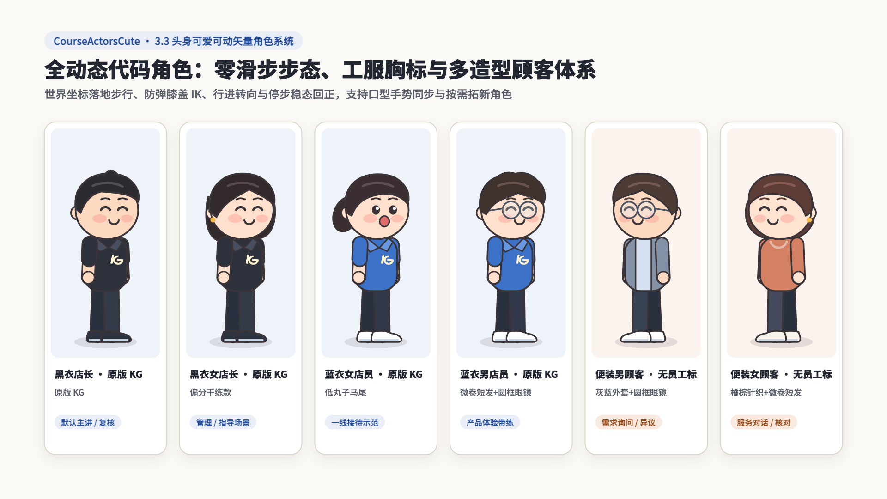

# 酷果星创 · AI 企业培训制课 Skill

把制度、手册和业务资料，在**纯对话交互**中做成**能直接讲的课件与配套文档**，或带拟真人配音、无标点字幕与代码化教学动画的**单支 / 多集系列课程视频**。去掉冗余网页表单与时间轴编辑器后，适合培训负责人、门店管理者和带教同事把“制度怎么写”直接讲成“遇到这件事，应该怎么做”。

- **适用范围更广（跨宿主标准 Skill）**：基于标准 `SKILL.md` 与无界面本地媒体引擎，支持 **Antigravity、Claude Code、Codex、WorkBuddy、Cursor、Trae、Windsurf** 等主流支持 Agent Skill 规范的 AI 编程与桌面宿主。
- **DSH 图形插件（可选）**：如使用 DeepSeek Harness（DSH），可另装图形插件，在同一窗口完成资料上传与对话确认。

[下载独立 Skill v7.1.0](https://github.com/hebokenn/kgxc-corporate-course-skill/releases/download/v7.1.0/kgxc-course-suite-v7.1.0.zip) · [下载 DSH 插件 v0.11.0](https://github.com/hebokenn/kgxc-corporate-course-skill/releases/download/v7.1.0/kgxc-course-plugin-v0.11.0.zip) · [在线观看 7.1 新版宣传片与实渲画廊](https://hebokenn.github.io/kgxc-corporate-course-skill/) · [安装或更新](#安装或更新)

| 你的需求 | 主要交付 | 适用方式 |
| --- | --- | --- |
| **单支课程视频** | 1080p MP4、单行无标点 SRT、第 0 帧封面，过程工程保留 | 内部学习平台、集中培训或自主学习 |
| **多集系列课 + 配套套件** | 分集 MP4/SRT/封面 + 《讲义精要》、测验题库、A4 可打印手写作业 | 专题训练营、门店系统化赋能，统一批次推进 |
| **自己讲课或带教** | 独立 PPTX / PDF / HTML 课件 + 完整逐字稿 | 现场授课、线上分享、带教或自行录屏 |
| **已有课程局部返修** | 仅重配/重渲受影响片段与字幕，复用未变更章节 | 业务规则或话术更新后的最小范围回改 |

---

## 适合哪些培训场景

| 场景 | 可提供的资料 | 课程怎样讲 |
| --- | --- | --- |
| **新人入职与岗位带教** | 岗位手册、工作清单、常见问题 | 按真实工作顺序拆任务，穿插示范、易错点与练习 |
| **制度与 SOP 流程** | 制度正文、条件与例外说明 | 交代适用范围，用案例对照“何时这样做、何时例外处理” |
| **收货、交接与信息核对** | 订单、票据、实物图、编码标签 | 同屏定位字段与实物，逐项核对、标出差异并演示处理 |
| **销售服务与顾客沟通** | 服务流程、典型对话、正反案例 | 编排走近、倾听、提问、异议回应与示范，多角色分声演练 |
| **店长经营与多集专题课** | 指标口径、辅导记录、多章节材料 | 统一批次规划多支视频与讲义/题库/手写作业，形成课后闭环 |
| **系统操作与 Apple 产品体验** | 界面截图、字段说明、Apple 设备资料 | 放大关键入口与状态反馈，结合设备示意讲清观察重点 |

> 当前内置角色、片头片尾和产品素材以酷果星创及 Apple 门店培训为主要场景；其他企业与团队可直接复用全套制课方法与渲染工具，按需替换为自有品牌与资料。

---

## 核心能力与实际价值

### 1. 无界面对话流：专注内容与局部回改，告别繁琐网页表单

- **使用场景**：资料确认、大纲调整、逐字稿润色与成片后局部改稿，全程在 AI 对话内完成。
- **具体做法**：全面移除冗余的浏览器表单页（`design.html`）与网页时间轴编辑器（`index.html`），后台渲染服务以无界面模式（`/renderer.html`）专责合成导出；含多支视频与讲义/题库/手写作业的系列课按**统一批次**推进（统一大纲 → 原件要点对照与逐字稿 → 母版三选一 `template_masters` + 全课分镜 → 3 段有声小样 → 共享母版分集导出）。
- **实际价值**：减少在不同网页界面与弹窗之间反复切换和重复点击；修改某段逐字稿时只重配重渲受影响节次，其余章节零返工，过程文件默认保留在工程内不自动删除。[7.0+ 精简工作流规范](skills/corporate-training-motion/references/59-streamlined-series-and-selfcheck.md)


### 2. 统一 `CourseActorsCute` 可爱人物与 16 套明亮浅色画布

- **使用场景**：顾客接待、门店交接、店长指导、制度对比与操作教学镜头。
- **具体做法**：
  - **唯一代码驱动人物引擎 [`actors_v3_cute.js`](skills/corporate-training-motion/workbench/motion/actors_v3_cute.js)**：采用 3.3 头身多部件可爱矢量人物，内置零滑步世界坐标步态、迈步转侧身与停步回正（方案 B）、防弹膝盖 IK 与口型手势，黑衣店长与蓝衣店员统一绑定原版 `kg-original.png` 胸标，便装顾客严禁顺色或佩戴员工标；旧版整张静态 PNG 人物与 `acting.js` 已彻底移除。
  - **16 套高对比明亮浅色色板**：默认仅从 `workbench/course-palettes.json` 的 **16 套 `random_eligible: true`（WCAG ≥ 4.5、无绿色）** 浅色画布中随机抽取，使视频画布与配套讲义、题库和手写作业保持统一视觉基调；结合 **F 型扫读** 与 100 种教学动效讲清因果。[角色指南](docs/CHARACTERS.md) · [选色规则](skills/corporate-training-motion/references/47-course-palette.md)




### 3. 本地 `didi / pipi` 配音、`tts_sync.py` 同步混音与 `verify_delivery.py` 一键质检

- **使用场景**：分句配音生成、多角色分声混音、字幕时间轴对齐，以及正式交付桌面目录前的成品技术与包装验收。
- **具体做法**：
  - 本地 **Qwen3-TTS** 驱动随包已获授权的 **didi 男声、pipi 女声**，无需云端 TTS API Key；新增 [`scripts/tts_sync.py`](skills/corporate-training-motion/scripts/tts_sync.py) 按视觉 beat 做文本/音色 SHA 增量缓存、检测句尾 80ms 能量防吞字截断、用 48kHz `amix` 混入原库“叮/嘟咚”提示音效并直接生成单行无标点 SRT。
  - 新增 [`scripts/verify_delivery.py`](skills/corporate-training-motion/scripts/verify_delivery.py) 在导出交付前一次性实检 1080p/`yuv420p`、48kHz AAC 音轨、末尾电平安全、第 0 帧独立封面与第 1 帧正片切换、`attached_pic` 封装，以及无标点/无重叠字幕。
- **适用范围**：完整本地渲染与 Qwen3-TTS 已在 macOS Apple Silicon 验证通过；代码自动校验不替代正式视频的完整人工视听审美确认。[配音指南](docs/VOICE.md) · [音效库与试听](docs/SOUND.md)

| 推荐语音 | 常见用途 | 同文案试听 |
| --- | --- | --- |
| **didi · 男声** | 任务说明、步骤讲解与重点提醒，清晰轻亮 | [在线试听 MP3](https://raw.githubusercontent.com/hebokenn/kgxc-corporate-course-skill/main/docs/media/voices/didi-audition.mp3) · [下载 WAV](docs/media/voices/didi-audition.wav) |
| **pipi · 女声** | 课程导入、概念解释与服务情境，清楚亲切 | [在线试听 MP3](https://raw.githubusercontent.com/hebokenn/kgxc-corporate-course-skill/main/docs/media/voices/pipi-audition.mp3) · [下载 WAV](docs/media/voices/pipi-audition.wav) |

---

## 实际演示

### 44 秒 7.1 新版宣传片：《对话驱动制课 · 酷果星创 7.1》

全程采用当前 **无界面 Chromium Canvas + `CourseActorsCute` 角色引擎 + `course-palettes.json` 浅色板 + 本地 `didi / pipi` Qwen3-TTS（通过 `tts_sync.py`） + `teaching-native-v1` 原库“叮/嘟咚”音效** 实际制作，并经 `verify_delivery.py` 全项通过（1920×1080、24fps、48kHz 立体声、第 0 帧封面隔离 + `attached_pic`、13 条无标点单行 SRT）。

[](https://hebokenn.github.io/kgxc-corporate-course-skill/)

**[在线观看 7.1 宣传片（GitHub Pages）](https://hebokenn.github.io/kgxc-corporate-course-skill/)** · [下载 1080p MP4](docs/media/v71/kgxc-v71-promo.mp4) · [下载无标点 SRT 字幕](docs/media/v71/kgxc-v71-promo.srt) · [查看独立封面原图](docs/media/v71/kgxc-v71-promo-cover.png)

> 如需回看早期 5.x / 6.x 版本的旧宣传片、旧版网页编辑器截图与此前静态人物演示，请移步独立归档页（仅供查看过往历史版本）：[历史版本与过往素材归档](docs/ARCHIVE.md) · [历史在线播放页](https://hebokenn.github.io/kgxc-corporate-course-skill/archive.html)

---

## 一门课怎样完成

**原始资料 → 对话梳理大纲与讲法 → 完整逐字稿（含原件对照与自查） → 独立课件/配套文档 或 母版三选一与 3 段有声小样 → `tts_sync` + `verify_delivery` 质检交付桌面。**

| 阶段 | AI 协助完成 | 你在对话中只需判断 |
| --- | --- | --- |
| **1. 资料与目标** | 诊断来源、梳理学习目标与大纲，规划单课或多集视频及配套讲义/题库/作业分工 | 教给谁、学什么、内容是否完整准确 |
| **2. 完整逐字稿** | 编写自然口播稿与原件要点对照表，制作端先完成实质自查并修精 | 核对原件覆盖、取舍依据、关键条件与例外 |
| **3A. 课件 / 配套文档** | 输出 PPTX / PDF / HTML 课件，或《讲义精要》、测验题库与 A4 手写作业 | 是否便于讲授、带教、自学或课后闭环 |
| **3B. 母版与全课分镜** | 每类内容母版提供 3 套实质不同方案（`template_masters`），定调后全课逐段输出最优分镜 | 选定视觉母版与共用配色、风格及重点段落 |
| **4. 3 段有声小样** | 抽取 3 段完整片段，用无界面引擎 + `tts_sync.py` 导出带头尾接缝与分声的有声 MP4 | 正常速度听看画面、动作、字幕、花字音效与声音 |
| **5. 整课交付与回改** | `verify_delivery.py` 质检后归集 MP4/SRT/首帧封面至桌面 `ai 制课/<课程名称>/`，工程保留 | 审阅成片或提出哪一段需要局部修改 |

---

## 安装或更新

### 方式一：独立 Skill（推荐，通用主流 AI 宿主）

**[下载 v7.1.0 联合包](https://github.com/hebokenn/kgxc-corporate-course-skill/releases/download/v7.1.0/kgxc-course-suite-v7.1.0.zip) → 解压 → 双击“安装或更新.command”**（或将 `skills/corporate-training-motion` 与 `skills/elearning-course-design` 放入宿主的全局/项目 `.agents/skills/` 目录）。

- 适用于 **Antigravity、Claude Code、Codex、WorkBuddy、Cursor、Trae、Windsurf** 等支持 Agent Skill 规范的宿主，日常统一调用 `corporate-training-motion`。
- 包含 `corporate-training-motion 7.1.0` 与 `elearning-course-design 2.1.0`；升级自动保留个人配置、已有课程与声音库。

### 方式二：DSH 插件（可选）

**[下载插件 v0.11.0](https://github.com/hebokenn/kgxc-corporate-course-skill/releases/download/v7.1.0/kgxc-course-plugin-v0.11.0.zip) → 解压 → 双击“安装制课插件.command” → 重新打开 DSH。**

<details>
<summary>展开查看：命令行安装、环境检查（doctor）、校验文件与开始做课示例</summary>

```sh
# 已有媒体环境，仅更新 Skill（其他宿主可直接复制到 ~/.agents/skills/）
./install.sh --skill-only --agent both

# 新机器准备完整本地媒体与配音环境（macOS Apple Silicon，需预留约 10GB 空间）
./install.sh --agent both

# 安装后检查本地依赖与 Qwen3-TTS 配音状态
"$HOME/.local/bin/kgxc-course" doctor
```

**安装包校验文件：** [Skill 包 SHA256SUMS](https://github.com/hebokenn/kgxc-corporate-course-skill/releases/download/v7.1.0/SHA256SUMS) · [DSH 插件 PLUGIN-SHA256SUMS](https://github.com/hebokenn/kgxc-corporate-course-skill/releases/download/v7.1.0/PLUGIN-SHA256SUMS) · [完整依赖说明](docs/DEPENDENCIES.md)

**开始做第一门课（在任意已加载本 Skill 的 AI 宿主中输入）：**

```text
请用 corporate-training-motion，把我提供的资料做成《收货核对流程》培训课。
受众：新入职门店同事。
目标：能找到并核对订单、商品 SN 和外包装信息，按原文要求完成交接。
交付：完整视频（MP4 + SRT + 封面）；若只需课件请改为“只交付独立课件和逐字稿”。
先诊断素材并给出大纲与讲法，等我确认后再推进逐字稿、母版分镜、三段有声小样与整课导出。
```

</details>

---

## 适用范围与相关文档

- **AI 宿主范围**：标准 `SKILL.md` + 本地 Python/Node/Playwright/FFmpeg 脚本架构，可在 **Antigravity、Claude Code、Codex、WorkBuddy、Cursor、Trae、Windsurf、DeepSeek Harness（DSH）** 等宿主中运行；AI 模型与计费沿用各宿主自身配置。
- **本地运行环境**：完整本地渲染与 Qwen3-TTS 配音环境当前在 **macOS Apple Silicon（arm64）** 验证通过，无需额外云端 TTS API Key。
- **开源协议与品牌边界**：本仓库自研代码、脚本与通用规范文档采用 **[Apache License 2.0](LICENSE)** 开源；酷果星创 Logo、角色、R5/R8 片头片尾包装及第三方字体/音效沿用 [THIRD_PARTY_NOTICES.md](THIRD_PARTY_NOTICES.md) 原权利条款。
- **项目共创**：由 [@hebokenn](https://github.com/hebokenn)（酷果星创）主导设计与维护，携手 **Antigravity（[Gemini](https://github.com/gemini-code-assist)）** 与 **[Codex](https://github.com/codex)** 协同共创。

| 想进一步了解 | 文档 |
| --- | --- |
| 7.1 无界面对话流、系列课与自查清单 | [59-streamlined-series-and-selfcheck.md](skills/corporate-training-motion/references/59-streamlined-series-and-selfcheck.md) |
| 安装、恢复与日常使用 | [使用指南](docs/USAGE.md) · [依赖说明](docs/DEPENDENCIES.md) · [DSH 插件说明](docs/PLUGIN.md) |
| 配音同步、多角色分声与原库音效 | [配音指南](docs/VOICE.md) · [音效库](docs/SOUND.md) · [tts_sync.py](skills/corporate-training-motion/scripts/tts_sync.py) |
| `CourseActorsCute` 角色与内容规范 | [角色指南](docs/CHARACTERS.md) · [内容素材](docs/CONTENT-ASSETS.md) · [动效指南](docs/MOTION.md) |
| 过往版本宣传片与旧版界面截图 | [历史版本归档 ARCHIVE.md](docs/ARCHIVE.md) · [完整变更历史 CHANGELOG.md](docs/CHANGELOG.md) · [发布流程 RELEASING.md](docs/RELEASING.md) |

---

## 版本更新

以下列出近期版本概览，完整逐版记录、原始说明与验证链接见 [docs/CHANGELOG.md](docs/CHANGELOG.md)。

### 无界面对话工作流、CourseActorsCute 可爱人物与公共交付工具：插件 0.11.0 / 核心 7.1.0 · 2026-11-26

- **全面切换至无界面对话工作台**：移除旧版浏览器表单（`design.html`）与网页时间轴编辑器（`index.html` / `editor.js` / `style.css`），本地服务保留 `/renderer.html` 无界面渲染合成与状态接口；同步刷新主页、GitHub Pages（`docs/index.html`）、新版 44 秒宣传片与实渲画廊，将历史版本宣传片和旧界面截图单独归档至 [`docs/ARCHIVE.md`](docs/ARCHIVE.md) / `docs/archive.html`。
- **统一角色引擎 `CourseActorsCute` 与兼容层清理**：在 `workbench/motion/actors_v3_cute.js` 补齐 `CourseActors` 适配层（`pose`、`editDx/editDy` 位移响应与零滑步左右脚对齐），同步清理 `motion_quality.py`、`visual_styles.py`、`production_preferences.py`、`motion_gallery.py` 等模块的旧静态 PNG 残留。
- **新增配音同步与一键交付质检 CLI**：新增 `scripts/tts_sync.py`（支持 Qwen3-TTS 24-bit WAV 尾音能量检测、按 beat 增量缓存、48kHz `amix` 混音与无标点单行 SRT）与 `scripts/verify_delivery.py`（1080p/48kHz、第 0 帧封面/第 1 帧正片切换、`attached_pic` 与字幕规则全检），配合 `test_v7_tools.py` 与全仓测试验证通过。

### 精简系列课工作流、16 套明亮浅色板与自查验收：插件 0.10.0 / 核心 7.0.0 · 2026-11-24

- **多集系列课统一批次与母版三选一**：`storyboard.py` 新增 `template_masters` 与 `segments[].template_id` 校验，每类内容母版提供 3 套实质不同方案供定调；未启用母版的旧工程继续兼容逐段三备选。
- **16 套精选明亮通透浅色色板 & 产出前自查**：默认随机池从 16 套高对比明亮浅色（`random_eligible: true`、无绿色）抽取；整合为产出前实质自查清单，成片改稿支持最小范围局部重做。

<details>
<summary>展开查看更早版本概览（6.9.8 – 5.7.1）</summary>

- **6.9.0 – 6.9.8（DSH 0.9.0 – 0.9.9）**：教学动效参数（预备、弧线、节奏、停稳）、渐进式工作台、应用内更新检查/下载、编号逐条显现（`ordered_reveals`）与片头等待预算（`introPolicy`）。
- **5.7.1 – 6.8.2**：制作合同与六项核心验证、原件要点覆盖与人工确认、全身可动顾客与对白朝向遮挡、随机选色禁绿与独立封面首帧规范、原库“叮/嘟咚”音效及随包 `didi / pipi` 本地声音参考。[完整历史与验证链接](docs/CHANGELOG.md)

</details>
