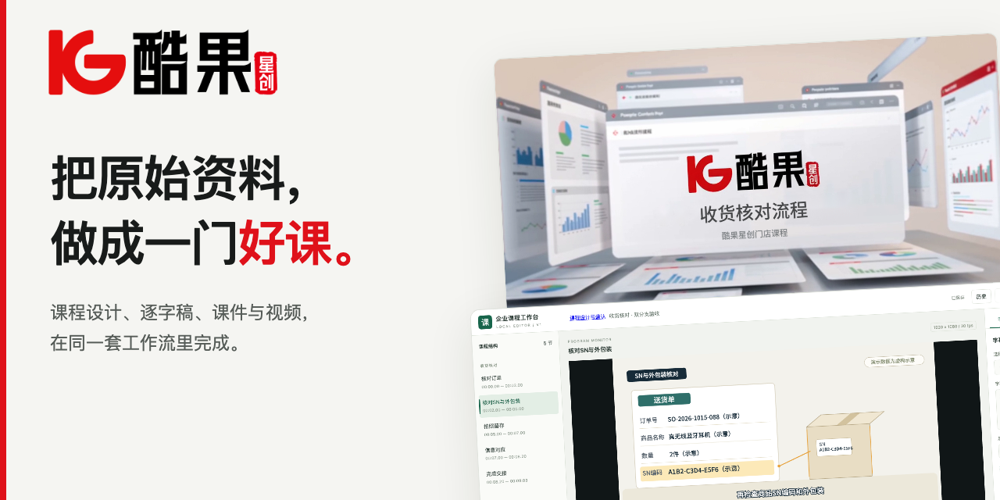
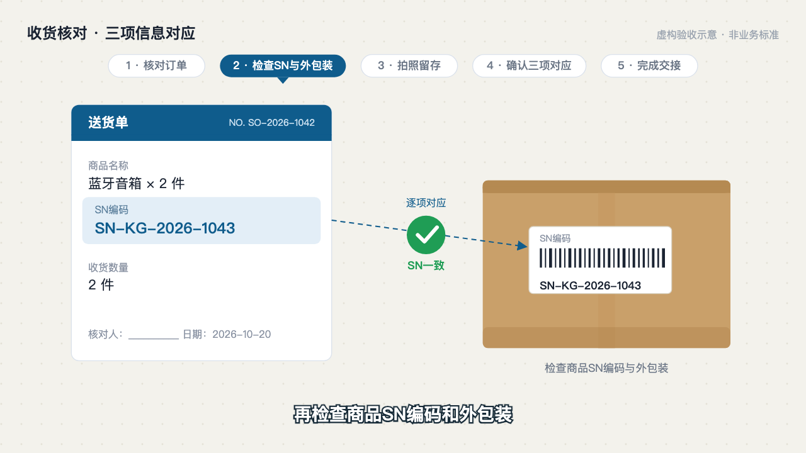
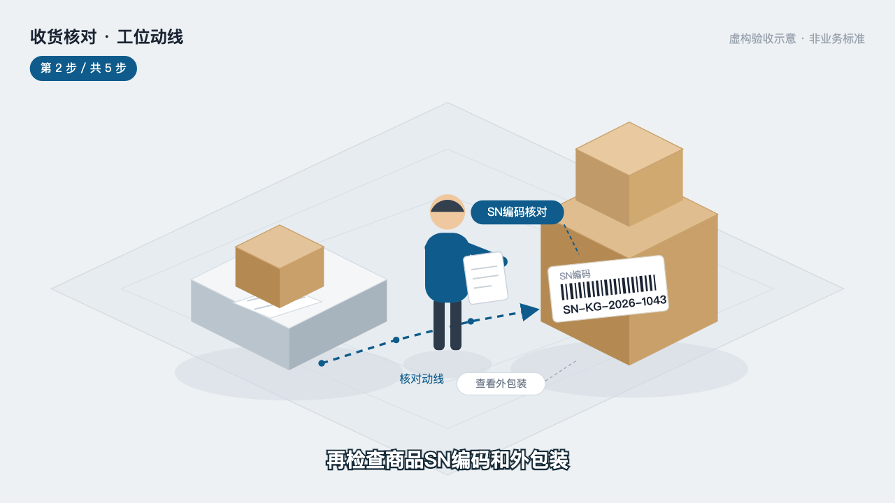

# 酷果星创课程共创与制作



**先把课讲清楚，再把画面做好。** 给 AI 一份制度、手册、PPT 或零散资料，先共同确定怎么教，再制作可讲授的课件或有声视频。

**[下载安装包](https://github.com/hebokenn/kgxc-corporate-course-skill/releases/download/v5.0.0/kgxc-course-suite-v5.0.0.zip)** · [看实际效果](#实际效果) · [开始做第一门课](#开始做第一门课) · [使用指南](docs/USAGE.md)

支持 **Codex / WorkBuddy** · 当前发布 **[v5.0.0](https://github.com/hebokenn/kgxc-corporate-course-skill/releases/tag/v5.0.0)** · 完整环境已验证 **macOS Apple 芯片**

## 实际效果

### 配音、画面、动作和字幕，一起看

下面是 WorkBuddy 实际导出的 **9 秒有声正文**：核对订单、检查 SN、拍照留存、对应核对、完成交接。播放器可直接播放和全屏；点击音量图标可打开声音。

https://github.com/user-attachments/assets/a3710430-2c9f-482e-8d03-6fb9078e4471

[下载原画质 MP4](docs/media/v5-course-demo.mp4) · [查看字幕](docs/media/v5-course-demo.srt)

这里展示的是虚构收货核对技术样例，用于看制作与编辑效果；不是完整企业课程或正式业务制度。[素材来源与演示范围](docs/media/README.md)

### 同一段讲解，先看三个视觉方向

视频从已确认逐字稿启动导演。同一段“检查商品 SN 编码和外包装”，先做出三份可查看的方案，再由你确认画面与风格。

| 实拍质感示意 | 2D 工程图示 | 等距微缩场景 |
| :---: | :---: | :---: |
|  |  |  |
| 看操作的现场感 | 把对应关系讲清楚 | 把流程放进空间 |

三图为真实生成的方案预览，实拍质感图使用 AI 生成，编号和数据为虚构示意。选定风格后制作**配音与画面结合的小样**，试听、看画面并确认，再制作完整视频。

### 课件路线，交付后就能自己讲

想自行授课或录制，就交付**独立课件＋逐字稿**。下面是 WorkBuddy 实际生成的 HTML 课件，包含目标、讲解、示范、练习与反馈，共 6 页。


[查看课件源码与下载](docs/media/courseware-demo.html) · [查看练习与反馈页](docs/media/courseware-exercise.png)

### 保存之后，课程还能继续改


在工作台里改画面文字、字幕、素材和时间轴；需要调整节奏时，先试听，再同步裁剪画面、配音与字幕。保存工程后可以再次导出，原始素材与录音保留。

<details>
<summary><strong>再看两个品牌包装示例：片头 10.5 秒 / 片尾 7 秒</strong></summary>

### R5 品牌片头

沿用已批准的品牌动画与原配乐，替换本门课的名称。下面是“收货核对流程”的实际导出。

https://github.com/user-attachments/assets/e9237470-ffc7-43af-ad71-81694ed3b7e9

### R8 品牌片尾

同一套品牌语言，完成课程收束。正式课程的固定问候与结束语由当课配音加入。

https://github.com/user-attachments/assets/031576a8-3d59-4ac1-9256-736f6bc7e987

</details>

## 一门课，先共创，再制作

**共同前段：原始素材 → 推荐讲法与课程大纲 → 你确认 → 完整逐字稿 → 你确认。**

按 ATD 教学设计思路，将资料拆成工作任务、学习目标、内容取舍、示范与练习。关键选择有具体建议和理由，确认原话、时间与关联版本随工程保存。

| 想自己讲、自己录 | 想直接拿到视频 |
| --- | --- |
| 制作独立课件，交付课件与逐字稿 | 启动导演，确认三个风格之一，再确认有声画面小样 |
| 完成本次交付；以后仍可追加视频 | 小样确认后生成完整 MP4、SRT 与可编辑工程 ZIP |

**课件与视频是两条独立路线。** 后续追加视频时，从仍有效的已确认逐字稿和原始素材启动导演，保留已有课件；生成的课件、页面布局或截图不作为视频制作基础。原始输入本来包含的 PPT 可以作为来源。

## 对话换了，工程还在


方案、逐字稿、当前分支、用户选择和确认记录保存在课程文件里。新建与恢复默认打开实际工作台；在独立新对话提供工程目录，即可读回进度并继续。

```sh
kgxc-course resume ./courses/my-course
```

也可以双击课程中的“打开课程工作台.command”。工程 ZIP 带上来源、导演方案、预览、确认记录、媒体与独立编辑器，方便后续修改和交接。

## 安装或更新

**[下载 v5.0.0 可安装更新包](https://github.com/hebokenn/kgxc-corporate-course-skill/releases/download/v5.0.0/kgxc-course-suite-v5.0.0.zip)** → 解压 → 双击 **安装或更新.command**。

默认更新 Codex 和 WorkBuddy 中的两个课程模块，保留现有媒体、Aiden 配音环境和个人配置。更新后开启新对话，调用 `$corporate-training-motion`。

<details>
<summary>命令行安装、新机器准备与校验文件</summary>

已有媒体环境，仅更新 Skill：

```sh
./install.sh --skill-only --agent both
```

新机器准备完整环境：

```sh
./install.sh --agent both
```

完整安装首次需要联网下载媒体依赖和本地 Aiden 模型，目前完整环境验证范围为 macOS Apple 芯片。只安装 WorkBuddy 使用 `--agent workbuddy`。

安装器保护已有自改 Skill；明确替换时添加 `--replace-skill`，先备份再更新。联合包包含 `corporate-training-motion 5.0.0` 与 `elearning-course-design 2.0.0`，日常只需调用统一课程入口。

[SHA256SUMS 校验文件](https://github.com/hebokenn/kgxc-corporate-course-skill/releases/download/v5.0.0/SHA256SUMS) · [依赖说明](docs/DEPENDENCIES.md) · [完整安装与使用指南](docs/USAGE.md)

</details>

## 开始做第一门课

把资料放进课程工作目录，在 Codex 或 WorkBuddy 新对话中输入：

```text
请用 $corporate-training-motion，把我提供的资料做成一门门店培训课。
先打开工作台，诊断原始素材，推荐讲解方法与大纲，等我确认。
再写完整逐字稿，确认后由我选择做课件还是做视频。
做视频时，从逐字稿启动导演，给出三个视觉风格，
确认后制作配音与画面小样，再经我确认后完成整片。
```

适合制度解读、门店业务流程、系统操作、新人带教和岗位协作。课程目标、业务事实与画面选择由你和 AI 一起核对，关键阶段主动确认。

## 使用前可以核对的事实

已完成 **54 项自动回归、7 项安装测试及 5 组既有脚本检查**。原生 WorkBuddy 已实际验证新对话文件恢复、服务重启后默认打开工作台、独立课件交付、确认记录保存、有声小样与完整短视频导出。

宿主整片验收使用准备好的短技术夹具；真实自动上下文压缩、任意长课的创作质量和学习效果没有据此宣称通过。实际发现、修复和限制见 [V5 验收记录](docs/V5-VERIFICATION.md)。旧 v4 工程沿用原流程，安装更新不自动改写或重渲既有课程。

[使用指南](docs/USAGE.md) · [版本变化](docs/CHANGELOG.md) · [V5 验收记录](docs/V5-VERIFICATION.md) · [第三方与素材说明](THIRD_PARTY_NOTICES.md)

品牌与配套资源用于酷果星创内部课程。仓库不包含私人课程原件、个人凭据或模型权重。
