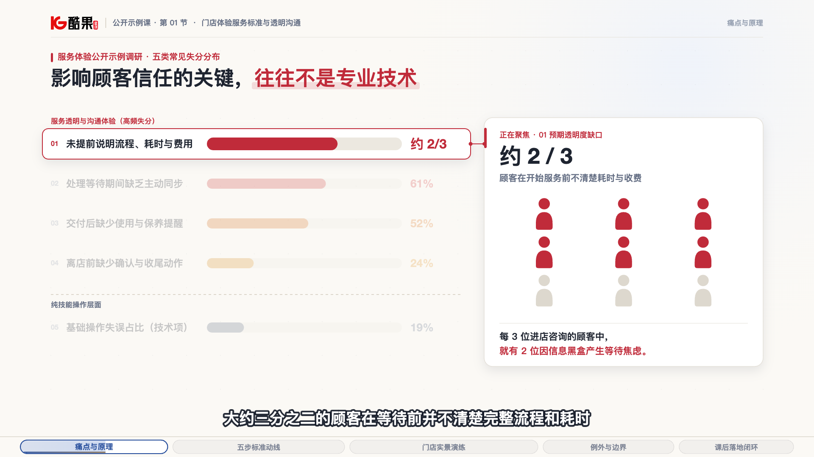
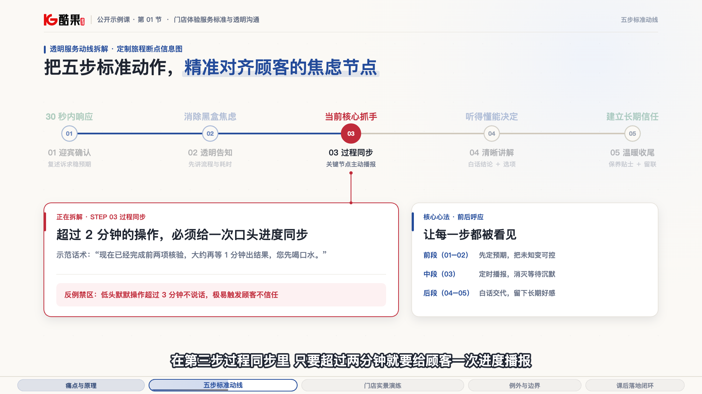
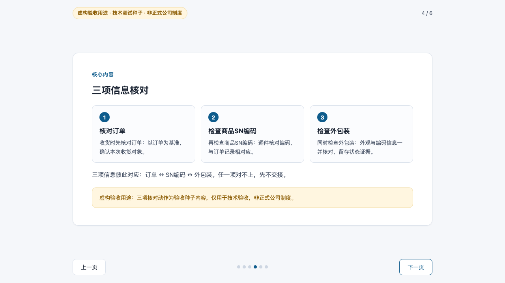

<div align="center">

# 酷果星创 · 企业培训课程全链路引擎

**Instructional Design × Code-Driven Motion × Deterministic QA**

面向企业培训团队、内训师与内容工程团队的开源 Agent Skill 套件。<br>
以经典教学设计与多媒体学习原理为底座，将企业原始业务资料直接编排为可溯源、可增量修改、可离线配音的系列 1080p 动画课程与配套学习资产。

[](https://github.com/hebokenn/kgxc-corporate-course-skill/releases/tag/v9.0.0)
[](LICENSE)
[](docs/DEPENDENCIES.md)
[](#快速开始)

[快速开始](#快速开始) · [核心能力](#核心能力) · [设计原理](#设计背后的经典教学设计认知与信息设计原理) · [实渲演示](#实渲演示) · [下载 v9.0.0](https://github.com/hebokenn/kgxc-corporate-course-skill/releases/download/v9.0.0/kgxc-course-suite-v9.0.0.zip)

</div>

---

### 架构定位：把企业制课变成确定性工程流水线

传统 AI 课件与视频生成往往停留在“文档摘要 + 静态模板拼贴”：业务条款的适用条件与例外容易丢失，同一组数据在图表、卡片与旁白间重复堆砌，局部修改常意味着全片返工。

本套件采用 **教学设计引擎（`elearning-course-design`）** 与 **代码动画制片引擎（`corporate-training-motion`）** 双核解耦架构，完整覆盖从知识拆解到工程验收的每一环：

| 维度 | 说明 |
| --- | --- |
| **原始输入** | 制度 PDF / Word / PPT、扫描件与图表、产品手册、业务 SOP、现场访谈音视频 |
| **多态交付** | 多集 `1080p / 24fps` 有声动画系列视频（含精准无标点字幕与独立封面），或独立交互课件（PPTX / HTML / PDF），同步输出《讲义精要》、章节测验题库与 A4 可打印实战作业 |
| **工程保障** | 原件要点覆盖台账 → 全集视觉多样性蓝图 → 逐句毫秒级音画咬合 → 分场景增量并行重渲 → 自动化遥测与实帧双验收门禁 |
| **运行边界** | 纯正标准 `SKILL.md` 与对话 / CLI 工作流，原生兼容 **Antigravity、Claude Code、Codex、Cursor、Windsurf、WorkBuddy、Trae**；全程本地离线 `Qwen3-TTS` 配音与渲染，原始业务资料不外传 |

---

## 快速开始

无需手动配置目录或记忆终端命令。**将下面这段话直接发给你正在使用的 AI 助手**，AI 会自动拉取仓库、完成本地安装与环境体检：

```text
请帮我安装这个企业培训制课 Skill：https://github.com/hebokenn/kgxc-corporate-course-skill
（macOS Apple Silicon 请运行仓库安装脚本 ./install.sh --agent both；若只需加载 Skill 规范也可安装 skills/corporate-training-motion 与 skills/elearning-course-design，安装好后告诉我怎么开始做第一门课。）
```

<details>
<summary>手动安装 / 环境体检（doctor）/ 校验清单 / 开课示例</summary>

1. **下载 ZIP 双击安装**：[下载 `kgxc-course-suite-v9.0.0.zip`](https://github.com/hebokenn/kgxc-corporate-course-skill/releases/download/v9.0.0/kgxc-course-suite-v9.0.0.zip) → 解压 → 双击`安装或更新.command`（升级自动保留个人配音、设置与已有课程工程；仅同步 Skill 可运行 `./install.sh --skill-only --agent both`）。
2. **命令行体检（核验 FFmpeg / Chromium / 本地 Qwen3-TTS）**：
   ```sh
   "$HOME/.local/bin/kgxc-course" doctor
   ```
3. **校验与依赖**：[SHA256SUMS 校验清单](https://github.com/hebokenn/kgxc-corporate-course-skill/releases/download/v9.0.0/SHA256SUMS) · [完整依赖说明](docs/DEPENDENCIES.md) · [已停用的 v7.2.0 历史插件归档](docs/ARCHIVE.md#历史-dsh-桌面插件安装备份已停用仅作历史存档)

**安装完成后，附带业务资料发给 AI 即可开课：**

```text
请用 corporate-training-motion，把我提供的资料做成《收货核对流程》培训课。
受众：新入职门店同事。
目标：能找到并核对订单、商品 SN 和外包装信息，按原文要求完成交接。
交付：完整系列视频（或改为“只交付独立 HTML/PPTX 课件 + 逐字稿 + 题库”）。
先做资料诊断与原件要点梳理，等我确认大纲后再推进后续制作。
```

</details>

---

## 核心能力

### 一、前端教学设计引擎（`elearning-course-design`）

先把企业资料读透，再转写成一线同事听得懂、用得上的实战课程：

| 能力模块 | 解决的问题与核心做法 |
| --- | --- |
| **多源资料解析与来源台账** | 解析 PDF、Word、PPT、扫描件图表及访谈录音；逐页建立来源台账，单列**业务规则、触发前提、适用条件与例外**，杜绝 AI 臆造审批流程或制度数字。 |
| **无原件视角上下文自检** | 假定听课学员手头没有原始附件，自动改写“如图/见原表”等悬空指代，首次提及表单与界面时先交代名称、用途与查看位置。 |
| **实战情境重构与关键决策提问** | 拒绝空洞口号，按“工作触发情境 → 动作判断 → 规则依据 → 示范 → 练习反馈”写稿；在影响课程边界的节点以 1–3 个简洁选项交由人工确认。 |
| **口语短标题、去标题连读与新人友好** | 标题短促说人话（建议 ≤ 14 字）；隐藏全部小节标题连读正文依然无缝过渡；面向新人先讲白话原理再引术语和红线规则。 |

### 二、视觉、动效与角色引擎（`corporate-training-motion`）

全程代码驱动的 1080p 渲染体系，在保持流程高度可复用的同时，杜绝静态 PPT 拼图与固定组件排列组合：

| 能力模块 | 解决的问题与核心做法 |
| --- | --- |
| **杂志级信息层级与定制信息图** | 融合极简去框排版与定制信息图：统一对齐 12 栏网格，每屏仅保留 **1 套无框观点大标题**（杜绝双标题叠罗汉与漂浮胶囊贴纸）；采用“左证据 + 右洞察”分工（严禁左图右卡复述同一组数字），内置分组水平聚光灯条、人像点阵、横向旅程断点与虚线防剧透骨架清单，并鼓励按每课业务现场定制专属图形。 |
| **全集视觉多样性蓝图（防 AI 偷懒套模子）** | 写渲染代码前强制通过 [`check_visual_blueprint.py`](skills/corporate-training-motion/scripts/check_visual_blueprint.py) 蓝图校验：拦截同屏数据复述、限制同一内置图表每集最多出现 **1 次**、禁止相邻信息页复用相同构图骨架，并要求信息密集剧集包含业务现场定制图形。 |
| **共享电影级导演引擎与开放画布** | 试看小样与全集正片共用 [`director_stage.js`](skills/corporate-training-motion/workbench/motion/director_stage.js) 内核，确保成片水准不降级。画面严跟旁白开口时刻逐项浮现（零提前剧透）；镜头推拉到位即停稳、总结页定机位零晃动；深度拆解停留在开放画布从容展开，硬门禁拦截快闪翻页 PPT。 |
| **可动矢量角色与物理接地道具互动** | `CourseActorsCute` 代码骨骼驱动，具备闲逛、迎宾、快步、离场等情绪化步态与自然口型眨眼，脚底实时接地；对话气泡与花字自动避让人物与 Logo；手机、名片、二维码等道具遵循物理接地（桌面展机 / 手持握紧 / 弧线递交 / 引导线屏幕特写），并支持通过 [`web_asset_search.py`](skills/corporate-training-motion/scripts/web_asset_search.py) 检索开放许可实景素材。 |
| **分段章节导航与高对比浅色画布** | 画面底部按各章真实音频时长自动生成胶囊式分段进度条（已学 / 当前推进 / 未学三态），单行无标点字幕独立避让；内置 16 套 WCAG ≥ 4.5:1 明亮浅色画布，确保视频、课件、讲义与题库视觉统一。 |
| **分场景增量重渲与多路并行出片** | 自动按场景切片、计算内容指纹并多路并行渲染；局部修改 1–2 个场景时，未改场景直接无损复用并在数秒内无缝拼回 1080p 成片，同时合并全量等价的质检遥测。 |

#### 9.0 引擎实渲画面画廊（公开脱敏示例）

以下 4 张 1080p 画面均由本套件 `DirectorStage` + `CourseActorsCute` + `VisualMetaphors` 9.0 引擎直接代码实渲，展示实景角色演绎与多样化信息图的交替节奏：

<table>
  <tr>
    <td width="50%" align="center">
      <br>
      <sub><b>信息层级 × 聚光灯 × 人像点阵</b>：唯一 L1 标题、分组水平条聚光灯退阶，右侧用 3×3 人像点阵翻译体感（零数据复述）</sub>
    </td>
    <td width="50%" align="center">
      <br>
      <sub><b>12 栏无框清单 × 虚线骨架防剧透</b>：未讲到的步骤以柔和虚线编号槽占位，兼顾零剧透与整屏构图稳重</sub>
    </td>
  </tr>
  <tr>
    <td width="50%" align="center">
      <br>
      <sub><b>实景门店演绎 × 物理接地道具互动</b>：<code>CourseActorsCute</code> 接地步态、手持真机、手部锚点引导线屏幕特写与防压字气泡</sub>
    </td>
    <td width="50%" align="center">
      <br>
      <sub><b>横向旅程断点图 × 视觉多样性</b>：按业务动线定制流程断点图与引导线拆解，拒绝单集重复套用同一图表模子</sub>
    </td>
  </tr>
</table>

#### 设计背后的经典教学设计、认知与信息设计原理

本套件的规则与门禁均源自成熟的教学设计与信息视觉方法论，并将其工程化为可校验的渲染原语与硬门禁（仅列本仓库已实际落地的部分，遵循公开资料口径，不宣称第三方机构官方认证）：

| 所属阶段 | 借鉴原理 / 方法论 | 解决的真实制课痛点 | 在本套件中的工程化落地 |
| --- | --- | --- | --- |
| **教学设计**<br>（前端） | **ATD 电子学习设计与 ADDIE / 5P 模型**<br>（Commit · Process · Practice · Prove · Perform） | 把制度原文直接缩写念稿，缺少业务情境、试做反馈与岗位落地支撑。 | [`elearning-course-design`](skills/elearning-course-design/references/research-and-methods.md) 将教学设计与制片解耦，按“情境触发 → 动作判断 → 规则依据 → 示范 → 练习反馈 → 岗位作业”组织课程，先审大纲与来源台账再进制作。 |
| **教学设计**<br>（前端） | **CMU Eberly Center 教学目标对齐原则**<br>（Learning Objectives Alignment） | 讲的内容、练的题目与考核目标脱节，用“看完率/满意度”替代能力证据。 | 按可观察的岗位行为目标反推内容取舍与测验题，改动目标、讲稿或练习任一项时联动复核其余项。 |
| **认知节奏**<br>（中段） | **Vanderbilt《Effective Educational Videos》与稳定阅读节奏模型** | 把“动画播完/旁白念完”当成“学员读懂”，或机械插入大片静音凑时长导致拖沓。 | [`45-reading-and-information-pacing.md`](skills/corporate-training-motion/references/45-reading-and-information-pacing.md) 将**动作、信息曝光与讲解**三轨分离：淡入和位移不计入有效阅读，稳定阅读窗口与同任务旁白自然重叠。 |
| **可读无障碍**<br>（底座） | **W3C WAI 音视频无障碍规划 & WCAG 对比度下限（≥ 4.5:1）** | 配色发灰看不清、字幕与开口错位，或课后缺乏可检索的文本替代材料。 | [`47-course-palette.md`](skills/corporate-training-motion/references/47-course-palette.md) 的 16 套明亮浅色画布均做 ≥ 4.5:1 对比校验；同步交付开口对齐的无标点 `.srt` 字幕与《讲义精要》。 |
| **信息视觉**<br>（9.0 升级） | **Richard Mayer 多媒体学习认知理论**<br>（冗余 Redundancy / 信号 Signaling / 空间临近 Spatial Contiguity / 一致性 Coherence） | 旁白、左侧图表与右侧卡片同时重复同一组数字导致认知过载；标注远离目标对象。 | **三通道分工**：旁白讲因果、主图展结构、文字仅作极简锚点；门禁 A 硬拦截同屏双载体数据复述；细引导线与分组大括号就近锚定数据对象。 |
| **信息视觉**<br>（9.0 升级） | **唯一视觉重心与三级字阶**<br>（Rule of One + Visual Hierarchy + 眯眼测试 Squint Test） | 页眉、副标题与彩色大胶囊同时抢戏，观众难以判断第一眼焦点。 | 每屏强制仅 **1 套无框 L1 观点标题**与 **1 个视觉主角**；门禁 A 拦截双主标题叠加，门禁 B 加入「眯眼测试」否决项。 |
| **信息视觉**<br>（9.0 升级） | **Vox / Kurzgesagt / Apple Keynote 信息叙事**<br>（聚光灯降噪 / 人像点阵 / 12 栏网格骨架先行） | 多项数据全亮抢眼；抽象分数缺乏体感；“防剧透”造成半屏空洞与孤立飘字。 | 讲哪项只高亮哪项、其余退阶至 24% 透明度；用人像点阵把抽象比例翻译为顾客体感；分步清单先呈现虚线编号骨架槽，兼顾零剧透与构图平衡。 |
| **AI 工程**<br>（9.0 升级） | **对抗 AI 最小路径执行**<br>（Anti-Satisficing / Goodhart's Law） | 当规则写死少量组件名和数值门禁时，AI 会走省力的应试路径，用同一套柱图和卡片反复排列组合。 | [`70-v9-editorial-info-design-and-diversity.md`](skills/corporate-training-motion/references/70-v9-editorial-info-design-and-diversity.md) 解绑旧组件的强制调用，以**全集视觉多样性蓝图**与运行期形态重复遥测倒逼每课按业务现场定制视觉。 |

> 内置人物预设与品牌片头片尾默认面向酷果星创及 Apple 门店零售场景；其他企业与讲师团队可完整复用整套教学设计、动效渲染与配音质检体系，并替换为自有品牌视觉。

<table>
  <tr>
    <td width="33%" align="center">
      <br>
      <sub><b>双核全链路工作流</b>：从原件拆解到多态交付闭环</sub>
    </td>
    <td width="33%" align="center">
      <br>
      <sub><b>16 套明亮浅色画布</b>：WCAG ≥ 4.5:1 对比度校验</sub>
    </td>
    <td width="33%" align="center">
      <br>
      <sub><b>CourseActorsCute 角色阵营</b>：可动骨骼、步态与便装扩展</sub>
    </td>
  </tr>
</table>

### 三、离线安全配音、双门禁验收与多态交付

| 环节 | 核心能力 |
| --- | --- |
| **本地离线配音与音色克隆** | 全程本地运行 `Qwen3-TTS`（内置获授权的 **didi 男声**、**pipi 女声**，支持克隆自有讲师声线），原始制度与音频不出本机；内置解码防截断补丁与尾音能量检测，确保每句末字自然收尾。 |
| **逐句音画咬合与发音分离** | [`tts_sync.py`](skills/corporate-training-motion/scripts/tts_sync.py) 按最小视觉意群合成，实测每句真实开口时刻与词锚点并生成单行无标点 `.srt` 字幕；支持口播与字幕发音分离（如 `WOW` 读“哇哦”、章节号不读前导 0，且可逐句覆写多音字/缩写），自动混入 48 kHz 原库提示音。 |
| **一套资料，四种交付形态** | 按需交付：**多集 1080p 系列视频套件**（视频 + 字幕 + 封面 + 讲义 + 题库 + A4 手写作业）、**单支重点视频**、**独立交互课件（PPTX / DOCX / PDF / HTML）**；所有过程工程默认保留。 |
| **双验收门禁与无损音频热替换** | **门禁 A**（[`verify_delivery.py`](skills/corporate-training-motion/scripts/verify_delivery.py)）自动拦截步态飘移、压字、画面抢跑、原地覆盖、同屏数据复述、双主标题、图表模板重复、悬空道具、快闪 PPT 与晃动总结页；**门禁 B** 对最终 MP4 抽帧执行实画与眯眼测试目检。仅微调少量发音且落入原槽位时，支持无损热替换音轨，数秒复验交付。 |

| 内置授权音色 | 典型适用位置 | 实声试听 |
| --- | --- | --- |
| **didi · 男声** | 步骤拆解、系统示范与要点提示，清晰利落 | [在线试听 MP3](https://raw.githubusercontent.com/hebokenn/kgxc-corporate-course-skill/main/docs/media/voices/didi-audition.mp3) · [下载 WAV](docs/media/voices/didi-audition.wav) |
| **pipi · 女声** | 课程导入、情景对话与概念阐述，自然亲切 | [在线试听 MP3](https://raw.githubusercontent.com/hebokenn/kgxc-corporate-course-skill/main/docs/media/voices/pipi-audition.mp3) · [下载 WAV](docs/media/voices/pipi-audition.wav) |

<table>
  <tr>
    <td width="50%" align="center">
      <br>
      <sub><b>独立交互课件分支 · 知识结构页</b>：不录视频也可直接交付可授课 HTML / PPTX / PDF 课件</sub>
    </td>
    <td width="50%" align="center">
      <br>
      <sub><b>独立交互课件分支 · 情景练习与反馈页</b>：自动配套与学习目标对齐的演练任务与核对判据</sub>
    </td>
  </tr>
</table>

---

## 实渲演示

以下 69 秒全能力演示片直接由 **Antigravity 调用本套件**实渲产出（含本地双声配音、原库提示音效、`CourseActorsCute` 动画演绎、16 套浅色画布与 `verify_delivery.py` 全项技术校验）：

[](https://hebokenn.github.io/kgxc-corporate-course-skill/)

**[在线观看 69 秒演示片（GitHub Pages）](https://hebokenn.github.io/kgxc-corporate-course-skill/)** · [下载 1080p MP4](docs/media/v71/kgxc-v71-promo.mp4) · [下载无标点 SRT 字幕](docs/media/v71/kgxc-v71-promo.srt) · [查看第 0 帧独立封面](docs/media/v71/kgxc-v71-promo-cover.png)

> 更早 5.x / 6.x 历史版本的旧演示片、风格样片与过往工作台界面已归档至：[历史版本归档](docs/ARCHIVE.md) · [在线历史画廊](https://hebokenn.github.io/kgxc-corporate-course-skill/archive.html)

---

## 端到端协作流程

| 阶段 | AI 自动完成 | 你只需确认 |
| --- | --- | --- |
| **1. 资料拆解与设计** | 解析多源原件，建立来源台账、学习目标与单课/系列课结构 | 教给谁、学什么、重点范围 |
| **2. 原件对照与逐字稿** | 核对要点覆盖、单列条件与例外、完成去标题连读与新人友好自查，并锁定原件/讲稿哈希 | 核对取舍说明与讲法后确认 |
| **3A. 独立课件与配套文档** | 交付可面授或录屏的 PPTX / HTML / PDF 课件、《讲义精要》、测验题库与 A4 手写作业 | 核对授课节奏与练习难度 |
| **3B. 视觉定调、蓝图与小样** | 输出 3 套视觉母版定调，先通过 [`check_visual_blueprint.py`](skills/corporate-training-motion/scripts/check_visual_blueprint.py) 全集多样性蓝图校验，再导出 3 段跨章节有声小样 | 选定画布风格、视觉蓝图与声音节奏 |
| **4. 并行出片与双门禁交付** | 沿用小样导演引擎分集并行出片，经门禁 A（自动化遥测）+ 门禁 B（成片抽帧与眯眼测试）后交付至桌面；后续局部修改支持分场景增量重渲与秒级音频热替换 | 验收成片或对话指定局部微调 |

---

## 适用环境、开源边界与文档索引

- **运行环境**：完整本地渲染与离线 `Qwen3-TTS` 配音已在 **macOS Apple Silicon（arm64）** 实测验证；标准 `SKILL.md` 兼容 Antigravity、Claude Code、Codex、Cursor、Windsurf、WorkBuddy、Trae，模型推理沿用宿主原生配置。
- **开源协议与共创**：自研引擎代码、工具链与通用规范采用 **[Apache License 2.0](LICENSE)**；酷果星创品牌视觉、专有工服角色、R5/R8 片头片尾及第三方字体音效沿用 [THIRD_PARTY_NOTICES.md](THIRD_PARTY_NOTICES.md)。由 [@hebokenn](https://github.com/hebokenn) 主导设计与维护，携手 **Antigravity（[Gemini](https://github.com/gemini-code-assist)）** 与 **[Codex](https://github.com/codex)** 协同共创。

| 专题文档 | 链接 |
| --- | --- |
| 使用指南与依赖说明 | [使用指南](docs/USAGE.md) · [依赖说明](docs/DEPENDENCIES.md) |
| 9.0 权威规范（信息层级、多样性与导演硬门禁） | [70-v9-editorial-info-design-and-diversity.md](skills/corporate-training-motion/references/70-v9-editorial-info-design-and-diversity.md) · [60-v8-cinematic-director-and-gates.md](skills/corporate-training-motion/references/60-v8-cinematic-director-and-gates.md) |
| 角色、配音、音效与动效参考 | [角色指南](docs/CHARACTERS.md) · [配音指南](docs/VOICE.md) · [音效库](docs/SOUND.md) · [动效指南](docs/MOTION.md) |
| 归档、完整变更记录与发布规范 | [历史归档 ARCHIVE.md](docs/ARCHIVE.md) · [CHANGELOG.md](docs/CHANGELOG.md) · [RELEASING.md](docs/RELEASING.md) |

---

## 版本更新

### 杂志级信息层级、定制信息图与反套路视觉多样性：核心 9.0.0 · 2026-11-28

- **借鉴经典信息设计与多媒体学习原理，确立融合视觉标准（[`70-v9-editorial-info-design-and-diversity.md`](skills/corporate-training-motion/references/70-v9-editorial-info-design-and-diversity.md)）**：系统吸收 Richard Mayer 多媒体学习理论（冗余/信号/空间临近/一致性原则）、唯一视觉重心（Rule of One + L1/L2/L3 字阶 + 眯眼测试）以及 Vox / Kurzgesagt / Apple Keynote 信息叙事方法，确立「杂志去框排版 + 定制信息图」融合视觉体系；明确“左证据 + 右高一维洞察”分工与“虚线编号骨架槽防剧透”规范，根治双标题叠罗汉、左右同屏复述同一组数据与漂浮圆角胶囊贴纸墙。
- **12 栏网格排版底座与低套路可选原语（[`visual_metaphors.js`](skills/corporate-training-motion/workbench/motion/visual_metaphors.js)）**：新增 `GRID_12` / `gridCols`、`drawQuietTopBar`、`drawEditorialHeadline`、`drawLeaderLine`、`drawGroupingBracket` 基础能力，以及 `drawSpotlightHorizontalBars`（分组水平排序 + 聚光灯退阶）、`drawPictogramGrid`（人像/设备点阵体感翻译）、`drawJourneyFunnel`（横向旅程断点）、`drawEditorialChecklist`（无框行动清单 + 虚线防剧透骨架槽）；同步将 `drawSculptureBar` / `drawKpiRail` / `drawCumulativeStack` / `drawFloatingTag` 从强制契约降级为可选工具，鼓励按业务现场定制原生 Canvas/SVG 图形。
- **对抗 AI 最小路径偷懒：全集视觉多样性蓝图与 9.0 门禁遥测（[`check_visual_blueprint.py`](skills/corporate-training-motion/scripts/check_visual_blueprint.py) / [`director_stage.js`](skills/corporate-training-motion/workbench/motion/director_stage.js) / [`verify_delivery.py`](skills/corporate-training-motion/scripts/verify_delivery.py)）**：新增写渲染代码前的全集视觉多样性蓝图硬检与 Markdown 排期表生成；`DirectorStage` 新增 `recordDataCarrier`、`recordHeadline`、`recordVisualPattern` 及分场景合并等价统计，门禁 A 硬拦截同屏双载体数据复述（`redundant_data_violations`）、双 L1 主标题（`double_headline_violations`）、单集内置图表复用超 1 次与相邻构图模板克隆（`visual_pattern_violations`），门禁 B 增加「眯眼测试」三项目视否决核查。

### 分场景增量重渲、多路并行渲染与无损审计合并：核心 8.3.0 · 2026-11-28

- **分场景增量重渲与自动缓存失效（[`render_director_incremental.mjs`](skills/corporate-training-motion/scripts/render_director_incremental.mjs)）**：新增独立可复用渲染引擎，自动解析导演 HTML 中的各场景函数（兼容 IIFE 闭包内 `SCENE_RENDERERS` 与 `// @scene:start` 标记），按“共享库/公共函数 + 当前场景源码 + 本场景台词/字幕/整帧区间”生成 SHA-256 指纹缓存；修改单个场景时自动复用其余全部未改动场景的 H.264 片段并通过 `-f concat -c:v copy` 无损拼接，修改公共样式/底库/总时长时自动全量失效确保零陈旧画面，同步输出 `render_cache_report.json` 缓存命中回执。
- **单实例多标签页并行渲染（默认 3 路 `--workers 3`）**：单次启动无头 Chrome 后自动派生多路 CDP 工作标签页并行渲染脏场景，首次全量出片与大面积返修均可显著提速。
- **整帧切片与全量等价门禁 A 遥测合并（[`director_stage.js`](skills/corporate-training-motion/workbench/motion/director_stage.js)）**：新增 `DirectorStage.partitionSceneFrames()` 与 `DirectorStage.mergeFrameAudits()`，保证每帧归属零漂移、零重帧/漏帧，并将分场景审计精准合并（含跨场景连续 `card_box` 计数、分段进度条访问并集与 8 类违规汇总），与单次全量渲染保持 100% 门禁 A 等价。

### 累进指标防覆盖、实景手持/递交道具互动与反快闪 PPT 开放画布：核心 8.2.0 · 2026-11-27

- **信息生命周期分级与累进展示原语（根治并列信息原地覆盖）**：在 [`visual_metaphors.js`](skills/corporate-training-motion/workbench/motion/visual_metaphors.js) 新增 `VM.drawKpiRail`（右上角并列指标轨，新项高亮滑入、旧项温和退阶保留）与 `VM.drawCumulativeStack`（同场连续事件/失误链自上而下累进排开），彻底替代单槽位原地改字覆盖；[`director_stage.js`](skills/corporate-training-motion/workbench/motion/director_stage.js) 新增 `auditor.recordMetricSlot()` 与 `kpi/evidence` 同位覆写检测，门禁 A（[`verify_delivery.py`](skills/corporate-training-motion/scripts/verify_delivery.py)）硬拦截 `info_overwrite_violations`。
- **实景道具物理接地、手持插槽与锚定屏幕特写（根治空中悬空无互动手机）**：[`actors_v3_cute.js`](skills/corporate-training-motion/workbench/motion/actors_v3_cute.js) 新增强校验 `heldProp`（`phone` / `qr_card` / `card`）直接绘制在人物手心，并实时导出世界坐标手部锚点 `bounds.frontHand / backHand`；[`visual_metaphors.js`](skills/corporate-training-motion/workbench/motion/visual_metaphors.js) 新增 `VM.drawHandoverProp(fromHand, toHand, progress)` 弧线真实递交、`VM.drawScreenInset(anchorPt, boxRect, opts)` 锚定屏幕功能特写窗，并为 `draw3DPhoneProp` 增配 `opts.showOrbit` 开关；规范与门禁 A（`auditor.recordProp` / `floating_prop_violations`）硬拦截 `cinematic_store` 实景门店中的无互动悬空道具。
- **反快闪 PPT 开放画布原语与高频翻页拦截**：新增 `VM.drawOpenChapterDots`、安全限高（`<= 210px` 防压上方浮标）`VM.drawSculptureBar` 与累进短浮标 `VM.drawFloatingTag`，并在 [`60-v8-cinematic-director-and-gates.md`](skills/corporate-training-motion/references/60-v8-cinematic-director-and-gates.md) 明确深度拆解段每主题停留 10–24 秒、禁止把每 2–4 秒整屏翻页的大卡片伪装成 `kinetic_metaphor`（同时注明 `drawStampBadge` 含前景色 `fg` 完整签名）；门禁 A 新增 `auditor.recordPanel` / `rapid_card_flip_violations` 硬拦截巨幅卡片快闪翻页。

### 根治 Qwen3-TTS 克隆音色吞尾字、清畸形双标点与双窗口尾音防切检：核心 8.1.2 · 2026-11-27

- **根治 Qwen3-TTS 克隆模式句尾吞字（[`qwen3_tts.py`](skills/corporate-training-motion/scripts/qwen3_tts.py)）**：定位并修补上游 `mlx_audio` 解码器 `speech_tokenizer.decode()` 中 `(audio_codes[..., 0] > 0).sum()` 将第 0 层合法语音 token `0` 误判为 padding 导致每遇 1 个 `0` 就硬砍句尾 80ms 的缺陷（`didi` 参考音固定含 1 个 `0`，叠加句内 `0` 造成每句被裁 80–240ms、末字没念完）；在模型加载后自动注入 `>= 0` 兼容补丁并写入侧车溯源字段 `decode_zero_token_patch`，不依赖改动 venv 第三方包，彻底恢复自然完整收尾。
- **清理句尾畸形双标点 + 30ms/80ms 双窗口尾音防切检（[`tts_sync.py`](skills/corporate-training-motion/scripts/tts_sync.py)）**：新增 `prepare_tts_text()` 将分句末尾的 `，、：；——` 规范替换为单句号，杜绝喂入 `，。`/`——。` 干扰韵律；`check_tail_energy()` 升级为 30ms（`> -24 dB`）与 80ms（`> -20 dB`）双窗口截断监测，复用缓存前自动复检并拒绝复用意已截断旧录音，异常时扩展 4 组候选种子择优重配。

### 逐字稿说人话、去标题连读衔接与零基础新人友好：核心 8.1.1 / 教学设计 2.1.2 · 2026-11-27

- **标题口语化硬规范（建议 ≤ 14 字）**：在 [`elearning-course-design/SKILL.md`](skills/elearning-course-design/SKILL.md)、[`script-authoring-quality.md`](skills/elearning-course-design/references/script-authoring-quality.md)、[`corporate-training-motion/SKILL.md`](skills/corporate-training-motion/SKILL.md) 与 [`59-streamlined-series-and-selfcheck.md`](skills/corporate-training-motion/references/59-streamlined-series-and-selfcheck.md) 统一明确课程、分集与小节标题须短促自然像真人和同事说话，杜绝“XX与XX：先XX再XX”式书面拼词冒号长标题，直接适配视频章节过场页与底部融合胶囊进度条排版。
- **去小标题连读无缝衔接自查**：明确视频中小节标题默认作画面过场页与底部进度条标签、不生硬照念；要求每两节交界处的口播正文自带自然承接过渡句，并在送审自查清单中强制执行“隐藏全部小标题从头连读检验”，杜绝只听口播时跨节突然跳题断层。
- **零基础新人友好写作规则**：面向全员或包含新员工的课程，要求开篇 30–60 秒先用生活化大白话讲清业务或工具本质；首次出现业务缩写、系统名或内部行话坚持“先白话解释、再顺带简称”；讲红线、风控或繁琐规程前先用一句话讲透背后的业务道理（防什么风险、为何这样定），再给标准动作与禁区。

### 声画零抢跑、定机位总结板书与融合胶囊分段进度条：核心 8.1.0 · 2026-11-27

- **底部「融合进度胶囊」分段章节进度条（默认必选，禁退化为单根总条）**：[`visual_metaphors.js`](skills/corporate-training-motion/workbench/motion/visual_metaphors.js) 新增 `VM.drawSegmentedProgressBar(ctx, segments, t, pal, opts)`（方案 A `inline_pill` 高 `48px`，按真实音频时长比例分配段宽并设最小宽度保底，已学浅蓝 / 当前段描边加内部渐进填充与底部蓝金细边 / 未学浅灰三态一目了然，单行字幕独立置于 `y = 988` 避让）；[`director_stage.js`](skills/corporate-training-motion/workbench/motion/director_stage.js) 新增 `DS.buildNavSegments(lines, chapterSpecs)` 与 `auditor.recordProgressBar(navInfo)`，[`verify_delivery.py`](skills/corporate-training-motion/scripts/verify_delivery.py) 门禁 A 硬拦截未接入分段进度条或未随时间轴切换分段的视频。
- **声画零抢跑（起声点实测 + 句内词锚点）**：`tts_sync.py` 自动实测每条 WAV 的真实发声起点 `speech_onset_sec / speech_start` 与 `cue_words` 锚点并从 `speech_start` 对齐字幕；`DirectorStage` 提供 `st.speechT`、`DS.phraseTime(beat, phrase, sceneStart)` 与 `auditor.recordReveal(id, targetAbsTime, visible)`，门禁 A 硬拦截对话气泡或画面元素抢先旁白 > 80ms（`premature_reveal_violations`）。
- **定机位要点总结板书与停稳运镜红线**：`DirectorStage` 新增 `DS.steadyCamera()` 与 `evalCamera` 的 `hold / holdUntil` 停稳区间，支持专用于一屏总结卡与讲义收尾页的 `layout_kind: "summary_board"`（占比 ≤ 22%、定机位零晃动、靠逐条揭示推进），门禁 A 拦截总结板书晃动及知识页全程漂移往返摇摆（`camera_sway_violations`），同时精准区分定机位局部揭示与微抖假动态 PPT。
- **实课双集全量实渲验收**：在真实课程《门店服务体验提升》第 01 节（6 段分段胶囊 / 116 句 / 9,173 帧）与第 02 节（9 段对应购机七步全流程 / 118 句 / 10,094 帧）完成全量 8.1.0 实渲、门禁 A 零错误零警告及门禁 B 多段切换与揭示前后对照帧目检。

### 电影级导演引擎、强契约避让、自然口语发音分离与双验收硬门禁：核心 8.0.0 · 2026-11-26

- **共享电影级导演内核 `DirectorStage`（小样即正片原型）**：新增 [`workbench/motion/director_stage.js`](skills/corporate-training-motion/workbench/motion/director_stage.js)，提供 `resolveTimeline`（Scene vs Beat 双层时间轴，跨句 `sceneT` 单调递增杜绝动画归零重播）、`evalCamera`（多关键帧真实推拉摇移运镜）与 `createFrameAuditor`（运行期逐帧记录人物步态、文字碰撞、PPT 框体占比与机位轨迹，输出 `render_audit.json`）；配套唯一权威规范 [`60-v8-cinematic-director-and-gates.md`](skills/corporate-training-motion/references/60-v8-cinematic-director-and-gates.md)。
- **强契约防漂移 + 智能避让防压字**：`CourseActorsCute` 对 `walkPhase/strideAmp` 与非法 `mood/gesture` 枚举运行期直接抛错阻断飘移，并返回精准 `headRect/bodyRect/exclusionRect`；`VisualMetaphors` 新增 `drawSmartSpeakerBubble` 与 `placeAvoidingActors`，自动避开人物头身、背景 Logo 与字幕安全区，并规范同场景子幕非重叠交接与左边缘气泡安全距。
- **口播发音与字幕分离 + 零重渲局部热替换**：`tts_sync.py --strict-beats` 自动拦截克隆雷同分镜与气泡错位，并内置自然口语规整（默认 `WOW`→“哇哦”、`第 01–09 节`→“第一–九节”不读前导 0，字幕与画面保持原样，同时支持逐句 `tts_text` 覆写）；沉淀片尾音乐末段 `0.35s` 软淡出与落入原槽位时 `-c:v copy` 秒级无损音频热替换经验。
- **不可跳过的双验收硬门禁（门禁 A + 门禁 B）**：`verify_delivery.py` 新增 `--render-audit` 硬校验（零容忍走路飘移、文字压人物、同场景重播、16×16 宏块微抖假动态、PPT 框体 > 25% 或连续 > 2 句及静态机位），并要求从最终编码 MP4 抽取关键帧目视核验；已在真实课程《门店服务体验提升》第 01 节（116 句 / 9,231 帧 / 6 分 35 秒）完成全量实渲与零错误零警告双门禁验证。

### 纯净 Skill 化、移除 DSH 插件并打通纯对话原件覆盖确认：核心 7.3.0 · 2026-11-26

- **全面移除 DSH 桌面插件，聚焦纯正跨平台 Skill**：从主仓库删除 `plugin/`、`plugin.json`、`.codex-plugin/`、`.mcp.json`、`cordis.patch.yml`、`安装制课插件.command` 及插件打包/安装脚本，不再在主分支维护桌面宿主插件；在 [`docs/ARCHIVE.md`](docs/ARCHIVE.md#历史-dsh-桌面插件安装备份已停用仅作历史存档) 保留唯一的 `v7.2.0` 历史插件备份入口。
- **打通纯对话 / CLI 原件覆盖确认闭环（`source_coverage.py` / `workflow.py`）**：修复 7.0.0 移除网页工作台后 `SourceCoverage.confirm()` 仍卡死在 `dsh-user-click` / `preferred_workbench == 'dsh'` 的历史阻塞；新增 `workflow.py source-coverage COURSE --save / --confirm` 命令，在保留当前原件/逐字稿/报告 SHA-256 绑定与防 AI 擅自代确认校验的前提下，允许用户在对话或宿主结构化提问中直接确认原件覆盖报告并推进分镜与出片。
- **统一纯对话操作口径（`elearning-course-design 2.1.1` / `corporate-training-motion 7.3.0`）**：清理 `SKILL.md`、`backend.py`、`ai_review.py`、`studio.py`、`stage_confirmation.py` 及参考文档中的 DSH 专属路径与提示，确保 Antigravity、Claude Code、Codex、WorkBuddy、Cursor 等宿主开箱即用。

### 情绪化多档步速物理、全屏 3 层视差门店与无白框电影级动效：插件 0.12.0 / 核心 7.2.0 · 2026-11-26

- **情绪化多档步速物理与微表演（`workbench/motion/actors_v3_cute.js`）**：新增 `GAIT_PRESETS`、`computeMoodWalk` 与 `paintExpressive`，支持按剧情区分 `stroll`（闲逛 `145px/s`）、`brisk`（轻快迎宾 `265px/s`）、`rush`（急匆匆冲入 `470px/s` + `+9.5°` 前倾与刹车急停回摆）与 `cold_exit`（冷脸快撤 `310px/s`），让着急进店、受压后退与热情迎候形成鲜明表演反差。
- **全屏 3 层视差 Apple 授权门店与无白框开放画布（`workbench/motion/visual_metaphors.js`）**：新增 `drawCinematicAppleStore`（商场玻璃幕墙与阳光斜射、MagSafe/AirPods 配件墙、旗舰灯箱、室内陶瓷绿植、顶棚线性 LED 柔光锥、透视暖橡木体验桌与斜立样机）及 `drawAmbientBackdrop` 开放画布基元，并在 `SKILL.md` 固化“去大白框 PPT 壳”规范。
- **同步纳入 7.1.1 动效库与素材能力**：完整包含真 3D 透视投影 `iPhone 18 Pro`（`draw3DPhoneProp`）、F 型扫读热区追踪、`scripts/web_asset_search.py` 开放许可素材联网检索入库与 5 幕连续运镜宣传片 v4；已完成真实课程 3 支 v7.2 样片（`verify_delivery.py --strict-ppt-guard` 零报错零滞留）与打包发布全检。

### 5 幕连续运镜动效引擎、真 3D iPhone 18 Pro 与联网素材检索：插件 0.11.1 / 核心 7.1.1 · 2026-11-26

- **底层动效与运镜基元升级（`workbench/motion/visual_metaphors.js`）**：新增绝对时间快节奏缓动（`easeOutExpo` / `easeOutQuint` / `easeOutBack` / `spring`）、虚拟相机层 `CameraRig`、多层门店景深背景、**F 型扫读激光热区组件**，以及严格按官方机身比例（`71.9 × 150.0 × 8.75 mm`）构建的**真 3D 透视投影 `iPhone 18 Pro`（冰川蓝全宽三摄平台）**。
- **支持联网检索开放许可素材入库（`scripts/web_asset_search.py`）**：聚合 Openverse 与 Wikimedia Commons 开放许可无水印图库，下载至课程 `project/assets/web/` 并自动写入含来源、许可与 SHA-256 的 `manifest.json` 溯源清单；同步写入 `SKILL.md` 与 `references/34-content-driven-assets.md`。
- **全新 5 幕连续运镜宣传片上线**：推翻旧版 16 页分镜，改用全幅连续运动构图、激光斜劈切场、X 光扫描切代码线框、左旋 5 列穿插高速动效墙、全屏上下画布轮播与五端逐项踩点微动效；全片通过 `verify_delivery.py --strict-ppt-guard` 零错误零警告校验。

### 全链路纯对话制课引擎、CourseActorsCute 可动角色与完整展示焕新：插件 0.11.0 / 核心 7.1.0 · 2026-11-26

- **全链路纯对话交互与公共 CLI 工具**：日常制课全部通过自然对话推进，支持多集系列课统一批次规划与按句最小范围局部返修；新增公共工具 `scripts/tts_sync.py`（支持 16/24/32-bit WAV 尾音能量检测、增量缓存、48 kHz 音效混音与单行无标点 SRT）及 `scripts/verify_delivery.py`（全自动核验 1080p/`yuv420p`、48 kHz AAC、第 0 帧独立封面与 `attached_pic` 嵌入、字幕无标点/零重叠）。
- **统一 `CourseActorsCute` 3.3 头身可动矢量角色**：内置世界坐标零滑步步态、防弹膝盖 IK、行进转向与停步稳态回正、口型同步说话及原版胸标绑定，支持按课程扩展新造型便装顾客。
- **全面焕新展示主页与独立历史归档页**：主页与 GitHub Pages 全面呈现双引擎能力矩阵、由 Antigravity 调用本 Skill 实渲制作的最新版宣传片及极简“发给 AI 自动安装”引导；过往历史版本展示与老旧样片统一归档至 [`docs/ARCHIVE.md`](docs/ARCHIVE.md) 与 `docs/archive.html`。

### 多集系列课母版三选一与 16 套明亮浅色板：插件 0.10.0 / 核心 7.0.0 · 2026-11-24

- **多集系列课统一批次与内容母版三选一**：`storyboard.py` 新增 `template_masters` 与 `segments[].template_id` 校验，整门课程可统一输出分集视频 + 《讲义精要》+ 测验题库 + A4 手写作业。
- **16 套高对比明亮浅色色板与实质自查清单**：默认随机选色池升级为 16 套 WCAG ≥ 4.5 无绿浅色画布；制作端在出片前完成实质自查修精，过程文件默认保留。

<details>
<summary>展开查看更早版本概览（5.7.1 – 6.9.8）</summary>

- **6.9.0 – 6.9.8（DSH 0.9.0 – 0.9.9）**：教学动效节奏参数（预备、弧线与落定）、渐进式任务面板、应用内更新提醒与片头等待预算。
- **5.7.1 – 6.8.2**：原件要点覆盖与条件例外单列、全身可动顾客与对白朝向校验、独立第 0 帧封面规则、原库“叮/嘟咚”音效及本地 `didi / pipi` 参考音色。[查看完整历史与验证记录](docs/CHANGELOG.md)

</details>
