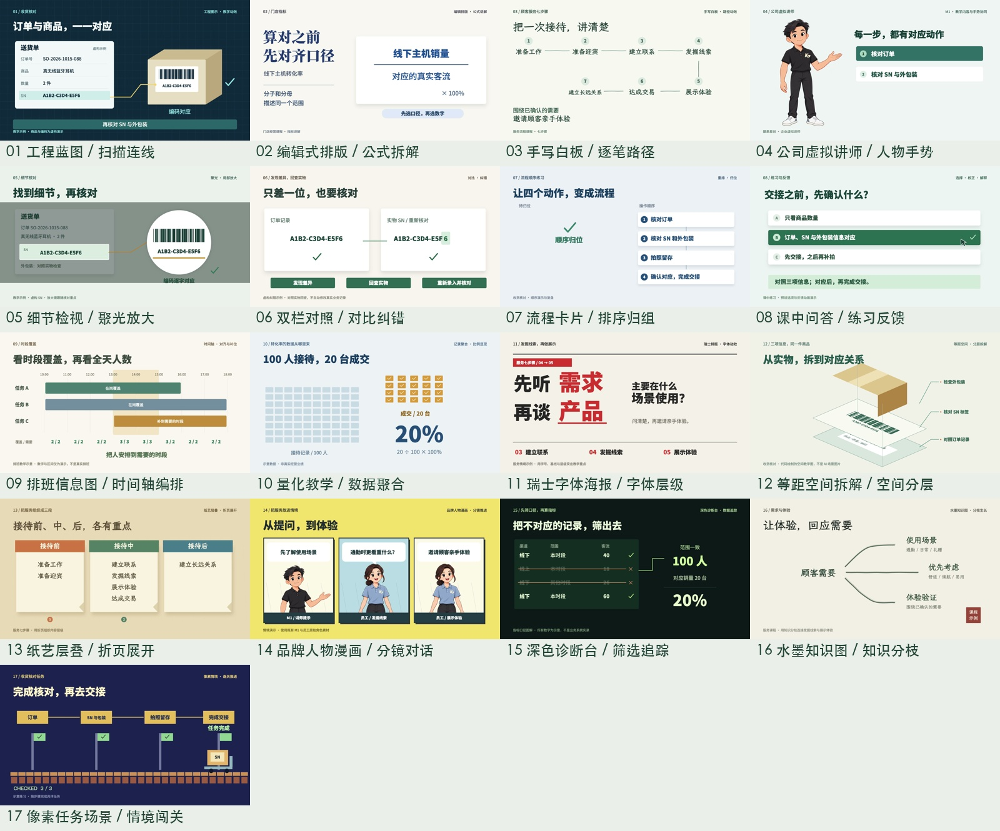
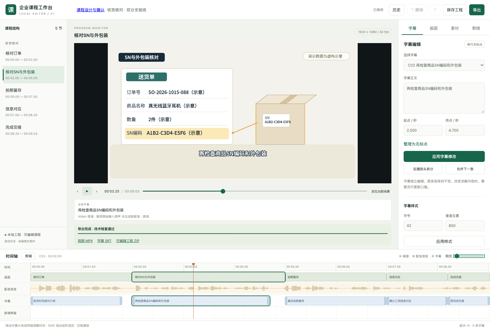
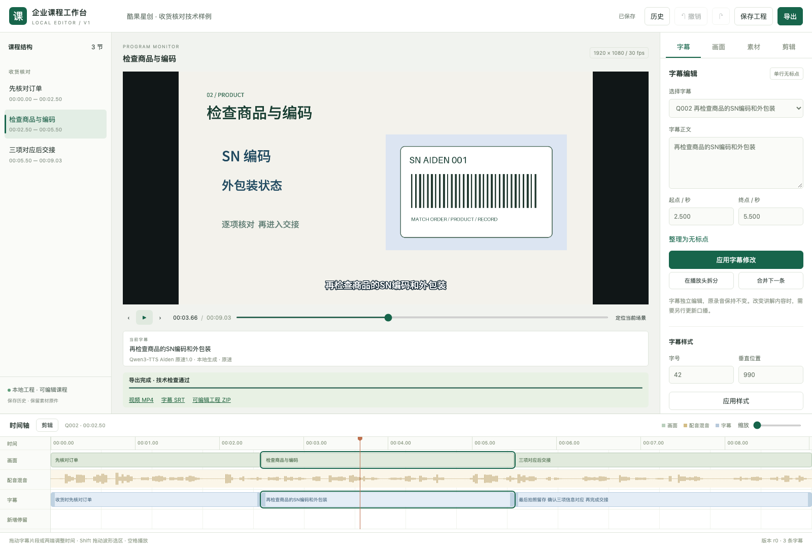
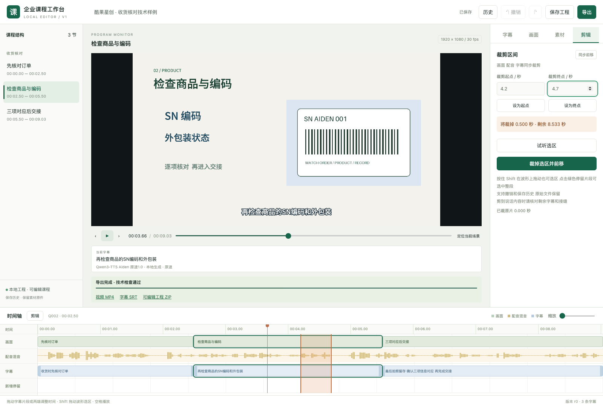
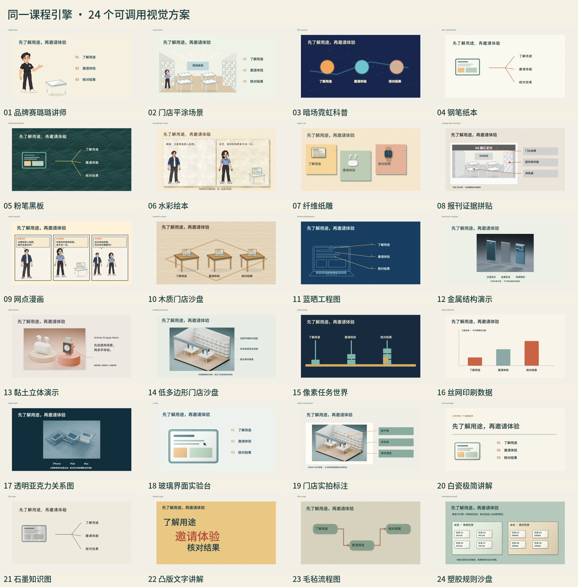
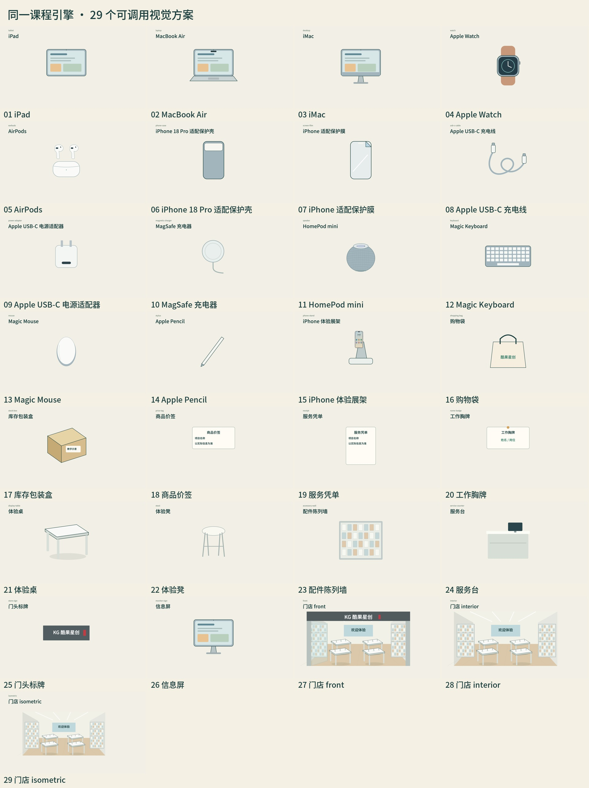
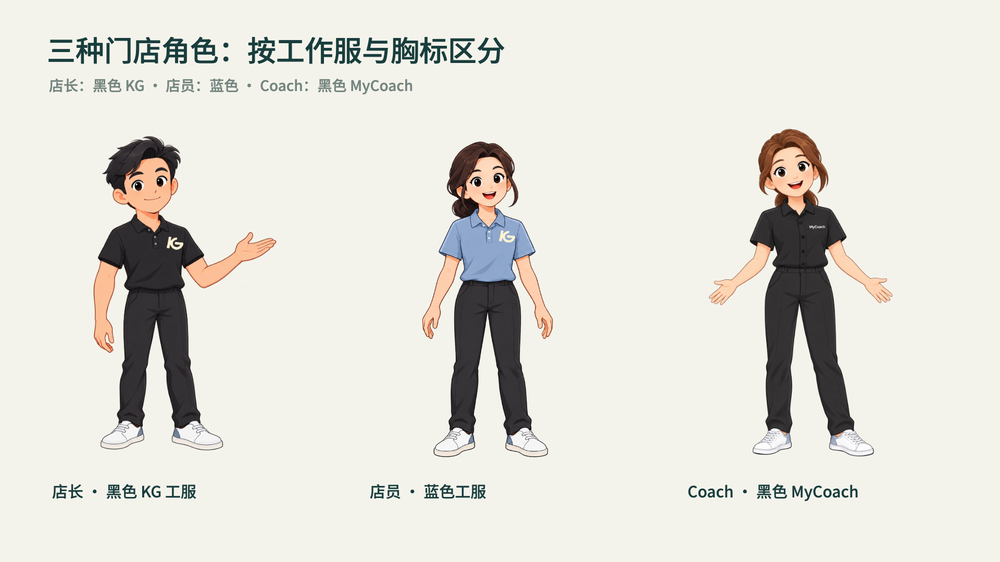
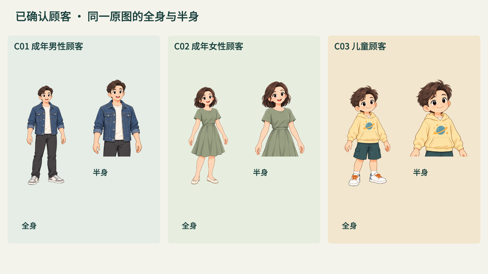

# 历史版本、旧版宣传片与过往素材归档

> **仅用于查阅过往历史版本。** 下列截图、宣传片与旧版操作方式对应 `5.x / 6.x` 阶段；自 `7.1.0` 起已移除旧版浏览器表单（`design.html`）、网页时间轴编辑器（`index.html`）、静态 PNG 人物原图（`C01..C03` / `M1-repaired` / `blue-cast`）与 `acting.js` 模型。[返回新版主页](../README.md) · [查看新版在线演示](index.html)

---

## 历史宣传片与公开演示

- **6.9.8 42 秒宣传片（《耳机一边没声音，怎么接？》）**：演示旧版 DSH 七阶段工作台与此前的人物/音色切换。[GitHub Releases v6.9.8 MP4](https://github.com/hebokenn/kgxc-corporate-course-skill/releases/download/v6.9.8/kgxc-story-trailer-42.mp4) · [历史网页播放器](archive.html?showreel=42)
- **6.9.8 64 秒动效鼓点版**：[GitHub Releases MP4](https://github.com/hebokenn/kgxc-corporate-course-skill/releases/download/v6.9.8/kgxc-kinetic-showreel.mp4) · [历史网页播放器](archive.html?showreel=64)
- **6.9.8 36 秒规则扫读与数据迁移短片**：[GitHub Releases MP4](https://github.com/hebokenn/kgxc-corporate-course-skill/releases/download/v6.9.8/kgxc-motion-promo.mp4)
- **6.9.8 100 种逐项动效图谱**：[下载离线 ZIP](https://github.com/hebokenn/kgxc-corporate-course-skill/releases/download/v6.9.8/kgxc-motion-actions-100.zip)
- **6.1.0 73 秒花字与原库音效样片（《回收价格异议处理》）**：[离线播放页](media/flower-native/) · [GitHub Releases MP4](https://github.com/hebokenn/kgxc-corporate-course-skill/releases/download/v6.1.0/price-objection-native-sfx.mp4) · [对应字幕](media/flower-native/price-objection-native-sfx.srt)
- **5.x 80 秒能力混剪与 17 支独立样片**：[下载混剪 MP4](media/capability-showreel.mp4) · [逐条说明与 17 支样片](SHOWCASE.md) · [v5.0.0 原画质包](https://github.com/hebokenn/kgxc-corporate-course-skill/releases/download/v5.0.0/kgxc-course-effects-17-v1.zip) · [可编辑样片工程](https://github.com/hebokenn/kgxc-corporate-course-skill/releases/download/v5.0.0/kgxc-course-effects-17-editable-v1.zip)
- **5.x 9 秒原生导出有声短片 & 6 页独立 HTML 课件**：[下载短片](media/v5-course-demo.mp4) · [查看字幕](media/v5-course-demo.srt) · [查看 HTML 课件](media/courseware-demo.html) · [课件总览截图](media/courseware-overview.png) · [练习页截图](media/courseware-exercise.png)

---

## 历史网页工作台与旧版界面截图

以下截图展示此前 3.x – 6.x 时期的浏览器表单页与时间轴编辑器界面（7.1.0 起已全面退役，改为对话推进 + 无界面渲染）：

---

## 历史静态人物与早期视觉参考图

以下参考图对应此前静态 PNG 人物（`C01..C03`、`M1-repaired`、`blue-cast`、`MyCoach-reference-2D`）及早期构图实验；现已全面清理并由代码驱动的 3.3 头身 `CourseActorsCute` 取代：

---

## 完整版本历史与早期验证记录

- 逐版本完整变更说明：[CHANGELOG.md](CHANGELOG.md)
- 演示素材来源与历史检验范围：[media/README.md](media/README.md)
