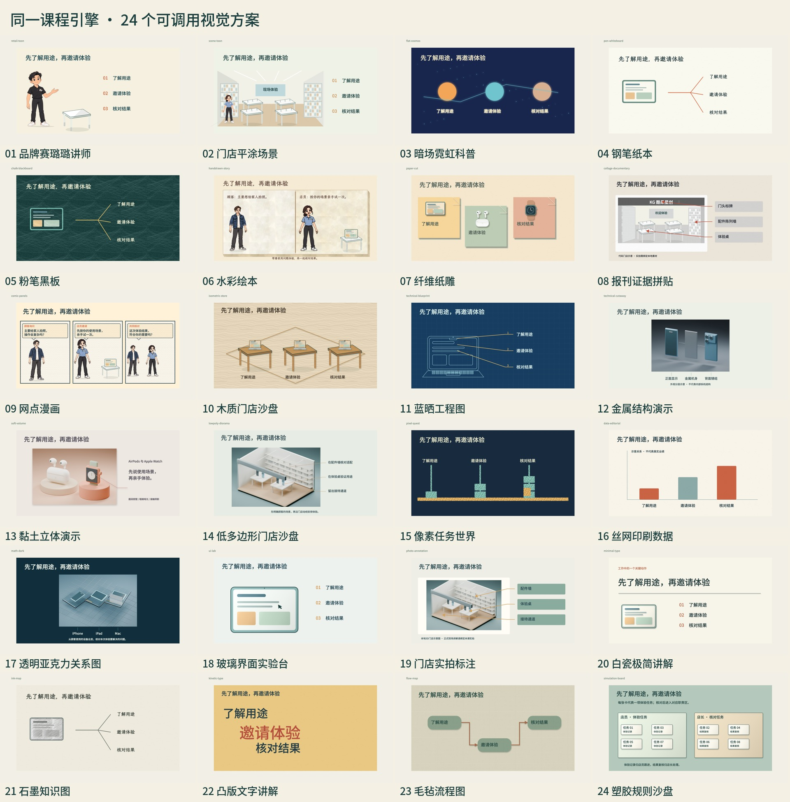
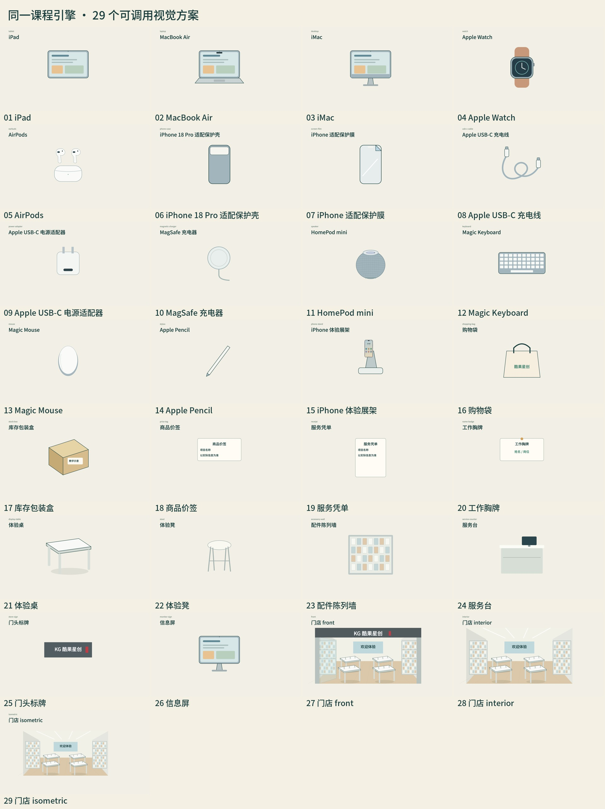
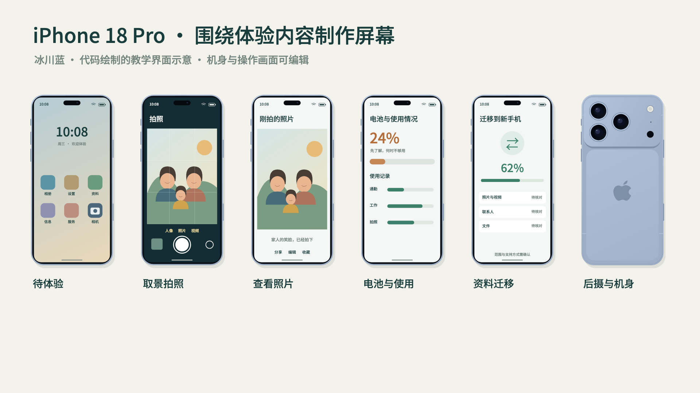
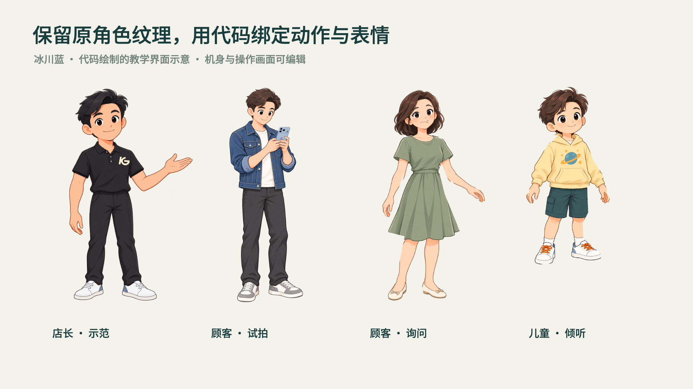

# 版本变更

[返回主页介绍](../README.md) · [安装与使用](USAGE.md) · [配音指南](VOICE.md)

按版本倒序保留功能变化、原主页说明与验证链接。历史段落记录发布时的默认值和验证范围；当前安装、声音与使用方式以主页和对应使用指南为准。

## DSH 对话入口与原生模型 · 2026-11-12（main 源码，待打包发布）

- 将 AI 对话开关移至始终可见的顶部工具栏，支持收起后恢复、刷新状态恢复与窄窗操作。
- 制作、独立审阅和监督使用当前会话实际选择的模型路由，移除个人 Codex 供应商/模型硬限制；仍核对同次任务路由一致性，禁止静默切换。
- 新增浏览器 UI 回归与非 Codex 原生模型路由测试。浏览器测试不等同同事 DSH 桌面实装验证；既有 Release 附件未替换。

## 整课质量基线 · 2026-11-12（制作指引更新）

- 从最近上下篇课程的实际返修中提炼内容分区导航及每区独立进度、关系整合、表现形式去重复、音画语义同步和字体布局验收。
- 花字/音效在分镜规划，主体完成后分层制作与复核；正文、字幕、花字和导航分别留区，不靠增加小字和装饰补信息。
- 保留封面、品牌片头、已确认音轨与名称；局部修改核对最终编码和共用对象，技术证据不冒称连续听审。
- 公共 Skill 尊重宿主当前原生模型；个人供应商/模型偏好不成为共享要求。
- 这是制作指引和验收基线更新，不宣称新增自动视觉识别，也不自动重做历史课程。

## 片头等待范围澄清 · 2026-11-10（文档维护）

- 只要求缩短标题出现后到开讲之间的等待时，保留原品牌动画、标题显现与落定过程，只缩尾部多余定格；停留秒数不作为整片头总时长。
- 制作前分别记录动画、标题、定格与开讲边界，编码后与原片头对照，重算相关字幕、章节、进度和音效。
- 明确现有时长检查不能自动证明动画保留。此次只更新说明和源码文件清单，不更改功能版本或替换既有Release附件。

## 编号与片头校验预览：插件 0.9.0-rc.2 / 核心 6.9.0-rc.2 · 2026-11-10

- 新增 `ordered_reveals`，具体段落、句子区间与显式出现次数绑定每行真实词时；重复过渡词、比例估时、首次模糊命中、时间排序和max钳制拒绝。
- 校验编号连续、旁白进入顺序、纵/横布局、前行保留及音效引用同步；同时整页与逐条出现分别检查。最终编码按实际主流的前/触发/稳定帧测量指定区域存在性，明确不是OCR或连续看听。
- 新增每课 `introPolicy` 和 `intro-check`，包含整个包装、标题静止及正文等待，保存真实选择来源；不把某课秒数做全局默认。缩短后核对字幕、chapterTable、音频/语速、SFX和总显示轴的当前依赖。
- `reveal-check / intro-check` 可一次输入相关多篇；正式执行聚合接入两项检查，现有工作台初始化和配置保留新字段。
- 解码取证关闭输入格式变化时的过滤器重初始化，避免拼接流元数据变动重置帧号。原模型、费用来源、一次盲审、过程保留和正式交付门禁不变。
- [验证范围与限制](verification-release-v6.9.0-rc.2.md)。此版不表示业务课程已经验收，也不更新任何活动课程或运行中插件。

## 执行链预览：插件 0.9.0-rc.1 / 核心 6.9.0-rc.1 · 2026-11-10

- 主合同新增稳定来源要求、阶段适用、派工/结果和当前证据依赖；删除、降级、空实现、旧证据及异常检查默认拒绝。
- 标准/恢复/定制入口共用release_gate；候选与正式引用分开，复制前后重算SHA，实际Finder回读后才写正式交付状态。
- 增加结构去重复、逐事件原句/次数/语义锚点、专门强调、阅读连续曝光、原库音效真实信号及显示时轴章节进度检查。
- 首帧封面默认一帧；独立完成音轨后封装并比较AAC包，排除attached_pic主流误计；未听审不声称结尾或听感通过。
- 预检真实通道与附件能力；完整发送白名单扫描隐蔽制作历史，精确解码帧号，不以重开/换哈希重置盲审和累计。
- 此为候选发布，系统权限隔离与真实连续视听仍独立保留卡点；软件测试范围及安装/运行状态见[验证说明](verification-release-v6.9.0-rc.1.md)。

## 正式发布：插件 0.8.24 / 核心 6.8.2 · 2026-11-09

- 原库音效、重点强调、语义动作、正文原版Logo、分节导航和品牌R5/R8头尾进入同一 `production-contract.json`；恢复交接读取合同，派工传递实际要求、实现位置与待补证据，正式登记核对当前文档及视频，缺项只保留候选。
- 花字接受marker、focus、underline等实现，逐项对应原句、用途、对象、帧与稳定阅读窗口；语义动作按起态、过程、结果与实际连续片段核对，透明度变化或动作次数不冒称教学演示。
- 酷果正文默认固定右上原Logo，仅本课明确选择允许改变位置或显隐；其他企业沿用自己的品牌。R5/R8保留，问候和末句优先当前已确认稿与录音，不自动按旧示例重录、重复添加。
- 中段小样明确延期特征与补验范围；整课不能缺适用品牌、导航、Logo及已启用项。机器结构与证据绑定、实际视听、用户认可分别记录，未验证不填通过。
- 保持每阶段当前选定方案一次盲审、一次汇总固定问题、集中修复与定向验收，不新增模型评审轮次，不重置历史及累计用量。
- 重要业务图示的对象、节点与关系在设计和派工时说明，并配可辨认的正文文字标签；显式 `diagram_labels` 绑定图示、标签、含义与共同可见窗。已登记的绑定核对实际非空正文text节点，拒绝字幕/页眉/导航替代；不按装饰数量推断缺字，不宣称程序证明语义。
- 正常改选分镜仅在原制作偏好绑定仍有效时，续接新已选方案的绑定；原绑定已经过期时继续阻断，不通过改选掩盖待核对状态。
- 编码/解码成功但六项合同未就绪时，内部技术任务保留 `complete` 与 `registration_status=held`，说明“制作候选已生成，待核验，未登记”，候选供作者检查；不提前归档旧成功导出、改变正式引用、登记阶段或桌面交付。合同就绪后沿原流程登记，编码失败与其他错误仍失败，不新增盲审。
- 本版将此前本地六项制作合同正式纳入发布。构建、安装和公开下载分别记录实际结果，见[本版发布验证](verification-release-v6.8.2.md)。结构检查不证明教学、美观或完整连续看听，真实课程仍按当前媒体核验。

## 正式发布：插件 0.8.23 / 核心 6.8.1 · 2026-11-09

- 汇总此前未发布的 0.7.0–0.8.23 完善，保留以下逐版开发历史及验证链接；旧正式版本与 6.5.0 草稿保留。
- 当前方案一次独立学员盲审，问题一次冻结、集中修复、固定清单定向验收；修改哈希、重开或无限次数均不重置盲审。审阅仅针对已选方案。
- 写稿质量前置：岗位场景、动作与依据、示范和练习反馈、自然口语及信息增量自检，保留酷果正文开场问候。
- 原件覆盖、取舍与新增依据、关键条件和例外逐项对照；真实人工确认绑定当前原件/讲稿/报告，变化即失效，模型没有代确认入口。
- 阻止 QA 模拟上下文冒充真实用户改选方案或重置盲审周期；原人工改选、历史及累计规则保持。
- 修复个人偏好建议被一律当作关键问题阻断的实现缺口：明确 advisory 保留为建议，缺省与关键问题仍阻断；拒绝未知严重性。
- 统一主页、插件说明、版本与下载入口；核查公开源码及两个发行包边界。测试、构建、隔离安装及公开下载核对的实际结果见[本版发布验证](verification-release-v6.8.1.md)。本次不运行真实课程、不调用外部模型、不替换运行中的本机安装。

## 本地开发 0.8.23 / 核心 6.8.1

- 新增按原件业务要点计算的覆盖对照，逐项解释舍弃和写稿新增的理由与依据，关键项单列；无来源或读取不足不伪造100%。
- 人工对照确认绑定当前原件、稿件和报告，可与原逐字稿确认一次提交；旧确认保留，内容变化后当前状态待核对。模型工具无确认动作。
- 对照按钮有真实工具范围约束和持久自动审阅抑制，只读来源/稿件和保存对照，不改稿、不出片、不重开盲审。
- 本轮仅合成夹具、插件构建及安装验证，真实课程状态不在本次验证范围。[验证范围](verification-plugin-v0.8.23.md)。

## 本地开发 0.8.22 / 核心 6.8.0

- 每阶段当前选定方案仅一次独立盲审；冻结问题清单后集中修复与定向验收，修改哈希、升级、重开和次数不限均不重置盲审。
- 只审已选方案；未选备选、未来阶段和个人审美建议不扩大当前阻断范围。保留当前证据、未解决问题、历史与累计预算。
- 教学输入对应真实任务、动作与依据、案例和反馈；写稿先检查自然口语、信息增量、无作用重复与酷果开场品牌问候。
- 本轮只做插件及合成夹具验证，不启动真实课程制作验证；公共版本不变。[验证范围](verification-plugin-v0.8.22.md)。

## 本地开发 0.8.21 / 核心 6.7.16

正常历史终态回证支持已经实际结束的Codex app-server原生turn/end错误，保留failed/error与原错误，不改为aborted或成功。既有暂停、身份/操作、单一最新事实、序列/调用及时间与事件哈希检查保持。普通失败、工具错误与缺少终态仍阻止设置修改，历史报告与用量保留。

[验证范围](verification-plugin-v0.8.21.md)。20版及旧安装包保留，当前安装与课程质量分别核验。

## 本地开发 0.8.20 / 核心 6.7.15

独立审阅及监督报告由宿主依据实际冻结调用和原生输入附加缺省版本绑定；已提供的空值/错误字段仍拒绝，真实版本变化继续由后端阻断。模型原始输出与宿主封装独立保存，不追认历史失败，不重置用量或改通道。

[实施与验证状态](verification-plugin-v0.8.20.md)。本地源码已完成离线回归；实际安装及课程完成不得据此预报。

## 本地开发 0.8.19 / 核心 6.7.14

按用户真实指令提供仅本课的配音免人工审批分工，继续记录自动技术核查与未执行连续听审，既有内容/视觉门槛及关键未知不被取消。分镜盲审保留有界、类型明确的阅读窗口；协议字节变化使旧AI报告失效，既有同稿人工确认按原绑定保留。

[验证范围](verification-plugin-v0.8.19.md)。公共发布状态单列，不预报安装或课程完成。

## 本地修复：DSH 插件 0.8.18 · 核心6.7.13 · 2026-11-08

- 从严格绑定的原生制作派发识别当前任务和阶段，避免旧pilot阶段及旧保存失败显示为当前状态。
- 历史失败不删除，实际成功须匹配候选、目标正文和较新revision才标记superseded_by；默认折叠历史，长错误可读。
- AI审阅后端、盲审边界、计费通道和用户听审不变。打包清单中教学设计版本对齐既有2.0.4源文，内容未改。[验证范围](verification-plugin-v0.8.18.md)。仅本地开发。

## 本地修复：DSH 插件 0.8.17 · 核心6.7.12 · 2026-11-08

- 可恢复错误的failure阶段不等于原生任务终止，缺真实终态证据继续阻止切换职责。
- 已核实中止的历史任务经正常failure事件追加回证，旧事件、报告、调用和用量保持；不把旧失败改成成功。
- 沿用用户听审分工及原一次确认，不新增通道、审批或清理。[验证范围](verification-plugin-v0.8.17.md)。仅本地更新。

## 本地更新：DSH 插件 0.8.16 · 核心6.7.11 · 2026-11-08

- 当前课经真实用户选择，可分工为AI审文字与画面、用户听音轨；记录原话来源，保持原模型通道。
- 用户听审声明与当前全部媒体SHA和完整范围绑定，复用原小样/全片确认，不另设审批。模式选择不代记实际听审。
- 非音频的内容、视觉和技术关键项未知继续阻断，保留AI能力、原始报告、失败与累计记录；默认模式行为保持。[验证范围](verification-plugin-v0.8.16.md)。本次为本地开发更新，公共下载不变。

## 本地修复：DSH 插件 0.8.15 · 核心6.7.10 · 2026-11-08

- 补齐原生写入工具请求的目标路径投影；按实际参数及受限补丁头提供请求范围，不转发正文或把请求当作文件系统认证。
- 监督端保留受支持的结构化基线匹配、版本、备份数量与输出目录实际值，核心清洗契约同步接收，避免两层过滤只留下类型而丢掉核对结果。
- 执行监督仍因关键证据不足而阻断；原暂停与失败记录保留，必须通过后续实际核验处理，不追认旧调用。[验证范围](verification-plugin-v0.8.15.md)。

## 本地修复：DSH 插件 0.8.14 · 核心仍6.7.9 · 2026-11-08

- 普通进展合批监督，完整事实逐条持久化；关键原生写入前后仍同步等待，失败、插话及生命周期检查保持。真实元数据顺序回放核对触发次数，不将减少次数等同实际用量或耗时收益。
- 通过SDK真实repeat-tool-reminder生成点和原调用链核验程序提醒，保留进模型及原生pending claim；真人、伪造、外来和已消费重插仍拒绝。
- 仅插件执行层变更，核心6.7.9、四阶段盲审、来源核验、CAS和确认不变。[验证范围](verification-plugin-v0.8.14.md)。

## 本地修复：DSH 插件 0.8.13 · 核心6.7.9 · 2026-11-08

- 执行监督原先只有通用工具标签和退出码，无法核实实际读取及核对任务；补充经过白名单筛选的路径、简单脚本参数、结果断言和哈希。
- 任意正文、复杂shell与自由输出不直接传入；明确区分工具回证和独立实核，保留无法验证状态及历史阻断。
- 插件投影与核心typed清洗共同保留执行元数据，不改学员隔离、CAS、确认或模型通道；边界文件变化按既有规则重验。[验证范围](verification-plugin-v0.8.13.md)。

## 本地修复：DSH 插件 0.8.12 · 核心6.7.8 · 2026-11-08

- 分镜成品投影保留导航标题/目录安全结构化帧窗和已有显示状态，避免将成品中已有信息整体过滤后误报缺失。
- 专门字段/类型白名单继续排除来源、资源路径、目标答案、制作历史与自由timing_budget，不补造覆盖范围或退场规则。其余阶段输入与质量验证/CAS不变。
- 核心边界文件变化按既有策略失效与重验，不绕过边界兼容校验；原正文与同稿真实确认保留。配套源码/主页/包与本机Skill同步。[验证范围](verification-plugin-v0.8.12.md)。

## 本地修复：DSH 插件 0.8.11 · 核心仍6.7.7 · 2026-11-08

- 实际repair事务失败时先登记repair_error，再把原异常交现有failed终结逻辑；不因retry标志重新审阅同一未改成果。失败登记自身报错只附注，不覆盖原错误。
- 提示列明既有storyboard顶层与segment保护字段，局部修订必须服从原导航/时长/风格，不通过搬字段改变规则；守护/CAS本身不变。
- 原学员、制作核验、监督、提案、累计和未知用量均保留，正常实际修改仍进入全新审阅。[验证范围](verification-plugin-v0.8.11.md)。

## 本地修复：DSH 插件 0.8.10 · 核心仍6.7.7 · 2026-11-08

- stdout/stderr在接收data事件前启用UTF-8流解码，避免每个Buffer单独转换时将跨块汉字写成替换字符；不改原件或把坏输入上的旧报告改为有效。
- 真实callReview/callTool子进程复现旧实现3项中文损坏，修后Unicode完整SHA、错误截断、大小、超时及取消检查通过；保留原控制边界。
- 核心6.7.7、原模型通道、工作/只读QA隔离和所有历史保持。[验证范围](verification-plugin-v0.8.10.md)。

## 本地修复：DSH 插件 0.8.9 · 核心仍6.7.7 · 2026-11-08

- 同一原制作agent在普通工作、零工具只读QA及后台任务之间切换时，在实际原生prepare边界验证完整技能清单及其刷新。
- 未产生新目录的分支只从当前可信registry、真实工作目录与有效显示策略派生本轮投影，使用新ID并明确审计，不写回持久历史。
- 预存job通知也须证明真实调用、注册、终态、原producer、inbox邻接及registry；无法证明则保留并拒绝。制作端提示明确规范问题ID并逐项回应，严格CAS不变。
- 真人、伪目录、未知输入及他人任务仍拒绝并保留。工具、取消、系统与完整会话历史保持；QA d50与课程核心不变。[验证范围](verification-plugin-v0.8.9.md)。

## 本地修复：DSH 插件 0.8.8 · 核心仍6.7.7 · 2026-11-08

- 制作端只读核验按原生生成位置识别并剔除精确空技能清单更新，保持原系统、完整当前包、真实用户打断和输入保留。
- 保留未核实消息阻断及已接受盲审的同轮制作恢复，不重开未改成果的盲审。
- 本次只有插件变动，沿用核心6.7.7，不重建或替换其既有安装包。[验证范围](verification-plugin-v0.8.8.md)。

## 本地修复：DSH 插件 0.8.7 · 核心 6.7.7 · 2026-11-07

- 受控制作接收本轮原生工具确实创建、属于原制作agent且已真实结束的后台任务通知，继续读取结果与返回独立审阅流程。
- 通知须与原生工具/任务生命周期和实际所有权对应；来源标签及文本前缀不构成授权，旧任务、他人任务、伪造输入和真实用户打断继续严格区分。
- 保留模型通道、工具权限、取消、持久历史及只读盲审边界，不改后端质量检查。[验证范围](verification-plugin-v0.8.7.md)。

## 本地修复：DSH 插件 0.8.6 · 核心 6.7.6 · 2026-11-07

- 受控已授权制作派发只发送当前任务及当前轮工具结果，保留原制作身份、持久历史、工具、权限、取消和执行监督；自动小样继续复用该路径。
- 生产start在锁内返回首次创建标记，同ID相同起始内容不再派发，已结束/失败的同请求也不重放。
- 私有核验保留旧JSON哈希并增加明确口径、原文及实际文件哈希；不改旧报告或把未知直接改通过。[验证范围](verification-plugin-v0.8.6.md)。

## 本地修复：DSH 插件 0.8.5 · 核心 6.7.5 · 2026-11-07

- 本课制作核验默认10分钟，可在明确暂停且无未结算调用时显式设置30秒至60分钟，保留旧值、依据、设置身份与历史；与次数不限独立。
- 当前新核对包携带真实等待值及有界授权，监督可核对；不改旧冻结包、报告、质量标准、确认及累计。
- 配合原通道适配器等待诊断保留真实失败，不把无事件超时冒称额度或鉴权结论。[验证范围](verification-plugin-v0.8.5.md)。

## 本地修复：DSH 插件 0.8.4 · 核心 6.7.4 · 2026-11-07

- 原制作agent单次核验只发送完整当前核对包与原生系统指令，保留身份、持久历史、原通道和配置；实际出站审计区分保留与排除的历史。
- 分镜包保留必要原件、讲稿、方案、要求及真实发现，去除阶段不可编辑副本与重复旧报告，旧包按路径与SHA保留。
- 同轮制作恢复严格核对当前版本、真实盲审与失败状态，追加新调用而不覆盖失败未知用量；修改后仍需新的独立审阅。[验证范围](verification-plugin-v0.8.4.md)。

## 本地修复：DSH 插件 0.8.3 · 核心 6.7.3 · 2026-11-07

- 支持仅当前课、明确授权、可恢复的临时调用与返修次数不限模式，保留旧上限和累计调用、修复、用量、失败及启停历史。
- 界面区分有限与临时不限，继续显示实际用量和未知调用，不生成巨大伪上限或零费用承诺。
- 当前课可对已验证的执行设置更新显式维护质量策略兼容，绑定旧策略、当前实际代码与未变边界，保留真实三角色通过记录；后续代码或课程变化继续失效。
- 修正分镜证据契约：明确片段ID、字段与逐字引文；可从唯一准确字段定位识别片段。未匹配意见保留为关键无法验证交制作端，不把它改成通过，也不吞掉其他有效意见。
- 来源、教学、视觉、连续视听、隔离和模型通道检查继续执行；已有独立token预算仍约束。[验证范围](verification-plugin-v0.8.3.md)。

## 本地修复：DSH 插件 0.8.2 · 核心 6.7.2 · 2026-11-07

- 用户要求按既有ID补充适用阶段及内容／执行职责；保留原文、证据、历史失败与累计预算，不让未来制作义务阻塞前阶段。
- 制作端明确逐字正文引文与来源引文协议，找不到证据保持无法验证，原句验证不放宽。
- 独立监督取得当前核验结果的有界元数据和拟执行动作，区分正常待修与真实违规放行；不取代来源核验或要求取得原件。[验证范围](verification-plugin-v0.8.2.md)。

## 本地修复：DSH 插件 0.8.1 · 核心 6.7.1 · 2026-11-07

- 实际DSH默认给新agent注册团队工具与required context；只读执行器显式隔离注册表，不把它误认成已发送模型的工具。最终请求零工具、上下文隔离、全部执行拒绝及泄露阻断继续强制。
- 避免重复设置已在新会话header保存的中性工作目录而产生额外inbox消息；实际Team与workingDirectory服务进入无联网推理验证。
- 仅失败会计允许真实调用前审计没有invocation，保存preflight/model_invoked/usage_status。成功报告仍要求真实模型请求记录，累计调用、返修与token预算不回退，不造零用量。[验证范围](verification-plugin-v0.8.1.md)。

## 本地开发：DSH 插件 0.8.0 · 核心 6.7.0 · 2026-11-07

- 正式审阅扩为逐字稿、全课分镜、实际有声小样、当前完整成片四节点；每次使用新的独立原生DSH agent，以当前阶段成品作为唯一学习依据。
- 审阅者不接触原件、目标答案、制作历史、其他阶段稿件和旧评语；真实上下文和工具隔离，报告先复述内容/所得/疑问，再只提问题，不改稿或提供补丁。原件核验与修改属于制作端。
- 分镜新增旁白推进与主体/信息/焦点变化检查，排查长静止页面与字幕或装饰代替主体演示；小样和全片增加全面视觉、表演与视听节奏检查，区分分镜计划、实际画面和无法验证范围。
- 增加独立只读监督侦探agent，核对用户要求与实际生产事件、角色权限、当前版本、模型通道和证据，向总导演/制作端回报。
- 新报告绑定盲审协议、真实agent/session、访问范围和成品哈希；旧知情报告保留，不改称盲审；累计预算与真实用户原话确认保留。分镜检查不凭空增加人工审批。
- 当前通道连续音视频理解限制保持，技术验证、片段或帧检查不冒充全片连续视听；公共发布仍为0.6.0/6.5.0。[本机验证与实际范围](verification-plugin-v0.8.0.md)。

## 本地开发：DSH 插件 0.7.0 · 核心 6.6.0 · 2026-11-06

- 在DSH直接挂载同一份Studio，替代外层iframe；媒体按当前课程授权转接，保留分段读取和修改令牌检查。使用实际生命周期入口的构建指纹复用服务。
- 逐字稿、实际有声小样、当前完整成片三个正式审阅节点；分镜和关键帧作为制作预检。
- 由本课原件、目标、当前要求和偏好形成验收清单，逐项返回通过/需修改/无法验证/不适用，关键项缺证据阻塞。
- 当前文本、实际解码媒体、字幕、已提交图片与检查范围绑定版本；不以抽帧、音轨存在或ASR冒称完整视听。
- AI提出并执行局部精确修改，保留旧稿和差异，核对输入版本以保护审阅期间的人工作业；更新后重新检查。
- 持久化请求与调用预留避免刷新和宿主重开重复消耗。主动继续与按意见修改发起新请求，累计返修、用量及失败保留。
- 修改意见保留在相应节点及后续节点的验收清单；无变化保存不产生新工程版本，未更新的旧媒体不因自动保存触发新审阅。可恢复执行失败在本轮内自动调整，失败策略同样计数。
- 默认每节点三轮自动返修、十二次模型调用，可沿用更紧的token预算；两轮无改善先分析根因。追加范围独立记录，不切换模型与计费来源。
- 每轮完成后汇总一次；关闭与稍后不批准，输入可恢复；AI通过、用户确认、正式桌面交付分别记录。
- 验证与当前能力限制：[0.7.0](verification-plugin-v0.7.0.md)。尚未发布 GitHub Release 或替换公共附件。

## DSH 插件适配 0.6.0 · 核心 6.5.0 · 2026-11-06

- 保存结果与文件处理弹窗显示实际交付目录，可一键在Finder打开。保存和重复保存移除暂存/源文件继承的macOS隐藏标记，避免有文件却看不见。保留/稍后提醒与清理范围扫描分开，版本快照目录正常识别，不再把清理警告重复显示为保存失败。

- 场内对白检查双方在场与头部朝向；真实CourseActors转向、手势及行走进入动作实现校验，避免用横线冒充交接。柜台与人物遮挡纳入连续帧复核。
- 空闲服务结束后，阶段切换检查并恢复同源工作台，不启动模型轮次，保留编辑恢复记录。

- 分镜前合并展示已有/新增顾客、重点花字和提示音效，点击即保存，沿用回答，关闭不代选；新增可提供描述与本课参考图。
- 选择与真实分镜衔接，修改只影响相关视频阶段；当前编码节点、原库混音回执及非静音音效分轨进入交付检查，避免规则存在但成片没有。
- 当前导出与历史失败分开；错误按尝试折叠，旧失败不再铺满界面，最新失败仍明确显示。
- 澄清总部是内部授课立场，不默认自报部门；新人物统一多部件可动结构，按课程情境变更发型和服装，预设不作固定班底；结尾检查保护句的半句残音。
- 保留原件、稿件、小样、配音、旧版本与缓存；仅DSH适配，Codex作为模型通道的使用仍沿用用户设置。
- 实际验证记录：[0.6.0](verification-plugin-v0.6.0.md)。安装、技术验证与业务验收分别记录。

## DSH 插件适配 0.5.0 · 核心 6.4.0 · 2026-11-05 · 本机测试版

- 当前只开发、安装和验证 DSH，Codex 暂缓。
- 新工程默认进入当前会话工作区，外置工程校验迁入，保留课程身份、原件、人工稿和有效确认；活动导出时不迁移。
- 六阶段固定导航，展示真实成果、待确认与变更状态；每个阶段都有独立内容及衔接操作。
- 大纲卡片编辑、拖动、增删拆并；稳定章节/段落身份带动稿件移动，分镜重排并标记下游更新。
- 分章改稿、选段模型建议、差异采用、单调版本与冲突保护；保存不构成阶段确认。
- 分镜方案选择与静态关键帧、小样真实文件和抽样说明、时间点反馈、整课任务/播放/跳转/文件。
- 继续保留原生 AI 对话与主动问答；末题单选真实点选后发送整组，默认推荐和恢复不误发。
- 当前真实课程已迁入其会话工作区，既有三项用户答案写回；未代用户确认大纲或其他内容。
- PDF逐页预览与素材去向、冻结小样区间及逐文件导航、声音参数绑定音频字节；生成失败可续跑，进行中禁止重复提交。
- 11月5日保留规则更新：保存桌面成品默认保留逐字稿、小样、配音、缓存与工程；交付后主动提供保留／稍后提醒／查看范围后确认清理，关闭不删除，明确要求保留的课程不重复询问。清理核对本课版本、短时文件清单和桌面成品字节。
- 各阶段显示当前未回答选择；模型漏调结构化提问时，界面主动请求原生选择窗口，已回答或已委托事项不反复询问。
- 原生验证课已导出完整151.2秒1080p视频并完成桌面文件哈希核验与工程清理；整课冻结文件保留对应导航元数据。修复媒体定位取消请求误报；交付标题沿用实际成片，已完成课程不会在其他阶段重新显示早先错误。
- 验证见[本机验证](verification-plugin-v0.5.0.md)，未公开发布。

## 插件适配 0.4.0 · 核心 6.3.3 · 2026-11-05 · 本机测试版

- 课程与 DSH 会话分别绑定并持久化；旧会话仅从成功制课工具记录迁移，不自动载入全局最近课程。
- 历史课程会话自动进入课程工作台；普通对话顶部保留入口。
- “新建课程”进入新会话和空白编辑区；明确选择旧课才恢复，旧课文件与有效确认保留。
- 异步返回校验当前会话，其他会话完成任务不再切换当前课程。
- 显式切换前保存，快速离开前的输入按课程暂存；其他地方改过稿时展示待恢复文本。
- 教学设计模块 2.0.4 主动调用宿主结构化提问，DSH 使用原生可选问答；右侧收起时有待回答事项自动展开。
- 选项居中展示，最后一道单选题真实点选后直接发送整组答案；预选、恢复、前题跳转和多选均不触发自动发送。
- 验证范围见[本机验证](verification-plugin-v0.4.0.md)，未发布公共版本。

## 插件适配 0.3.0 · 核心 6.3.2 · 2026-11-05 · 本机测试版

- 右侧嵌入 DSH 原生 Conversation，复用同一会话、模型和文件能力；支持收起及调宽。
- 新增资料文件夹与文件加入对话入口；桌面文件夹优先使用 Electron 原生桥，避免误用后台进程的选择器。
- AI 完成一轮后同步编辑内容与新增课程，保留未保存的人工作业。
- 修复旧测试适配中缺少消息标识的问题；新增契约测试，所有插件写入的消息均带身份。旧问题仅影响本次合成测试对话，原记录已备份并定点修复。
- 本机开发验证，未发布公共版本。

## 插件适配 0.2.0 · 核心 6.3.1 · 2026-11-05 · 本机测试版

- 将人工编辑界面与 AI 工具入口分开；新增逐字稿编辑、选段或整段 AI 建议、局部替换与撤销。
- 独立草稿自动保存，拒绝旧窗口覆盖及 AI 返回时覆盖较新文字；即时画面预览复用实际渲染器。
- 渲染显式触发并冻结提交文本；配音与编码不随输入自动运行。
- 多角色音色、语速重排、视觉风格编辑属于已讨论的后续方案，本版不宣称完成。
- 本次仍为本机开发验证，未发布公共版本。

## 插件适配 0.1.0 · 2026-11-04 · 本机测试版

- 增加 DSH 原生工具、侧栏及实际工作台嵌入，提供新建、恢复、最近课程与环境检查。
- 增加 Codex 插件清单、本地目录安装和 stdio MCP；两个宿主调用同一课程服务，复用核心6.3.0及现有个人媒体配置。
- 保存草稿校验当前工作流 revision，导出复用原有前置确认和画面检查；提供任务查询，不将排队与技术测试作为成片或用户验收。
- 本轮先本机安装及验证，未据此发布新的公共稳定版。使用场景、安装与验证范围见[插件说明](PLUGIN.md)。

## 6.3.0 · 2026-11-03

- 将已采用的情境演绎经验整理为具体做法：人物意图与站位→完整粗演→连续形体→自然动作节拍→正常速度复看。以可复用实现和调整示例为主，检查规则帮助定位问题，不代替演出。
- 新增通用 `CourseActors` 二维人物运行器，包含全身朝向、交替支撑/落脚、调整步转身、步态反向摆臂、肩袖和肘腕连续轮廓、实心前后层级、单一脸形五官裁剪及本人对白能量口型。保留原版胸标，左右转向不镜像文字。
- `stage-acting` 根据本课设计、距离和步频生成节点与朝向轨道，`acting-check` 提供输入诊断及连续帧复看范围；自动选路接入同一实际预览、编辑、定位、隔离对象和导出代码。示例无私人讲稿、声音或课程画面。
- 公开新绘二维人物的实际能力与边界，原批准PNG与原图正面演出继续使用自己的标定，旧课不自动迁移或重做。教学模块仍为2.0.3。[用法](../skills/corporate-training-motion/references/48-situational-acting.md) · [验证范围](verification-v6.3.0.md)。

## 6.2.1 · 2026-11-03

- 将经用户确认的制课经验归入教学设计与制作指引：原件逐页要点对应课程去处与取舍理由，核对业务目标、动作标准、费用权益、条件及例外；不把课程示例数字或拆分数量固化成通用标准。
- 管理要求用真实工作情境解释，主课与选修按岗位任务取舍。精简保留因果、回应与收尾；按完整语义组织配音，剪接核对自然边界与完整尾字，不能拿旧稿散句拼出新含义。
- 课程名、片头标题页和独立封面分开，取消默认从片头定格中选择封面的规则；以相关场景设计，实看完整尺寸及320×180缩略图，核对真实播放器接线。普通封面不新增审批，明确要求先确认时提供草稿。
- 新增场景、拆分及局部修改持续保留原版Logo、配色、角色与有效确认；改标题同步实际显示处，只改封面不自动重录或重编码。技术检查、正常速度完整看听与用户认可分开记录。
- 教学模块更新至2.0.3；同步主页中的适用场景、具体用法与价值，以及安装说明与版本声明。修正主页安装模块版本的旧标注。此版改变制作指引，不新增自动语义或审美判定器；不重做旧课，不公开私人课程原件、成片及本轮封面。[验证范围](verification-v6.2.1.md)

## 6.2.0 · 2026-10-28

- 新课建档自动保存整套随机色板；默认六套候选不含绿色，用户指定和已确认画面优先。色板记录包含实际种子、筛选后的候选池、禁用色和结果，恢复与重编译不重新抽取。改色需要原因，原记录保留。
- 增加 `palette` / `palette-catalog` 制作入口；禁用色没有候选时明确报错，合格色板检查文字与画布/容器的对比。
- 17类教学构图、24种视觉方案和文书容器接入 `coursePalette`；固定灰绿默认值不再覆盖新课色板，人物、设备与真实内容保留本色。分镜页展示本课实际色值，保存与导出前检查绑定、画布和禁用色。
- 白色中性审阅界面与课程画布分开，旧课恢复不自动选色或重做。同步源码、主页场景/用法/价值、安装包和实际安装副本。[验证范围](verification-v6.2.0.md)。

## 6.1.0 · 2026-10-28

- 将花字与动作选音接入主Skill和恢复交接：按当前原句的行动、条件、依据、边界、选项与总结设计，关联实际动作、阅读窗口、信息组与静音理由，不增加独立审批。
- 按用户明确要求，将选定的《提示音》（叮）与《嘟咚，提示音1》原库MP3、立体声PCM16副本、来源哈希及离线试听内置为teaching-native-v1，成为新音效默认。15角色是两音源别名，旧自然库作为显式备选，已有课程声音保持。
- 混音支持立体声素材；groupId约束平等选项同素材同增益，局部避让取组内共同较低增益，回执保存实际appliedGains。原旁白与时轴保留。
- 经用户授权公开约73秒花字与原库音效样片，主页、使用/安装说明、来源及校验清单一并提供。更新源码、安装副本、安装包、SHA256SUMS及正式Release。[验证范围](verification-v6.1.0.md)。

## 6.0.0 · 2026-10-28

- 纠正“独立阅读时间”被误解为“额外静音”的路径：稳定文字与相关讲解可重叠；分别设计动作、信息和讲解节奏，优先精简、分组和保留结果。
- 新视频默认启用continuityPolicy与防删除契约；continuityPlan明确作答、观察或品牌停顿的实际窗口、提示和总预算，禁止普通讲解自动补静音或句中插停顿。
- 导出前扫描同轴旁白干声，最终编码同时检查实际混音；复用采样级剪切/停顿滤镜，发现剪切合并空白、自然尾静音与新增停顿叠加，背景音乐不能掩盖旁白中断。新增continuity-check与显式旧课continuity-enable。
- 工作台停顿操作与生成交接更新，混音绑定保留干声；完成登记核对当前文档、声音、导出范围和实际视频回执。
- 全课逐段三种备选、确认后分层随机三个完整有声样段的流程沿用；增加必要衔接、未抽中导航与高风险信息段的检查，技术检查与真实听看、用户认可分开。
- 阅读、抽样、声音交付与经验维护文档一并修订，当前使用说明与安装入口同步更新；旧课及冻结确认不自动改写。[验证范围](verification-v6.0.0.md)。

## 5.9.1 · 2026-10-27

- 将文字阅读与对象动作分别编排：全课分镜的每种备选说明信息组、阅读任务、动作/稳定阅读时长、焦点顺序及结果保留方式。
- 新视频默认启用阅读契约；按实际文字编辑、父容器运动、淡入、替换、剪切与静帧停留核对连续窗口和后续回看。临时正文不能改称常驻标签避检。
- 同一生产渲染器逐帧提供文字、透明度、位置、已知裁切/遮盖回执；曝光不足或缺少实现时不登记当前小样/成片。完整候选的正常速度阅读复核继续与用户确认分开。
- 新增只读 `reading-check` 与显式旧课 `reading-enable`，保留旧文件、原稿与有效确认；不自动重做。
- 文档中的阅读速度是发现明显不足的工程估算，不是学习效果保证。实际验证与边界见[5.9.1验证记录](verification-v5.9.1.md)。

## 5.9.0 · 全课分镜备选与三段随机有声预览

- 新视频课程先覆盖完整逐字稿，每个语义片段至少三种实质不同的画面表现，说明起态、动作、结果、焦点、人物、实现条件、成本与风险；共用美术规范单列。只换配色不算三种表现。
- 工作台和CLI新增分镜导入、逐段或批量明确选择、全课确认、分层随机抽三个完整片段。抽样保存种子和候选池，恢复不重抽，重抽记录原因；公布未覆盖类型及高风险。
- 导出前检查抽中片段和完整源帧覆盖；有声小样的登记绑定实际视频、分镜、抽样计划、生产画布与源码。旧工程显式升级，保留逐字稿与历史确认，不把QA模拟写成用户认可。
- 联合教学模块2.0.2同步视频交接方法。结构和流程技术验证见[5.9.0验证记录](verification-v5.9.0.md)；不据此声称课程审美或用户验收通过。WorkBuddy原生新流程本次未验证。

## 5.8.6 — 推荐 didi / pipi 随包安装与试听

- 将用户明确授权的 didi 男声、pipi 女声参考 WAV、逐字文本和通用配置纳入源码与安装包；同一 Base 模型即可调用两者。
- 完整干净安装推荐男声 didi、女声 pipi，未指定性别时用 didi。已有个人配置和同名私有声音优先，参考损坏时报错，不静默切换。
- 新增同一通用文案的 AI 合成 MP3 / WAV 试听、双播放器页和来源哈希；主页介绍说明推荐的用途、好处及后续自定义路径。
- 配音指南详细说明选声、保音高调速、发音与节奏调试、VoiceDesign、准确参考文本克隆、私有注册及保存或恢复默认。
- 保留 B2、其他预设及历史课程。仅这两套已授权参考公开，其他私有库、课程原件和运行配置不入包。

[试听与操作指南](VOICE.md) · [实际验证范围](V5.8.6-VERIFICATION.md)

## 5.8.5 — 完成课程后自动释放工作台

课程完成、无导出任务且空闲两分钟后，服务端自动退出。页面状态轮询不续命，未变化的视频复用复核结果，并发请求共用一次检查。排队、渲染、编码、打包与结果落盘均受保护；未保存编辑、播放或下载会延后退出。需要返修时从课程目录重新打开，工程、交付和确认记录保留。

[工作台规则](../skills/corporate-training-motion/references/27-content-workbench.md#完成后的自动关闭) · [验证范围](V5.8.5-VERIFICATION.md)

## 5.8.4 — 中文命名声音可直接调用

修复 `qwen3_tts.py --voice 名称` 只接受公共预设、拦截私有命名声音的问题；已注册的英文或中文声音ID均可按名称调用。默认男女声、参考哈希核验、单次选声与默认配置继续分别保存，升级保留个人设置。

公共源码与安装包只包含通用调用能力和合成测试，不分发个人参考录音或本机声音身份。其他机器需注册或单独迁移获授权的私有库。

[声音用法](VOICE.md) · [验证范围](V5.8.4-VERIFICATION.md)

## 5.8.3 — 参考片讲解方法与本地声音库

新增可按名字调用的讲师引题、情境演示、人物说听回应、焦点返回和逐项对照方法；用本课内容与已确认美术实现，不复制参考片角色或画面。章节页补查对应的任务口播，已有等价衔接不重复改稿。

声音按句意安排提问、邀请、提醒和总结的起伏；保留原音色与重新VoiceDesign的候选分别试听，不声称Base克隆支持情绪指令。`voice_library.py` 可注册、列出、核验和调用Skill之外的本地参考声音；参考片、裁段、克隆身份和私有音频不进入公共源码或安装包，注册不会改变默认；用户明确指定后可保存默认男女声，并用`--gender male|female`或`--voice 名称`调用。

[参考片方法](../skills/corporate-training-motion/references/43-reference-teaching-and-voice.md) · [声音用法](VOICE.md) · [验证范围](V5.8.3-VERIFICATION.md)

## 5.8.2 — 按内容导演与关键时刻复核

自动恢复交接现在明确连接人物演出与按内容导演方法。新增 `direction-check`，从当前工程的口播、对象、动作、人物姿态、镜头/标签边界和时间映射生成检查计划；不使用某一课的布局、帧号、角色组合或动作数量作为模板。已有状态、编码像素、工艺与真实验收边界保持。

[制作方法](../skills/corporate-training-motion/references/42-content-directed-production.md) · [验证范围](V5.8.2-VERIFICATION.md)

## 5.8.1 — 长课程对象证据的批量解码

对象证据复用已有平衡表达式，修复数百提帧条件直接相加导致的FFmpeg解析深度失败。新增900个实际编码帧、300个对象事件的合成回归；不减少证据、不放慢动作，也不改变人物演出、视听或用户验收的边界。

## 5.8.0 — 人物反应、视线与对象证据

C01顾客与S01店员各自的原图标定接入正式工作台：眉眼连续形变、闭口情绪、视线、独立眨眼、短促点头和已验证范围的关节动作，共用预览、编辑与MP4导出。它属于正面二维演出，不承诺自然行走、接物或逐音素口型；其他人物需重新标定。

导演从动态分镜、实际对象和工作动词编排起态、过程、结果与反应。新工程按明确状态断言与目标隔离像素检查最终MP4；字幕高度参与排除，整场observe不能豁免需要演示的内容。结果能停稳读清，技术、工艺和用户认可分别保留。已有冻结课程不自动重渲染。

[导演与人物演出用法](../skills/corporate-training-motion/references/41-direction-and-performance.md) · [使用指南](USAGE.md)。本次公共发布仅含通用源码、已有角色资产与合成测试，不包含私人课程、音频或成片。

## 5.7.5 — 冻结小样保留实际导出范围

- 冻结真实小样时同时保存与视频哈希相符的导出侧记录，配色只来自实际展示区间。
- 覆盖登记、冻结、确认、整课拦截的完整测试；拒绝用其他视频的范围记录缩小检查。
- 不改写历史课程及其批准文件。

原主页说明与验证链接（发布时记录）

设计、剪辑与资源预览界面统一白色和中性灰，工具界面不参与视频导出。新小样冻结时保留与视频哈希匹配的实际导出范围，确认只记录展示区间的配色；整课扩展检查画布、文字、容器与线条，不凭相同风格名放行新增灰绿卡片。保留原本确认的其他颜色方向及有依据的产品内容色。

## 5.7.4 — 白色工作台与小样配色约束

- 设计、剪辑、资源预览、播放器空白区和波形统一白色与中性灰。
- 通用画布缺省颜色改为中性，实际确认的画面优先于风格名与文字描述。
- 新小样确认记录实际配色并绑定文件；整课检查画布、文字、容器、线条和显式动效颜色。
- 区分教学主题色与有依据的产品内容色；不自动改签历史课程或变更其确认。

## 5.7.3 — 总部授课立场与正文导航边界

- 酷果课程代表总部团队发展中心授课，完整转换为任务与工作要求；来源追溯留在制作记录。
- 学员口播、字幕、标题和练习全量语义复核，保留条件与例外，不以删词替代改稿。
- 章节进度只在正式教学区间显示，按当前编码视频核对起止边界。
- 同步技能、源码、说明和安装包；不自动改写冻结课程。

原主页说明与验证链接（发布时记录）

酷果课程代表总部团队发展中心直接讲工作要求、操作、服务和管理动作，来源核验留在制作记录；全稿、字幕、标题与练习分别复核，不能只做来源关键词替换。章节导航仅在正式教学小节中显示，封面、品牌片头、导入、目录、总结和片尾隐藏；编码视频另查真实显隐边界。

## 5.7.2 — 发音、目录与实际编码链复查

- 记录标准拼写、整词/缩写读法和配音输入；完整语义段修复，核对所有重复位置及衔接，不全局套用某次参数。
- 目录章节与口播问题逐项对应，当前高亮及节选进度落到真实章节时轴。
- 局部返修核对实际服务的课程编辑器、版本与源码，再从编码MP4检查导航、文字尺寸和避让。
- 更新源码、使用及配音说明、在线安装版本和可安装包；不自动改冻结课程或个人声音选择。

原主页说明与验证链接（发布时记录）

英文名称区分整词与字母缩写；标准字幕与配音输入分开记录，优先用相同声音重生成完整语义段，并从编码MP4核对全部重复位置。目录的章节名与口播任务逐项对应，当前高亮及章节进度使用同一实际时间线；返修先确认正在服务的课程编辑器与源码。某次有效参数不成为所有课程的默认，也不自动重配冻结录音。详见[配音指南](VOICE.md)与[使用指南](USAGE.md)。

## 5.7.1 — 随视觉风格设计的课程导航

后续视频课程包含画面底部的课程进度条；两节及以上必须有目录页和每节独立标题页，单节课可省略目录与小节标题页。进度条随所选视觉风格调整配色、字体、线条、材质和标记形式，同一课程内保持统一，不能所有课程套同一个外观。

目录、标题页、正文与当前进度共用章节表，进度依据实际成片时轴同步并避让字幕。三种风格预览及有声小样显示对应导航，完整视频检查实际编码画面。原稿已分节并有开场路线时只补画面设计，不机械重写口播；旧课不自动重制。这是制作规则更新，不宣称渲染器新增了自动导航功能。

[导航与章节要求](../skills/corporate-training-motion/references/03-visual.md#课程导航与章节呈现) · [使用指南](USAGE.md)。

## 5.7.0 — 100种业务动作、24种视觉方案与空间约束

100种动作都有实际门店任务、对象、起态和结果，通过同一课程渲染器调用；交接记录、岗位泳道、Apple设备、表单与操作替代三色块占位。新增52种动作，缓动、配色和材质不计入动作数量。

24种方案涵盖原角色讲解、门店情境、白板推导、水彩绘本、纤维纸雕、网点漫画、蓝晒工程图、界面操作和规则沙盘。四种立体方案分别使用本地Blender建立金属外观分层、黏土AirPods与Apple Watch、完整低多边形门店和透明斜置设备面板，保留独立几何、程序材质、PNG与blend源文件。它们是可调用静态素材，课程动作由节点驱动。参考Kurzgesagt、TED-Ed、3Blue1Brown、Crash Course、Animagraffs等官方作品和开放项目的视觉组织，不复制其角色或影片；风格JSON支持后续增改。

讲师、蓝衣KG店员和顾客默认绑定7位原批准角色；56份同源PNG提供纸本、水彩、漫画、像素等处理，身份与胸标保持对应。新增人物不再静默退回通用橙衣人。

商品限Apple及无其他品牌的Apple适配配件，包括具名iPhone 18 Pro、iPad、Mac、Apple Watch、AirPods与Apple配件。26种物件及3种门店场景进入实际画廊，另保留100个可选代码顾客组合，共129对透明SVG/PNG；代码顾客不充当公司人员。附30个Lucide ISC图标、36个Kenney CC0家具视角及9个GLB，仅用于操作符号与门店设施。

**后续课程必查人物落地、物件支撑和文字避让。** 人物按可见脚底定位，设备底座绑定实际桌面点；渲染器逐帧核对已登记接触关系和人物文字避让。新工程逐场要求支撑、排版与当前编码画面的复核记录。照片标签必须绑定实际图像尺寸与目标点，标签按对象顺序排列；说明、产品标签和字幕独立留区。返修沿所有复用位置排查，再检查动作进入、运动中和停稳后的画面。

本地素材注册、哈希暂存、照片平涂/线稿和可选Blender导出支持后续扩展；本次没有调用生图。用户门店实拍及衍生图仅保留在本地素材库，不进入公共源码、展示图或安装包。新规则不静默改写冻结课程。

[调用与扩展](../skills/corporate-training-motion/references/40-library-direction-assets.md) · [空间与文字规则](../skills/corporate-training-motion/references/39-visual-hygiene.md) · [验证范围](V5.7.0-VERIFICATION.md)。自动约束覆盖已登记对象，技术采样不能代替实际看图、整课视听或用户最终验收。

## 5.6.0 — 逐场检查对齐、箭头和动画残留

完整视频交付前检查每个场景的人物与容器对齐、箭头端点和动画结束状态；局部返修时沿复用对象排查全片同类问题。新工程的完整候选需有绑定当前MP4与工程哈希的逐场编码画面证据，缺少场景、旧图或预览图不能通过。可见轮廓测量工具帮助识别透明图片留白造成的假居中，保留有意的非对称构图。

连接动画的移动点默认在完成后消失；有业务意义的终点可显式保留。普通箭头使用干净的逐笔路径。旧冻结工程不因安装更新自动改写。桌面成品按一门课程一个文件夹归集，当前视频、字幕与封面同放，历史版本、小样和工程过程文件分别保存。

[逐场检查用法](../skills/corporate-training-motion/references/39-visual-hygiene.md) · [验证范围](V5.6.0-VERIFICATION.md)。自动检查核对证据完整性与真实像素，实际美观、动态适配和用户验收分别记录。

## 5.5.0 — 封面、首尾口播与后期时间线一起交付

完整视频新增独立封面门槛：在320×180缩略图中检查课程名、构图和原版Logo，并核实实际视频首帧或播放器poster。缺少当前版本封面记录、旧视频哈希、只有一张图片而未接入播放器的候选，不算完成。旧冻结工程保留原约定。

新增可复用后期工具，将画面、语音、字幕和章节按同一基准提速，支持只升旁白音调、保持音乐音高，保留原版和分轨；首尾固定话术需从实际编码片段核对。倍率、音调和封面美术服从当前用户选择，不把某一课的1.1倍或升调值设成通用规则。

[封面与后期用法](../skills/corporate-training-motion/references/37-cover-and-delivery-finish.md) · [验证范围](V5.5.0-VERIFICATION.md)。技术检查不代替实际审美观察、试听或最终用户认可。新增外来经验的批判吸收规则：不照搬其他课程的speaker、CPS、F0或EQ参数；按实际时间锚点检查音画衔接，结束语先语义查重。

## 5.4.0 — 独立审美与配音工艺复核

- 清楚、美观、声音自然分别复核；复杂和重复段落比较有依据的内容表现，保持有效确认，不凑动作数量、不无限返工。
- 新工程保存 qualityPolicy 与 craft-contract，缺少绑定当前视频的六项审美观察、配音依据或实际编码画面时保留候选状态。
- 重复构图仅提供导演判断线索；同一表单连续比较可以写明理由，实际编码像素用于核对证据来源。
- 配音要求自然普通的培训语气、标准普通话、干脆利落、声线连贯；检查末句完整性，禁止字幕掩盖缺失口播。
- 同步源码、使用说明、安装包和哈希清单；不改个人声音配置和既有冻结课程。

原主页说明与验证链接（发布时记录）

新增适用于不同 AI 的课程工艺流程：按内容选择表现，复杂或易重复的段落比较有依据的方案，再对实际渲染的构图、字体、配色材质、插画、留白比例和视觉节奏分别复核。重复构图只提示导演判断；连续比较同一张表可以保持位置，不以动效数量或自评分冒充质量。

配音明确要求普通、自然的培训语气，标准普通话，干脆利落、停顿适度，速度不拖沓；整课尽量使用同一已确认参考声线，并检查衔接和完整尾音。新工程默认保存独立审美与声音复核要求，最终记录绑定当前视频、文档和早中晚段的实际编码画面；编码像素检查不能替代审美判断或真实试听。

[制作规则](../skills/corporate-training-motion/references/36-course-craft.md) · [使用方法](USAGE.md) · [配音要求](VOICE.md) · [验证范围](V5.4.0-VERIFICATION.md)。沿用有效确认，保留个人声音配置和历史冻结课程。规则无法保证每个 AI 的主观审美达到同一水平，也不宣称自动保证最佳课程效果。

## 5.3.0 — 视觉风格与内容动效分离

- 三选一比较配色、字体、图形材质和画面气质，不再将表单、人物、流程等表现方法设为互斥选项。
- 新导演方案声明style_scope=visual，视觉规范与逐段画面动作分开保存，工作台显示视觉属性。
- 内容分镜和动作组合扩展不会使视觉选择或冻结小样批准失效；实际美术、声音、字幕、渲染源码和小样文件仍受版本保护，整片绑定当前完整制作版本。
- 整课充分选用适合内容的不同动效，保留逐句语义、实际调用、编码画面与导演复核；旧工程不自动迁移。

原主页说明与验证链接（发布时记录）

三选一比较配色、字体、图形材质和画面气质，确定整课美术方向。人物交流、表单操作、流程流转、对比、镜头和转场仍按每段内容组合，全部动效库保持可用，不能把小样扩成同一模板的反复播放。

工作台新增 `style_scope=visual`：视觉规范与分镜动作分开保存。正常增加内容镜头或动作不使已选风格和冻结小样批准失效；改变美术规范、声音、字幕、渲染源码或冻结MP4仍触发受影响复核。完整导出继续核对当前完整制作版本；旧工程不自动迁移。

[使用说明](USAGE.md) · [验证范围](V5.3.0-VERIFICATION.md)。此规则更新不等于已完成任何课程的视觉重制或用户验收。

## 5.2.2 — 学员上下文与资料指代

- 教学设计与制作入口默认学员没有原始附件；首次引用说清名称、用途与本段项目，必要内容直接纳入课程。
- 增加配音前无原件通读及制作后口播、字幕、标题一致性复核，提供表单与守时项目的改写示例。
- 对象指代语义由制作端复核，技术校验不冒充教学质量判断；不自动改动历史课程。
- 联合发布 corporate-training-motion 5.2.2 与 elearning-course-design 2.0.1；在线安装入口固定到本版 tag。

原主页说明与验证链接（发布时记录）

默认学员只拿到课程成品。首次提到表单、图表、制度或界面，先交代名称、用途与当前要看的内容；判断或操作必需的字段、数值和条件直接纳入课程。不能默认学员拥有制作端的 Excel、PDF、手卡或工程包。

逐字稿在配音前按“没有原件”的视角通读；制作后再检查实际口播、字幕和画面标题。讲到具体子项时，同时定位该项及所属维度；“表里”“原表”等指代需要清楚前文。语义检查由制作端执行，结构校验和编码通过不能替代。

[具体规则与改写示例](../skills/elearning-course-design/references/learner-context.md) · [验证范围](V5.2.2-VERIFICATION.md)。本次更新不自动修改已确认逐字稿、既有配音或已交付视频。

## 5.2.1 — 高亮边界与完整角色胸标

- 文书高亮绑定整行与互斥时间窗，预览/导出按实际字体与变换检查包围及同行间隔，失败阻止导出。
- 店长和蓝衣男女店员必须带原 KG，Coach 保留 MyCoach；新增完整公司角色入口。
- 拦截直接裁切已知无标原图以及胸标提前消失。
- 复现穿字框、字段位移、长文字、双焦点与缺胸标的失败用例，不能靠人工说明绕过这些检查。

原主页说明与验证链接（发布时记录）

实际审阅继续发现了固定宽度高亮穿过右列文字、蓝衣店员误用无标原图的问题。本版把文书高亮绑定到具体行，并在实际预览和导出中测量字体范围，检查框线与左右列。高亮窗口不重叠；改字或位移后不合布局会报错停止导出。

店长和蓝衣男女店员必须带原版 KG，Coach 保留 MyCoach。新增完整角色入口；直接裁切已知无标公司原图、胸标未覆盖人物时间窗，也会被检查拒绝。检查范围和具体调用见 [文字边界与门店胸标](LAYOUT-UNIFORMS.md)，不把这些规则宣传为自动判断全部视觉遮挡。

## 5.2.0 — 按内容制作素材与接触姿态修正

- 增加同工作台代码素材编译：具名 iPhone 18 Pro、七类界面、逐行文书、外箱与角色表现。
- 加入官方参考与型号独立几何、同设备状态、前后遮挡、局部取景及平面变换。
- 实际审阅后禁用旋转松开手掌来持机；新增 C01 独立接触姿态候选、代码机身与自身手部遮挡。
- 黑衣 M1 必须接入原版 KG 胸标，半身与已有动作共用位置；顾客便装不加店员标记。
- 新增实际像素、可编辑、反向定位、素材保护、拒绝旧握法与缺失胸标的回归；保留 B2、48 动作及17构图。
- 完成45秒 B2 技术候选；新动作、全片质量和用户接受分别记录。

原主页说明与验证链接（发布时记录）

新增可编译为工作台普通节点的代码素材：手机机身与七类屏幕、文书/票据、外箱及角色表现。对象的结构、内容、状态、景别与操作按本句讲解设计，素材库不限制新增画法。iPhone 18 Pro 有独立的官方参考、机身比例、正背侧视角与配色；界面明确标为教学示意。

顾客原图分层、表情与姿态分别登记。实际审阅指出旋转松开手掌会产生错误握持，因此该捷径已在入口禁用；C01 修订为看向自己屏幕、手指握边的接触姿态，手机由代码绘制并位于自己的手部遮挡之后。黑衣 M1 必须带原版 KG 左胸标，与原有动作网格使用相同位置。角色修订仍是待课程小样审阅的候选，不将新图生成或技术检查冒充用户认可。

**角色定义：店长是黑衣 KG，店员是蓝衣，Coach 是黑衣 MyCoach。** 当前与后续新制作使用同一角色配置，保留历史冻结文件。

[创建、修改与调用代码素材](CONTENT-ASSETS.md) · [角色制作方法](CHARACTERS.md) · [5.2.0验证与范围](V5.2-VERIFICATION.md)

## 5.1.1 — 动作按具体讲解发生，纠正慢放填时长

5.1.0的有声连续样段在实际观看中暴露了问题：局部交接、回填和描线被拖到整句的5～12秒，动作虽在执行，却没有继续展现下一句的操作、结果和反馈。此前的技术通过不能视为教学效果通过，该样段不再作为合格节奏示范。

新课把旁白窗口、单次动作和停稳读图分别安排。逐句说明正在解释的对象、用途与结果，动作绑定实际词句和时刻；普通过长位移与揭示会被检查拦下。编码验证改用动作真实起、中、末帧，快速点击无需放慢以迁就2fps采样。完成整课前还要记录正常速度连续复看，判断动作是否适合本句，技术计数不能代替观看。

[具体调用和修改方法](MOTION.md) · [5.1.1修正及验证边界](V5.1.1-VERIFICATION.md)

48种动作、17类构图、B2默认声音及角色创建能力保留；调用数量是可用能力，不是每门课必须凑齐的指标。

## 5.1.0 — 整课动效与虚拟角色

- 同一工作台预览/导出入口接入48种真实动作，其中37种教学对象动作；17类教学构图以本课数据和绝对帧节拍调用，保持普通节点可编辑。
- 新工程增加逐段动作计划、旁白覆盖、实际运行回执、编码主体检查和绑定成片的逐段导演复核；短入场不能冒充整段实现，未经复核不标记整课完成。
- 小样批准绑定实际动作代码、动作语言与核心效果；安装更新保留已冻结课程及配音。
- 增加48动作画面验证、17构图验证与针对静态主体、虚构对象、未实现调用、编辑时间轴的回归。
- 增加C01男性、C02女性、C03儿童顾客的设计板、透明原图、profile、同源全/半身取景与提示词；记录设计确认，禁止复用M1关节坐标冒称自然动画。
- 文档说明宿主图像生成、身份保持修改、补姿态、角色自己的绑定、能力边界与实际调用；B2和natural-ui-v1保持默认。

原主页说明与验证链接（发布时记录）

**48种动作已接入工作台的同一预览、编辑和导出入口**，其中37种是教学对象的操作、比较、判断、路径和反馈，另有8种文字/强调和3种符号描绘。17类教学构图可带入本课数据和实际旁白节拍；原有展示片保留在下方作为视觉参考。风格、配色、缓动和速度变化不计作新的动作。

为防止小样扩成全片后变成静止页面，新视频工程必须登记逐段对象动作与读图停留；导出前检查实现和旁白覆盖，编码后检查实际主体画面及运行回执。批准小样绑定实际动效代码；缺少逐段导演复核时，完整MP4仍是待审候选。检查用于发现问题，不能代替真实听看或自动保证审美。

[48种动作、17类构图与实际调用](MOTION.md) · [本版验证范围](V5.1-VERIFICATION.md)

**新增 C01 牛仔便装男性、C02 绿裙女性、C03 卡通卫衣儿童顾客**，配有已确认设计板、独立透明全身原图、同源半身取景、表情/姿态设计、profile及提示词。角色采用日常服装，与原品牌店员区分。

[创建、换衣、修改表情与动作的方法](CHARACTERS.md) · [角色素材与确认记录](../skills/corporate-training-motion/assets/characters/kgxc-customers-v1/catalog.json)

B2默认旁白及natural-ui-v1自然界面音效继续沿用。更新保留个人声音配置和既有课程；新顾客已验证静态全身、半身和图解站位，**自然走路、接物和关节动画需要该角色单独绑定与验证**。

## 5.0.3 — B2 默认、可选声音与自然界面音效

- 新安装默认已确认的 B2 教学男声；本机个人默认已按用户要求切换，既有安装更新继续保留个人选择。
- 配音脚本实际支持 VoiceDesign、九种 CustomVoice 预设和 Base 参考克隆；一次换声、设置默认、参考文本、改描述、交付速度、模型准备及完整内容检查见 VOICE.md。
- 原始生成速度和交付速度分别记录，保留原始 WAV；B2 默认 1.1 倍保音高交付，工作台正常 1× 播放。
- natural-ui-v1 覆盖 15 类动作、45 个常用 WAV，保留 100 个 Kenney CC0 来源素材与许可；旧噪声合成库不再作为默认。
- 新增逐项离线试听、30 秒动作试听片、动作起点/峰值/终点对齐和指定变体，按局部人声能量避让；旧计划与素材仍可恢复。

原主页说明与验证链接（发布时记录）

**默认 B2 清亮平和教学男声**，沿用已确认整课的声音描述与 1.1 倍保音高交付节奏。它是默认选项；也可以选择其他九种预设、用文字调整音色，或用自己的参考录音与逐字文本克隆声音。一次换声与“以后默认”分开保存；既有课程保留原录音。新安装默认 B2，更新保留个人选择，主动切换可用 `--voice-profile B2`。

[如何切换、克隆和修改配音](VOICE.md) · [B2 原始参考](../skills/corporate-training-motion/assets/voice/B2-reference.wav) · [实际声音配置](../skills/corporate-training-motion/assets/voice/profiles.json)

**音效改为 natural-ui-v1：15 类动作、45 个常用 WAV，另附 100 个 Kenney CC0 原始素材。** 覆盖点击、构建、移动、放大、缩小、出现、消失、旋转、增长、收拢、揭示、聚焦、确认、切换和提醒。常用素材经短切和柔化，取代上一版的滤波噪声生成器；动作对位、语音避让和静音留白可编辑。

[15 类动作有声试听 MP4](media/natural-ui-audition.mp4) · [45 个声音逐项试听 HTML](../skills/corporate-training-motion/assets/sfx/natural-ui-v1/audition.html)（下载后打开） · [音效库及替换方法](SOUND.md) · [本版验证范围](V5.0.3-VERIFICATION.md)

## 5.0.2 — 自动选路、动效接入与动作音效

- “继续制作”恢复当前阶段并返回 production_handoff，沿用有效确认；制作端负责实际选路、接入、选音和验证，课件与已完成工程保留各自状态。
- configure 按内容选择基础图解或内置动效，接入逐字、模糊、遮罩、渐变、描线、强调、镜头和缓动；特殊需求保留实际原生实现，缺失能力不被静默忽略。
- 旧通用画布可保留文字、位置、素材与时间轴后显式升级；自定义源码受保护，安装不自动迁移既有工程。
- 新增 soft-tactile-v1 的 7 类 21 个 WAV；按语义选音、同类轮换、稳定重现并支持留白，避免重复同一提示声。
- sfx-plan 与 sfx-mix 使用真实素材，保留原旁白和时间轴，输出音效分轨、混音与来源记录；新工程可在画面配置前依据实际构图时轴准备混音。
- 工程包携带动效依赖、许可、音效和对应制作工具，解压后可继续恢复、编辑与导出。实际验证范围见 V5.0.2-VERIFICATION.md。

原主页说明与验证链接（发布时记录）

在已知课程工程的对话中说“继续制作”，制作端会恢复已有确认，读取构图与导演需求，选择基础图解、内置动效或实际原生渲染，并接好当前阶段需要的动作。逐字、模糊、遮罩、渐变、描线、强调与镜头已接入，画面文字仍按整段编辑。新对话先提供课程工程目录即可。

5.0.2 曾使用 soft-tactile-v1：落位、位移、展开、聚焦、确认、转场、提醒共 7 类 21 个本地 WAV，按动作选择并轮换，支持留白。5.0.3 的新音效默认见上方；旧库保留用于历史课程。原始旁白和有效确认保留，已完成工程不因恢复自动重制。详见[选路说明](../skills/corporate-training-motion/references/30-renderer-selection.md)、[动作音效](../skills/corporate-training-motion/references/31-action-sound.md)和[本版验证](V5.0.2-VERIFICATION.md)。

## 5.0.0 — 逐字稿共同前段与独立交付分支

- 前置课程设计模块升级2.0：素材诊断、工作任务、目标、讲解方法与大纲确认后，单独编写并确认逐字稿。
- 逐字稿确认后分别进入课件或视频。课件交付实际PPTX/PDF/HTML及逐字稿即可完成；以后追加视频时保留课件和有效确认。
- 视频导演仅基于已确认逐字稿与原始素材，提供三个实际风格预览；确认画面与风格后生成配音与画面结合的MP4小样，确认小样后才能生成完整视频。
- 导出用途明确区分pilot与final，独立短小样可以导出自己的完整时间线；批准绑定冻结小样和共用方案，随后扩展整片不会覆盖原批准。
- 新版工作台显示分支、三个风格、小样播放器、确认说明与交付历史。恢复摘要直接携带分支请求、审阅原话和时间；更改独立课件不使视频确认失效。
- 工程包保存分支、导演、预览、审阅文件和原件；旧v4工程继续原流程，不自动改写或重渲。
- 增加分支隔离、真实视听样片、输入来源、确认版本与恢复回归。实际宿主验证范围见V5-VERIFICATION.md。

## 4.0.0 — 教学设计、持续工作台与恢复

- 联合安装现有电子课程设计模块，先完成素材诊断、工作任务、目标、内容取舍、示范和练习反馈，再进入视频制作。
- 建档与恢复默认打开工作台；新增设计、待确认、阶段审阅页面，保留视频编辑。
- 选择、说明、时间、产物版本和历史保存到工程文件；新对话从文件恢复，关联内容改变后提示复核。
- 六个阶段提供具体产物与关键选择；推荐不会自动成为确认，制作和导出检查实际已确认的前置阶段。
- 同包安装Codex与WorkBuddy，保留用户运行配置；工程包包含教学设计、确认记录和独立工作台启动器。

## 3.4.0 — 发布与安装适配

- 保留3.3已确认的教学、品牌、审核、字幕、Aiden原速、工作台和同步裁剪功能，明确用于酷果星创企业内部课程。
- 新增可重复执行的安装器、独立媒体环境、检查与快捷入口；本机配置移出仓库并保护用户已有值。
- 将依赖开发者工作区的R5/R8换课标题链路封装为内置资源与合成器，保留批准画面、声音和可编辑课名，并附Blender几何工程；打包图片/声音并将渲染输出目录改为工程相对路径。
- 工作台渲染器可使用安装器准备的Chromium；环境位置通过配置发现，避免硬依赖开发者的Chrome、Python和Node路径。
- 新增真实有声技术样例、中文同事文档、依赖锁定及安装回归。
- 一键安装默认自动部署Qwen3-TTS本地环境和固定版本模型，检查Aiden原速短句生成；保留官方项目链接；Blender列为人工安装准备项。
- 清理旧引用页中Azure默认值、包外片头路径和固定Chrome要求的冲突说明。
- 未重做既有课程、改写业务规则或自动批准课程内容。
