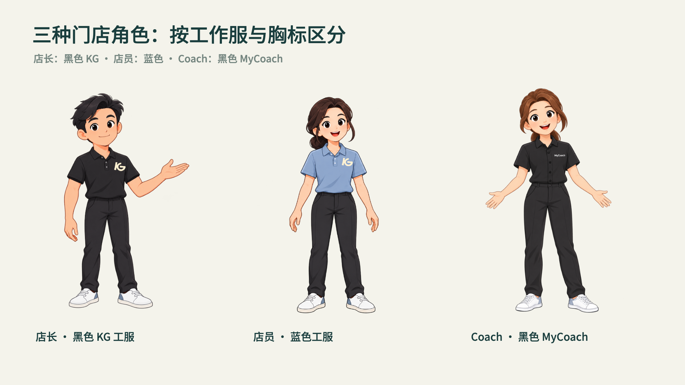
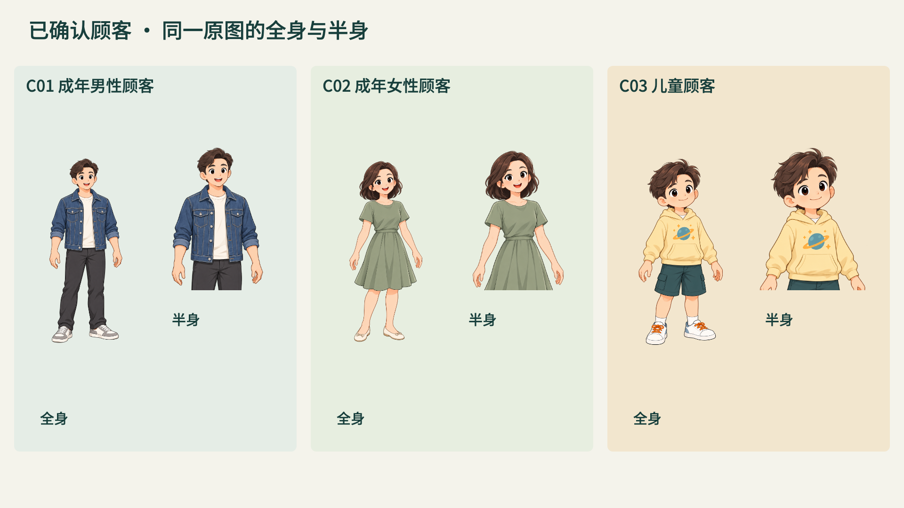

# 虚拟角色：创建、修改与使用

门店人员身份固定为：**店长＝黑衣 KG；店员＝蓝色工服＋KG；Coach＝黑衣 MyCoach**。M1 对应店长，不能再将蓝衣配置为店长。实际绑定见 [roles.json](../skills/corporate-training-motion/assets/profiles/kgxc/roles.json)。



已确认的三位顾客与原门店店员共用插画画风，日常服装用于区分身份。每人附设计板、独立透明全身原图、同源半身取景、表情与姿态设计、提示词和可核对的profile。

| 角色 | 服装与身份 | 资产 |
|---|---|---|
| C01 男性顾客 | 牛仔夹克、休闲长裤，无店员胸标 | [设计板](../skills/corporate-training-motion/assets/characters/kgxc-customers-v1/C01-design-v1.png) · [透明原图](../skills/corporate-training-motion/assets/characters/kgxc-customers-v1/C01-full-v1.png) |
| C02 女性顾客 | 绿色裙装、日常便鞋，无制服标识 | [设计板](../skills/corporate-training-motion/assets/characters/kgxc-customers-v1/C02-design-v1.png) · [透明原图](../skills/corporate-training-motion/assets/characters/kgxc-customers-v1/C02-full-v1.png) |
| C03 儿童顾客 | 小行星卡通卫衣、短裤与运动鞋 | [设计板](../skills/corporate-training-motion/assets/characters/kgxc-customers-v1/C03-design-v1.png) · [透明原图](../skills/corporate-training-motion/assets/characters/kgxc-customers-v1/C03-full-v1.png) |



## 可以怎样创建

优先使用宿主内置图像生成和图片编辑。先查看实际店员参考，写角色需求：身份、年龄、服装、比例、与员工的区别、视角、表情和本课所需动作。生成实际设计板后展示并记录确认，再引用确认板生成独立透明全身原图。设计板不是生产透明原图。

```sh
python3 SKILL_DIR/scripts/character_assets.py prepare NEW_CHARACTER --id C04 --role customer --outfit 日常便装
python3 SKILL_DIR/scripts/character_assets.py check SKILL_DIR/assets/characters/kgxc-customers-v1/C01-profile.json
python3 SKILL_DIR/scripts/character_assets.py stage SKILL_DIR/assets/characters/kgxc-customers-v1/C01-profile.json COURSE --view full
python3 SKILL_DIR/scripts/character_assets.py stage SKILL_DIR/assets/characters/kgxc-customers-v1/C01-profile.json COURSE --view half --action static-half
```

`prepare`创建brief和提示词，实际图像由宿主工具生成；脚本不自动付费、不生成假批准。`stage`检查文件SHA、透明度和已确认设计，将实际素材与证据复制到课程，返回可编辑image节点和素材绑定；将结果并入当前构图，不覆盖工程。

全身与半身共用同一原图，通过 `crop=[x,y,w,h]` 取景。坐标归一化到0—1，半身默认 `[0.1,0,0.8,0.61]`。已验证实际渲染和裁切，不通过重新生成另一张脸实现半身。

## 换衣服、表情或视角

修改时引用当前角色原图；补视角时同时引用确认板。提示词明确只修改指定项目，其余锁定脸型、发型、肤色、身体比例、未指定服装、鞋子和透明轮廓。另存v2，保留v1及其已引用课程；记录输入/输出SHA、提示词和受影响范围。

例如换衣服：“只把外套改成浅色牛仔服，锁定同一人物的脸型、发型、肤色、体态、裤子和鞋子，保留全身与透明背景。”生成后检查领口、肩肘腕、衣摆或裙摆、手指及鞋底。设计有变化时展示真实差异；只修改profile的SHA不能冒充原批准。

设计板包含倾听、疑虑、放松等表情及试用姿态；需要独立表情纹理、拿手机等生产素材时，继续引用同一人物生成和验证。不能将设计板头像直接贴到全身头部上，也不能在胸口盖色块当换装。

## 动作方法和实际边界

- 现有M1可用其已验证的连续二维网格和局部纹理；它的关节坐标仅属于M1。
- 新角色先制作自己的关键姿态、关节标注和代表性动作段；可使用身份保持重画、连续网格或具备实际工具/许可的专业2D/3D绑定。文档提到某工具不代表已自动支持其所有模型。
- 接物检查手—物件接触、时间和遮挡；行走检查身体协调、骨段长度与脚底支撑；顾客不随旁白自动张嘴。需要对白时，能量开合与逐音素口型分别验证和说明。

三位顾客当前完成**设计确认、透明原图、静态全身/半身与图解站位**。自然走路、接物、转身与完整关节动画尚未验证，stage会拒绝未验证动作。表情设计与可连续动画的生产纹理分开登记。详见[完整制作规范](../skills/corporate-training-motion/references/33-virtual-characters.md)、[原角色动作规范](../skills/corporate-training-motion/references/19-character-performance.md)和[提示词](../skills/corporate-training-motion/assets/characters/kgxc-customers-v1/prompts.json)。

## 5.2 的代码分层与接触姿态

C01/C02/C03 现在可分别 stage 自己的纹理分层与局部表情，普通倾听/询问/欢迎姿态可展开为普通工作台节点。持机另走接触姿态：已拒绝的摊开手掌旋转方案不能再生成。C01 修订姿态基于原身份用内置 imagegen 制作，机身、手部遮挡与屏幕特写由代码合成；它不等于自然连续手指动作。新姿态随实际课程小样审阅，原设计确认不被扩写为新动作确认。

黑衣店长必须绑定原版 KG 左胸标；旧原图不被覆盖，静态与原动作使用同一标定位置。[具体调用和修改方法](CONTENT-ASSETS.md)。

5.2.1 起，蓝衣男女店员使用各自的胸口坐标和原版 KG 层；完整身份素材通过 stage-company-character 取得。直接裁切已知无标原图会被新工程检查拦下，见[胸标与布局检查](LAYOUT-UNIFORMS.md)。
