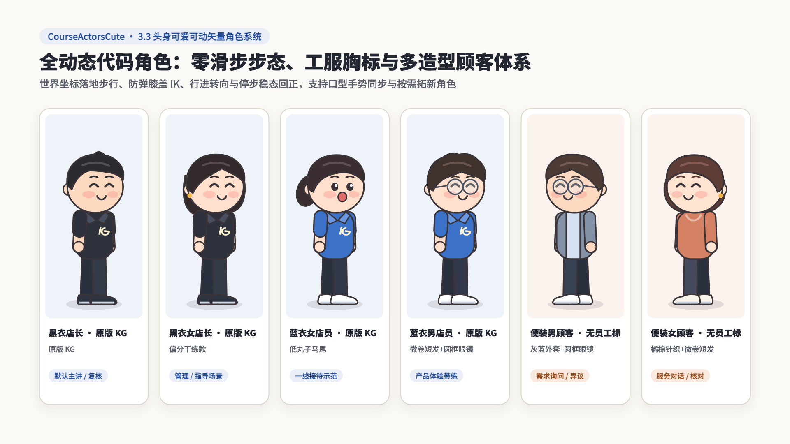

# 虚拟角色：CourseActorsCute 统一多部件矢量人物

[返回新版主页](../README.md) · [在线角色展示](index.html) · [过往静态人物归档](ARCHIVE.md)

自 `7.1.0` 起全面统一使用代码驱动的 3.3 头身可爱可动矢量人物引擎 [`actors_v3_cute.js`](../skills/corporate-training-motion/workbench/motion/actors_v3_cute.js)（`window.CourseActorsCute`），**彻底移除**过往整张静态 PNG 人物原图（`C01..C03`、`M1-repaired`、`blue-cast`、`MyCoach-reference-2D`）与旧版 `acting.js`。角色规范见 [roles.json](../skills/corporate-training-motion/assets/profiles/kgxc/roles.json)（`kgxc-character-roles/2`）。

## 角色定义与服装标识边界

| 角色身份 | 着装与胸标要求 | 内置预设与扩展能力 |
|---|---|---|
| **店长（`store_manager`）** | 黑色 Polo + 左胸原版 `kg-original.png`，严禁胸口加印文字 | `manager_male`、`manager_female` |
| **店员（`store_staff`）** | 蓝色工服 + 左胸原版 `kg-original.png`，通过发型/眼镜区分多人 | `staff_bun`、`staff_pony`、`staff_long`、`staff_male_part`、`staff_male_curl` |
| **Coach（`coach`）** | 黑色服装 + 工程内独立获准的 `MyCoach` 原标，不能套用 `KG` | 独立绑定 `logoPath` / `logoSha256` |
| **顾客（`customer`）** | 日常便装，**禁止员工制服、KG 标，且配色不能与背景顺色** | 起点预设 `C_M01` / `C_F01` 及 `cust_*` 系列，按课程扩展发型/穿搭 |

## 编排与质检要点

- **零滑步接地与方案 B 转侧身**：行进过程由 `CourseActorsCute.computeGroundedWalk` 计算真实支撑脚世界坐标与停步回正；通过 `workbench/acting.py` 与 `course_tools.py stage-acting` / `acting-check` 校验步行节拍、转向与同场对白朝向。
- **同场对白与层级遮挡**：说话人开口帧必须能定位同场受话人并面向对方；柜台前后、桌面物件支撑接触与人物轮廓不得错层穿模。
- **扩展顾客外貌**：在 `workbench/layered_customers.py`（`design_for_course`）或 `actors_v3_cute.js` 同一骨架内按场景扩展发型与便装，严禁调用外部 AI 生图回退静态 PNG 拼贴。详见 [33-virtual-characters.md](../skills/corporate-training-motion/references/33-virtual-characters.md) 与 [48-situational-acting.md](../skills/corporate-training-motion/references/48-situational-acting.md)。
