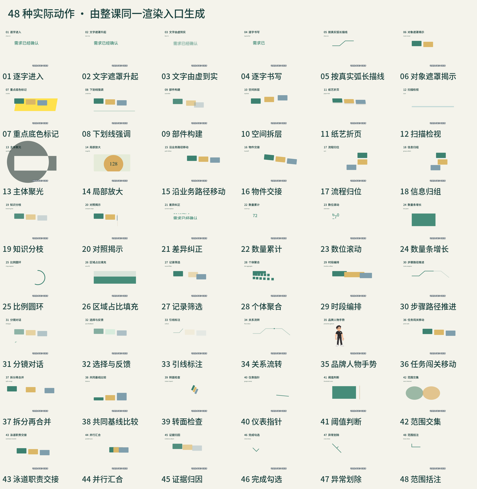

# 整课动效：实际调用和质量检查

5.1.1保留48种可执行动作，其中37种教学对象动作、8种文字/强调和3种符号描绘。17类教学构图可直接带入本课内容，通过同一工作台预览、改字、移动、换图和导出。速度、颜色、缓动、构图或样式不重复计数。



## 调用方法

以下 `SKILL_DIR` 指已安装的 corporate-training-motion 目录，`COURSE` 指实际课程工程。

```sh
python3 SKILL_DIR/scripts/course_tools.py motion-catalog
python3 SKILL_DIR/scripts/course_tools.py compile-modules --spec SPEC --out COMPILED
python3 SKILL_DIR/scripts/course_tools.py motion-check --spec COURSE/project/workbench.json
```

普通节点的 `effects` 使用绝对整数帧；将当前课的对象、动作起态、执行过程与结果排入逐段旁白。例如：

```json
{
  "id":"phone-transfer", "type":"group", "sceneId":"S01",
  "x":350, "y":400, "width":180, "height":300, "role":"subject",
  "children":[{"id":"phone-body","type":"rect","width":180,"height":300,"fill":"#397a69"}],
  "effects":[{"type":"handoff","startFrame":60,"endFrame":84,"dx":750,"dy":0}]
}
```

这表示物件交接图解，不会自动变成人物自然接物。图片、文字与目标位置继续通过稳定ID在工作台编辑。外部成片登记同样检查实际动作计划。自定义原生路线必须实现真实函数和运行回执；仅写效果名不会通过检查。

## 按词句安排操作、结果与反馈

不要把整句旁白长度直接传入`effects.endFrame`。例如口播“邀请顾客自己操作”时开始一次约0.8秒的物件交接；接着在“拍照体验”出现时打开相机，在“自己操作”处按快门，在“是否符合期待”处显示照片结果旁的反馈问题。原对象身份延续，动作完成后可以停稳解释结果。准备、演示、交接、试拍和确认是不同事件，不能由一条长位移代替。

5.1.1新工程默认要求`narrationLinks`，逐句说明用途和实际可见对象；动作计划另绑定真实词句锚点。例如以下为对应字段片段，需放入本课实际scene、caption及节点中：

```json
{
  "narrationLinks": {
    "schema":"narration-object-events/1",
    "cueLinks":[{"cueId":"C01","text":"再邀请顾客自己操作","purpose":"明确设备交给顾客，由顾客亲手操作","visibleObjectIds":["phone-transfer"]}]
  },
  "motionPlan": {
    "schema":"course-motion-plan/1","language":"已选A风格",
    "beats":[{"id":"handoff-01","sceneId":"S01","startFrame":60,"endFrame":84,
      "objectIds":["phone-transfer"],"purpose":"由顾问转为顾客操作","before":"顾问演示","after":"设备到达顾客一侧",
      "anchor":{"cueId":"C01","phrase":"邀请顾客自己操作","atFrame":60}}]
  }
}
```

`C01`必须存在于当前真实字幕中，词句和源帧需按实际录音填写，不能照抄示例时间。后续旁白可以解释已完成状态；不要求每句话持续运动。修改逐字稿、场景或时序后同时修改对应，旧词句和错位锚点会被拒绝。

普通对话/揭示超过1.2秒、交接/归组超过2秒、路径位移超过2.5秒会提示异常。长过程需有实际内容理由、多句口播锚点与过程复看帧，再经真实观看判断；不能将“覆盖整句”作为理由。完整字段和更改方法见[整课制作规范](../skills/corporate-training-motion/references/32-full-course-motion.md)。

## 17类教学构图

| 模块 | 教学用途 |
|---|---|
| blueprint | 扫描标签、建立对应连线 |
| editorial | 拆开公式、说明分子分母及范围 |
| whiteboard | 逐笔画出流程与路径 |
| presenter | 已有M1的品牌手势与讲解 |
| spotlight | 聚焦、放大需要核对的细节 |
| correction | 对照差异并纠正 |
| sorting | 将对象归位到实际流程 |
| quiz | 判断选择并显示反馈 |
| timeline | 时段覆盖与工作安排 |
| data | 数量聚合与计算 |
| swiss | 建立关键词与信息层级 |
| isometric | 沿空间轴拆开物件层次 |
| papercut | 接待阶段与折页展开 |
| comic | 人物情境与分镜对话 |
| terminal | 筛选记录、保留同口径数据 |
| ink | 从问题生长知识分枝 |
| pixel | 任务站点与完成反馈 |

通过 `sceneGraph.modules` 指定 `module`、本课 `data`、`sceneId` 与实际 `beats`；编译后成为普通可编辑节点。完整JSON和约束见[整课制作规范](../skills/corporate-training-motion/references/32-full-course-motion.md)。不将短展示片慢放填满旁白，也不要求每课机械使用全部48种。长课需在导演方案中安排合适的动作变化，连续样段仍需真实听看。

## 从小样扩到整课的检查

1. 导出前：每段旁白对应用途、对象和可见状态，动作绑定真实词句与时间；检查缺漏、错位和异常拖长。旁白窗口不等于动作窗口，已完成状态可以供解释和读图。
2. 编码后：保存真实运行回执，独立解码最终MP4主体区域，排除页眉、字幕和跨镜头变化。按每个动作真实起、中、末帧检查，2fps只用于静止定位；快速动作不必放慢。检测不到声明的动作即失败；未说明的长静止段保留候选与证据供修正，不登记为完成。
3. 完成整课前：逐场景复核批准小样与成片，检查动作、旁白对应、版式重复、可读性和角色遮挡。复核须记录1倍速连续观看的范围和方法、每场景的动作用途、节奏及结果/反馈。复核文件绑定当前文档与视频哈希；没有复核时保持待审候选。

已选小样绑定实际加载的动效代码、动作语言与核心效果，不能只保留风格名称后换成简化实现。更新Skill保留已冻结课程，不自动迁移或替换原录音。技术检查、内部导演复核、人工听看和用户最终认可分别记录；检查不等于自动审美保证。

## 复现技术验证

```sh
python3 SKILL_DIR/scripts/motion_gallery.py NEW_GALLERY
python3 SKILL_DIR/scripts/verify_motion_library.py NEW_GALLERY --out QA_DIR
python3 SKILL_DIR/scripts/motion_gallery.py NEW_MODULE_GALLERY --modules
python3 -m unittest discover -s SKILL_DIR/scripts -p test_motion_quality.py
```

图库明确标注无旁白技术演示。验证每种动作的真实像素变化、运行调用、正反向定位、实际改字/移动/换图，并以移除全部动作作为负例；连续有声教学段与图库分别验收。

[观看48种动作的实际导出视频（4分钟，无旁白技术演示）](https://github.com/hebokenn/kgxc-corporate-course-skill/releases/download/v5.1.0/kgxc-motion-actions-48-v5.1.mp4)

## 48种动作清单

| 实际API | 动作 | 用途 |
|---|---|---|
| `chars-in` | 逐字进入 | 逐字进入 |
| `text-rise` | 文字遮罩升起 | 文字遮罩升起 |
| `blur-in` | 文字由虚到实 | 文字由虚到实 |
| `typewriter` | 逐字书写 | 逐字书写 |
| `draw-on` | 按真实弧长描线 | 按真实弧长描线 |
| `mask-reveal` | 对象遮罩揭示 | 对象遮罩揭示 |
| `marker` | 重点底色标记 | 重点底色标记 |
| `underline` | 下划线强调 | 下划线强调 |
| `assemble` | 部件构建 | 部件依次进入并组合成可使用的整体 |
| `explode` | 空间拆层 | 整体沿空间轴分解成可对应的信息层 |
| `paper-fold` | 纸艺折页 | 纸层沿折轴展开并带动折角与投影 |
| `scan` | 扫描检视 | 扫描线经过明确的检视范围 |
| `spotlight` | 主体聚光 | 压暗上下文并将视线聚焦到指定区域 |
| `magnify` | 局部放大 | 保持原图与放大位置对应并显露细节 |
| `path-follow` | 沿业务路径移动 | 对象按真实路径与弧长到达目的位置 |
| `handoff` | 物件交接 | 物件从持有者移到接收者并停稳 |
| `sort` | 流程归位 | 内容从各自初始位置排入目标顺序 |
| `group-collect` | 信息归组 | 散开的证据移入各自对应类别 |
| `branch-grow` | 知识分枝 | 主干之后依次生长分枝与末端知识 |
| `compare-wipe` | 对照揭示 | 沿分界显露第二种状态供直接比较 |
| `correct-replace` | 差异纠正 | 旧信息向上退出并由已核实信息替换 |
| `count-up` | 数量累计 | 数值从实际起值累计到可编辑终值 |
| `odometer` | 数位滚动 | 各个数位沿自己的数字滚轮变化 |
| `bar-grow` | 数量条增长 | 数量长度从共同零点增长到对应值 |
| `ring-progress` | 比例圆环 | 沿圆周累计显示对应比例 |
| `area-fill` | 区域占比填充 | 从底部填充对应数量的区域 |
| `record-filter` | 记录筛选 | 无关记录退出并重新排列保留记录 |
| `dot-aggregate` | 个体聚合 | 独立记录按稳定身份聚合成结果 |
| `timeline-reflow` | 时段编排 | 时间区间移动并改变实际覆盖位置 |
| `route-progress` | 步骤路径推进 | 业务路径依次贯通并保留完成轨迹 |
| `dialogue` | 分镜对话 | 气泡出现并随说话方转移解释焦点 |
| `quiz-feedback` | 选择与反馈 | 先选择再显露答案与解释 |
| `callout` | 引线标注 | 引线抵达对象后显露对应标注 |
| `flow-token` | 关系流转 | 信息沿关系线传递而保留关系本身 |
| `presenter-gesture` | 品牌人物手势 | 原品牌人物连续网格抬手与知识点协同 |
| `pixel-walk` | 任务闯关移动 | 对象按像素步进经过任务站并到达终点 |
| `split-merge` | 拆分再合并 | 整体分开检视后重新合并并保持身份 |
| `balance` | 共同基线比较 | 同尺度柱体从共同基线呈现差异 |
| `rotate-inspect` | 转面检查 | 对象围绕中心转面以暴露另一侧信息 |
| `gauge-sweep` | 仪表指针 | 指针沿量表角度移动到对应读数 |
| `threshold-cross` | 阈值判断 | 数量越过阈值后改变状态并保留阈值线 |
| `venn-intersect` | 范围交集 | 两个范围相交并显示共同部分 |
| `swimlane-transfer` | 泳道职责交接 | 对象先跨职责边界再进入下一任务 |
| `parallel-sync` | 并行汇合 | 独立任务完成后同步汇入共同节点 |
| `evidence-attach` | 证据归因 | 证据依次连接到对应结论并保留来源关系 |
| `check-draw` | 完成勾选 | 完成勾选 |
| `cross-draw` | 异常划除 | 异常划除 |
| `brace-draw` | 范围括注 | 范围括注 |
