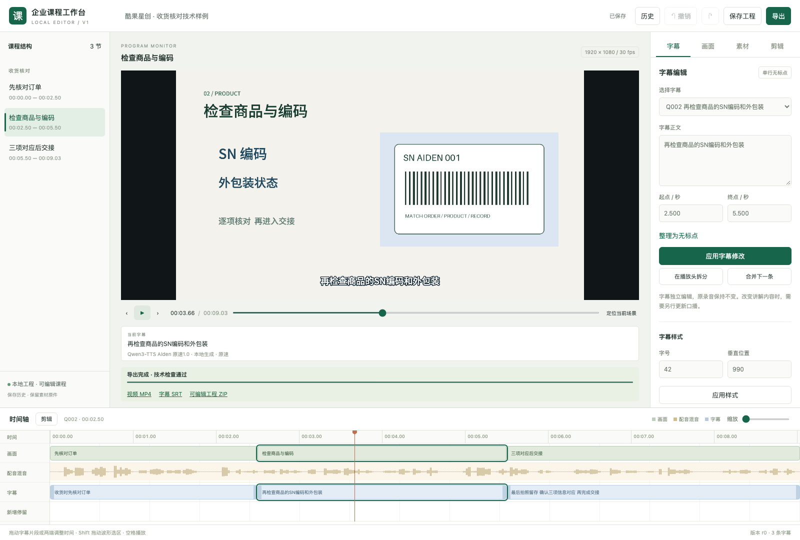
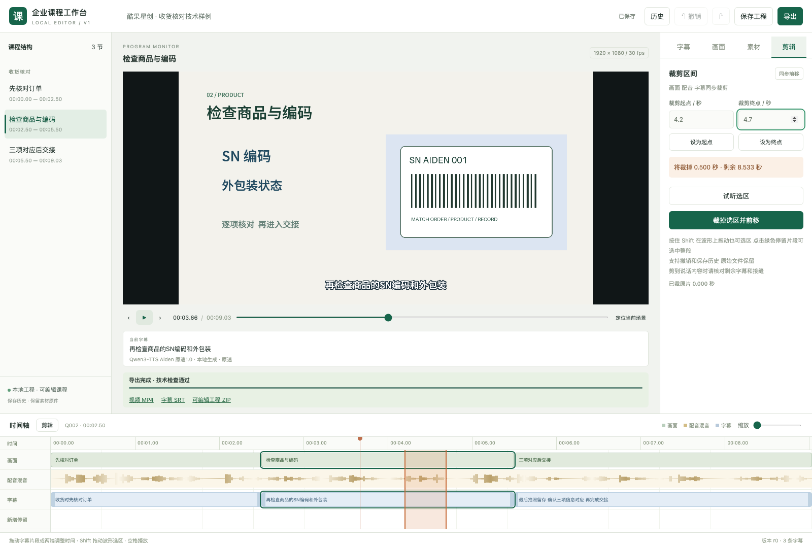

# 酷果星创企业课程 Skill 使用指南

[返回首页](../README.md) · [安装与依赖](DEPENDENCIES.md) · [切换与克隆配音](VOICE.md) · [自然界面音效库](SOUND.md)

日常制作通过Codex或WorkBuddy对话和本地工作台完成。企业课程入口为 `$corporate-training-motion`；安装器同时安装前置教学设计模块 `elearning-course-design`。先确认教学方案，再确认逐字稿；此后选择独立课件或导演视频分支。

## 1. 安装后先确认环境

按[首页安装说明](../README.md#安装或更新)完成准备。终端运行：

```bash
"$HOME/.local/bin/kgxc-course" doctor
```

完整准备就绪应显示：

```text
编辑导出环境：就绪；B2 配音：就绪
```

使用本人已登录的Codex或WorkBuddy；Blender本人安装。模型、媒体环境由完整安装器自动准备，默认无需TTS API Key。仅复制Skill文件不等于环境已经齐全。当前媒体环境验证范围为macOS Apple芯片；WorkBuddy恢复与确认的验收范围见随包版本记录。

## 2. 整理资料并第一次调用

把Word、PDF、制度正文、原图和系统截图放在一个资料目录，在Codex打开可写课程工作目录。告诉Codex受众、目标和原文位置，把下面的课程名换成实际名称：

```text
请使用 $corporate-training-motion 为酷果星创制作《收货核对流程》内部课程。
受众是新入职门店同事，原始资料见我提供的文件，以原文为准，不新增业务规则。
先打开工作台，诊断素材并设计工作任务、学习目标、大纲、示范与练习反馈。
先推荐有理由的讲解方法和课程大纲，请我确认后再写逐字稿。
逐字稿确认后选择课件或视频；视频再确认三个视觉风格之一和配音与画面小样。
每次给我具体内容与关键选择，保存我的答复，再推进依赖它的制作。
默认使用B2清亮平和教学男声；可以另选预设或参考克隆，详见配音指南，字幕单行无标点，画面标题按内容保留。
根据内容选择实物、截图、图表、流程或泳道，不强制整课大地图。
完整课程使用已批准R5/R8片头片尾，替换本课名称并保留固定问候与结束语。
每门新课从建档开始接入工作台。课件路线交付课件和逐字稿；视频路线交付MP4、SRT和可编辑工程ZIP。
```

Codex会建立 `inputs/`、`project/`、`delivery/`、`packages/`。先锁定原文条件、例外和口径，再安排画面，避免仅凭标题补造业务规则。

默认学员拿不到这些原件。Skill会先把表单名称、用途和当前要点讲清，并把完成任务必需的字段及条件放进课程；如确实会分发学员用材料，在任务中说明即可。逐字稿与画面复核见[学员上下文和改写示例](../skills/elearning-course-design/references/learner-context.md)。

## 3. 按阶段确认

| 阶段 | 你重点看什么 | 确认后进入 |
|---|---|---|
| 教学方案 | 原始资料疑义、工作任务、目标、推荐讲法、大纲与练习 | 编写逐字稿 |
| 逐字稿 | 实际口播、案例、练习引导、答案反馈及来源 | 选择课件或视频 |
| 课件分支 | 独立课件是否适合讲授或自行录制 | 交付课件与逐字稿，本次完成 |
| 视频：三个视觉风格 | 同一内容的配色、字体、图形材质、画面气质及制作影响 | 配音与画面小样 |
| 视频：有声画面小样 | 同时观看和试听语速、发音、画面、动作、字幕与配合 | 完整配音与视频 |

后续视频课程默认有底部课程进度条，多节课增加目录和每节独立标题页；单节课可省略目录和小节标题页。进度条外观随选定风格设计，同课内保持一致，按实际时轴与章节边界推进，避让字幕与主体。三种风格关键帧与有声小样会展示对应导航。已分节且开场路线清楚的逐字稿无需为此重写，只补画面与时间线方案。详见[课程导航与章节呈现](../skills/corporate-training-motion/references/03-visual.md#课程导航与章节呈现)。

三选一只确定美术方向。选定后，人物交流、表单操作、流程流转、对比和镜头等仍由导演按各段内容组合；小样中的动作和版式不会成为全课模板。工作台把视觉规范与内容分镜分开保存，新增适合内容的动作不要求重选风格。

课件交付后仍可提出视频需求，从原已确认逐字稿启动导演。保留原课件；课件的页面、截图、版式与导出图片不进入视频制作。视频共同使用逐字稿与原始素材，不需要先生成课件。

已有明确确认按范围沿用；重要变更只要求复核受影响部分。选择有推荐，但不会自动勾选。工作台和聊天提交写入同一工程，保存原话、时间与关联版本。技术检查不代填负责人意见；完整课仍需实际观看和听校。

## 整课制作与独立审美复核

制作端按本句要看清的对象和关系选择表现，在同一美术方向内组合人物、实物、表单、流程、对比和镜头。难讲或重复的段落先在制作端比较有依据的表现，不把普通导演选择反复交给用户。画面清楚和画面好看分别判断；查看实际构图、字体、配色材质、插画、留白与节奏后修正实际画面。

新工程同时保存 `qualityPolicy` 和 `craft-contract.json`。完整 MP4 导出后，制作端填写 `qa/craft-review.json`，记录六项审美观察、四项配音依据和实际听看范围，并绑定当前视频、文档与正文早中晚段的编码画面。`craft-check` 可提示构图重复并核对已保存证据；同一表单的连续操作允许保持构图，说明内容理由即可。不能用同一句“美观”复制成复核，也不能以技术通过冒充听过整课或用户最终认可。

```bash
python3 skills/corporate-training-motion/scripts/course_tools.py craft-check --spec course/project/workbench.json
python3 skills/corporate-training-motion/scripts/course_tools.py craft-check --spec course/project/workbench.json --project course/project --video course/delivery/course.mp4
```

检查结果和缺口留在工程中，完成实际修正再复看受影响部分；不要求无限返工或重复确认。配音遵守自然培训语气、标准普通话、干脆节奏与统一声线。旧工程保留原约定，已确认小样和历史冻结文件不自动失效。见[课程工艺规则](../skills/corporate-training-motion/references/36-course-craft.md)与[配音指南](VOICE.md)。

## 4. 打开工作台

新课建档和继续制作默认会启动并打开工作台。也可以直接对Codex或WorkBuddy说：

```text
继续制作这门课程。工程目录：填写实际课程目录。
```

已知当前工程时只说“继续制作”即可。制作端按当前阶段执行，视频阶段自动核对需求和实际能力，选择并接入合适渲染器与动作音效；沿用有效确认，遇到真正缺少的事实、资源或内容/风格/新小样确认再询问。已完成工程不会因恢复自动重制。具体见[渲染选路](../skills/corporate-training-motion/references/30-renderer-selection.md)和[动作音效](../skills/corporate-training-motion/references/31-action-sound.md)。

已安装快捷入口时，也可将路径替换成实际课程目录：

```bash
"$HOME/.local/bin/kgxc-course" resume "$HOME/Documents/酷果课程试用"
```

恢复命令会核对课程身份、复用或启动后台服务并请求浏览器打开实际地址。工作台监听本机127.0.0.1，不固定端口；关闭聊天不丢记录。双击课程根目录的“打开课程工作台.command”也可恢复。页面先显示教学设计、待确认、制作与交付。课件完成后不再等待视频步骤；视频分支展示三个风格与有声画面小样，视频编辑保留原画布与时间轴。另机打开仍需匹配媒体环境。



## 5. 视频分支常用编辑方法

| 想修改什么 | 操作 | 会发生什么 |
|---|---|---|
| 字幕错字、时间 | 在“字幕”选择片段，改正文、起止秒数，再应用 | 实时更新字幕；不会自动重录原配音 |
| 停留太短或太长 | 在“画面”选择场景，调整句尾停留秒数并应用 | 在句尾插入或调整静音与画面冻结，后续时间同步变化，原声不变速 |
| 裁掉空白或冗长片段 | 打开“剪辑”，输入起止秒数，或Shift拖动波形选区；先试听，再裁剪 | 画面、声音、字幕同步前移；保留原始录音和素材 |
| 画面标题、要点、位置 | 在“画面”选择登记对象，修改文字或水平/垂直位移并应用 | 当前画布中的对应对象变化；应检查新位置是否遮挡 |
| 图片 | 在“素材”选择登记素材并上传PNG/JPEG/WebP | 替换该素材的所有引用，原素材仍保留，可恢复 |
| 撤回操作 | 使用撤销/重做，或从“历史”恢复为草稿 | 可以回到之前的编辑状态，恢复后按需保存 |
| 保存和导出 | 点击“保存工程”，再“导出”；选择整课或所需区间 | 导出MP4、SRT和可编辑ZIP，预览与导出使用同一个渲染器 |



直接减少“新增停留”适合缩短人为添加的空等；剪辑选区适合移除某段实际时间。剪到讲话时核对剩余句意、字幕和接缝。改字幕不会改变录音；改讲解内容时请让Codex同步更新配音与时间轴。

## 6. 后续修改可直接这样说

**交付课件后追加视频：**

```text
恢复这门课程，保留已交付课件，从仍有效的已确认逐字稿追加视频制作。
不要使用课件页面或截图；请导演重新设计画面与动作，提供三个实际视觉风格让我比较配色、字体、图形材质和画面气质；各段动效按内容组合。
风格确认后给配音与画面结合的MP4小样，确认小样后再做完整视频。
```

**修改业务讲解：**

```text
根据我补充的原文修订第二节，先列出需要改变的讲稿内容。
确认后用本课已批准的声音更新配音、字幕和工作台，不改其他已确认小节。
```

**只改视觉：**

```text
这一版只调整画面和动效，复用已确认原音。
保持字幕单行无标点，修改后从当前工作台版本重新导出并检查。
```

**继续编辑和导出：**

```text
打开这门课的工作台，保留原始素材和录音。
把当前已保存版本导出为整课MP4、SRT和可编辑工程包，报告实际检查范围。
```

## 7. 拿到哪些文件

- `inputs/`：原始资料。
- `project/`：实际源码、素材、音轨、编辑数据和检查记录。
- `delivery/courseware/`：独立课件和逐字稿；`delivery/`：当前视频、字幕及对应记录。
- `packages/`：可编辑课程ZIP。

ZIP解压后可继续打开内置工作台。换电脑时仍需完成媒体运行环境安装，不能把ZIP理解为无需环境的独立应用。已有课程不因安装/更新Skill自动迁移或重新渲染。

约9秒的[技术样例MP4](media/course-demo.mp4)适合了解实际画面、Aiden配音与字幕；其长度仅用于验证制作链路。

## 5.5.0 完整课封面与后期修订

完整视频交付包含清楚的课程标题封面；在实际320×180缩略图中看过，并核实MP4首帧或播放器poster。新工程默认启用封面检查，复核记录绑定当前封面、视频和实际观察。参见[完整约定及命令](../skills/corporate-training-motion/references/37-cover-and-delivery-finish.md)。

用户要求提速、升调或补首尾话术时，保留原版，以同一输入时间线处理语音、画面和字幕，单独保留音乐/音效。`finish_media.py`输出实际参数与哈希回执；首尾话术必须从最终视频实际有声片段核对，不能只查稿件。后期计划和原始导演工程一同保存，派生MP4不冒称原生可编辑对象。

## 5.6.0 逐场画面与成品目录

交付前按[逐场视觉检查](../skills/corporate-training-motion/references/39-visual-hygiene.md)核对人物可见轮廓、对齐目标、箭头和动画结束状态。新工程默认启用逐场证据要求；返修须查全片同类复用对象，当前编码MP4重新取证。运行`visual_hygiene_check.py COURSE/project --video 当前候选.mp4`，按需用`measure_visible_bounds.py`辅助测量透明留白和实际偏移，不能把自动检查当审美评分。

酷果课程默认保存至桌面`ai 制课/<课程名称>/`，视频、字幕与封面同放；旧版、小样分别归档，过程文件留在工程。用户另有交付位置时沿用其要求。整理移动保留字节校验，不擅自删除已有课程。

## 100种动作、视觉风格与本地素材

见[扩展调用说明](../skills/corporate-training-motion/references/40-library-direction-assets.md)。`course_tools.py motion-catalog/style-catalog/surface-catalog/retail-catalog`列出实际条目；`recommend-visuals --intent "顾客 对话 操作"`按课程目的推荐不同家族，`stage-style-assets COURSE --style 风格ID --out 素材JSON`暂存原角色和所需材质图。合并返回的assets和data后编译，不能只抄风格名称。

先定具体业务对象与状态，再选动作。画廊示例各有任务与可见结果；整课维持已确认美术方向，按内容组合对话、操作、流程和数据，不把一个小样复制成全课。

新工程默认要求逐场 `physicalSupport` 与 `typography` 观察，实际编码画面需绑定当前候选。人物按alpha可见轮廓和脚底定位；设备登记contactAnchor并通过supportBinding绑定桌面supportSurface；文字避让使用textExclusion，说明和标签保留独立行。运行时检测已登记接触点脱离或文字侵入后阻止该帧。仍须看当前画面，检查姿态、复杂遮挡及动作最大外延；不能将通过的坐标检查当作自动视觉验收。见[逐场规则](../skills/corporate-training-motion/references/39-visual-hygiene.md)。

`asset_library.py register/import-photo/stage`保留本地原件并按哈希暂存素材。产品登记Apple品牌或无品牌Apple适配信息。实拍标注同时提供photoSize和带label/归一化point的annotations，并核对箭头所指物件。`register-style --file JSON`增加用户美术配方；全新动作、材质和物件须先实现、再登记实际可见示例与相应检查。原有课程的确认与冻结文件按原记录保留。

## 发音及导航返修

制作端先列英文名称与缩写的发音表，字幕保持标准拼写；必要的大小写、语言模式和别名只作用于记录过的配音输入。优先在同一已确认声音下重生成整句，并从实际编码视频核对所有重复位置。目录把正式章节名、短标签与口播问题逐项对应，节选进度不推测未采样章节时间。局部返修核对实际服务的课程路径、revision与编辑器源码，再检查当前导出。ASR、截图和技术检测均不代替实际试听或用户认可。

## 授课立场与导航边界

酷果课程代表总部团队发展中心面向门店授课，直接教工作要求与行动。原始材料的文件名、版本、引用和疑义留在制作端台账；学员口播、字幕、标题和练习不写成AI解读原件。全稿语义通读后核对业务条件，不能只删除来源词。章节进度从第一节标题页起显示，最后一节正文结束后隐藏；封面、品牌开场、导入、目录、总结和片尾不铺空轨。技术导出与实际内容、显隐观察分别验收。

## 工作台与配色一致性

工作台外壳统一白色与中性灰；视频画布独立使用已确认风格。新小样确认后自动记录实际配色范围，完整课程新增卡片、文字或线条须与其一致；中性灰可扩展，产品本色可按对象说明依据。风格名称或文字说明不能替代实际画面确认。历史课程保持原确认算法，明确要求配色返修时才对当前工程应用新检查。


## 人物演出与对象状态证据（5.8.0）

制作视频时从实际任务排动态分镜与反应，使用 `stage-performance` 为C01或S01取得自己的原图标定，再填写本课关键帧和真实视线目标。正式工作台的预览、编辑和导出共用实现。新工程默认检查 `evidenceFrames`、`stateChecks` 及编码目标像素；有目的的查阅可停稳，不能把整场observe作为演示豁免。完整字段、范围与边界见[导演与人物演出](../skills/corporate-training-motion/references/41-direction-and-performance.md)。

### 5.8.1 长课程批量证据

对象验收与动作采样共用平衡的帧选择表达式，支持数百实际编码证据帧。新增900帧/300事件的合成视频回归；不以减少证据、放慢动作或字幕变化规避验收。此项是验证器修复，旧课不自动重渲染。

### 5.8.2 按当前内容继续导演

新课和视觉返修先读[按内容导演方法](../skills/corporate-training-motion/references/42-content-directed-production.md)。`resume` 的 `production_handoff.direction` 自动提供入口与当前场景概览；普通制作选择由AI依据当前逐字稿、对象和有效美术规范完成，不让用户选底层渲染参数。

```sh
python3 SKILL_DIR/scripts/course_tools.py direction-check --spec COURSE/project/workbench.json --out NEW_REVIEW_PLAN.json
```

报告保留当前逐句目的、对象和真实动作，选取动作/表演、显隐与变换边界、停稳和下一场的源帧及编辑后帧。它仅生成检查候选，不从关键词强配模板，也不修改工程。制作端补充实际峰值，检查正常速度演出及最终编码结果，仍须完成原有工艺与交付检查；计划存在不等于审美或用户通过。

## 完成后释放后台服务（5.8.5）

课程已完成、无导出且空闲两分钟时工作台自动关闭；后台状态查询不会延长时间。导出全流程、未保存编辑、播放和下载受到保护。成品继续保存在原交付位置，工作台地址只在服务运行期间有效；后续编辑请从课程目录重新打开或resume。
