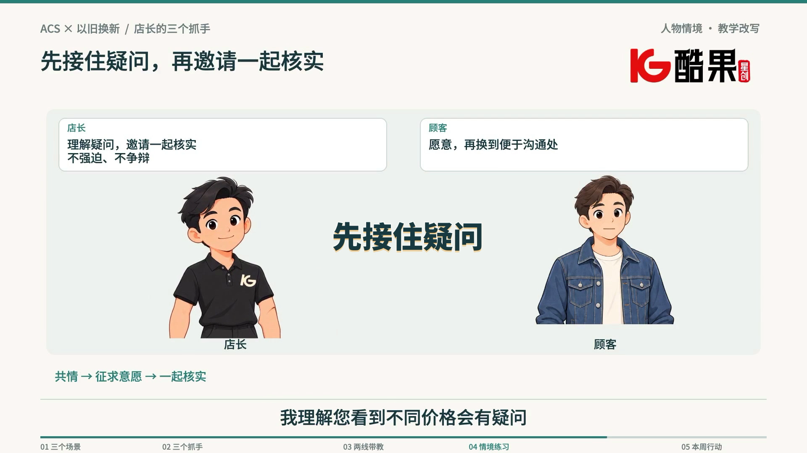

# 花字与原库音效样片

[返回主页](../../../README.md#实际演示) · [在GitHub查看MP4](price-objection-native-sfx.mp4) · [下载本版MP4](https://github.com/hebokenn/kgxc-corporate-course-skill/releases/download/v6.1.0/price-objection-native-sfx.mp4) · [字幕](price-objection-native-sfx.srt)

《回收价格异议处理》有声样片为1920×1080、30fps、2176帧，时长72.533秒。本次依用户“更新skill，把这个样品也放在GitHub”的请求公开，MP4与已交付的原库音效版v2字节一致。

- 画面与原旁白保留；22处花字中选15次发声，不叠加旧音效。
- 弹出、条件与轻提醒使用嘟咚；依据标记、完成与总结使用叮。
- 三个平等选择使用同源同增益；连续步骤按组提示，末尾三问及最后阅读留白保持安静。

这是具体片段的制作选择，不是每门课必须使用的数量、时长、构图或音效密度。片段中的服务情境用于教学展示，不能据此设定真实价格、权益、权限或承诺。它不代表整门课程或真实学员理解已获最终验收。

用户进一步要求“把我的选定的这些内置到skill里，让安装skill的人默认用我确定的音效”；两份原库MP3及渲染副本现已内置为 `teaching-native-v1`。来源为黑罐头《提示音》（ID `7888c6c8af55469792f3371251ac4f8e`）与《嘟咚，提示音1》（ID `5a04b6d43e0743f5b9b74dc3e8cb2348`），来源页与哈希见[演示清单](manifest.json)及[默认音源记录](../../../skills/corporate-training-motion/assets/sfx/teaching-native-v1/source.json)。原参考视频、分离试听片、私有配音参考、模型、工程缓存与个人配置未纳入。

MP4、字幕、海报的SHA-256及具体参数见[manifest.json](manifest.json)。技术检查包括完整解码、画面流保持一致、混音无削波与三个选项等增益；这些结果不冒充制作端完整人工听校或用户最终认可。
